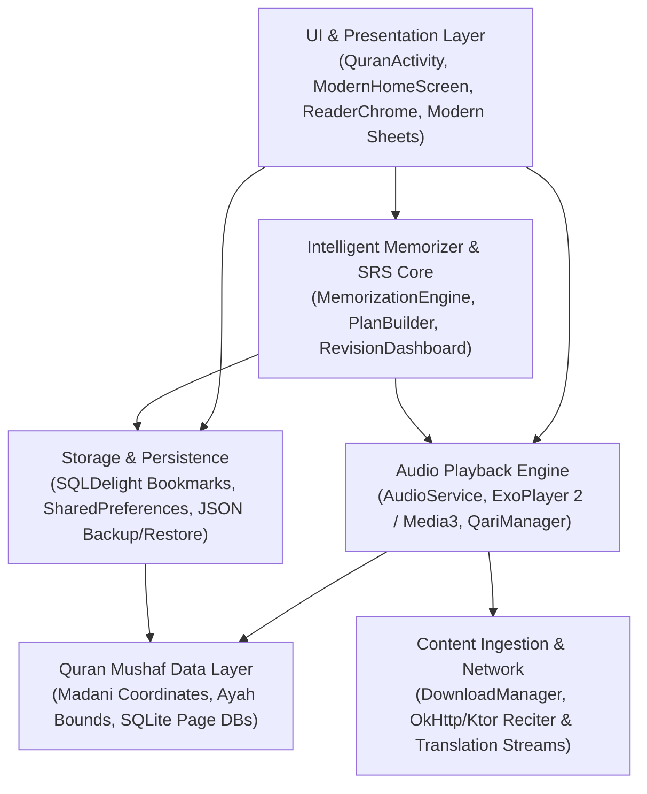

# 4-TIER HIERARCHICAL ARCHITECTURE PYRAMID MAP
> **Repository:** `quran-intelligent-memorizer`  
> **Total Cataloged Files:** 1,726 files (Zero Omissions, 100% Registry)

---

## 🏛️ Tier L0 — Executive App Blueprint
`quran-intelligent-memorizer` is a modernized, intelligent Quran memorization and recitation application built on top of the battle-tested `quran_android` engine. It combines high-fidelity Madani Mushaf page rendering (with pixel-accurate glyph coordinate databases) with a reactive, continuous sliding-window memorization state machine, spaced repetition (SRS) revision scheduling, voice recitation validation, and an emerald Material 3 design system with full 12-language localization.

---

## 📦 Tier L1 — Domain Subsystems
| Subsystem ID | Subsystem Name | Core Responsibility | Root Directories | Primary Entry Point Files |
| :--- | :--- | :--- | :--- | :--- |
| `MEMORIZATION_CORE` | Intelligent Memorizer & SRS | Sliding-window loop, spaced repetition algorithms, streak goals, recall quiz, custom playlists | `common/audio/.../memorization/`, `feature/audiobar/ui/` | `MemorizationEngine.kt`, `MemorizationPlanBuilder.kt`, `MemorizationHud.kt` |
| `AUDIO_ENGINE` | Audio Playback & Recitation | ExoPlayer integration, background audio service, reciter streams, gapless playback | `common/audio/`, `feature/audio/`, `app/.../service/` | `AudioService.kt`, `AudioQueue.kt`, `CurrentQariManager.kt` |
| `QURAN_DATA` | Quran Mushaf & Ayah Data | Page coordinate mapping, Ayah bounds, Surah/Juz metadata, canvas drawing | `pages/`, `common/data/`, `common/pages/`, `common/drawing/` | `QuranInfo.kt`, `SuraAyah.kt`, `PageCoordinates.kt` |
| `UI_PRESENTATION` | Modern Material 3 UI | Compose views, bottom sheets, navigation bar, reader chrome, action sheets, theme | `app/.../ui/modern/`, `common/ui/core/` | `QuranActivity.kt`, `QuranModernHomeScreen.kt`, `ModernReaderChrome.kt` |
| `STORAGE_STATE` | State, Storage & Preferences | SQLDelight bookmarks, tags, reading history, SharedPreferences, JSON export/import | `common/bookmark/`, `common/preference/`, `common/reading/` | `BookmarksDB.sq`, `QuranSettings.java`, `MemorizationPreferences.kt` |
| `INGESTION_NETWORK` | Ingestion, Network & Downloads | Translation fetchers, audio downloads, search indexing, network queues | `common/download/`, `common/translation/`, `common/search/` | `DownloadManager.kt`, `TranslationManager.kt` |
| `BUILD_INFRA` | Build Logic & Infrastructure | Gradle convention plugins, Proguard rules, Flavors, Store metadata, Manifests | `build-logic/`, `gradle/`, `metadata/`, root | `build.gradle.kts`, `settings.gradle.kts`, `AndroidManifest.xml` |

---

## 🧩 Tier L2 — Module & Service Clusters

### Cluster 1: Memorization & Review Engine (`MEMORIZATION_CORE`)
- **Sliding-Window Plan Builder**: `MemorizationPlanBuilder.kt` calculates Solo Ayah repeats, Connecting Range intervals, Recitation verification, and Bridge forward steps.
- **State Machine Coordinator**: `MemorizationEngine.kt` dispatches `MemorizationStep` events and coordinates with `AudioService`.
- **Targeted Practice & Quizzes**: `ModernRecallQuizSheet.kt` and `ModernRevisionDashboardScreen.kt` handle active recall and SRS mastery ratings.
- **Custom Cross-Surah Playlists**: `PlaylistRepository.kt` manages user-defined memorization ranges.

### Cluster 2: Audio & Media Pipeline (`AUDIO_ENGINE`)
- **Background Player Service**: `AudioService.kt` manages foreground media notifications, earphone controls, and lockscreen integration.
- **Qari & Streaming Providers**: `CurrentQariManager.kt` and `AudioPathInfo.kt` generate remote streaming URLs and local cache paths.
- **ExoPlayer Audio Queue**: `AudioQueue.kt` coordinates gapless audio advancement across Ayahs.

### Cluster 3: Quran Text & Glyph Engine (`QURAN_DATA`)
- **Mushaf Coordinates**: `pages/madani` contains pixel-accurate coordinate databases for 604 pages of the 1405/1440H Madani Mushaf.
- **Ayah Highlighting**: `HighlightType.kt` and `HighlightingManager.kt` draw active reciter audio bounds on canvas.

### Cluster 4: Presentation & UI Layer (`UI_PRESENTATION`)
- **Modern Home Screen**: `QuranModernHomeScreen.kt` renders Surahs, Juz quarters, Bookmarks, and Memorizer tabs.
- **Reader Chrome**: `ModernReaderChrome.kt` provides top/bottom overlays, navigation pills, and page headers.
- **Interactive Action Sheets**: `ModernAyahActionSheet.kt`, `ModernJumpSheet.kt`, `ModernAudioSettingsSheet.kt`, `ModernLanguagePickerSheet.kt`.
- **Design System**: `common/ui/core/src/.../Theme.kt` defines the emerald color palette, typography, and card components.

### Cluster 5: Storage & Configuration (`STORAGE_STATE`)
- **SQLDelight**: `BookmarksDB.sq` defines transactional storage for Ayah bookmarks and tagging.
- **Application Preferences**: `QuranSettings.java` and `MemorizationPreferences.kt` manage user preferences.
- **Backup & Restore**: `ModernBackupRestoreSheet.kt` provides JSON serialization and export/import.

### Cluster 6: Content Ingestion (`INGESTION_NETWORK`)
- **Download Coordinator**: `DownloadManager.kt` handles batch audio downloads and translation databases.
- **Quran Search**: `QuranSearchManager.kt` executes full-text search across Quranic verses and translations.

### Cluster 7: Build Logic & Tooling (`BUILD_INFRA`)
- **Gradle Convention Plugins**: `build-logic/convention` enforces consistent Kotlin, Android, Compose, and Detekt standards.

---

## 📋 Tier L3 — Exhaustive 100% File & Symbol Registry

### Subsystem: `MEMORIZATION_CORE` (30 Files)

| File Path | Subsystem (L1) | Role / Responsibility | Key Exported Symbols (Functions/Classes/Types/Components) | State / Storage Touched | When an Agent Should Edit This File |
| :--- | :--- | :--- | :--- | :--- | :--- |
| `INTELLIGENT_MEMORIZER_ARCH_AND_CHANGELOG.md` | `MEMORIZATION_CORE` | Configuration, rule, database, or documentation asset (INTELLIGENT_MEMORIZER_ARCH_AND_CHANGELOG.md) | Config / Asset: `INTELLIGENT_MEMORIZER_ARCH_AND_CHANGELOG.md` | None (Stateless / Pure UI) | When updating project configuration, documentation, or static data for INTELLIGENT_MEMORIZER_ARCH_AND_CHANGELOG.md |
| `app/src/main/java/com/quran/labs/androidquran/service/memorization/RecitationRecorder.kt` | `MEMORIZATION_CORE` | Domain logic / utility class declaring RecitationRecorder | `RecitationRecorder`, `startRecording()`, `stopRecording()`, `cancelRecording()`, `playRecording()`, `stopPlayback()` | None (Stateless / Pure UI) | When extending capabilities, modifying models, or fixing bugs in RecitationRecorder |
| `app/src/main/java/com/quran/labs/androidquran/ui/QuranRevisionActivity.kt` | `MEMORIZATION_CORE` | Domain logic / utility class declaring QuranRevisionActivity | `QuranRevisionActivity`, `onCreate()`, `onResume()`, `refreshState()`, `getIntent()` | SharedPreferences, Memorization Settings Store | When extending capabilities, modifying models, or fixing bugs in QuranRevisionActivity |
| `app/src/main/java/com/quran/labs/androidquran/ui/modern/ModernHifzPlanSheet.kt` | `MEMORIZATION_CORE` | UI Composable rendering ModernHifzPlanSheet and handling user interactions | @Composable, `ModernHifzPlanSheet()` | Compose Local State | When updating UI layout, visual design, or user interactions for ModernHifzPlanSheet |
| `app/src/main/java/com/quran/labs/androidquran/ui/modern/ModernRecallQuizSheet.kt` | `MEMORIZATION_CORE` | UI Composable rendering ModernRecallQuizSheet and handling user interactions | @Composable, `ModernRecallQuizSheet()`, `nextQuestion()` | Compose Local State | When updating UI layout, visual design, or user interactions for ModernRecallQuizSheet |
| `app/src/main/java/com/quran/labs/androidquran/ui/modern/ModernRevisionDashboardScreen.kt` | `MEMORIZATION_CORE` | UI Composable rendering ModernRevisionDashboardScreen and handling user interactions | @Composable, `ModernRevisionDashboardScreen()`, `RevisionSurahCard()`, `getRelativeTimeText()` | Compose Local State | When updating UI layout, visual design, or user interactions for ModernRevisionDashboardScreen |
| `app/src/main/java/com/quran/labs/androidquran/util/HifzReminderScheduler.kt` | `MEMORIZATION_CORE` | Domain logic / utility class declaring HifzReminderScheduler | `HifzReminderReceiver`, `HifzReminderScheduler`, `onReceive()`, `ensureChannel()`, `showReminderNotification()`, `scheduleDailyReminder()` | SharedPreferences | When extending capabilities, modifying models, or fixing bugs in HifzReminderScheduler |
| `common/audio/src/main/java/com/quran/labs/androidquran/common/audio/memorization/CustomPlaylist.kt` | `MEMORIZATION_CORE` | Domain logic / utility class declaring CustomPlaylist | `CustomPlaylist`, `toFlattenedAyahs()`, `serialize()`, `deserialize()` | None (Stateless / Pure UI) | When extending capabilities, modifying models, or fixing bugs in CustomPlaylist |
| `common/audio/src/main/java/com/quran/labs/androidquran/common/audio/memorization/MasteredRange.kt` | `MEMORIZATION_CORE` | Domain logic / utility class declaring MasteredRange | `MasteredRange`, `serialize()`, `deserialize()` | None (Stateless / Pure UI) | When extending capabilities, modifying models, or fixing bugs in MasteredRange |
| `common/audio/src/main/java/com/quran/labs/androidquran/common/audio/memorization/MemorizationConfig.kt` | `MEMORIZATION_CORE` | Domain logic / utility class declaring MemorizationConfig | `MaskingLevel`, `MemorizationConfig` | None (Stateless / Pure UI) | When extending capabilities, modifying models, or fixing bugs in MemorizationConfig |
| `common/audio/src/main/java/com/quran/labs/androidquran/common/audio/memorization/MemorizationDelayMode.kt` | `MEMORIZATION_CORE` | Domain logic / utility class declaring MemorizationDelayMode | `MemorizationDelayMode`, `None`, `FixedSeconds`, `MatchAyahDuration` | None (Stateless / Pure UI) | When extending capabilities, modifying models, or fixing bugs in MemorizationDelayMode |
| `common/audio/src/main/java/com/quran/labs/androidquran/common/audio/memorization/MemorizationEngine.kt` | `MEMORIZATION_CORE` | Core computational state machine / algorithmic coordinator for MemorizationEngine | `MemorizationEngine`, `startMemorization()`, `resumeSavedSession()`, `resumeSavedSessionForSura()`, `pause()`, `resume()` | Coroutines StateFlow, Memorization Settings Store | When changing calculation formulas, step progressions, or core rules |
| `common/audio/src/main/java/com/quran/labs/androidquran/common/audio/memorization/MemorizationPlanBuilder.kt` | `MEMORIZATION_CORE` | Core computational state machine / algorithmic coordinator for MemorizationPlanBuilder | `MemorizationPlanBuilder`, `getAyahsInRange()`, `buildPlan()` | None (Stateless / Pure UI) | When changing calculation formulas, step progressions, or core rules |
| `common/audio/src/main/java/com/quran/labs/androidquran/common/audio/memorization/MemorizationPreferences.kt` | `MEMORIZATION_CORE` | Domain logic / utility class declaring MemorizationPreferences | `SavedSuraSession`, `MemorizedSurahInfo`, `MemorizationProfile`, `HifzPlan`, `MemorizationDefaultSettings`, `MemorizationPreferences` | SharedPreferences, Memorization Settings Store | When extending capabilities, modifying models, or fixing bugs in MemorizationPreferences |
| `common/audio/src/main/java/com/quran/labs/androidquran/common/audio/memorization/MemorizationState.kt` | `MEMORIZATION_CORE` | Domain logic / utility class declaring MemorizationState | `MemorizationState` | None (Stateless / Pure UI) | When extending capabilities, modifying models, or fixing bugs in MemorizationState |
| `common/audio/src/main/java/com/quran/labs/androidquran/common/audio/memorization/MemorizationStep.kt` | `MEMORIZATION_CORE` | Domain logic / utility class declaring MemorizationStep | `StepType`, `MemorizationStep` | None (Stateless / Pure UI) | When extending capabilities, modifying models, or fixing bugs in MemorizationStep |
| `common/audio/src/main/java/com/quran/labs/androidquran/common/audio/memorization/PlaylistRepository.kt` | `MEMORIZATION_CORE` | Data repository managing persistence and queries for PlaylistRepository | `PlaylistRepository`, `getAllPlaylists()`, `getPlaylistById()`, `savePlaylist()`, `deletePlaylist()`, `updateLastPlayed()` | SharedPreferences, Playlist JSON / Room DB | When adding queries, changing caching policies, or updating data retrieval |
| `common/audio/src/main/java/com/quran/labs/androidquran/common/audio/memorization/PlaylistSegment.kt` | `MEMORIZATION_CORE` | Domain logic / utility class declaring PlaylistSegment | `PlaylistSegment`, `toAyahs()`, `serialize()`, `createFullSurah()`, `deserialize()` | None (Stateless / Pure UI) | When extending capabilities, modifying models, or fixing bugs in PlaylistSegment |
| `common/audio/src/test/java/com/quran/labs/androidquran/common/audio/memorization/MemorizationEngineTest.kt` | `MEMORIZATION_CORE` | Core computational state machine / algorithmic coordinator for MemorizationEngineTest | `MemorizationEngineTest`, `FakeTestSharedPreferences`, `setup()`, `getAll()`, `getString()`, `getStringSet()` | SharedPreferences, Memorization Settings Store | When changing calculation formulas, step progressions, or core rules |
| `common/audio/src/test/java/com/quran/labs/androidquran/common/audio/memorization/MemorizationPlanBuilderTest.kt` | `MEMORIZATION_CORE` | Core computational state machine / algorithmic coordinator for MemorizationPlanBuilderTest | `MemorizationPlanBuilderTest`, `setup()` | None (Stateless / Pure UI) | When changing calculation formulas, step progressions, or core rules |
| `common/audio/src/test/java/com/quran/labs/androidquran/common/audio/memorization/MemorizationPreferencesTest.kt` | `MEMORIZATION_CORE` | Unit / Integration test suite validating MemorizationPreferencesTest | `MemorizationPreferencesTest`, `FakeSharedPreferences`, `FakeEditor`, `setUp()`, `getAll()`, `getString()` | SharedPreferences, Memorization Settings Store | When adding regression tests, updating test assertions, or verifying behavior |
| `common/audio/src/test/java/com/quran/labs/androidquran/common/audio/memorization/PlaylistRepositoryTest.kt` | `MEMORIZATION_CORE` | Data repository managing persistence and queries for PlaylistRepositoryTest | `PlaylistRepositoryTest`, `FakeSharedPreferences`, `setUp()`, `getAll()`, `getString()`, `getStringSet()` | SharedPreferences, Playlist JSON / Room DB | When adding queries, changing caching policies, or updating data retrieval |
| `feature/audiobar/src/main/kotlin/com/quran/mobile/feature/audiobar/ui/MemorizationHud.kt` | `MEMORIZATION_CORE` | UI Composable rendering MemorizationHud and handling user interactions | @Composable, `MemorizationHud()` | None (Stateless / Pure UI) | When updating UI layout, visual design, or user interactions for MemorizationHud |
| `feature/audiobar/src/main/kotlin/com/quran/mobile/feature/audiobar/ui/MemorizationLiveSettingsSheet.kt` | `MEMORIZATION_CORE` | UI Composable rendering MemorizationLiveSettingsSheet and handling user interactions | @Composable, `MemorizationLiveSettingsSheet()` | Compose Local State | When updating UI layout, visual design, or user interactions for MemorizationLiveSettingsSheet |
| `feature/audiobar/src/main/kotlin/com/quran/mobile/feature/audiobar/ui/MemorizationSetupSheet.kt` | `MEMORIZATION_CORE` | UI Composable rendering MemorizationSetupSheet and handling user interactions | @Composable, `MemorizationSetupSheet()`, `getSuraTitle()`, `NumberStepper()` | Compose Local State | When updating UI layout, visual design, or user interactions for MemorizationSetupSheet |
| `feature/audiobar/src/main/kotlin/com/quran/mobile/feature/audiobar/ui/MemorizationSetupSheetWrapper.kt` | `MEMORIZATION_CORE` | UI Composable rendering MemorizationSetupSheetWrapper and handling user interactions | `MemorizationSetupSheetWrapper` | None (Stateless / Pure UI) | When updating UI layout, visual design, or user interactions for MemorizationSetupSheetWrapper |
| `feature/audiobar/src/main/kotlin/com/quran/mobile/feature/audiobar/ui/MemorizationTrackerSheet.kt` | `MEMORIZATION_CORE` | UI Composable rendering MemorizationTrackerSheet and handling user interactions | @Composable, `MemorizationTrackerSheet()`, `getSuraTitle()` | None (Stateless / Pure UI) | When updating UI layout, visual design, or user interactions for MemorizationTrackerSheet |
| `feature/audiobar/src/main/kotlin/com/quran/mobile/feature/audiobar/ui/PlaylistEditorSheet.kt` | `MEMORIZATION_CORE` | UI Composable rendering PlaylistEditorSheet and handling user interactions | @Composable, `PlaylistEditorSheet()`, `getSuraTitle()` | Compose Local State | When updating UI layout, visual design, or user interactions for PlaylistEditorSheet |
| `feature/audiobar/src/main/kotlin/com/quran/mobile/feature/audiobar/ui/PlaylistListSheet.kt` | `MEMORIZATION_CORE` | UI Composable rendering PlaylistListSheet and handling user interactions | @Composable, `PlaylistListSheet()`, `getSuraShortName()` | Compose Local State, Playlist JSON / Room DB | When updating UI layout, visual design, or user interactions for PlaylistListSheet |
| `feature/audiobar/src/main/kotlin/com/quran/mobile/feature/audiobar/ui/PlaylistSheetWrapper.kt` | `MEMORIZATION_CORE` | UI Composable rendering PlaylistSheetWrapper and handling user interactions | `PlaylistSheetWrapper` | Playlist JSON / Room DB | When updating UI layout, visual design, or user interactions for PlaylistSheetWrapper |

### Subsystem: `AUDIO_ENGINE` (171 Files)

| File Path | Subsystem (L1) | Role / Responsibility | Key Exported Symbols (Functions/Classes/Types/Components) | State / Storage Touched | When an Agent Should Edit This File |
| :--- | :--- | :--- | :--- | :--- | :--- |
| `app/src/main/java/com/quran/labs/androidquran/dao/audio/AudioPlaybackInfo.kt` | `AUDIO_ENGINE` | Domain logic / utility class declaring AudioPlaybackInfo | `AudioPlaybackInfo` | None (Stateless / Pure UI) | When extending capabilities, modifying models, or fixing bugs in AudioPlaybackInfo |
| `app/src/main/java/com/quran/labs/androidquran/feature/reading/presenter/recitation/PagerActivityRecitationPresenter.kt` | `AUDIO_ENGINE` | Business logic and UI state presenter for PagerActivityRecitationPresenter | `PagerActivityRecitationPresenter`, `Bridge`, `isRecitationEnabled()`, `bind()`, `unbind()`, `onStateChanged()` | None (Stateless / Pure UI) | When changing state emissions, user events, or presentation logic in PagerActivityRecitationPresenter |
| `app/src/main/java/com/quran/labs/androidquran/ui/fragment/AyahPlaybackFragment.kt` | `AUDIO_ENGINE` | Domain logic / utility class declaring AyahPlaybackFragment | `AyahPlaybackFragment`, `Provider`, `newAyahActionFragment()`, `onCreateView()`, `arFormat()`, `onAttach()` | None (Stateless / Pure UI) | When extending capabilities, modifying models, or fixing bugs in AyahPlaybackFragment |
| `app/src/main/java/com/quran/labs/androidquran/ui/listener/AudioBarRecitationListener.kt` | `AUDIO_ENGINE` | Domain logic / utility class declaring AudioBarRecitationListener | `AudioBarRecitationListener`, `onRecitationPressed()`, `onRecitationLongPressed()`, `onRecitationTranscriptPressed()`, `onHideVersesPressed()`, `onEndRecitationSessionPressed()` | None (Stateless / Pure UI) | When extending capabilities, modifying models, or fixing bugs in AudioBarRecitationListener |
| `app/src/test/java/com/quran/labs/androidquran/common/audio/extension/QariDownloadInfoExtensionTest.kt` | `AUDIO_ENGINE` | Unit / Integration test suite validating QariDownloadInfoExtensionTest | `QariDownloadInfoExtensionTest`, `checkDownloadedGaplessFiles()`, `checkDownloadedGappedFiles()` | None (Stateless / Pure UI) | When adding regression tests, updating test assertions, or verifying behavior |
| `common/audio/src/main/java/com/quran/labs/androidquran/common/audio/cache/AudioCacheInvalidator.kt` | `AUDIO_ENGINE` | Domain logic / utility class declaring AudioCacheInvalidator | `AudioCacheInvalidator`, `qarisToInvalidate()`, `invalidateCacheForQari()` | None (Stateless / Pure UI) | When extending capabilities, modifying models, or fixing bugs in AudioCacheInvalidator |
| `common/audio/src/main/java/com/quran/labs/androidquran/common/audio/cache/QariDownloadInfoManager.kt` | `AUDIO_ENGINE` | Data repository managing persistence and queries for QariDownloadInfoManager | `QariDownloadInfoManager`, `downloadedQariInfo()`, `downloadQariInfoFilteringNonDownloadedGappedQaris()`, `populateCache()`, `subscribeToChanges()`, `updateQariInformationForQariId()` | None (Stateless / Pure UI) | When adding queries, changing caching policies, or updating data retrieval |
| `common/audio/src/main/java/com/quran/labs/androidquran/common/audio/cache/QariDownloadInfoSource.kt` | `AUDIO_ENGINE` | Domain logic / utility class declaring QariDownloadInfoSource | `QariDownloadInfoSource`, `downloadQariInfoFilteringNonDownloadedGappedQaris()` | None (Stateless / Pure UI) | When extending capabilities, modifying models, or fixing bugs in QariDownloadInfoSource |
| `common/audio/src/main/java/com/quran/labs/androidquran/common/audio/cache/QariDownloadInfoStorageCache.kt` | `AUDIO_ENGINE` | Domain logic / utility class declaring QariDownloadInfoStorageCache | `QariDownloadInfoStorageCache`, `flow()`, `lastValue()`, `writeAll()` | Coroutines StateFlow | When extending capabilities, modifying models, or fixing bugs in QariDownloadInfoStorageCache |
| `common/audio/src/main/java/com/quran/labs/androidquran/common/audio/cache/command/AudioInfoCommand.kt` | `AUDIO_ENGINE` | Domain logic / utility class declaring AudioInfoCommand | `AudioInfoCommand`, `generateAllQariDownloadInfo()`, `generateQariDownloadInfo()`, `generateQariDownloadInfoWithPath()` | None (Stateless / Pure UI) | When extending capabilities, modifying models, or fixing bugs in AudioInfoCommand |
| `common/audio/src/main/java/com/quran/labs/androidquran/common/audio/cache/command/GaplessAudioInfoCommand.kt` | `AUDIO_ENGINE` | Domain logic / utility class declaring GaplessAudioInfoCommand | `GaplessAudioInfoCommand`, `gaplessDownloads()`, `fullGaplessDownloads()`, `partialGaplessDownloads()` | None (Stateless / Pure UI) | When extending capabilities, modifying models, or fixing bugs in GaplessAudioInfoCommand |
| `common/audio/src/main/java/com/quran/labs/androidquran/common/audio/cache/command/GappedAudioInfoCommand.kt` | `AUDIO_ENGINE` | Domain logic / utility class declaring GappedAudioInfoCommand | `GappedAudioInfoCommand`, `gappedDownloads()` | None (Stateless / Pure UI) | When extending capabilities, modifying models, or fixing bugs in GappedAudioInfoCommand |
| `common/audio/src/main/java/com/quran/labs/androidquran/common/audio/extension/PartiallyDownloadedSuraExtension.kt` | `AUDIO_ENGINE` | Domain logic / utility class declaring PartiallyDownloadedSuraExtension | Declarations | None (Stateless / Pure UI) | When extending capabilities, modifying models, or fixing bugs in PartiallyDownloadedSuraExtension |
| `common/audio/src/main/java/com/quran/labs/androidquran/common/audio/extension/QariDownloadInfoExtension.kt` | `AUDIO_ENGINE` | Domain logic / utility class declaring QariDownloadInfoExtension | Declarations | None (Stateless / Pure UI) | When extending capabilities, modifying models, or fixing bugs in QariDownloadInfoExtension |
| `common/audio/src/main/java/com/quran/labs/androidquran/common/audio/model/QariItem.kt` | `AUDIO_ENGINE` | Domain logic / utility class declaring QariItem | `QariItem`, `hasOpus()`, `url()`, `fromQari()` | None (Stateless / Pure UI) | When extending capabilities, modifying models, or fixing bugs in QariItem |
| `common/audio/src/main/java/com/quran/labs/androidquran/common/audio/model/download/AudioDownloadMetadata.kt` | `AUDIO_ENGINE` | Domain logic / utility class declaring AudioDownloadMetadata | `AudioDownloadMetadata` | None (Stateless / Pure UI) | When extending capabilities, modifying models, or fixing bugs in AudioDownloadMetadata |
| `common/audio/src/main/java/com/quran/labs/androidquran/common/audio/model/download/PartiallyDownloadedSura.kt` | `AUDIO_ENGINE` | Domain logic / utility class declaring PartiallyDownloadedSura | `PartiallyDownloadedSura` | None (Stateless / Pure UI) | When extending capabilities, modifying models, or fixing bugs in PartiallyDownloadedSura |
| `common/audio/src/main/java/com/quran/labs/androidquran/common/audio/model/download/QariDownloadInfo.kt` | `AUDIO_ENGINE` | Domain logic / utility class declaring QariDownloadInfo | `QariDownloadInfo`, `GaplessQariDownloadInfo`, `GappedQariDownloadInfo` | None (Stateless / Pure UI) | When extending capabilities, modifying models, or fixing bugs in QariDownloadInfo |
| `common/audio/src/main/java/com/quran/labs/androidquran/common/audio/model/playback/AudioPathInfo.kt` | `AUDIO_ENGINE` | Domain logic / utility class declaring AudioPathInfo | `AudioPathInfo` | None (Stateless / Pure UI) | When extending capabilities, modifying models, or fixing bugs in AudioPathInfo |
| `common/audio/src/main/java/com/quran/labs/androidquran/common/audio/model/playback/AudioRequest.kt` | `AUDIO_ENGINE` | Domain logic / utility class declaring AudioRequest | `AudioRequest`, `isGapless()`, `needsIsti3athaAudio()` | None (Stateless / Pure UI) | When extending capabilities, modifying models, or fixing bugs in AudioRequest |
| `common/audio/src/main/java/com/quran/labs/androidquran/common/audio/model/playback/AudioStatus.kt` | `AUDIO_ENGINE` | Domain logic / utility class declaring AudioStatus | `AudioStatus`, `Stopped`, `Playback` | None (Stateless / Pure UI) | When extending capabilities, modifying models, or fixing bugs in AudioStatus |
| `common/audio/src/main/java/com/quran/labs/androidquran/common/audio/model/playback/PlaybackStatus.kt` | `AUDIO_ENGINE` | Domain logic / utility class declaring PlaybackStatus | `PlaybackStatus` | None (Stateless / Pure UI) | When extending capabilities, modifying models, or fixing bugs in PlaybackStatus |
| `common/audio/src/main/java/com/quran/labs/androidquran/common/audio/repository/AudioStatusRepository.kt` | `AUDIO_ENGINE` | Data repository managing persistence and queries for AudioStatusRepository | `AudioStatusRepository`, `updateAyahPlayback()` | Coroutines StateFlow | When adding queries, changing caching policies, or updating data retrieval |
| `common/audio/src/main/java/com/quran/labs/androidquran/common/audio/repository/CurrentQariManager.kt` | `AUDIO_ENGINE` | Data repository managing persistence and queries for CurrentQariManager | `CurrentQariManager`, `flow()`, `currentQariId()`, `currentQari()`, `setCurrentQari()` | SharedPreferences, Coroutines StateFlow | When adding queries, changing caching policies, or updating data retrieval |
| `common/audio/src/main/java/com/quran/labs/androidquran/common/audio/util/AudioExtensionDecider.kt` | `AUDIO_ENGINE` | Domain logic / utility class declaring AudioExtensionDecider | `AudioExtensionDecider`, `audioExtensionForQari()`, `allowedAudioExtensions()` | None (Stateless / Pure UI) | When extending capabilities, modifying models, or fixing bugs in AudioExtensionDecider |
| `common/audio/src/main/java/com/quran/labs/androidquran/common/audio/util/AudioFileUtil.kt` | `AUDIO_ENGINE` | Domain logic / utility class declaring AudioFileUtil | `AudioFileUtil`, `filesMatchingSuffixWithSuffixRemoved()`, `fileNamesMatchingSuffix()` | None (Stateless / Pure UI) | When extending capabilities, modifying models, or fixing bugs in AudioFileUtil |
| `common/audio/src/main/java/com/quran/labs/androidquran/common/audio/util/QariUtil.kt` | `AUDIO_ENGINE` | Domain logic / utility class declaring QariUtil | `QariUtil`, `getQariList()`, `getDefaultQariId()` | None (Stateless / Pure UI) | When extending capabilities, modifying models, or fixing bugs in QariUtil |
| `common/audio/src/main/java/com/quran/labs/androidquran/common/audio/util/QuranAudioExtensionDecider.kt` | `AUDIO_ENGINE` | Domain logic / utility class declaring QuranAudioExtensionDecider | `QuranAudioExtensionDecider`, `audioExtensionForQari()`, `allowedAudioExtensions()` | None (Stateless / Pure UI) | When extending capabilities, modifying models, or fixing bugs in QuranAudioExtensionDecider |
| `common/audio/src/main/res/values/readers.xml` | `AUDIO_ENGINE` | Android XML resource definitions (strings, colors, styles) in values | Resources: `readers.xml` | None (Stateless / Pure UI) | When updating UI translations, color palettes, theme attributes, or dimension resources |
| `common/audio/src/main/res/values-ar/readers.xml` | `AUDIO_ENGINE` | Android XML resource definitions (strings, colors, styles) in values-ar | Resources: `readers.xml` | None (Stateless / Pure UI) | When updating UI translations, color palettes, theme attributes, or dimension resources |
| `common/audio/src/main/res/values-de/readers.xml` | `AUDIO_ENGINE` | Android XML resource definitions (strings, colors, styles) in values-de | Resources: `readers.xml` | None (Stateless / Pure UI) | When updating UI translations, color palettes, theme attributes, or dimension resources |
| `common/audio/src/main/res/values-es/readers.xml` | `AUDIO_ENGINE` | Android XML resource definitions (strings, colors, styles) in values-es | Resources: `readers.xml` | None (Stateless / Pure UI) | When updating UI translations, color palettes, theme attributes, or dimension resources |
| `common/audio/src/main/res/values-fa/readers.xml` | `AUDIO_ENGINE` | Android XML resource definitions (strings, colors, styles) in values-fa | Resources: `readers.xml` | None (Stateless / Pure UI) | When updating UI translations, color palettes, theme attributes, or dimension resources |
| `common/audio/src/main/res/values-fr/readers.xml` | `AUDIO_ENGINE` | Android XML resource definitions (strings, colors, styles) in values-fr | Resources: `readers.xml` | None (Stateless / Pure UI) | When updating UI translations, color palettes, theme attributes, or dimension resources |
| `common/audio/src/main/res/values-hu/readers.xml` | `AUDIO_ENGINE` | Android XML resource definitions (strings, colors, styles) in values-hu | Resources: `readers.xml` | None (Stateless / Pure UI) | When updating UI translations, color palettes, theme attributes, or dimension resources |
| `common/audio/src/main/res/values-kk/readers.xml` | `AUDIO_ENGINE` | Android XML resource definitions (strings, colors, styles) in values-kk | Resources: `readers.xml` | None (Stateless / Pure UI) | When updating UI translations, color palettes, theme attributes, or dimension resources |
| `common/audio/src/main/res/values-ku/readers.xml` | `AUDIO_ENGINE` | Android XML resource definitions (strings, colors, styles) in values-ku | Resources: `readers.xml` | None (Stateless / Pure UI) | When updating UI translations, color palettes, theme attributes, or dimension resources |
| `common/audio/src/main/res/values-ms/readers.xml` | `AUDIO_ENGINE` | Android XML resource definitions (strings, colors, styles) in values-ms | Resources: `readers.xml` | None (Stateless / Pure UI) | When updating UI translations, color palettes, theme attributes, or dimension resources |
| `common/audio/src/main/res/values-nl/readers.xml` | `AUDIO_ENGINE` | Android XML resource definitions (strings, colors, styles) in values-nl | Resources: `readers.xml` | None (Stateless / Pure UI) | When updating UI translations, color palettes, theme attributes, or dimension resources |
| `common/audio/src/main/res/values-pl/readers.xml` | `AUDIO_ENGINE` | Android XML resource definitions (strings, colors, styles) in values-pl | Resources: `readers.xml` | None (Stateless / Pure UI) | When updating UI translations, color palettes, theme attributes, or dimension resources |
| `common/audio/src/main/res/values-pt/readers.xml` | `AUDIO_ENGINE` | Android XML resource definitions (strings, colors, styles) in values-pt | Resources: `readers.xml` | None (Stateless / Pure UI) | When updating UI translations, color palettes, theme attributes, or dimension resources |
| `common/audio/src/main/res/values-ru/readers.xml` | `AUDIO_ENGINE` | Android XML resource definitions (strings, colors, styles) in values-ru | Resources: `readers.xml` | None (Stateless / Pure UI) | When updating UI translations, color palettes, theme attributes, or dimension resources |
| `common/audio/src/main/res/values-ug/readers.xml` | `AUDIO_ENGINE` | Android XML resource definitions (strings, colors, styles) in values-ug | Resources: `readers.xml` | None (Stateless / Pure UI) | When updating UI translations, color palettes, theme attributes, or dimension resources |
| `common/audio/src/main/res/values-uz/readers.xml` | `AUDIO_ENGINE` | Android XML resource definitions (strings, colors, styles) in values-uz | Resources: `readers.xml` | None (Stateless / Pure UI) | When updating UI translations, color palettes, theme attributes, or dimension resources |
| `common/audio/src/main/res/values-vi/readers.xml` | `AUDIO_ENGINE` | Android XML resource definitions (strings, colors, styles) in values-vi | Resources: `readers.xml` | None (Stateless / Pure UI) | When updating UI translations, color palettes, theme attributes, or dimension resources |
| `common/audio/src/test/java/com/quran/labs/androidquran/common/audio/cache/command/GaplessAudioInfoCommandTest.kt` | `AUDIO_ENGINE` | Unit / Integration test suite validating GaplessAudioInfoCommandTest | `GaplessAudioInfoCommandTest`, `testGaplessAudio()`, `testGaplessAudioWithPartials()`, `testGaplessAudioWithIllegalFilenames()` | None (Stateless / Pure UI) | When adding regression tests, updating test assertions, or verifying behavior |
| `common/audio/src/test/java/com/quran/labs/androidquran/common/audio/cache/command/GappedAudioInfoCommandTest.kt` | `AUDIO_ENGINE` | Unit / Integration test suite validating GappedAudioInfoCommandTest | `GappedAudioInfoCommandTest`, `testGappedAudio()`, `testGappedAudioWithPartials()`, `testGappedAudioWithIllegalFilenames()`, `testGappedAudioWithMixedExtensionsDoesNotDoubleCountAyat()` | None (Stateless / Pure UI) | When adding regression tests, updating test assertions, or verifying behavior |
| `common/audio/src/test/java/com/quran/labs/androidquran/common/audio/extension/PartiallyDownloadedSuraExtensionTest.kt` | `AUDIO_ENGINE` | Unit / Integration test suite validating PartiallyDownloadedSuraExtensionTest | `PartiallyDownloadedSuraExtensionTest` | None (Stateless / Pure UI) | When adding regression tests, updating test assertions, or verifying behavior |
| `common/audio/src/test/java/com/quran/labs/androidquran/common/audio/repository/AudioStatusRepositoryTest.kt` | `AUDIO_ENGINE` | Data repository managing persistence and queries for AudioStatusRepositoryTest | `AudioStatusRepositoryTest`, `buildPlaybackStatus()`, `setup()` | Coroutines StateFlow | When adding queries, changing caching policies, or updating data retrieval |
| `common/audio/src/test/java/com/quran/labs/androidquran/common/audio/util/QuranAudioExtensionDeciderTest.kt` | `AUDIO_ENGINE` | Unit / Integration test suite validating QuranAudioExtensionDeciderTest | `QuranAudioExtensionDeciderTest`, `testAllowedExtensionsForOpusQariIncludesMp3Fallback()`, `testAllowedExtensionsForOpusQariItemIncludesMp3Fallback()`, `testAllowedExtensionsForMp3OnlyQari()` | None (Stateless / Pure UI) | When adding regression tests, updating test assertions, or verifying behavior |
| `common/data/src/main/java/com/quran/data/model/audio/Qari.kt` | `AUDIO_ENGINE` | Domain logic / utility class declaring Qari | `Qari`, `url()` | None (Stateless / Pure UI) | When extending capabilities, modifying models, or fixing bugs in Qari |
| `common/recitation/src/main/java/com/quran/recitation/common/Recitation.kt` | `AUDIO_ENGINE` | Domain logic / utility class declaring Recitation | `Recitation`, `recitedAyahs()` | None (Stateless / Pure UI) | When extending capabilities, modifying models, or fixing bugs in Recitation |
| `common/recitation/src/main/java/com/quran/recitation/common/RecitationSession.kt` | `AUDIO_ENGINE` | Domain logic / utility class declaring RecitationSession | `RecitationSession`, `id()`, `startAyah()`, `currentAyah()`, `startedAt()`, `recitation()` | None (Stateless / Pure UI) | When extending capabilities, modifying models, or fixing bugs in RecitationSession |
| `common/recitation/src/main/java/com/quran/recitation/common/RecitationType.kt` | `AUDIO_ENGINE` | Domain logic / utility class declaring RecitationType | `RecitationType`, `isValid()` | None (Stateless / Pure UI) | When extending capabilities, modifying models, or fixing bugs in RecitationType |
| `common/recitation/src/main/java/com/quran/recitation/common/RecitedAyah.kt` | `AUDIO_ENGINE` | Domain logic / utility class declaring RecitedAyah | `RecitedAyah`, `ayah()`, `recitedSections()`, `startTime()`, `endTime()` | None (Stateless / Pure UI) | When extending capabilities, modifying models, or fixing bugs in RecitedAyah |
| `common/recitation/src/main/java/com/quran/recitation/common/RecitedSection.kt` | `AUDIO_ENGINE` | Domain logic / utility class declaring RecitedSection | `RecitedSection`, `type()`, `ayah()`, `recitedWords()`, `startWord()`, `endWord()` | None (Stateless / Pure UI) | When extending capabilities, modifying models, or fixing bugs in RecitedSection |
| `common/recitation/src/main/java/com/quran/recitation/common/RecitedWord.kt` | `AUDIO_ENGINE` | Domain logic / utility class declaring RecitedWord | `RecitedWord`, `text()`, `hasTimingInfo()`, `startTime()`, `endTime()`, `matchedWords()` | None (Stateless / Pure UI) | When extending capabilities, modifying models, or fixing bugs in RecitedWord |
| `common/recitation/src/main/java/com/quran/recitation/events/RecitationEventPresenter.kt` | `AUDIO_ENGINE` | Business logic and UI state presenter for RecitationEventPresenter | `RecitationEventPresenter`, `onRecitationChange()`, `isListening()`, `recitationSession()`, `hasRecitationSession()`, `onListeningStateChange()` | Coroutines StateFlow | When changing state emissions, user events, or presentation logic in RecitationEventPresenter |
| `common/recitation/src/main/java/com/quran/recitation/events/RecitationPlaybackEventPresenter.kt` | `AUDIO_ENGINE` | Business logic and UI state presenter for RecitationPlaybackEventPresenter | `RecitationPlaybackEventPresenter`, `isPlaying()`, `onLoadedRecitationChange()`, `onPlayingStateChange()`, `onPlaybackPositionChange()` | Coroutines StateFlow | When changing state emissions, user events, or presentation logic in RecitationPlaybackEventPresenter |
| `common/recitation/src/main/java/com/quran/recitation/events/RecitationSelection.kt` | `AUDIO_ENGINE` | Domain logic / utility class declaring RecitationSelection | `RecitationSelection`, `None`, `Ayah`, `Section`, `Word`, `ayah()` | None (Stateless / Pure UI) | When extending capabilities, modifying models, or fixing bugs in RecitationSelection |
| `common/recitation/src/main/java/com/quran/recitation/presenter/Presenter.kt` | `AUDIO_ENGINE` | Business logic and UI state presenter for Presenter | `Presenter`, `bind()`, `unbind()` | None (Stateless / Pure UI) | When changing state emissions, user events, or presentation logic in Presenter |
| `common/recitation/src/main/java/com/quran/recitation/presenter/RecitationHighlightsPresenter.kt` | `AUDIO_ENGINE` | Business logic and UI state presenter for RecitationHighlightsPresenter | `RecitationHighlightsPresenter`, `RecitationPage`, `HighlightAction`, `Highlight`, `Unhighlight`, `UnhighlightAll` | None (Stateless / Pure UI) | When changing state emissions, user events, or presentation logic in RecitationHighlightsPresenter |
| `common/recitation/src/main/java/com/quran/recitation/presenter/RecitationPlaybackPresenter.kt` | `AUDIO_ENGINE` | Business logic and UI state presenter for RecitationPlaybackPresenter | `RecitationPlaybackPresenter`, `bind()`, `unbind()`, `play()`, `pauseIfPlaying()` | Coroutines StateFlow | When changing state emissions, user events, or presentation logic in RecitationPlaybackPresenter |
| `common/recitation/src/main/java/com/quran/recitation/presenter/RecitationPopupPresenter.kt` | `AUDIO_ENGINE` | Business logic and UI state presenter for RecitationPopupPresenter | `RecitationPopupPresenter`, `PopupContainer`, `bind()`, `unbind()`, `getQuranPageImageView()`, `getSelectionBoundsForWord()` | None (Stateless / Pure UI) | When changing state emissions, user events, or presentation logic in RecitationPopupPresenter |
| `common/recitation/src/main/java/com/quran/recitation/presenter/RecitationPresenter.kt` | `AUDIO_ENGINE` | Business logic and UI state presenter for RecitationPresenter | `RecitationPresenter`, `bind()`, `unbind()`, `isRecitationEnabled()`, `isRecitationEnabledFlow()`, `onRequestPermissionsResult()` | Coroutines StateFlow | When changing state emissions, user events, or presentation logic in RecitationPresenter |
| `common/recitation/src/main/java/com/quran/recitation/presenter/RecitationSettings.kt` | `AUDIO_ENGINE` | Domain logic / utility class declaring RecitationSettings | `RecitationSettings`, `isRecitationEnabled()`, `toggleAyahVisibility()` | None (Stateless / Pure UI) | When extending capabilities, modifying models, or fixing bugs in RecitationSettings |
| `feature/audio/proguard.cfg` | `AUDIO_ENGINE` | Repository file (proguard.cfg) | File: `proguard.cfg` | None (Stateless / Pure UI) | When maintaining proguard.cfg |
| `feature/audio/src/main/java/com/quran/labs/androidquran/feature/audio/AudioUpdater.kt` | `AUDIO_ENGINE` | Domain logic / utility class declaring AudioUpdater | `AudioUpdater`, `computeUpdates()`, `findCorrespondingQari()`, `makeLocalUpdate()` | None (Stateless / Pure UI) | When extending capabilities, modifying models, or fixing bugs in AudioUpdater |
| `feature/audio/src/main/java/com/quran/labs/androidquran/feature/audio/VersionableDatabaseChecker.kt` | `AUDIO_ENGINE` | Domain logic / utility class declaring VersionableDatabaseChecker | `VersionableDatabaseChecker`, `getVersionForDatabase()` | None (Stateless / Pure UI) | When extending capabilities, modifying models, or fixing bugs in VersionableDatabaseChecker |
| `feature/audio/src/main/java/com/quran/labs/androidquran/feature/audio/api/AudioFileUpdate.kt` | `AUDIO_ENGINE` | Domain logic / utility class declaring AudioFileUpdate | `AudioFileUpdate` | None (Stateless / Pure UI) | When extending capabilities, modifying models, or fixing bugs in AudioFileUpdate |
| `feature/audio/src/main/java/com/quran/labs/androidquran/feature/audio/api/AudioSetUpdate.kt` | `AUDIO_ENGINE` | Domain logic / utility class declaring AudioSetUpdate | `AudioSetUpdate` | None (Stateless / Pure UI) | When extending capabilities, modifying models, or fixing bugs in AudioSetUpdate |
| `feature/audio/src/main/java/com/quran/labs/androidquran/feature/audio/api/AudioUpdateService.kt` | `AUDIO_ENGINE` | Android background service managing lifecycle and operations for AudioUpdateService | `AudioUpdateService`, `getUpdates()` | None (Stateless / Pure UI) | When adjusting background execution, notifications, or service bindings |
| `feature/audio/src/main/java/com/quran/labs/androidquran/feature/audio/api/AudioUpdates.kt` | `AUDIO_ENGINE` | Domain logic / utility class declaring AudioUpdates | `AudioUpdates` | None (Stateless / Pure UI) | When extending capabilities, modifying models, or fixing bugs in AudioUpdates |
| `feature/audio/src/main/java/com/quran/labs/androidquran/feature/audio/dao/LocalUpdate.kt` | `AUDIO_ENGINE` | Domain logic / utility class declaring LocalUpdate | `LocalUpdate` | None (Stateless / Pure UI) | When extending capabilities, modifying models, or fixing bugs in LocalUpdate |
| `feature/audio/src/main/java/com/quran/labs/androidquran/feature/audio/util/AudioFileChecker.kt` | `AUDIO_ENGINE` | Domain logic / utility class declaring AudioFileChecker | `AudioFileChecker`, `isQariOnFilesystem()`, `doesFileExistForQari()`, `doesHashMatchForQariFile()`, `getDatabasePathForQari()`, `doesDatabaseExist()` | None (Stateless / Pure UI) | When extending capabilities, modifying models, or fixing bugs in AudioFileChecker |
| `feature/audio/src/main/java/com/quran/labs/androidquran/feature/audio/util/AudioFileCheckerImpl.kt` | `AUDIO_ENGINE` | Domain logic / utility class declaring AudioFileCheckerImpl | `AudioFileCheckerImpl`, `isQariOnFilesystem()`, `doesFileExistForQari()`, `doesHashMatchForQariFile()`, `getDatabasePathForQari()`, `doesDatabaseExist()` | None (Stateless / Pure UI) | When extending capabilities, modifying models, or fixing bugs in AudioFileCheckerImpl |
| `feature/audio/src/main/java/com/quran/labs/androidquran/feature/audio/util/HashCalculator.kt` | `AUDIO_ENGINE` | Domain logic / utility class declaring HashCalculator | `HashCalculator`, `calculateHash()` | None (Stateless / Pure UI) | When extending capabilities, modifying models, or fixing bugs in HashCalculator |
| `feature/audio/src/main/java/com/quran/labs/androidquran/feature/audio/util/MD5Calculator.kt` | `AUDIO_ENGINE` | Domain logic / utility class declaring MD5Calculator | `MD5Calculator`, `calculateHash()` | None (Stateless / Pure UI) | When extending capabilities, modifying models, or fixing bugs in MD5Calculator |
| `feature/audio/src/test/java/com/quran/labs/androidquran/feature/audio/AudioUpdaterTest.kt` | `AUDIO_ENGINE` | Unit / Integration test suite validating AudioUpdaterTest | `AudioUpdaterTest`, `isQariOnFilesystem()`, `doesFileExistForQari()`, `doesHashMatchForQariFile()`, `getDatabasePathForQari()`, `doesDatabaseExist()` | None (Stateless / Pure UI) | When adding regression tests, updating test assertions, or verifying behavior |
| `feature/audio/src/test/java/com/quran/labs/androidquran/feature/audio/util/AudioFileCheckerImplTest.kt` | `AUDIO_ENGINE` | Unit / Integration test suite validating AudioFileCheckerImplTest | `AudioFileCheckerImplTest`, `setup()` | None (Stateless / Pure UI) | When adding regression tests, updating test assertions, or verifying behavior |
| `feature/audio/src/test/java/com/quran/labs/androidquran/feature/audio/util/MD5CalculatorTest.kt` | `AUDIO_ENGINE` | Unit / Integration test suite validating MD5CalculatorTest | `MD5CalculatorTest`, `testMd5()` | None (Stateless / Pure UI) | When adding regression tests, updating test assertions, or verifying behavior |
| `feature/audio/src/test/java/com/quran/labs/androidquran/feature/audio/util/fakes/FakeHashCalculator.kt` | `AUDIO_ENGINE` | Domain logic / utility class declaring FakeHashCalculator | `FakeHashCalculator`, `setHash()`, `calculateHash()` | None (Stateless / Pure UI) | When extending capabilities, modifying models, or fixing bugs in FakeHashCalculator |
| `feature/audio/src/test/resources/bismillah.mp3` | `AUDIO_ENGINE` | Repository file (bismillah.mp3) | File: `bismillah.mp3` | None (Stateless / Pure UI) | When maintaining bismillah.mp3 |
| `feature/audiobar/src/main/kotlin/com/quran/mobile/feature/audiobar/AudioBarInjector.kt` | `AUDIO_ENGINE` | Domain logic / utility class declaring AudioBarInjector | `AudioBarInjector`, `inject()` | None (Stateless / Pure UI) | When extending capabilities, modifying models, or fixing bugs in AudioBarInjector |
| `feature/audiobar/src/main/kotlin/com/quran/mobile/feature/audiobar/AudioBarWrapper.kt` | `AUDIO_ENGINE` | Domain logic / utility class declaring AudioBarWrapper | @Composable, `AudioBarWrapper`, `Content()` | SharedPreferences, Compose Local State, Memorization Settings Store | When extending capabilities, modifying models, or fixing bugs in AudioBarWrapper |
| `feature/audiobar/src/main/kotlin/com/quran/mobile/feature/audiobar/presenter/AudioBarEventRepository.kt` | `AUDIO_ENGINE` | Data repository managing persistence and queries for AudioBarEventRepository | `AudioBarEventRepository`, `onAudioBarEvent()` | None (Stateless / Pure UI) | When adding queries, changing caching policies, or updating data retrieval |
| `feature/audiobar/src/main/kotlin/com/quran/mobile/feature/audiobar/presenter/AudioBarPresenter.kt` | `AUDIO_ENGINE` | Business logic and UI state presenter for AudioBarPresenter | @Composable, `AudioBarPresenter`, `audioBarPresenter()`, `eventListeners()`, `transformAudioBarState()`, `transformAudioBarRecitationState()` | Coroutines StateFlow | When changing state emissions, user events, or presentation logic in AudioBarPresenter |
| `feature/audiobar/src/main/kotlin/com/quran/mobile/feature/audiobar/state/AudioBarEvent.kt` | `AUDIO_ENGINE` | Domain logic / utility class declaring AudioBarEvent | `AudioBarEvent`, `ChangeQari`, `Memorize`, `Playlists`, `Cancel`, `CancelDownload` | None (Stateless / Pure UI) | When extending capabilities, modifying models, or fixing bugs in AudioBarEvent |
| `feature/audiobar/src/main/kotlin/com/quran/mobile/feature/audiobar/state/AudioBarScreen.kt` | `AUDIO_ENGINE` | UI Composable rendering AudioBarScreen and handling user interactions | `AudioBarState`, `ActivePlayback`, `Playing`, `Paused`, `Stopped`, `Downloading` | None (Stateless / Pure UI) | When updating UI layout, visual design, or user interactions for AudioBarScreen |
| `feature/audiobar/src/main/kotlin/com/quran/mobile/feature/audiobar/ui/AudioBar.kt` | `AUDIO_ENGINE` | Domain logic / utility class declaring AudioBar | @Composable, `AudioBar()`, `AudioBarStoppedPreview()`, `AudioBarPlayingPreview()` | Coroutines StateFlow | When extending capabilities, modifying models, or fixing bugs in AudioBar |
| `feature/audiobar/src/main/kotlin/com/quran/mobile/feature/audiobar/ui/ErrorAudioBar.kt` | `AUDIO_ENGINE` | Domain logic / utility class declaring ErrorAudioBar | @Composable, `ErrorAudioBar()`, `ErrorAudioBarPreview()` | None (Stateless / Pure UI) | When extending capabilities, modifying models, or fixing bugs in ErrorAudioBar |
| `feature/audiobar/src/main/kotlin/com/quran/mobile/feature/audiobar/ui/LoadingAudioBar.kt` | `AUDIO_ENGINE` | Domain logic / utility class declaring LoadingAudioBar | @Composable, `LoadingAudioBar()`, `DownloadingAudioBar()`, `ProgressAudioBar()`, `ModernProgressAudioBar()`, `ClassicProgressAudioBar()` | None (Stateless / Pure UI) | When extending capabilities, modifying models, or fixing bugs in LoadingAudioBar |
| `feature/audiobar/src/main/kotlin/com/quran/mobile/feature/audiobar/ui/NumberInputOrStepper.kt` | `AUDIO_ENGINE` | Domain logic / utility class declaring NumberInputOrStepper | @Composable, `NumberInputOrStepper()` | Compose Local State | When extending capabilities, modifying models, or fixing bugs in NumberInputOrStepper |
| `feature/audiobar/src/main/kotlin/com/quran/mobile/feature/audiobar/ui/PlaybackAudioBar.kt` | `AUDIO_ENGINE` | Domain logic / utility class declaring PlaybackAudioBar | @Composable, `PlayingAudioBar()`, `PausedAudioBar()`, `ModernPlaybackAudioBar()`, `AudioBar()`, `PlayingAudioBarPreview()` | None (Stateless / Pure UI) | When extending capabilities, modifying models, or fixing bugs in PlaybackAudioBar |
| `feature/audiobar/src/main/kotlin/com/quran/mobile/feature/audiobar/ui/PromptingAudioBar.kt` | `AUDIO_ENGINE` | Domain logic / utility class declaring PromptingAudioBar | @Composable, `PromptingAudioBar()`, `PromptingAudioBarPreview()` | None (Stateless / Pure UI) | When extending capabilities, modifying models, or fixing bugs in PromptingAudioBar |
| `feature/audiobar/src/main/kotlin/com/quran/mobile/feature/audiobar/ui/RecitationAudioBar.kt` | `AUDIO_ENGINE` | Domain logic / utility class declaring RecitationAudioBar | @Composable, `RecitationListeningAudioBar()`, `RecitationPlayingAudioBar()`, `RecitationStoppedAudioBar()`, `RecitationAudioBar()`, `RecitationListeningAudioBarPreview()` | None (Stateless / Pure UI) | When extending capabilities, modifying models, or fixing bugs in RecitationAudioBar |
| `feature/audiobar/src/main/kotlin/com/quran/mobile/feature/audiobar/ui/RepeatableButton.kt` | `AUDIO_ENGINE` | Domain logic / utility class declaring RepeatableButton | @Composable, `RepeatableButton()`, `RepeatableButtonPreview()` | None (Stateless / Pure UI) | When extending capabilities, modifying models, or fixing bugs in RepeatableButton |
| `feature/audiobar/src/main/kotlin/com/quran/mobile/feature/audiobar/ui/StoppedAudioBar.kt` | `AUDIO_ENGINE` | Domain logic / utility class declaring StoppedAudioBar | @Composable, `StoppedAudioBar()`, `ModernStoppedAudioBar()`, `ClassicStoppedAudioBar()`, `StoppedAudioBarPreview()`, `StoppedAudioBarWithRecordingPreview()` | None (Stateless / Pure UI) | When extending capabilities, modifying models, or fixing bugs in StoppedAudioBar |
| `feature/audiobar/src/main/res/values/dimens.xml` | `AUDIO_ENGINE` | Android XML resource definitions (strings, colors, styles) in values | Resources: `dimens.xml` | None (Stateless / Pure UI) | When updating UI translations, color palettes, theme attributes, or dimension resources |
| `feature/audiobar/src/main/res/values-land/dimens.xml` | `AUDIO_ENGINE` | Android XML resource definitions (strings, colors, styles) in values-land | Resources: `dimens.xml` | None (Stateless / Pure UI) | When updating UI translations, color palettes, theme attributes, or dimension resources |
| `feature/audiobar/src/test/java/com/quran/mobile/feature/audiobar/presenter/AudioBarEventRepositoryTest.kt` | `AUDIO_ENGINE` | Data repository managing persistence and queries for AudioBarEventRepositoryTest | `AudioBarEventRepositoryTest`, `createRepository()` | None (Stateless / Pure UI) | When adding queries, changing caching policies, or updating data retrieval |
| `feature/autoquran/src/main/java/com/quran/labs/feature/autoquran/common/QariArtworkContentProvider.kt` | `AUDIO_ENGINE` | Domain logic / utility class declaring QariArtworkContentProvider | `QariArtworkContentProvider`, `Parsed`, `sizeOf()`, `onCreate()`, `getType()`, `openFile()` | None (Stateless / Pure UI) | When extending capabilities, modifying models, or fixing bugs in QariArtworkContentProvider |
| `feature/autoquran/src/main/java/com/quran/labs/feature/autoquran/common/QariArtworkProvider.kt` | `AUDIO_ENGINE` | Domain logic / utility class declaring QariArtworkProvider | `QariArtworkProvider`, `artworkUriFor()`, `suraArtworkUriFor()`, `generateQariPng()`, `generateSuraPng()`, `renderPng()` | None (Stateless / Pure UI) | When extending capabilities, modifying models, or fixing bugs in QariArtworkProvider |
| `feature/autoquran/src/main/java/com/quran/labs/feature/autoquran/common/RecentQari.kt` | `AUDIO_ENGINE` | Domain logic / utility class declaring RecentQari | `RecentQari` | None (Stateless / Pure UI) | When extending capabilities, modifying models, or fixing bugs in RecentQari |
| `feature/autoquran/src/main/java/com/quran/labs/feature/autoquran/common/RecentQariManager.kt` | `AUDIO_ENGINE` | Data repository managing persistence and queries for RecentQariManager | `RecentQariManager`, `getRecentQaris()`, `recordQari()` | SharedPreferences | When adding queries, changing caching policies, or updating data retrieval |
| `feature/autoquran/src/main/java/com/quran/labs/feature/autoquran/service/QuranBrowsableAudioPlaybackService.kt` | `AUDIO_ENGINE` | Android background service managing lifecycle and operations for QuranBrowsableAudioPlaybackService | `QuranBrowsableAudioPlaybackService`, `PlayerEventListener`, `QuranServiceCallback`, `buildRecentPlaybackRecorder()`, `postDelayed()`, `removeCallbacks()` | None (Stateless / Pure UI) | When adjusting background execution, notifications, or service bindings |
| `feature/autoquran/src/main/java/com/quran/labs/feature/autoquran/service/RecentPlaybackRecorder.kt` | `AUDIO_ENGINE` | Domain logic / utility class declaring RecentPlaybackRecorder | `RecentPlaybackRecorder`, `RecentPlaybackCandidate`, `DelayedExecutor`, `onMediaItemTransition()`, `onIsPlayingChanged()`, `clear()` | None (Stateless / Pure UI) | When extending capabilities, modifying models, or fixing bugs in RecentPlaybackRecorder |
| `feature/autoquran/src/test/java/com/quran/labs/feature/autoquran/common/RecentQariManagerTest.kt` | `AUDIO_ENGINE` | Data repository managing persistence and queries for RecentQariManagerTest | `RecentQariManagerTest`, `setUp()` | SharedPreferences | When adding queries, changing caching policies, or updating data retrieval |
| `feature/autoquran/src/test/java/com/quran/labs/feature/autoquran/service/RecentPlaybackRecorderTest.kt` | `AUDIO_ENGINE` | Unit / Integration test suite validating RecentPlaybackRecorderTest | `RecentPlaybackRecorderTest`, `FakeDelayedExecutor`, `ScheduledTask`, `mediaItem()`, `postDelayed()`, `removeCallbacks()` | None (Stateless / Pure UI) | When adding regression tests, updating test assertions, or verifying behavior |
| `feature/downloadmanager/src/main/kotlin/com/quran/mobile/feature/downloadmanager/model/sheikhdownload/EntryForQari.kt` | `AUDIO_ENGINE` | Domain logic / utility class declaring EntryForQari | `EntryForQari`, `SuraForQari`, `DatabaseForQari` | None (Stateless / Pure UI) | When extending capabilities, modifying models, or fixing bugs in EntryForQari |
| `feature/qarilist/src/main/kotlin/com/quran/mobile/feature/qarilist/QariListWrapper.kt` | `AUDIO_ENGINE` | Domain logic / utility class declaring QariListWrapper | @Composable, `QariListWrapper`, `QariListBottomSheet()` | SharedPreferences, Compose Local State | When extending capabilities, modifying models, or fixing bugs in QariListWrapper |
| `feature/qarilist/src/main/kotlin/com/quran/mobile/feature/qarilist/di/QariListWrapperInjector.kt` | `AUDIO_ENGINE` | Domain logic / utility class declaring QariListWrapperInjector | `QariListWrapperInjector`, `injectQariListWrapper()` | None (Stateless / Pure UI) | When extending capabilities, modifying models, or fixing bugs in QariListWrapperInjector |
| `feature/qarilist/src/main/kotlin/com/quran/mobile/feature/qarilist/model/QariUiModel.kt` | `AUDIO_ENGINE` | Domain logic / utility class declaring QariUiModel | `QariUiModel` | None (Stateless / Pure UI) | When extending capabilities, modifying models, or fixing bugs in QariUiModel |
| `feature/qarilist/src/main/kotlin/com/quran/mobile/feature/qarilist/presenter/QariListPresenter.kt` | `AUDIO_ENGINE` | Business logic and UI state presenter for QariListPresenter | `QariListPresenter`, `qariList()` | None (Stateless / Pure UI) | When changing state emissions, user events, or presentation logic in QariListPresenter |
| `feature/qarilist/src/main/kotlin/com/quran/mobile/feature/qarilist/ui/QariList.kt` | `AUDIO_ENGINE` | Domain logic / utility class declaring QariList | @Composable, `QariList()` | None (Stateless / Pure UI) | When extending capabilities, modifying models, or fixing bugs in QariList |
| `feature/qarilist/src/main/kotlin/com/quran/mobile/feature/qarilist/ui/QariRow.kt` | `AUDIO_ENGINE` | Domain logic / utility class declaring QariRow | @Composable, `QariRow()`, `ModernQariRow()`, `ClassicQariRow()` | None (Stateless / Pure UI) | When extending capabilities, modifying models, or fixing bugs in QariRow |
| `feature/qarilist/src/main/kotlin/com/quran/mobile/feature/qarilist/ui/QariSection.kt` | `AUDIO_ENGINE` | Domain logic / utility class declaring QariSection | @Composable, `QariSection()` | None (Stateless / Pure UI) | When extending capabilities, modifying models, or fixing bugs in QariSection |
| `feature/qarilist/src/main/res/values/strings.xml` | `AUDIO_ENGINE` | Android XML resource definitions (strings, colors, styles) in values | Resources: `strings.xml` | None (Stateless / Pure UI) | When updating UI translations, color palettes, theme attributes, or dimension resources |
| `feature/qarilist/src/main/res/values-ar/strings.xml` | `AUDIO_ENGINE` | Android XML resource definitions (strings, colors, styles) in values-ar | Resources: `strings.xml` | None (Stateless / Pure UI) | When updating UI translations, color palettes, theme attributes, or dimension resources |
| `feature/qarilist/src/main/res/values-az/strings.xml` | `AUDIO_ENGINE` | Android XML resource definitions (strings, colors, styles) in values-az | Resources: `strings.xml` | None (Stateless / Pure UI) | When updating UI translations, color palettes, theme attributes, or dimension resources |
| `feature/qarilist/src/main/res/values-bg/strings.xml` | `AUDIO_ENGINE` | Android XML resource definitions (strings, colors, styles) in values-bg | Resources: `strings.xml` | None (Stateless / Pure UI) | When updating UI translations, color palettes, theme attributes, or dimension resources |
| `feature/qarilist/src/main/res/values-bn/strings.xml` | `AUDIO_ENGINE` | Android XML resource definitions (strings, colors, styles) in values-bn | Resources: `strings.xml` | None (Stateless / Pure UI) | When updating UI translations, color palettes, theme attributes, or dimension resources |
| `feature/qarilist/src/main/res/values-bs/strings.xml` | `AUDIO_ENGINE` | Android XML resource definitions (strings, colors, styles) in values-bs | Resources: `strings.xml` | None (Stateless / Pure UI) | When updating UI translations, color palettes, theme attributes, or dimension resources |
| `feature/qarilist/src/main/res/values-cs/strings.xml` | `AUDIO_ENGINE` | Android XML resource definitions (strings, colors, styles) in values-cs | Resources: `strings.xml` | None (Stateless / Pure UI) | When updating UI translations, color palettes, theme attributes, or dimension resources |
| `feature/qarilist/src/main/res/values-da/strings.xml` | `AUDIO_ENGINE` | Android XML resource definitions (strings, colors, styles) in values-da | Resources: `strings.xml` | None (Stateless / Pure UI) | When updating UI translations, color palettes, theme attributes, or dimension resources |
| `feature/qarilist/src/main/res/values-de/strings.xml` | `AUDIO_ENGINE` | Android XML resource definitions (strings, colors, styles) in values-de | Resources: `strings.xml` | None (Stateless / Pure UI) | When updating UI translations, color palettes, theme attributes, or dimension resources |
| `feature/qarilist/src/main/res/values-el/strings.xml` | `AUDIO_ENGINE` | Android XML resource definitions (strings, colors, styles) in values-el | Resources: `strings.xml` | None (Stateless / Pure UI) | When updating UI translations, color palettes, theme attributes, or dimension resources |
| `feature/qarilist/src/main/res/values-es/strings.xml` | `AUDIO_ENGINE` | Android XML resource definitions (strings, colors, styles) in values-es | Resources: `strings.xml` | None (Stateless / Pure UI) | When updating UI translations, color palettes, theme attributes, or dimension resources |
| `feature/qarilist/src/main/res/values-et/strings.xml` | `AUDIO_ENGINE` | Android XML resource definitions (strings, colors, styles) in values-et | Resources: `strings.xml` | None (Stateless / Pure UI) | When updating UI translations, color palettes, theme attributes, or dimension resources |
| `feature/qarilist/src/main/res/values-fa/strings.xml` | `AUDIO_ENGINE` | Android XML resource definitions (strings, colors, styles) in values-fa | Resources: `strings.xml` | None (Stateless / Pure UI) | When updating UI translations, color palettes, theme attributes, or dimension resources |
| `feature/qarilist/src/main/res/values-fi/strings.xml` | `AUDIO_ENGINE` | Android XML resource definitions (strings, colors, styles) in values-fi | Resources: `strings.xml` | None (Stateless / Pure UI) | When updating UI translations, color palettes, theme attributes, or dimension resources |
| `feature/qarilist/src/main/res/values-fr/strings.xml` | `AUDIO_ENGINE` | Android XML resource definitions (strings, colors, styles) in values-fr | Resources: `strings.xml` | None (Stateless / Pure UI) | When updating UI translations, color palettes, theme attributes, or dimension resources |
| `feature/qarilist/src/main/res/values-hi/strings.xml` | `AUDIO_ENGINE` | Android XML resource definitions (strings, colors, styles) in values-hi | Resources: `strings.xml` | None (Stateless / Pure UI) | When updating UI translations, color palettes, theme attributes, or dimension resources |
| `feature/qarilist/src/main/res/values-hr/strings.xml` | `AUDIO_ENGINE` | Android XML resource definitions (strings, colors, styles) in values-hr | Resources: `strings.xml` | None (Stateless / Pure UI) | When updating UI translations, color palettes, theme attributes, or dimension resources |
| `feature/qarilist/src/main/res/values-hu/strings.xml` | `AUDIO_ENGINE` | Android XML resource definitions (strings, colors, styles) in values-hu | Resources: `strings.xml` | None (Stateless / Pure UI) | When updating UI translations, color palettes, theme attributes, or dimension resources |
| `feature/qarilist/src/main/res/values-in/strings.xml` | `AUDIO_ENGINE` | Android XML resource definitions (strings, colors, styles) in values-in | Resources: `strings.xml` | None (Stateless / Pure UI) | When updating UI translations, color palettes, theme attributes, or dimension resources |
| `feature/qarilist/src/main/res/values-it/strings.xml` | `AUDIO_ENGINE` | Android XML resource definitions (strings, colors, styles) in values-it | Resources: `strings.xml` | None (Stateless / Pure UI) | When updating UI translations, color palettes, theme attributes, or dimension resources |
| `feature/qarilist/src/main/res/values-ja/strings.xml` | `AUDIO_ENGINE` | Android XML resource definitions (strings, colors, styles) in values-ja | Resources: `strings.xml` | None (Stateless / Pure UI) | When updating UI translations, color palettes, theme attributes, or dimension resources |
| `feature/qarilist/src/main/res/values-kk/strings.xml` | `AUDIO_ENGINE` | Android XML resource definitions (strings, colors, styles) in values-kk | Resources: `strings.xml` | None (Stateless / Pure UI) | When updating UI translations, color palettes, theme attributes, or dimension resources |
| `feature/qarilist/src/main/res/values-ko/strings.xml` | `AUDIO_ENGINE` | Android XML resource definitions (strings, colors, styles) in values-ko | Resources: `strings.xml` | None (Stateless / Pure UI) | When updating UI translations, color palettes, theme attributes, or dimension resources |
| `feature/qarilist/src/main/res/values-ku/strings.xml` | `AUDIO_ENGINE` | Android XML resource definitions (strings, colors, styles) in values-ku | Resources: `strings.xml` | None (Stateless / Pure UI) | When updating UI translations, color palettes, theme attributes, or dimension resources |
| `feature/qarilist/src/main/res/values-lt/strings.xml` | `AUDIO_ENGINE` | Android XML resource definitions (strings, colors, styles) in values-lt | Resources: `strings.xml` | None (Stateless / Pure UI) | When updating UI translations, color palettes, theme attributes, or dimension resources |
| `feature/qarilist/src/main/res/values-lv/strings.xml` | `AUDIO_ENGINE` | Android XML resource definitions (strings, colors, styles) in values-lv | Resources: `strings.xml` | None (Stateless / Pure UI) | When updating UI translations, color palettes, theme attributes, or dimension resources |
| `feature/qarilist/src/main/res/values-ms/strings.xml` | `AUDIO_ENGINE` | Android XML resource definitions (strings, colors, styles) in values-ms | Resources: `strings.xml` | None (Stateless / Pure UI) | When updating UI translations, color palettes, theme attributes, or dimension resources |
| `feature/qarilist/src/main/res/values-nl/strings.xml` | `AUDIO_ENGINE` | Android XML resource definitions (strings, colors, styles) in values-nl | Resources: `strings.xml` | None (Stateless / Pure UI) | When updating UI translations, color palettes, theme attributes, or dimension resources |
| `feature/qarilist/src/main/res/values-pl/strings.xml` | `AUDIO_ENGINE` | Android XML resource definitions (strings, colors, styles) in values-pl | Resources: `strings.xml` | None (Stateless / Pure UI) | When updating UI translations, color palettes, theme attributes, or dimension resources |
| `feature/qarilist/src/main/res/values-ps/strings.xml` | `AUDIO_ENGINE` | Android XML resource definitions (strings, colors, styles) in values-ps | Resources: `strings.xml` | None (Stateless / Pure UI) | When updating UI translations, color palettes, theme attributes, or dimension resources |
| `feature/qarilist/src/main/res/values-pt/strings.xml` | `AUDIO_ENGINE` | Android XML resource definitions (strings, colors, styles) in values-pt | Resources: `strings.xml` | None (Stateless / Pure UI) | When updating UI translations, color palettes, theme attributes, or dimension resources |
| `feature/qarilist/src/main/res/values-ro/strings.xml` | `AUDIO_ENGINE` | Android XML resource definitions (strings, colors, styles) in values-ro | Resources: `strings.xml` | None (Stateless / Pure UI) | When updating UI translations, color palettes, theme attributes, or dimension resources |
| `feature/qarilist/src/main/res/values-ru/strings.xml` | `AUDIO_ENGINE` | Android XML resource definitions (strings, colors, styles) in values-ru | Resources: `strings.xml` | None (Stateless / Pure UI) | When updating UI translations, color palettes, theme attributes, or dimension resources |
| `feature/qarilist/src/main/res/values-sk/strings.xml` | `AUDIO_ENGINE` | Android XML resource definitions (strings, colors, styles) in values-sk | Resources: `strings.xml` | None (Stateless / Pure UI) | When updating UI translations, color palettes, theme attributes, or dimension resources |
| `feature/qarilist/src/main/res/values-sl/strings.xml` | `AUDIO_ENGINE` | Android XML resource definitions (strings, colors, styles) in values-sl | Resources: `strings.xml` | None (Stateless / Pure UI) | When updating UI translations, color palettes, theme attributes, or dimension resources |
| `feature/qarilist/src/main/res/values-sq/strings.xml` | `AUDIO_ENGINE` | Android XML resource definitions (strings, colors, styles) in values-sq | Resources: `strings.xml` | None (Stateless / Pure UI) | When updating UI translations, color palettes, theme attributes, or dimension resources |
| `feature/qarilist/src/main/res/values-sr/strings.xml` | `AUDIO_ENGINE` | Android XML resource definitions (strings, colors, styles) in values-sr | Resources: `strings.xml` | None (Stateless / Pure UI) | When updating UI translations, color palettes, theme attributes, or dimension resources |
| `feature/qarilist/src/main/res/values-sv/strings.xml` | `AUDIO_ENGINE` | Android XML resource definitions (strings, colors, styles) in values-sv | Resources: `strings.xml` | None (Stateless / Pure UI) | When updating UI translations, color palettes, theme attributes, or dimension resources |
| `feature/qarilist/src/main/res/values-th/strings.xml` | `AUDIO_ENGINE` | Android XML resource definitions (strings, colors, styles) in values-th | Resources: `strings.xml` | None (Stateless / Pure UI) | When updating UI translations, color palettes, theme attributes, or dimension resources |
| `feature/qarilist/src/main/res/values-tr/strings.xml` | `AUDIO_ENGINE` | Android XML resource definitions (strings, colors, styles) in values-tr | Resources: `strings.xml` | None (Stateless / Pure UI) | When updating UI translations, color palettes, theme attributes, or dimension resources |
| `feature/qarilist/src/main/res/values-ug/strings.xml` | `AUDIO_ENGINE` | Android XML resource definitions (strings, colors, styles) in values-ug | Resources: `strings.xml` | None (Stateless / Pure UI) | When updating UI translations, color palettes, theme attributes, or dimension resources |
| `feature/qarilist/src/main/res/values-uk/strings.xml` | `AUDIO_ENGINE` | Android XML resource definitions (strings, colors, styles) in values-uk | Resources: `strings.xml` | None (Stateless / Pure UI) | When updating UI translations, color palettes, theme attributes, or dimension resources |
| `feature/qarilist/src/main/res/values-ur/strings.xml` | `AUDIO_ENGINE` | Android XML resource definitions (strings, colors, styles) in values-ur | Resources: `strings.xml` | None (Stateless / Pure UI) | When updating UI translations, color palettes, theme attributes, or dimension resources |
| `feature/qarilist/src/main/res/values-uz/strings.xml` | `AUDIO_ENGINE` | Android XML resource definitions (strings, colors, styles) in values-uz | Resources: `strings.xml` | None (Stateless / Pure UI) | When updating UI translations, color palettes, theme attributes, or dimension resources |
| `feature/qarilist/src/main/res/values-vi/strings.xml` | `AUDIO_ENGINE` | Android XML resource definitions (strings, colors, styles) in values-vi | Resources: `strings.xml` | None (Stateless / Pure UI) | When updating UI translations, color palettes, theme attributes, or dimension resources |
| `feature/qarilist/src/main/res/values-zh/strings.xml` | `AUDIO_ENGINE` | Android XML resource definitions (strings, colors, styles) in values-zh | Resources: `strings.xml` | None (Stateless / Pure UI) | When updating UI translations, color palettes, theme attributes, or dimension resources |
| `feature/qarilist/src/test/java/com/quran/mobile/feature/qarilist/fakes/FakeQariDownloadInfoSource.kt` | `AUDIO_ENGINE` | Domain logic / utility class declaring FakeQariDownloadInfoSource | `FakeQariDownloadInfoSource`, `emit()`, `downloadQariInfoFilteringNonDownloadedGappedQaris()` | Coroutines StateFlow | When extending capabilities, modifying models, or fixing bugs in FakeQariDownloadInfoSource |
| `feature/qarilist/src/test/java/com/quran/mobile/feature/qarilist/presenter/QariListPresenterTest.kt` | `AUDIO_ENGINE` | Business logic and UI state presenter for QariListPresenterTest | `QariListPresenterTest`, `makeGaplessQari()`, `makeGappedQari()`, `qariToItem()`, `makeGaplessDownloadInfo()`, `makeGappedDownloadInfo()` | None (Stateless / Pure UI) | When changing state emissions, user events, or presentation logic in QariListPresenterTest |
| `feature/recitation/src/main/java/com/quran/mobile/recitation/presenter/RecitationBindings.kt` | `AUDIO_ENGINE` | Domain logic / utility class declaring RecitationBindings | `RecitationBindings`, `RecitationPageBindings`, `RecitationAppBindings` | None (Stateless / Pure UI) | When extending capabilities, modifying models, or fixing bugs in RecitationBindings |
| `feature/recitation/src/main/java/com/quran/mobile/recitation/presenter/RecitationHighlightsPresenterImpl.kt` | `AUDIO_ENGINE` | Business logic and UI state presenter for RecitationHighlightsPresenterImpl | `RecitationHighlightsPresenterImpl`, `bind()`, `unbind()`, `refresh()` | None (Stateless / Pure UI) | When changing state emissions, user events, or presentation logic in RecitationHighlightsPresenterImpl |
| `feature/recitation/src/main/java/com/quran/mobile/recitation/presenter/RecitationPlaybackPresenterImpl.kt` | `AUDIO_ENGINE` | Business logic and UI state presenter for RecitationPlaybackPresenterImpl | `RecitationPlaybackPresenterImpl`, `bind()`, `unbind()`, `play()`, `pauseIfPlaying()` | Coroutines StateFlow | When changing state emissions, user events, or presentation logic in RecitationPlaybackPresenterImpl |
| `feature/recitation/src/main/java/com/quran/mobile/recitation/presenter/RecitationPopupPresenterImpl.kt` | `AUDIO_ENGINE` | Business logic and UI state presenter for RecitationPopupPresenterImpl | `RecitationPopupPresenterImpl`, `bind()`, `unbind()` | None (Stateless / Pure UI) | When changing state emissions, user events, or presentation logic in RecitationPopupPresenterImpl |
| `feature/recitation/src/main/java/com/quran/mobile/recitation/presenter/RecitationPresenterImpl.kt` | `AUDIO_ENGINE` | Business logic and UI state presenter for RecitationPresenterImpl | `RecitationPresenterImpl`, `bind()`, `unbind()`, `isRecitationEnabled()`, `isRecitationEnabledFlow()`, `onRequestPermissionsResult()` | Coroutines StateFlow | When changing state emissions, user events, or presentation logic in RecitationPresenterImpl |
| `feature/recitation/src/main/java/com/quran/mobile/recitation/presenter/RecitationSettingsImpl.kt` | `AUDIO_ENGINE` | Domain logic / utility class declaring RecitationSettingsImpl | `RecitationSettingsImpl`, `isRecitationEnabled()`, `toggleAyahVisibility()` | None (Stateless / Pure UI) | When extending capabilities, modifying models, or fixing bugs in RecitationSettingsImpl |

### Subsystem: `QURAN_DATA` (259 Files)

| File Path | Subsystem (L1) | Role / Responsibility | Key Exported Symbols (Functions/Classes/Types/Components) | State / Storage Touched | When an Agent Should Edit This File |
| :--- | :--- | :--- | :--- | :--- | :--- |
| `app/src/madani/assets/uthmanic_hafs_ver12.otf` | `QURAN_DATA` | Repository file (uthmanic_hafs_ver12.otf) | File: `uthmanic_hafs_ver12.otf` | None (Stateless / Pure UI) | When maintaining uthmanic_hafs_ver12.otf |
| `app/src/madani/assets/word_alignment.db` | `QURAN_DATA` | Configuration, rule, database, or documentation asset (word_alignment.db) | Config / Asset: `word_alignment.db` | None (Stateless / Pure UI) | When updating project configuration, documentation, or static data for word_alignment.db |
| `app/src/madani/java/com/quran/labs/androidquran/data/QuranFileConstants.kt` | `QURAN_DATA` | Domain logic / utility class declaring QuranFileConstants | `QuranFileConstants` | Ayah/Quran SQLite DB | When extending capabilities, modifying models, or fixing bugs in QuranFileConstants |
| `app/src/madani/res/drawable-hdpi/icon.png` | `QURAN_DATA` | Bitmap / raster graphic asset (icon.png) | Graphic Asset: `icon.png` | Static Asset | When updating branding images, splash screens, or raster icons |
| `app/src/madani/res/drawable-mdpi/icon.png` | `QURAN_DATA` | Bitmap / raster graphic asset (icon.png) | Graphic Asset: `icon.png` | Static Asset | When updating branding images, splash screens, or raster icons |
| `app/src/madani/res/drawable-xhdpi/icon.png` | `QURAN_DATA` | Bitmap / raster graphic asset (icon.png) | Graphic Asset: `icon.png` | Static Asset | When updating branding images, splash screens, or raster icons |
| `app/src/madani/res/drawable-xxhdpi/icon.png` | `QURAN_DATA` | Bitmap / raster graphic asset (icon.png) | Graphic Asset: `icon.png` | Static Asset | When updating branding images, splash screens, or raster icons |
| `app/src/madani/res/drawable-xxxhdpi/icon.png` | `QURAN_DATA` | Bitmap / raster graphic asset (icon.png) | Graphic Asset: `icon.png` | Static Asset | When updating branding images, splash screens, or raster icons |
| `app/src/madani/res/xml/shortcuts.xml` | `QURAN_DATA` | XML configuration / resource (shortcuts.xml) | XML: `shortcuts.xml` | None (Stateless / Pure UI) | When modifying XML resource values or configuration |
| `app/src/main/java/com/quran/labs/androidquran/common/QuranAyahInfo.java` | `QURAN_DATA` | Domain logic / utility class declaring QuranAyahInfo | `QuranAyahInfo` | None (Stateless / Pure UI) | When extending capabilities, modifying models, or fixing bugs in QuranAyahInfo |
| `app/src/main/java/com/quran/labs/androidquran/dao/audio/SuraTimings.kt` | `QURAN_DATA` | Domain logic / utility class declaring SuraTimings | `SuraTimings` | None (Stateless / Pure UI) | When extending capabilities, modifying models, or fixing bugs in SuraTimings |
| `app/src/main/java/com/quran/labs/androidquran/dao/bookmark/AyahMark.kt` | `QURAN_DATA` | Domain logic / utility class declaring AyahMark | `AyahMark`, `Bookmark`, `Unhighlighted`, `Highlighted` | None (Stateless / Pure UI) | When extending capabilities, modifying models, or fixing bugs in AyahMark |
| `app/src/main/java/com/quran/labs/androidquran/data/AyahInfoDatabaseHandler.java` | `QURAN_DATA` | Domain logic / utility class declaring AyahInfoDatabaseHandler | `AyahInfoDatabaseHandler` | Ayah/Quran SQLite DB | When extending capabilities, modifying models, or fixing bugs in AyahInfoDatabaseHandler |
| `app/src/main/java/com/quran/labs/androidquran/data/AyahInfoDatabaseProvider.kt` | `QURAN_DATA` | Domain logic / utility class declaring AyahInfoDatabaseProvider | `AyahInfoDatabaseProvider`, `getAyahInfoHandler()`, `getPageWidth()` | Ayah/Quran SQLite DB | When extending capabilities, modifying models, or fixing bugs in AyahInfoDatabaseProvider |
| `app/src/main/java/com/quran/labs/androidquran/data/SuraAyahIterator.kt` | `QURAN_DATA` | Domain logic / utility class declaring SuraAyahIterator | `SuraAyahIterator`, `reset()`, `hasNext()`, `next()`, `asSet()` | None (Stateless / Pure UI) | When extending capabilities, modifying models, or fixing bugs in SuraAyahIterator |
| `app/src/main/java/com/quran/labs/androidquran/database/SuraTimingDatabaseHandler.kt` | `QURAN_DATA` | Domain logic / utility class declaring SuraTimingDatabaseHandler | `SuraTimingDatabaseHandler`, `TimingsTable`, `PropertiesTable`, `getDatabaseHandler()`, `clearDatabaseHandlerIfExists()`, `validDatabase()` | Ayah/Quran SQLite DB | When extending capabilities, modifying models, or fixing bugs in SuraTimingDatabaseHandler |
| `app/src/main/java/com/quran/labs/androidquran/extension/SuraAyahExtension.kt` | `QURAN_DATA` | Domain logic / utility class declaring SuraAyahExtension | Declarations | None (Stateless / Pure UI) | When extending capabilities, modifying models, or fixing bugs in SuraAyahExtension |
| `app/src/main/java/com/quran/labs/androidquran/model/quran/CoordinatesModel.kt` | `QURAN_DATA` | Domain logic / utility class declaring CoordinatesModel | `CoordinatesModel`, `getPageCoordinates()`, `getAyahCoordinates()`, `normalizePageAyahs()`, `alignWithLines()`, `normalizeAyahBounds()` | Ayah/Quran SQLite DB | When extending capabilities, modifying models, or fixing bugs in CoordinatesModel |
| `app/src/main/java/com/quran/labs/androidquran/model/quran/CoordinatesModelInterface.kt` | `QURAN_DATA` | Domain logic / utility class declaring CoordinatesModelInterface | `CoordinatesModelInterface`, `getPageCoordinates()`, `getAyahCoordinates()` | None (Stateless / Pure UI) | When extending capabilities, modifying models, or fixing bugs in CoordinatesModelInterface |
| `app/src/main/java/com/quran/labs/androidquran/pageselect/PageSelectActivity.kt` | `QURAN_DATA` | Domain logic / utility class declaring PageSelectActivity | `PageSelectActivity`, `onCreate()`, `onResume()`, `onPause()`, `onDestroy()`, `onUpdatedData()` | SharedPreferences | When extending capabilities, modifying models, or fixing bugs in PageSelectActivity |
| `app/src/main/java/com/quran/labs/androidquran/pageselect/PageSelectAdapter.kt` | `QURAN_DATA` | Domain logic / utility class declaring PageSelectAdapter | `PageSelectAdapter`, `replaceItems()`, `getCount()`, `isViewFromObject()`, `updateView()`, `readImage()` | None (Stateless / Pure UI) | When extending capabilities, modifying models, or fixing bugs in PageSelectAdapter |
| `app/src/main/java/com/quran/labs/androidquran/pageselect/PageSelectPresenter.kt` | `QURAN_DATA` | Business logic and UI state presenter for PageSelectPresenter | `PageSelectPresenter`, `generateData()`, `bind()`, `unbind()` | None (Stateless / Pure UI) | When changing state emissions, user events, or presentation logic in PageSelectPresenter |
| `app/src/main/java/com/quran/labs/androidquran/pageselect/PageTypeItem.kt` | `QURAN_DATA` | Domain logic / utility class declaring PageTypeItem | `PageTypeItem` | None (Stateless / Pure UI) | When extending capabilities, modifying models, or fixing bugs in PageTypeItem |
| `app/src/main/java/com/quran/labs/androidquran/presenter/data/JuzListPresenter.kt` | `QURAN_DATA` | Business logic and UI state presenter for JuzListPresenter | `JuzListPresenter`, `quarters()` | None (Stateless / Pure UI) | When changing state emissions, user events, or presentation logic in JuzListPresenter |
| `app/src/main/java/com/quran/labs/androidquran/presenter/quran/QuranPageScreen.kt` | `QURAN_DATA` | UI Composable rendering QuranPageScreen and handling user interactions | `QuranPageScreen`, `setPageCoordinates()`, `setAyahCoordinatesError()`, `setPageBitmap()`, `hidePageDownloadError()`, `setPageDownloadError()` | None (Stateless / Pure UI) | When updating UI layout, visual design, or user interactions for QuranPageScreen |
| `app/src/main/java/com/quran/labs/androidquran/presenter/quran/ayahtracker/AyahImageTrackerItem.kt` | `QURAN_DATA` | Domain logic / utility class declaring AyahImageTrackerItem | `AyahImageTrackerItem`, `onSetPageBounds()`, `onSetAyahCoordinates()`, `onHighlightAyah()`, `onHighlightAyat()`, `onUnHighlightAyah()` | None (Stateless / Pure UI) | When extending capabilities, modifying models, or fixing bugs in AyahImageTrackerItem |
| `app/src/main/java/com/quran/labs/androidquran/presenter/quran/ayahtracker/AyahScrollableImageTrackerItem.kt` | `QURAN_DATA` | Domain logic / utility class declaring AyahScrollableImageTrackerItem | `AyahScrollableImageTrackerItem`, `onHighlightAyah()`, `getToolBarPosition()` | None (Stateless / Pure UI) | When extending capabilities, modifying models, or fixing bugs in AyahScrollableImageTrackerItem |
| `app/src/main/java/com/quran/labs/androidquran/presenter/quran/ayahtracker/AyahSplitConsolidationTrackerItem.kt` | `QURAN_DATA` | Domain logic / utility class declaring AyahSplitConsolidationTrackerItem | `AyahSplitConsolidationTrackerItem`, `onSetPageBounds()`, `onSetAyahCoordinates()`, `onHighlightAyah()`, `onHighlightAyat()`, `onUnHighlightAyah()` | None (Stateless / Pure UI) | When extending capabilities, modifying models, or fixing bugs in AyahSplitConsolidationTrackerItem |
| `app/src/main/java/com/quran/labs/androidquran/presenter/quran/ayahtracker/AyahTrackerItem.kt` | `QURAN_DATA` | Domain logic / utility class declaring AyahTrackerItem | `AyahTrackerItem`, `onSetPageBounds()`, `onSetAyahCoordinates()`, `onHighlight()`, `onUnhighlight()`, `onHighlightAyah()` | None (Stateless / Pure UI) | When extending capabilities, modifying models, or fixing bugs in AyahTrackerItem |
| `app/src/main/java/com/quran/labs/androidquran/presenter/quran/ayahtracker/AyahTrackerPresenter.kt` | `QURAN_DATA` | Business logic and UI state presenter for AyahTrackerPresenter | `AyahTrackerPresenter`, `AyahInteractionHandler`, `subscribe()`, `setPageBounds()`, `setAyahCoordinates()`, `onAyahSelectionChanged()` | SharedPreferences | When changing state emissions, user events, or presentation logic in AyahTrackerPresenter |
| `app/src/main/java/com/quran/labs/androidquran/presenter/quran/ayahtracker/AyahTranslationTrackerItem.kt` | `QURAN_DATA` | Domain logic / utility class declaring AyahTranslationTrackerItem | `AyahTranslationTrackerItem`, `onHighlightAyah()`, `onUnHighlightAyah()`, `onUnHighlightAyahType()`, `getToolBarPosition()`, `getQuranAyahInfo()` | None (Stateless / Pure UI) | When extending capabilities, modifying models, or fixing bugs in AyahTranslationTrackerItem |
| `app/src/main/java/com/quran/labs/androidquran/presenter/quran/ayahtracker/NoOpImageTrackerItem.kt` | `QURAN_DATA` | Domain logic / utility class declaring NoOpImageTrackerItem | `NoOpImageTrackerItem`, `getToolBarPosition()` | None (Stateless / Pure UI) | When extending capabilities, modifying models, or fixing bugs in NoOpImageTrackerItem |
| `app/src/main/java/com/quran/labs/androidquran/service/download/SuraAyahExtension.kt` | `QURAN_DATA` | Domain logic / utility class declaring SuraAyahExtension | Declarations | None (Stateless / Pure UI) | When extending capabilities, modifying models, or fixing bugs in SuraAyahExtension |
| `app/src/main/java/com/quran/labs/androidquran/ui/fragment/AyahActionFragment.kt` | `QURAN_DATA` | Domain logic / utility class declaring AyahActionFragment | `AyahActionFragment`, `onCreate()`, `onDestroy()`, `onToggleDetailsPanel()`, `refreshView()` | None (Stateless / Pure UI) | When extending capabilities, modifying models, or fixing bugs in AyahActionFragment |
| `app/src/main/java/com/quran/labs/androidquran/ui/fragment/AyahTranslationFragment.kt` | `QURAN_DATA` | Domain logic / utility class declaring AyahTranslationFragment | `AyahTranslationFragment`, `Provider`, `newAyahActionFragment()`, `onAttach()`, `onDetach()`, `onCreateView()` | SharedPreferences | When extending capabilities, modifying models, or fixing bugs in AyahTranslationFragment |
| `app/src/main/java/com/quran/labs/androidquran/ui/fragment/JuzListFragment.kt` | `QURAN_DATA` | Domain logic / utility class declaring JuzListFragment | `JuzListFragment`, `onCreateView()`, `onDestroyView()`, `onAttach()`, `onViewCreated()`, `onResume()` | None (Stateless / Pure UI) | When extending capabilities, modifying models, or fixing bugs in JuzListFragment |
| `app/src/main/java/com/quran/labs/androidquran/ui/fragment/SuraListFragment.kt` | `QURAN_DATA` | Domain logic / utility class declaring SuraListFragment | `SuraListFragment`, `onAttach()`, `onCreateView()`, `onResume()`, `updateScrollBarPositionHoneycomb()`, `getSuraList()` | SharedPreferences | When extending capabilities, modifying models, or fixing bugs in SuraListFragment |
| `app/src/main/java/com/quran/labs/androidquran/ui/helpers/AyahHighlight.kt` | `QURAN_DATA` | Domain logic / utility class declaring AyahHighlight | `AyahHighlight`, `SingleAyahHighlight`, `TransitionAyahHighlight`, `isTransition()`, `createSet()` | None (Stateless / Pure UI) | When extending capabilities, modifying models, or fixing bugs in AyahHighlight |
| `app/src/main/java/com/quran/labs/androidquran/ui/helpers/AyahSelectedListener.kt` | `QURAN_DATA` | Domain logic / utility class declaring AyahSelectedListener | `AyahSelectedListener`, `EventType` | None (Stateless / Pure UI) | When extending capabilities, modifying models, or fixing bugs in AyahSelectedListener |
| `app/src/main/java/com/quran/labs/androidquran/ui/helpers/AyahTracker.kt` | `QURAN_DATA` | Domain logic / utility class declaring AyahTracker | `AyahTracker`, `getToolBarPosition()`, `getQuranAyahInfo()`, `getLocalTranslations()` | None (Stateless / Pure UI) | When extending capabilities, modifying models, or fixing bugs in AyahTracker |
| `app/src/main/java/com/quran/labs/androidquran/ui/modern/JuzConstants.kt` | `QURAN_DATA` | Domain logic / utility class declaring JuzConstants | `JuzData`, `JuzConstants`, `getJuz()` | None (Stateless / Pure UI) | When extending capabilities, modifying models, or fixing bugs in JuzConstants |
| `app/src/main/java/com/quran/labs/androidquran/ui/modern/ModernAyahActionSheet.kt` | `QURAN_DATA` | UI Composable rendering ModernAyahActionSheet and handling user interactions | @Composable, `ModernAyahActionSheet()`, `ModernAyahActionItem()` | None (Stateless / Pure UI) | When updating UI layout, visual design, or user interactions for ModernAyahActionSheet |
| `app/src/main/java/com/quran/labs/androidquran/ui/modern/ModernJuzPickerSheet.kt` | `QURAN_DATA` | UI Composable rendering ModernJuzPickerSheet and handling user interactions | @Composable, `ModernJuzPickerSheet()` | None (Stateless / Pure UI) | When updating UI layout, visual design, or user interactions for ModernJuzPickerSheet |
| `app/src/main/java/com/quran/labs/androidquran/ui/preference/SeekBarAyahTextSizePreference.kt` | `QURAN_DATA` | Domain logic / utility class declaring SeekBarAyahTextSizePreference | `SeekBarAyahTextSizePreference`, `getPreviewVisibility()`, `onProgressChanged()` | None (Stateless / Pure UI) | When extending capabilities, modifying models, or fixing bugs in SeekBarAyahTextSizePreference |
| `app/src/main/java/com/quran/labs/androidquran/ui/util/ImageAyahUtils.kt` | `QURAN_DATA` | Domain logic / utility class declaring ImageAyahUtils | `ImageAyahUtils`, `getAyahFromKey()`, `getAyahFromCoordinates()`, `getAyahBoundsFromCoordinates()`, `getToolBarPosition()`, `getPageXY()` | None (Stateless / Pure UI) | When extending capabilities, modifying models, or fixing bugs in ImageAyahUtils |
| `app/src/main/java/com/quran/labs/androidquran/view/AyahNumberView.java` | `QURAN_DATA` | UI Composable rendering AyahNumberView and handling user interactions | `AyahNumberView` | None (Stateless / Pure UI) | When updating UI layout, visual design, or user interactions for AyahNumberView |
| `app/src/main/java/com/quran/labs/androidquran/view/JuzView.kt` | `QURAN_DATA` | UI Composable rendering JuzView and handling user interactions | `JuzView`, `setBounds()`, `draw()`, `getOpacity()`, `setAlpha()`, `setColorFilter()` | None (Stateless / Pure UI) | When updating UI layout, visual design, or user interactions for JuzView |
| `app/src/main/res/menu/surah_audio_manager_contextual_menu.xml` | `QURAN_DATA` | XML configuration / resource (surah_audio_manager_contextual_menu.xml) | XML: `surah_audio_manager_contextual_menu.xml` | None (Stateless / Pure UI) | When modifying XML resource values or configuration |
| `app/src/naskh/res/values/sura_names.xml` | `QURAN_DATA` | Android XML resource definitions (strings, colors, styles) in values | Resources: `sura_names.xml` | None (Stateless / Pure UI) | When updating UI translations, color palettes, theme attributes, or dimension resources |
| `app/src/naskh/res/values-ar/sura_names.xml` | `QURAN_DATA` | Android XML resource definitions (strings, colors, styles) in values-ar | Resources: `sura_names.xml` | None (Stateless / Pure UI) | When updating UI translations, color palettes, theme attributes, or dimension resources |
| `app/src/test/java/com/quran/data/model/SuraAyahTest.kt` | `QURAN_DATA` | Unit / Integration test suite validating SuraAyahTest | `SuraAyahTest`, `testSuraAyahComparison()`, `testSuraAyahComparisonSameSura()` | None (Stateless / Pure UI) | When adding regression tests, updating test assertions, or verifying behavior |
| `app/src/test/kotlin/com/quran/labs/androidquran/fakes/FakeCoordinatesModel.kt` | `QURAN_DATA` | Domain logic / utility class declaring FakeCoordinatesModel | `PageCoordinatesCall`, `FakeCoordinatesModel`, `getPageCoordinates()`, `getAyahCoordinates()` | None (Stateless / Pure UI) | When extending capabilities, modifying models, or fixing bugs in FakeCoordinatesModel |
| `app/src/test/kotlin/com/quran/labs/androidquran/fakes/FakeQuranPageScreen.kt` | `QURAN_DATA` | UI Composable rendering FakeQuranPageScreen and handling user interactions | `FakeQuranPageScreen`, `setPageCoordinates()`, `setAyahCoordinatesError()`, `hidePageDownloadError()`, `setAyahCoordinatesData()`, `setPageBitmap()` | None (Stateless / Pure UI) | When updating UI layout, visual design, or user interactions for FakeQuranPageScreen |
| `app/src/test/kotlin/com/quran/labs/androidquran/fakes/FakeRecentPagesDao.kt` | `QURAN_DATA` | Domain logic / utility class declaring FakeRecentPagesDao | `FakeRecentPagesDao`, `setRecentPages()`, `recentPagesFlow()`, `recentPages()`, `addRecentPage()`, `replaceRecentRangeWithPage()` | Coroutines StateFlow | When extending capabilities, modifying models, or fixing bugs in FakeRecentPagesDao |
| `common/bookmark/src/main/java/com/quran/mobile/bookmark/model/RecentPagesDaoImpl.kt` | `QURAN_DATA` | Domain logic / utility class declaring RecentPagesDaoImpl | `RecentPagesDaoImpl`, `recentPagesFlow()`, `recentPages()`, `addRecentPage()`, `replaceRecentRangeWithPage()`, `removeRecentPages()` | Coroutines StateFlow | When extending capabilities, modifying models, or fixing bugs in RecentPagesDaoImpl |
| `common/bookmark/src/test/kotlin/com/quran/mobile/bookmark/model/RecentPagesDaoImplTest.kt` | `QURAN_DATA` | Unit / Integration test suite validating RecentPagesDaoImplTest | `RecentPagesDaoImplTest`, `FakeSettings`, `setup()`, `tearDown()`, `setVersion()`, `setShouldOverlayPageInfo()` | None (Stateless / Pure UI) | When adding regression tests, updating test assertions, or verifying behavior |
| `common/data/src/main/java/com/quran/data/dao/RecentPagesDao.kt` | `QURAN_DATA` | Domain logic / utility class declaring RecentPagesDao | `RecentPagesDao`, `recentPagesFlow()`, `recentPages()`, `addRecentPage()`, `replaceRecentRangeWithPage()`, `removeRecentPages()` | None (Stateless / Pure UI) | When extending capabilities, modifying models, or fixing bugs in RecentPagesDao |
| `common/data/src/main/java/com/quran/data/di/QuranPageScope.kt` | `QURAN_DATA` | Domain logic / utility class declaring QuranPageScope | `QuranPageScope` | None (Stateless / Pure UI) | When extending capabilities, modifying models, or fixing bugs in QuranPageScope |
| `common/data/src/main/java/com/quran/data/di/QuranReadingPageScope.kt` | `QURAN_DATA` | Domain logic / utility class declaring QuranReadingPageScope | `QuranReadingPageScope` | None (Stateless / Pure UI) | When extending capabilities, modifying models, or fixing bugs in QuranReadingPageScope |
| `common/data/src/main/java/com/quran/data/model/AyahGlyph.kt` | `QURAN_DATA` | Domain logic / utility class declaring AyahGlyph | `AyahGlyph`, `HizbGlyph`, `SajdahGlyph`, `PauseGlyph`, `AyahEndGlyph`, `WordGlyph` | None (Stateless / Pure UI) | When extending capabilities, modifying models, or fixing bugs in AyahGlyph |
| `common/data/src/main/java/com/quran/data/model/AyahWord.kt` | `QURAN_DATA` | Domain logic / utility class declaring AyahWord | `AyahWord`, `compareTo()`, `toString()` | None (Stateless / Pure UI) | When extending capabilities, modifying models, or fixing bugs in AyahWord |
| `common/data/src/main/java/com/quran/data/model/SuraAyah.kt` | `QURAN_DATA` | Domain logic / utility class declaring SuraAyah | `SuraAyah`, `compareTo()`, `toString()`, `after()`, `next()`, `prev()` | None (Stateless / Pure UI) | When extending capabilities, modifying models, or fixing bugs in SuraAyah |
| `common/data/src/main/java/com/quran/data/model/SuraAyahIterator.kt` | `QURAN_DATA` | Domain logic / utility class declaring SuraAyahIterator | `SuraAyahIterator`, `reset()`, `hasNext()`, `next()` | None (Stateless / Pure UI) | When extending capabilities, modifying models, or fixing bugs in SuraAyahIterator |
| `common/data/src/main/java/com/quran/data/model/bookmark/AyahBookmark.kt` | `QURAN_DATA` | Domain logic / utility class declaring AyahBookmark | `AyahBookmark` | None (Stateless / Pure UI) | When extending capabilities, modifying models, or fixing bugs in AyahBookmark |
| `common/data/src/main/java/com/quran/data/model/selection/AyahSelection.kt` | `QURAN_DATA` | Domain logic / utility class declaring AyahSelection | `AyahSelection`, `None`, `Ayah`, `AyahRange` | None (Stateless / Pure UI) | When extending capabilities, modifying models, or fixing bugs in AyahSelection |
| `common/data/src/main/java/com/quran/data/pageinfo/mapper/AyahMapper.kt` | `QURAN_DATA` | Domain logic / utility class declaring AyahMapper | `AyahMapper`, `mapAyah()`, `reverseMapAyah()`, `mapRange()`, `mapKufiData()` | None (Stateless / Pure UI) | When extending capabilities, modifying models, or fixing bugs in AyahMapper |
| `common/data/src/main/java/com/quran/data/pageinfo/mapper/IdentityAyahMapper.kt` | `QURAN_DATA` | Domain logic / utility class declaring IdentityAyahMapper | `IdentityAyahMapper`, `mapAyah()`, `reverseMapAyah()`, `mapRange()`, `mapKufiData()` | None (Stateless / Pure UI) | When extending capabilities, modifying models, or fixing bugs in IdentityAyahMapper |
| `common/data/src/main/java/com/quran/data/source/PageSizeCalculator.kt` | `QURAN_DATA` | Domain logic / utility class declaring PageSizeCalculator | `PageSizeCalculator`, `getWidthParameter()`, `getTabletWidthParameter()`, `setOverrideParameter()` | None (Stateless / Pure UI) | When extending capabilities, modifying models, or fixing bugs in PageSizeCalculator |
| `common/di/src/main/java/com/quran/mobile/di/AyahActionFragmentProvider.kt` | `QURAN_DATA` | Domain logic / utility class declaring AyahActionFragmentProvider | `AyahActionFragmentProvider`, `newAyahActionFragment()` | None (Stateless / Pure UI) | When extending capabilities, modifying models, or fixing bugs in AyahActionFragmentProvider |
| `common/drawing/src/main/java/com/quran/labs/androidquran/common/drawing/AyahMarkerDrawable.kt` | `QURAN_DATA` | Domain logic / utility class declaring AyahMarkerDrawable | `AyahMarkerDrawable`, `draw()`, `setAlpha()`, `getOpacity()`, `setColorFilter()` | None (Stateless / Pure UI) | When extending capabilities, modifying models, or fixing bugs in AyahMarkerDrawable |
| `common/drawing/src/main/java/com/quran/labs/androidquran/common/drawing/helper/AyahMarkerDrawer.kt` | `QURAN_DATA` | Domain logic / utility class declaring AyahMarkerDrawer | `AyahMarkerDrawer`, `draw()` | None (Stateless / Pure UI) | When extending capabilities, modifying models, or fixing bugs in AyahMarkerDrawer |
| `common/drawing/src/main/java/com/quran/labs/androidquran/common/drawing/helper/SuraHeaderDrawer.kt` | `QURAN_DATA` | Domain logic / utility class declaring SuraHeaderDrawer | `SuraHeaderDrawer`, `draw()` | None (Stateless / Pure UI) | When extending capabilities, modifying models, or fixing bugs in SuraHeaderDrawer |
| `common/drawing/src/main/java/com/quran/labs/androidquran/common/drawing/util/ResourcesExtension.kt` | `QURAN_DATA` | Domain logic / utility class declaring ResourcesExtension | Declarations | None (Stateless / Pure UI) | When extending capabilities, modifying models, or fixing bugs in ResourcesExtension |
| `common/drawing/src/main/res/drawable-mdpi/chapter_hdr.png` | `QURAN_DATA` | Bitmap / raster graphic asset (chapter_hdr.png) | Graphic Asset: `chapter_hdr.png` | Static Asset | When updating branding images, splash screens, or raster icons |
| `common/drawing/src/main/res/drawable-xhdpi/chapter_hdr.png` | `QURAN_DATA` | Bitmap / raster graphic asset (chapter_hdr.png) | Graphic Asset: `chapter_hdr.png` | Static Asset | When updating branding images, splash screens, or raster icons |
| `common/drawing/src/main/res/drawable-xxhdpi/chapter_hdr.png` | `QURAN_DATA` | Bitmap / raster graphic asset (chapter_hdr.png) | Graphic Asset: `chapter_hdr.png` | Static Asset | When updating branding images, splash screens, or raster icons |
| `common/linebyline/data/src/main/java/com/quran/mobile/linebyline/data/dao/AyahHighlight.kt` | `QURAN_DATA` | Domain logic / utility class declaring AyahHighlight | `AyahHighlight` | None (Stateless / Pure UI) | When extending capabilities, modifying models, or fixing bugs in AyahHighlight |
| `common/linebyline/data/src/main/java/com/quran/mobile/linebyline/data/dao/AyahMarkerInfo.kt` | `QURAN_DATA` | Domain logic / utility class declaring AyahMarkerInfo | `AyahMarkerInfo` | None (Stateless / Pure UI) | When extending capabilities, modifying models, or fixing bugs in AyahMarkerInfo |
| `common/linebyline/data/src/main/java/com/quran/mobile/linebyline/data/dao/SuraHeader.kt` | `QURAN_DATA` | Domain logic / utility class declaring SuraHeader | `SuraHeader` | None (Stateless / Pure UI) | When extending capabilities, modifying models, or fixing bugs in SuraHeader |
| `common/linebyline/data/src/main/java/com/quran/mobile/linebyline/data/dao/WordHighlight.kt` | `QURAN_DATA` | Domain logic / utility class declaring WordHighlight | `WordHighlight` | None (Stateless / Pure UI) | When extending capabilities, modifying models, or fixing bugs in WordHighlight |
| `common/linebyline/data/src/main/java/com/quran/mobile/linebyline/data/di/LineByLineDataModule.kt` | `QURAN_DATA` | Domain logic / utility class declaring LineByLineDataModule | `LineByLineDataModule`, `provideDatabase()` | None (Stateless / Pure UI) | When extending capabilities, modifying models, or fixing bugs in LineByLineDataModule |
| `common/linebyline/data/src/main/java/com/quran/mobile/linebyline/data/model/PageModel.kt` | `QURAN_DATA` | Domain logic / utility class declaring PageModel | `PageModel`, `suraHeaders()`, `ayahMarkers()`, `ayahHighlight()`, `wordHighlights()` | None (Stateless / Pure UI) | When extending capabilities, modifying models, or fixing bugs in PageModel |
| `common/linebyline/data/src/main/sqldelight/databases/1.db` | `QURAN_DATA` | Configuration, rule, database, or documentation asset (1.db) | Config / Asset: `1.db` | None (Stateless / Pure UI) | When updating project configuration, documentation, or static data for 1.db |
| `common/linebyline/ui/src/main/java/com/quran/mobile/linebyline/ui/renderer/calculator/Measurements.kt` | `QURAN_DATA` | Domain logic / utility class declaring Measurements | `Measurements` | None (Stateless / Pure UI) | When extending capabilities, modifying models, or fixing bugs in Measurements |
| `common/linebyline/ui/src/main/java/com/quran/mobile/linebyline/ui/renderer/calculator/PageCalculator.kt` | `QURAN_DATA` | Domain logic / utility class declaring PageCalculator | `PageCalculator`, `calculate()` | None (Stateless / Pure UI) | When extending capabilities, modifying models, or fixing bugs in PageCalculator |
| `common/linebyline/ui/src/main/java/com/quran/mobile/linebyline/ui/renderer/calculator/QuranPageCalculator.kt` | `QURAN_DATA` | Domain logic / utility class declaring QuranPageCalculator | `QuranPageCalculator`, `calculate()` | None (Stateless / Pure UI) | When extending capabilities, modifying models, or fixing bugs in QuranPageCalculator |
| `common/linebyline/ui/src/main/java/com/quran/mobile/linebyline/ui/renderer/calculator/QuranScrollablePageCalculator.kt` | `QURAN_DATA` | Domain logic / utility class declaring QuranScrollablePageCalculator | `QuranScrollablePageCalculator`, `calculate()` | None (Stateless / Pure UI) | When extending capabilities, modifying models, or fixing bugs in QuranScrollablePageCalculator |
| `common/linebyline/ui/src/main/java/com/quran/mobile/linebyline/ui/renderer/calculator/SidelinesWrapperCalculator.kt` | `QURAN_DATA` | Domain logic / utility class declaring SidelinesWrapperCalculator | `SidelinesWrapperCalculator`, `calculate()` | None (Stateless / Pure UI) | When extending capabilities, modifying models, or fixing bugs in SidelinesWrapperCalculator |
| `common/linebyline/ui/src/main/java/com/quran/mobile/linebyline/ui/renderer/composable/QuranLineLayout.kt` | `QURAN_DATA` | Domain logic / utility class declaring QuranLineLayout | @Composable, `QuranLineLayout()`, `QuranPageLayoutPreview()`, `QuranPageLayoutOverridingPreview()` | None (Stateless / Pure UI) | When extending capabilities, modifying models, or fixing bugs in QuranLineLayout |
| `common/linebyline/ui/src/main/java/com/quran/mobile/linebyline/ui/renderer/composable/QuranNonScrollablePage.kt` | `QURAN_DATA` | Domain logic / utility class declaring QuranNonScrollablePage | @Composable, `QuranNonScrollablePage()`, `QuranPagePreview()` | None (Stateless / Pure UI) | When extending capabilities, modifying models, or fixing bugs in QuranNonScrollablePage |
| `common/linebyline/ui/src/main/java/com/quran/mobile/linebyline/ui/renderer/composable/QuranPageLayout.kt` | `QURAN_DATA` | Domain logic / utility class declaring QuranPageLayout | @Composable, `QuranPageLayout()` | None (Stateless / Pure UI) | When extending capabilities, modifying models, or fixing bugs in QuranPageLayout |
| `common/linebyline/ui/src/main/java/com/quran/mobile/linebyline/ui/renderer/composable/QuranScrollablePage.kt` | `QURAN_DATA` | Domain logic / utility class declaring QuranScrollablePage | @Composable, `QuranScrollablePage()`, `QuranScrollableColumn()`, `QuranScrollablePagePreview()` | None (Stateless / Pure UI) | When extending capabilities, modifying models, or fixing bugs in QuranScrollablePage |
| `common/mapper/src/main/kotlin/com/quran/labs/androidquran/common/mapper/MadaniToKufiMap.kt` | `QURAN_DATA` | Domain logic / utility class declaring MadaniToKufiMap | `MadaniToKufiMap` | None (Stateless / Pure UI) | When extending capabilities, modifying models, or fixing bugs in MadaniToKufiMap |
| `common/mapper/src/main/kotlin/com/quran/labs/androidquran/common/mapper/MadaniToKufiMapper.kt` | `QURAN_DATA` | Domain logic / utility class declaring MadaniToKufiMapper | `MadaniToKufiMapper`, `mapAyah()`, `reverseMapAyah()`, `mapInternal()`, `mapRange()`, `getAyahId()` | None (Stateless / Pure UI) | When extending capabilities, modifying models, or fixing bugs in MadaniToKufiMapper |
| `common/mapper/src/main/kotlin/com/quran/labs/androidquran/common/mapper/MadaniToKufiOperator.kt` | `QURAN_DATA` | Domain logic / utility class declaring MadaniToKufiOperator | `MadaniToKufiOperator`, `RangeOffsetOperator`, `JoinOperator`, `SplitOperator` | None (Stateless / Pure UI) | When extending capabilities, modifying models, or fixing bugs in MadaniToKufiOperator |
| `common/mapper/src/test/kotlin/com/quran/labs/androidquran/common/mapper/MadaniToKufiMapperTest.kt` | `QURAN_DATA` | Unit / Integration test suite validating MadaniToKufiMapperTest | `MadaniToKufiMapperTest`, `testFatihaMapping()`, `testFatihaReverseMapping()`, `testSuraBaqarahMapping()`, `testSuraBaqarahReverseMapping()`, `testSuraHajjMapping()` | None (Stateless / Pure UI) | When adding regression tests, updating test assertions, or verifying behavior |
| `common/pages/src/main/java/com/quran/page/common/data/AyahBounds.java` | `QURAN_DATA` | Domain logic / utility class declaring AyahBounds | `AyahBounds` | None (Stateless / Pure UI) | When extending capabilities, modifying models, or fixing bugs in AyahBounds |
| `common/pages/src/main/java/com/quran/page/common/data/AyahCoordinates.kt` | `QURAN_DATA` | Domain logic / utility class declaring AyahCoordinates | `AyahCoordinates` | None (Stateless / Pure UI) | When extending capabilities, modifying models, or fixing bugs in AyahCoordinates |
| `common/pages/src/main/java/com/quran/page/common/data/AyahMarkerLocation.kt` | `QURAN_DATA` | Domain logic / utility class declaring AyahMarkerLocation | `AyahMarkerLocation` | None (Stateless / Pure UI) | When extending capabilities, modifying models, or fixing bugs in AyahMarkerLocation |
| `common/pages/src/main/java/com/quran/page/common/data/PageCoordinates.kt` | `QURAN_DATA` | Domain logic / utility class declaring PageCoordinates | `PageCoordinates` | None (Stateless / Pure UI) | When extending capabilities, modifying models, or fixing bugs in PageCoordinates |
| `common/pages/src/main/java/com/quran/page/common/data/PageMode.kt` | `QURAN_DATA` | Domain logic / utility class declaring PageMode | `PageMode`, `SingleArabicPage`, `SingleTranslationPage`, `DualScreenMode`, `Arabic`, `Translation` | None (Stateless / Pure UI) | When extending capabilities, modifying models, or fixing bugs in PageMode |
| `common/pages/src/main/java/com/quran/page/common/data/QuranNaming.kt` | `QURAN_DATA` | Domain logic / utility class declaring QuranNaming | `QuranNaming`, `getSuraName()`, `getSuraNameWithNumber()`, `getSuraAyahString()`, `getSuraPageString()` | None (Stateless / Pure UI) | When extending capabilities, modifying models, or fixing bugs in QuranNaming |
| `common/pages/src/main/java/com/quran/page/common/data/SuraHeaderLocation.kt` | `QURAN_DATA` | Domain logic / utility class declaring SuraHeaderLocation | `SuraHeaderLocation` | None (Stateless / Pure UI) | When extending capabilities, modifying models, or fixing bugs in SuraHeaderLocation |
| `common/pages/src/main/java/com/quran/page/common/data/coordinates/GlyphCoords.kt` | `QURAN_DATA` | Domain logic / utility class declaring GlyphCoords | `GlyphCoords` | None (Stateless / Pure UI) | When extending capabilities, modifying models, or fixing bugs in GlyphCoords |
| `common/pages/src/main/java/com/quran/page/common/data/coordinates/PageGlyphsCoords.kt` | `QURAN_DATA` | Domain logic / utility class declaring PageGlyphsCoords | `PageGlyphsCoords`, `suraOfLine()`, `getBounds()`, `getBoundsForWord()`, `getBoundsForGlyph()` | None (Stateless / Pure UI) | When extending capabilities, modifying models, or fixing bugs in PageGlyphsCoords |
| `common/pages/src/main/java/com/quran/page/common/draw/ImageDrawHelper.kt` | `QURAN_DATA` | Domain logic / utility class declaring ImageDrawHelper | `ImageDrawHelper`, `draw()` | None (Stateless / Pure UI) | When extending capabilities, modifying models, or fixing bugs in ImageDrawHelper |
| `common/pages/src/main/java/com/quran/page/common/factory/PageViewFactory.kt` | `QURAN_DATA` | UI Composable rendering PageViewFactory and handling user interactions | `PageViewFactory`, `providePage()`, `providePageView()` | None (Stateless / Pure UI) | When updating UI layout, visual design, or user interactions for PageViewFactory |
| `common/pages/src/main/java/com/quran/page/common/factory/PageViewFactoryProvider.kt` | `QURAN_DATA` | UI Composable rendering PageViewFactoryProvider and handling user interactions | `PageViewFactoryProvider`, `providePageViewFactory()` | None (Stateless / Pure UI) | When updating UI layout, visual design, or user interactions for PageViewFactoryProvider |
| `common/toolbar/src/main/java/com/quran/page/common/toolbar/AyahSelectionReactor.kt` | `QURAN_DATA` | Domain logic / utility class declaring AyahSelectionReactor | `AyahSelectionReactor`, `onSelectionChanged()`, `updateBookmarkStatus()` | None (Stateless / Pure UI) | When extending capabilities, modifying models, or fixing bugs in AyahSelectionReactor |
| `common/toolbar/src/main/java/com/quran/page/common/toolbar/AyahToolBar.kt` | `QURAN_DATA` | Domain logic / utility class declaring AyahToolBar | `AyahToolBar`, `onAttachedToWindow()`, `onDetachedFromWindow()`, `onLayout()`, `onMeasure()`, `showMenu()` | None (Stateless / Pure UI) | When extending capabilities, modifying models, or fixing bugs in AyahToolBar |
| `common/toolbar/src/main/java/com/quran/page/common/toolbar/AyahToolBarPip.kt` | `QURAN_DATA` | Domain logic / utility class declaring AyahToolBarPip | `AyahToolBarPip`, `ensurePosition()`, `updatePoints()`, `onSizeChanged()`, `onDraw()` | None (Stateless / Pure UI) | When extending capabilities, modifying models, or fixing bugs in AyahToolBarPip |
| `common/toolbar/src/main/java/com/quran/page/common/toolbar/AyahToolBarPresenter.kt` | `QURAN_DATA` | Business logic and UI state presenter for AyahToolBarPresenter | `AyahToolBarPresenter`, `onAyahSelectionChanged()`, `bind()`, `unbind()` | None (Stateless / Pure UI) | When changing state emissions, user events, or presentation logic in AyahToolBarPresenter |
| `common/toolbar/src/main/java/com/quran/page/common/toolbar/dao/SelectedAyahPlacementType.kt` | `QURAN_DATA` | Domain logic / utility class declaring SelectedAyahPlacementType | `SelectedAyahPlacementType` | None (Stateless / Pure UI) | When extending capabilities, modifying models, or fixing bugs in SelectedAyahPlacementType |
| `common/toolbar/src/main/java/com/quran/page/common/toolbar/di/AyahToolBarInjector.kt` | `QURAN_DATA` | Domain logic / utility class declaring AyahToolBarInjector | `AyahToolBarInjector`, `injectToolBar()` | None (Stateless / Pure UI) | When extending capabilities, modifying models, or fixing bugs in AyahToolBarInjector |
| `common/toolbar/src/main/res/menu/ayah_menu.xml` | `QURAN_DATA` | XML configuration / resource (ayah_menu.xml) | XML: `ayah_menu.xml` | None (Stateless / Pure UI) | When modifying XML resource values or configuration |
| `common/ui/core/src/main/java/com/quran/labs/androidquran/common/ui/core/components/SurahCalligraphyBadge.kt` | `QURAN_DATA` | Domain logic / utility class declaring SurahCalligraphyBadge | @Composable, `SurahNumberBadge()` | None (Stateless / Pure UI) | When extending capabilities, modifying models, or fixing bugs in SurahCalligraphyBadge |
| `common/ui/core/src/main/res/values/sura_names.xml` | `QURAN_DATA` | Android XML resource definitions (strings, colors, styles) in values | Resources: `sura_names.xml` | None (Stateless / Pure UI) | When updating UI translations, color palettes, theme attributes, or dimension resources |
| `common/ui/core/src/main/res/values/sura_names_arabic.xml` | `QURAN_DATA` | Android XML resource definitions (strings, colors, styles) in values | Resources: `sura_names_arabic.xml` | None (Stateless / Pure UI) | When updating UI translations, color palettes, theme attributes, or dimension resources |
| `common/ui/core/src/main/res/values-ar/sura_names.xml` | `QURAN_DATA` | Android XML resource definitions (strings, colors, styles) in values-ar | Resources: `sura_names.xml` | None (Stateless / Pure UI) | When updating UI translations, color palettes, theme attributes, or dimension resources |
| `common/ui/core/src/main/res/values-bs/sura_names.xml` | `QURAN_DATA` | Android XML resource definitions (strings, colors, styles) in values-bs | Resources: `sura_names.xml` | None (Stateless / Pure UI) | When updating UI translations, color palettes, theme attributes, or dimension resources |
| `common/ui/core/src/main/res/values-de/sura_names.xml` | `QURAN_DATA` | Android XML resource definitions (strings, colors, styles) in values-de | Resources: `sura_names.xml` | None (Stateless / Pure UI) | When updating UI translations, color palettes, theme attributes, or dimension resources |
| `common/ui/core/src/main/res/values-es/sura_names.xml` | `QURAN_DATA` | Android XML resource definitions (strings, colors, styles) in values-es | Resources: `sura_names.xml` | None (Stateless / Pure UI) | When updating UI translations, color palettes, theme attributes, or dimension resources |
| `common/ui/core/src/main/res/values-fa/sura_names.xml` | `QURAN_DATA` | Android XML resource definitions (strings, colors, styles) in values-fa | Resources: `sura_names.xml` | None (Stateless / Pure UI) | When updating UI translations, color palettes, theme attributes, or dimension resources |
| `common/ui/core/src/main/res/values-fr/sura_names.xml` | `QURAN_DATA` | Android XML resource definitions (strings, colors, styles) in values-fr | Resources: `sura_names.xml` | None (Stateless / Pure UI) | When updating UI translations, color palettes, theme attributes, or dimension resources |
| `common/ui/core/src/main/res/values-hr/sura_names.xml` | `QURAN_DATA` | Android XML resource definitions (strings, colors, styles) in values-hr | Resources: `sura_names.xml` | None (Stateless / Pure UI) | When updating UI translations, color palettes, theme attributes, or dimension resources |
| `common/ui/core/src/main/res/values-hu/sura_names.xml` | `QURAN_DATA` | Android XML resource definitions (strings, colors, styles) in values-hu | Resources: `sura_names.xml` | None (Stateless / Pure UI) | When updating UI translations, color palettes, theme attributes, or dimension resources |
| `common/ui/core/src/main/res/values-in/sura_names.xml` | `QURAN_DATA` | Android XML resource definitions (strings, colors, styles) in values-in | Resources: `sura_names.xml` | None (Stateless / Pure UI) | When updating UI translations, color palettes, theme attributes, or dimension resources |
| `common/ui/core/src/main/res/values-kk/sura_names.xml` | `QURAN_DATA` | Android XML resource definitions (strings, colors, styles) in values-kk | Resources: `sura_names.xml` | None (Stateless / Pure UI) | When updating UI translations, color palettes, theme attributes, or dimension resources |
| `common/ui/core/src/main/res/values-nl/sura_names.xml` | `QURAN_DATA` | Android XML resource definitions (strings, colors, styles) in values-nl | Resources: `sura_names.xml` | None (Stateless / Pure UI) | When updating UI translations, color palettes, theme attributes, or dimension resources |
| `common/ui/core/src/main/res/values-pl/sura_names.xml` | `QURAN_DATA` | Android XML resource definitions (strings, colors, styles) in values-pl | Resources: `sura_names.xml` | None (Stateless / Pure UI) | When updating UI translations, color palettes, theme attributes, or dimension resources |
| `common/ui/core/src/main/res/values-ru/sura_names.xml` | `QURAN_DATA` | Android XML resource definitions (strings, colors, styles) in values-ru | Resources: `sura_names.xml` | None (Stateless / Pure UI) | When updating UI translations, color palettes, theme attributes, or dimension resources |
| `common/ui/core/src/main/res/values-sr/sura_names.xml` | `QURAN_DATA` | Android XML resource definitions (strings, colors, styles) in values-sr | Resources: `sura_names.xml` | None (Stateless / Pure UI) | When updating UI translations, color palettes, theme attributes, or dimension resources |
| `common/ui/core/src/main/res/values-tr/sura_names.xml` | `QURAN_DATA` | Android XML resource definitions (strings, colors, styles) in values-tr | Resources: `sura_names.xml` | None (Stateless / Pure UI) | When updating UI translations, color palettes, theme attributes, or dimension resources |
| `common/ui/core/src/main/res/values-ug/sura_names.xml` | `QURAN_DATA` | Android XML resource definitions (strings, colors, styles) in values-ug | Resources: `sura_names.xml` | None (Stateless / Pure UI) | When updating UI translations, color palettes, theme attributes, or dimension resources |
| `common/ui/core/src/main/res/values-uz/sura_names.xml` | `QURAN_DATA` | Android XML resource definitions (strings, colors, styles) in values-uz | Resources: `sura_names.xml` | None (Stateless / Pure UI) | When updating UI translations, color palettes, theme attributes, or dimension resources |
| `common/ui/core/src/main/res/values-vi/sura_names.xml` | `QURAN_DATA` | Android XML resource definitions (strings, colors, styles) in values-vi | Resources: `sura_names.xml` | None (Stateless / Pure UI) | When updating UI translations, color palettes, theme attributes, or dimension resources |
| `feature/autoquran/src/main/java/com/quran/labs/feature/autoquran/common/BrowsableSurahBuilder.kt` | `QURAN_DATA` | Core computational state machine / algorithmic coordinator for BrowsableSurahBuilder | `BrowsableSurahBuilder`, `children()`, `child()`, `expandMediaItem()`, `search()`, `recentChildren()` | None (Stateless / Pure UI) | When changing calculation formulas, step progressions, or core rules |
| `feature/autoquran/src/main/java/com/quran/labs/feature/autoquran/common/SurahUtils.kt` | `QURAN_DATA` | Domain logic / utility class declaring SurahUtils | `getSuraName()`, `makeThreeDigit()` | None (Stateless / Pure UI) | When extending capabilities, modifying models, or fixing bugs in SurahUtils |
| `feature/autoquran/src/test/java/com/quran/labs/feature/autoquran/common/BrowsableSurahBuilderTest.kt` | `QURAN_DATA` | Core computational state machine / algorithmic coordinator for BrowsableSurahBuilderTest | `BrowsableSurahBuilderTest`, `setUp()`, `getDataSource()`, `getPageSizeCalculator()`, `getImageVersion()`, `getImagesBaseUrl()` | None (Stateless / Pure UI) | When changing calculation formulas, step progressions, or core rules |
| `feature/ayahbookmark/src/main/kotlin/com/quran/mobile/feature/ayahbookmark/AyahBookmarkWrapper.kt` | `QURAN_DATA` | Domain logic / utility class declaring AyahBookmarkWrapper | @Composable, `AyahBookmarkWrapper`, `notifyDismissed()`, `AyahBookmarkBottomSheet()` | Compose Local State | When extending capabilities, modifying models, or fixing bugs in AyahBookmarkWrapper |
| `feature/ayahbookmark/src/main/kotlin/com/quran/mobile/feature/ayahbookmark/di/AyahBookmarkWrapperInjector.kt` | `QURAN_DATA` | Domain logic / utility class declaring AyahBookmarkWrapperInjector | `AyahBookmarkWrapperInjector`, `injectAyahBookmarkWrapper()` | None (Stateless / Pure UI) | When extending capabilities, modifying models, or fixing bugs in AyahBookmarkWrapperInjector |
| `feature/ayahbookmark/src/main/kotlin/com/quran/mobile/feature/ayahbookmark/presenter/AyahBookmarkPresenter.kt` | `QURAN_DATA` | Business logic and UI state presenter for AyahBookmarkPresenter | @Composable, `AyahBookmarkPresenter`, `Factory`, `create()`, `present()`, `locationName()` | Compose Local State | When changing state emissions, user events, or presentation logic in AyahBookmarkPresenter |
| `feature/ayahbookmark/src/main/kotlin/com/quran/mobile/feature/ayahbookmark/readingbookmark/ReadingBookmarkAction.kt` | `QURAN_DATA` | Domain logic / utility class declaring ReadingBookmarkAction | `ReadingBookmarkAction`, `Place`, `Clear` | None (Stateless / Pure UI) | When extending capabilities, modifying models, or fixing bugs in ReadingBookmarkAction |
| `feature/ayahbookmark/src/main/kotlin/com/quran/mobile/feature/ayahbookmark/readingbookmark/ReadingBookmarkSheetWrapper.kt` | `QURAN_DATA` | UI Composable rendering ReadingBookmarkSheetWrapper and handling user interactions | @Composable, `ReadingBookmarkSheetWrapper`, `ReadingBookmarkBottomSheet()`, `finish()` | None (Stateless / Pure UI) | When updating UI layout, visual design, or user interactions for ReadingBookmarkSheetWrapper |
| `feature/ayahbookmark/src/main/kotlin/com/quran/mobile/feature/ayahbookmark/readingbookmark/di/ReadingBookmarkSheetWrapperInjector.kt` | `QURAN_DATA` | UI Composable rendering ReadingBookmarkSheetWrapperInjector and handling user interactions | `ReadingBookmarkSheetWrapperInjector`, `injectReadingBookmarkSheetWrapper()` | None (Stateless / Pure UI) | When updating UI layout, visual design, or user interactions for ReadingBookmarkSheetWrapperInjector |
| `feature/ayahbookmark/src/main/kotlin/com/quran/mobile/feature/ayahbookmark/readingbookmark/presenter/ReadingBookmarkSheetPresenter.kt` | `QURAN_DATA` | UI Composable rendering ReadingBookmarkSheetPresenter and handling user interactions | @Composable, `ReadingBookmarkSheetPresenter`, `Factory`, `create()`, `present()`, `commitNames()` | Compose Local State | When updating UI layout, visual design, or user interactions for ReadingBookmarkSheetPresenter |
| `feature/ayahbookmark/src/main/kotlin/com/quran/mobile/feature/ayahbookmark/readingbookmark/state/ReadingBookmarkSheetState.kt` | `QURAN_DATA` | UI Composable rendering ReadingBookmarkSheetState and handling user interactions | `ReadingBookmarkSheetState`, `ReadingBookmarkSlotItem`, `ReadingBookmarkSheetEvent`, `PlaceSlot`, `ClearSlot`, `StartEditing` | None (Stateless / Pure UI) | When updating UI layout, visual design, or user interactions for ReadingBookmarkSheetState |
| `feature/ayahbookmark/src/main/kotlin/com/quran/mobile/feature/ayahbookmark/readingbookmark/ui/ReadingBookmarkSheet.kt` | `QURAN_DATA` | UI Composable rendering ReadingBookmarkSheet and handling user interactions | @Composable, `ReadingBookmarkSheet()` | None (Stateless / Pure UI) | When updating UI layout, visual design, or user interactions for ReadingBookmarkSheet |
| `feature/ayahbookmark/src/main/kotlin/com/quran/mobile/feature/ayahbookmark/readingbookmark/ui/ReadingBookmarkSheetPreviews.kt` | `QURAN_DATA` | UI Composable rendering ReadingBookmarkSheetPreviews and handling user interactions | @Composable, `previewState()`, `PreviewScaffold()`, `ReadingBookmarkSheetPagePreview()`, `ReadingBookmarkSheetNothingPlacedPreview()`, `ReadingBookmarkSheetAyahPreview()` | None (Stateless / Pure UI) | When updating UI layout, visual design, or user interactions for ReadingBookmarkSheetPreviews |
| `feature/ayahbookmark/src/main/kotlin/com/quran/mobile/feature/ayahbookmark/readingbookmark/ui/ReadingBookmarkSlotRow.kt` | `QURAN_DATA` | Domain logic / utility class declaring ReadingBookmarkSlotRow | @Composable, `ReadingBookmarkSlotRow()`, `ReadingBookmarkNameField()` | Compose Local State | When extending capabilities, modifying models, or fixing bugs in ReadingBookmarkSlotRow |
| `feature/ayahbookmark/src/main/kotlin/com/quran/mobile/feature/ayahbookmark/state/AyahBookmarkState.kt` | `QURAN_DATA` | Domain logic / utility class declaring AyahBookmarkState | `AyahBookmarkState`, `AyahBookmarkCollectionItem`, `AyahBookmarkCollectionCreationState`, `Inactive`, `Active`, `AyahBookmarkEvent` | None (Stateless / Pure UI) | When extending capabilities, modifying models, or fixing bugs in AyahBookmarkState |
| `feature/ayahbookmark/src/main/kotlin/com/quran/mobile/feature/ayahbookmark/ui/AyahBookmark.kt` | `QURAN_DATA` | Domain logic / utility class declaring AyahBookmark | @Composable, `AyahBookmark()`, `previewOtherSlots()`, `previewHighlight()`, `previewState()`, `PreviewScaffold()` | None (Stateless / Pure UI) | When extending capabilities, modifying models, or fixing bugs in AyahBookmark |
| `feature/ayahbookmark/src/main/kotlin/com/quran/mobile/feature/ayahbookmark/ui/AyahBookmarkSheet.kt` | `QURAN_DATA` | UI Composable rendering AyahBookmarkSheet and handling user interactions | @Composable, `AyahBookmarkSheet()` | None (Stateless / Pure UI) | When updating UI layout, visual design, or user interactions for AyahBookmarkSheet |
| `feature/ayahbookmark/src/main/kotlin/com/quran/mobile/feature/ayahbookmark/ui/CollectionRow.kt` | `QURAN_DATA` | Domain logic / utility class declaring CollectionRow | @Composable, `CollectionRow()`, `CollectionCheckbox()` | None (Stateless / Pure UI) | When extending capabilities, modifying models, or fixing bugs in CollectionRow |
| `feature/ayahbookmark/src/main/kotlin/com/quran/mobile/feature/ayahbookmark/ui/HighlightRow.kt` | `QURAN_DATA` | Domain logic / utility class declaring HighlightRow | @Composable, `HighlightRow()`, `ColorSwatch()`, `NoneSwatch()`, `SelectedCheck()` | None (Stateless / Pure UI) | When extending capabilities, modifying models, or fixing bugs in HighlightRow |
| `feature/ayahbookmark/src/main/kotlin/com/quran/mobile/feature/ayahbookmark/ui/NewCollectionRow.kt` | `QURAN_DATA` | Domain logic / utility class declaring NewCollectionRow | @Composable, `NewCollectionTriggerRow()`, `NewCollectionInputRow()`, `PlusGlyph()` | Compose Local State | When extending capabilities, modifying models, or fixing bugs in NewCollectionRow |
| `feature/ayahbookmark/src/main/kotlin/com/quran/mobile/feature/ayahbookmark/ui/ReadingBookmarkCard.kt` | `QURAN_DATA` | Domain logic / utility class declaring ReadingBookmarkCard | @Composable, `ReadingBookmarkCard()`, `SuggestedReadingBookmarkRow()`, `OtherReadingBookmarksRow()` | None (Stateless / Pure UI) | When extending capabilities, modifying models, or fixing bugs in ReadingBookmarkCard |
| `feature/ayahbookmark/src/main/kotlin/com/quran/mobile/feature/ayahbookmark/ui/icons/AyahBookmarkIcons.kt` | `QURAN_DATA` | Domain logic / utility class declaring AyahBookmarkIcons | Declarations | None (Stateless / Pure UI) | When extending capabilities, modifying models, or fixing bugs in AyahBookmarkIcons |
| `feature/ayahbookmark/src/main/res/values/strings.xml` | `QURAN_DATA` | Android XML resource definitions (strings, colors, styles) in values | Resources: `strings.xml` | None (Stateless / Pure UI) | When updating UI translations, color palettes, theme attributes, or dimension resources |
| `feature/ayahbookmark/src/main/res/values-ar/strings.xml` | `QURAN_DATA` | Android XML resource definitions (strings, colors, styles) in values-ar | Resources: `strings.xml` | None (Stateless / Pure UI) | When updating UI translations, color palettes, theme attributes, or dimension resources |
| `feature/ayahbookmark/src/main/res/values-az/strings.xml` | `QURAN_DATA` | Android XML resource definitions (strings, colors, styles) in values-az | Resources: `strings.xml` | None (Stateless / Pure UI) | When updating UI translations, color palettes, theme attributes, or dimension resources |
| `feature/ayahbookmark/src/main/res/values-bg/strings.xml` | `QURAN_DATA` | Android XML resource definitions (strings, colors, styles) in values-bg | Resources: `strings.xml` | None (Stateless / Pure UI) | When updating UI translations, color palettes, theme attributes, or dimension resources |
| `feature/ayahbookmark/src/main/res/values-bn/strings.xml` | `QURAN_DATA` | Android XML resource definitions (strings, colors, styles) in values-bn | Resources: `strings.xml` | None (Stateless / Pure UI) | When updating UI translations, color palettes, theme attributes, or dimension resources |
| `feature/ayahbookmark/src/main/res/values-bs/strings.xml` | `QURAN_DATA` | Android XML resource definitions (strings, colors, styles) in values-bs | Resources: `strings.xml` | None (Stateless / Pure UI) | When updating UI translations, color palettes, theme attributes, or dimension resources |
| `feature/ayahbookmark/src/main/res/values-cs/strings.xml` | `QURAN_DATA` | Android XML resource definitions (strings, colors, styles) in values-cs | Resources: `strings.xml` | None (Stateless / Pure UI) | When updating UI translations, color palettes, theme attributes, or dimension resources |
| `feature/ayahbookmark/src/main/res/values-da/strings.xml` | `QURAN_DATA` | Android XML resource definitions (strings, colors, styles) in values-da | Resources: `strings.xml` | None (Stateless / Pure UI) | When updating UI translations, color palettes, theme attributes, or dimension resources |
| `feature/ayahbookmark/src/main/res/values-de/strings.xml` | `QURAN_DATA` | Android XML resource definitions (strings, colors, styles) in values-de | Resources: `strings.xml` | None (Stateless / Pure UI) | When updating UI translations, color palettes, theme attributes, or dimension resources |
| `feature/ayahbookmark/src/main/res/values-el/strings.xml` | `QURAN_DATA` | Android XML resource definitions (strings, colors, styles) in values-el | Resources: `strings.xml` | None (Stateless / Pure UI) | When updating UI translations, color palettes, theme attributes, or dimension resources |
| `feature/ayahbookmark/src/main/res/values-es/strings.xml` | `QURAN_DATA` | Android XML resource definitions (strings, colors, styles) in values-es | Resources: `strings.xml` | None (Stateless / Pure UI) | When updating UI translations, color palettes, theme attributes, or dimension resources |
| `feature/ayahbookmark/src/main/res/values-et/strings.xml` | `QURAN_DATA` | Android XML resource definitions (strings, colors, styles) in values-et | Resources: `strings.xml` | None (Stateless / Pure UI) | When updating UI translations, color palettes, theme attributes, or dimension resources |
| `feature/ayahbookmark/src/main/res/values-fa/strings.xml` | `QURAN_DATA` | Android XML resource definitions (strings, colors, styles) in values-fa | Resources: `strings.xml` | None (Stateless / Pure UI) | When updating UI translations, color palettes, theme attributes, or dimension resources |
| `feature/ayahbookmark/src/main/res/values-fi/strings.xml` | `QURAN_DATA` | Android XML resource definitions (strings, colors, styles) in values-fi | Resources: `strings.xml` | None (Stateless / Pure UI) | When updating UI translations, color palettes, theme attributes, or dimension resources |
| `feature/ayahbookmark/src/main/res/values-fr/strings.xml` | `QURAN_DATA` | Android XML resource definitions (strings, colors, styles) in values-fr | Resources: `strings.xml` | None (Stateless / Pure UI) | When updating UI translations, color palettes, theme attributes, or dimension resources |
| `feature/ayahbookmark/src/main/res/values-hi/strings.xml` | `QURAN_DATA` | Android XML resource definitions (strings, colors, styles) in values-hi | Resources: `strings.xml` | None (Stateless / Pure UI) | When updating UI translations, color palettes, theme attributes, or dimension resources |
| `feature/ayahbookmark/src/main/res/values-hr/strings.xml` | `QURAN_DATA` | Android XML resource definitions (strings, colors, styles) in values-hr | Resources: `strings.xml` | None (Stateless / Pure UI) | When updating UI translations, color palettes, theme attributes, or dimension resources |
| `feature/ayahbookmark/src/main/res/values-hu/strings.xml` | `QURAN_DATA` | Android XML resource definitions (strings, colors, styles) in values-hu | Resources: `strings.xml` | None (Stateless / Pure UI) | When updating UI translations, color palettes, theme attributes, or dimension resources |
| `feature/ayahbookmark/src/main/res/values-in/strings.xml` | `QURAN_DATA` | Android XML resource definitions (strings, colors, styles) in values-in | Resources: `strings.xml` | None (Stateless / Pure UI) | When updating UI translations, color palettes, theme attributes, or dimension resources |
| `feature/ayahbookmark/src/main/res/values-it/strings.xml` | `QURAN_DATA` | Android XML resource definitions (strings, colors, styles) in values-it | Resources: `strings.xml` | None (Stateless / Pure UI) | When updating UI translations, color palettes, theme attributes, or dimension resources |
| `feature/ayahbookmark/src/main/res/values-ja/strings.xml` | `QURAN_DATA` | Android XML resource definitions (strings, colors, styles) in values-ja | Resources: `strings.xml` | None (Stateless / Pure UI) | When updating UI translations, color palettes, theme attributes, or dimension resources |
| `feature/ayahbookmark/src/main/res/values-kk/strings.xml` | `QURAN_DATA` | Android XML resource definitions (strings, colors, styles) in values-kk | Resources: `strings.xml` | None (Stateless / Pure UI) | When updating UI translations, color palettes, theme attributes, or dimension resources |
| `feature/ayahbookmark/src/main/res/values-ko/strings.xml` | `QURAN_DATA` | Android XML resource definitions (strings, colors, styles) in values-ko | Resources: `strings.xml` | None (Stateless / Pure UI) | When updating UI translations, color palettes, theme attributes, or dimension resources |
| `feature/ayahbookmark/src/main/res/values-ku/strings.xml` | `QURAN_DATA` | Android XML resource definitions (strings, colors, styles) in values-ku | Resources: `strings.xml` | None (Stateless / Pure UI) | When updating UI translations, color palettes, theme attributes, or dimension resources |
| `feature/ayahbookmark/src/main/res/values-lt/strings.xml` | `QURAN_DATA` | Android XML resource definitions (strings, colors, styles) in values-lt | Resources: `strings.xml` | None (Stateless / Pure UI) | When updating UI translations, color palettes, theme attributes, or dimension resources |
| `feature/ayahbookmark/src/main/res/values-lv/strings.xml` | `QURAN_DATA` | Android XML resource definitions (strings, colors, styles) in values-lv | Resources: `strings.xml` | None (Stateless / Pure UI) | When updating UI translations, color palettes, theme attributes, or dimension resources |
| `feature/ayahbookmark/src/main/res/values-ms/strings.xml` | `QURAN_DATA` | Android XML resource definitions (strings, colors, styles) in values-ms | Resources: `strings.xml` | None (Stateless / Pure UI) | When updating UI translations, color palettes, theme attributes, or dimension resources |
| `feature/ayahbookmark/src/main/res/values-nl/strings.xml` | `QURAN_DATA` | Android XML resource definitions (strings, colors, styles) in values-nl | Resources: `strings.xml` | None (Stateless / Pure UI) | When updating UI translations, color palettes, theme attributes, or dimension resources |
| `feature/ayahbookmark/src/main/res/values-pl/strings.xml` | `QURAN_DATA` | Android XML resource definitions (strings, colors, styles) in values-pl | Resources: `strings.xml` | None (Stateless / Pure UI) | When updating UI translations, color palettes, theme attributes, or dimension resources |
| `feature/ayahbookmark/src/main/res/values-ps/strings.xml` | `QURAN_DATA` | Android XML resource definitions (strings, colors, styles) in values-ps | Resources: `strings.xml` | None (Stateless / Pure UI) | When updating UI translations, color palettes, theme attributes, or dimension resources |
| `feature/ayahbookmark/src/main/res/values-pt/strings.xml` | `QURAN_DATA` | Android XML resource definitions (strings, colors, styles) in values-pt | Resources: `strings.xml` | None (Stateless / Pure UI) | When updating UI translations, color palettes, theme attributes, or dimension resources |
| `feature/ayahbookmark/src/main/res/values-ro/strings.xml` | `QURAN_DATA` | Android XML resource definitions (strings, colors, styles) in values-ro | Resources: `strings.xml` | None (Stateless / Pure UI) | When updating UI translations, color palettes, theme attributes, or dimension resources |
| `feature/ayahbookmark/src/main/res/values-ru/strings.xml` | `QURAN_DATA` | Android XML resource definitions (strings, colors, styles) in values-ru | Resources: `strings.xml` | None (Stateless / Pure UI) | When updating UI translations, color palettes, theme attributes, or dimension resources |
| `feature/ayahbookmark/src/main/res/values-sk/strings.xml` | `QURAN_DATA` | Android XML resource definitions (strings, colors, styles) in values-sk | Resources: `strings.xml` | None (Stateless / Pure UI) | When updating UI translations, color palettes, theme attributes, or dimension resources |
| `feature/ayahbookmark/src/main/res/values-sl/strings.xml` | `QURAN_DATA` | Android XML resource definitions (strings, colors, styles) in values-sl | Resources: `strings.xml` | None (Stateless / Pure UI) | When updating UI translations, color palettes, theme attributes, or dimension resources |
| `feature/ayahbookmark/src/main/res/values-sq/strings.xml` | `QURAN_DATA` | Android XML resource definitions (strings, colors, styles) in values-sq | Resources: `strings.xml` | None (Stateless / Pure UI) | When updating UI translations, color palettes, theme attributes, or dimension resources |
| `feature/ayahbookmark/src/main/res/values-sr/strings.xml` | `QURAN_DATA` | Android XML resource definitions (strings, colors, styles) in values-sr | Resources: `strings.xml` | None (Stateless / Pure UI) | When updating UI translations, color palettes, theme attributes, or dimension resources |
| `feature/ayahbookmark/src/main/res/values-sv/strings.xml` | `QURAN_DATA` | Android XML resource definitions (strings, colors, styles) in values-sv | Resources: `strings.xml` | None (Stateless / Pure UI) | When updating UI translations, color palettes, theme attributes, or dimension resources |
| `feature/ayahbookmark/src/main/res/values-th/strings.xml` | `QURAN_DATA` | Android XML resource definitions (strings, colors, styles) in values-th | Resources: `strings.xml` | None (Stateless / Pure UI) | When updating UI translations, color palettes, theme attributes, or dimension resources |
| `feature/ayahbookmark/src/main/res/values-tr/strings.xml` | `QURAN_DATA` | Android XML resource definitions (strings, colors, styles) in values-tr | Resources: `strings.xml` | None (Stateless / Pure UI) | When updating UI translations, color palettes, theme attributes, or dimension resources |
| `feature/ayahbookmark/src/main/res/values-ug/strings.xml` | `QURAN_DATA` | Android XML resource definitions (strings, colors, styles) in values-ug | Resources: `strings.xml` | None (Stateless / Pure UI) | When updating UI translations, color palettes, theme attributes, or dimension resources |
| `feature/ayahbookmark/src/main/res/values-uk/strings.xml` | `QURAN_DATA` | Android XML resource definitions (strings, colors, styles) in values-uk | Resources: `strings.xml` | None (Stateless / Pure UI) | When updating UI translations, color palettes, theme attributes, or dimension resources |
| `feature/ayahbookmark/src/main/res/values-ur/strings.xml` | `QURAN_DATA` | Android XML resource definitions (strings, colors, styles) in values-ur | Resources: `strings.xml` | None (Stateless / Pure UI) | When updating UI translations, color palettes, theme attributes, or dimension resources |
| `feature/ayahbookmark/src/main/res/values-uz/strings.xml` | `QURAN_DATA` | Android XML resource definitions (strings, colors, styles) in values-uz | Resources: `strings.xml` | None (Stateless / Pure UI) | When updating UI translations, color palettes, theme attributes, or dimension resources |
| `feature/ayahbookmark/src/main/res/values-vi/strings.xml` | `QURAN_DATA` | Android XML resource definitions (strings, colors, styles) in values-vi | Resources: `strings.xml` | None (Stateless / Pure UI) | When updating UI translations, color palettes, theme attributes, or dimension resources |
| `feature/ayahbookmark/src/main/res/values-zh/strings.xml` | `QURAN_DATA` | Android XML resource definitions (strings, colors, styles) in values-zh | Resources: `strings.xml` | None (Stateless / Pure UI) | When updating UI translations, color palettes, theme attributes, or dimension resources |
| `feature/downloadmanager/src/main/kotlin/com/quran/mobile/feature/downloadmanager/model/sheikhdownload/SuraDownloadStatusEvent.kt` | `QURAN_DATA` | Domain logic / utility class declaring SuraDownloadStatusEvent | `SuraDownloadStatusEvent`, `Progress`, `Done`, `Error` | None (Stateless / Pure UI) | When extending capabilities, modifying models, or fixing bugs in SuraDownloadStatusEvent |
| `feature/downloadmanager/src/main/kotlin/com/quran/mobile/feature/downloadmanager/model/sheikhdownload/SuraOption.kt` | `QURAN_DATA` | Domain logic / utility class declaring SuraOption | `SuraOption` | None (Stateless / Pure UI) | When extending capabilities, modifying models, or fixing bugs in SuraOption |
| `feature/downloadmanager/src/main/kotlin/com/quran/mobile/feature/downloadmanager/ui/sheikhdownload/SheikhSuraInfoList.kt` | `QURAN_DATA` | Domain logic / utility class declaring SheikhSuraInfoList | @Composable, `SheikhSuraInfoList()` | None (Stateless / Pure UI) | When extending capabilities, modifying models, or fixing bugs in SheikhSuraInfoList |
| `feature/downloadmanager/src/main/kotlin/com/quran/mobile/feature/downloadmanager/ui/sheikhdownload/SheikhSuraRow.kt` | `QURAN_DATA` | Domain logic / utility class declaring SheikhSuraRow | @Composable, `SheikhSuraRow()` | None (Stateless / Pure UI) | When extending capabilities, modifying models, or fixing bugs in SheikhSuraRow |
| `feature/downloadmanager/src/main/kotlin/com/quran/mobile/feature/downloadmanager/ui/sheikhdownload/SuraRangeDialog.kt` | `QURAN_DATA` | Domain logic / utility class declaring SuraRangeDialog | @Composable, `SuraRangeDialog()` | Compose Local State | When extending capabilities, modifying models, or fixing bugs in SuraRangeDialog |
| `feature/linebyline/src/main/java/com/quran/data/page/provider/di/Injector.kt` | `QURAN_DATA` | Domain logic / utility class declaring Injector | Declarations | None (Stateless / Pure UI) | When extending capabilities, modifying models, or fixing bugs in Injector |
| `feature/linebyline/src/main/java/com/quran/data/page/provider/di/LineByLineWrapperViewInjector.kt` | `QURAN_DATA` | UI Composable rendering LineByLineWrapperViewInjector and handling user interactions | `LineByLineWrapperViewInjector`, `inject()` | None (Stateless / Pure UI) | When updating UI layout, visual design, or user interactions for LineByLineWrapperViewInjector |
| `feature/linebyline/src/main/java/com/quran/labs/androidquran/extra/feature/linebyline/QuranLineByLineFragment.kt` | `QURAN_DATA` | Domain logic / utility class declaring QuranLineByLineFragment | `QuranLineByLineFragment`, `onCreateView()`, `currentPage()`, `newInstance()` | None (Stateless / Pure UI) | When extending capabilities, modifying models, or fixing bugs in QuranLineByLineFragment |
| `feature/linebyline/src/main/java/com/quran/labs/androidquran/extra/feature/linebyline/QuranLineByLineWrapperView.kt` | `QURAN_DATA` | UI Composable rendering QuranLineByLineWrapperView and handling user interactions | `QuranLineByLineWrapperView`, `generateComposeView()`, `resolveActivity()`, `finishAndRestart()` | None (Stateless / Pure UI) | When updating UI layout, visual design, or user interactions for QuranLineByLineWrapperView |
| `feature/linebyline/src/main/java/com/quran/labs/androidquran/extra/feature/linebyline/model/DisplaySettings.kt` | `QURAN_DATA` | Domain logic / utility class declaring DisplaySettings | `DisplaySettings` | None (Stateless / Pure UI) | When extending capabilities, modifying models, or fixing bugs in DisplaySettings |
| `feature/linebyline/src/main/java/com/quran/labs/androidquran/extra/feature/linebyline/model/DisplayText.kt` | `QURAN_DATA` | Domain logic / utility class declaring DisplayText | `DisplayText` | None (Stateless / Pure UI) | When extending capabilities, modifying models, or fixing bugs in DisplayText |
| `feature/linebyline/src/main/java/com/quran/labs/androidquran/extra/feature/linebyline/model/HighlightAyah.kt` | `QURAN_DATA` | Domain logic / utility class declaring HighlightAyah | `HighlightAyah` | None (Stateless / Pure UI) | When extending capabilities, modifying models, or fixing bugs in HighlightAyah |
| `feature/linebyline/src/main/java/com/quran/labs/androidquran/extra/feature/linebyline/model/HighlightType.kt` | `QURAN_DATA` | Domain logic / utility class declaring HighlightType | `HighlightType`, `Selection`, `Audio`, `AudioWord`, `Bookmark`, `MemorizationMask` | None (Stateless / Pure UI) | When extending capabilities, modifying models, or fixing bugs in HighlightType |
| `feature/linebyline/src/main/java/com/quran/labs/androidquran/extra/feature/linebyline/model/LineModel.kt` | `QURAN_DATA` | Domain logic / utility class declaring LineModel | `LineModel` | None (Stateless / Pure UI) | When extending capabilities, modifying models, or fixing bugs in LineModel |
| `feature/linebyline/src/main/java/com/quran/labs/androidquran/extra/feature/linebyline/model/MissingLineByLineImagesException.kt` | `QURAN_DATA` | Domain logic / utility class declaring MissingLineByLineImagesException | `MissingLineByLineImagesException` | None (Stateless / Pure UI) | When extending capabilities, modifying models, or fixing bugs in MissingLineByLineImagesException |
| `feature/linebyline/src/main/java/com/quran/labs/androidquran/extra/feature/linebyline/model/PageInfo.kt` | `QURAN_DATA` | Domain logic / utility class declaring PageInfo | `PageInfo` | None (Stateless / Pure UI) | When extending capabilities, modifying models, or fixing bugs in PageInfo |
| `feature/linebyline/src/main/java/com/quran/labs/androidquran/extra/feature/linebyline/model/ReadingBookmarkAyah.kt` | `QURAN_DATA` | Domain logic / utility class declaring ReadingBookmarkAyah | `ReadingBookmarkAyah` | None (Stateless / Pure UI) | When extending capabilities, modifying models, or fixing bugs in ReadingBookmarkAyah |
| `feature/linebyline/src/main/java/com/quran/labs/androidquran/extra/feature/linebyline/model/SidelineDirection.kt` | `QURAN_DATA` | Domain logic / utility class declaring SidelineDirection | `SidelineDirection` | None (Stateless / Pure UI) | When extending capabilities, modifying models, or fixing bugs in SidelineDirection |
| `feature/linebyline/src/main/java/com/quran/labs/androidquran/extra/feature/linebyline/model/SidelineModel.kt` | `QURAN_DATA` | Domain logic / utility class declaring SidelineModel | `SidelineModel` | None (Stateless / Pure UI) | When extending capabilities, modifying models, or fixing bugs in SidelineModel |
| `feature/linebyline/src/main/java/com/quran/labs/androidquran/extra/feature/linebyline/model/SidelinesPosition.kt` | `QURAN_DATA` | Domain logic / utility class declaring SidelinesPosition | `SidelinesPosition` | None (Stateless / Pure UI) | When extending capabilities, modifying models, or fixing bugs in SidelinesPosition |
| `feature/linebyline/src/main/java/com/quran/labs/androidquran/extra/feature/linebyline/presenter/QuranLineByLinePresenter.kt` | `QURAN_DATA` | Business logic and UI state presenter for QuranLineByLinePresenter | `QuranLineByLinePresenter`, `PageDetails`, `loadPage()`, `emptyState()`, `fallbackToImageType()`, `onClick()` | None (Stateless / Pure UI) | When changing state emissions, user events, or presentation logic in QuranLineByLinePresenter |
| `feature/linebyline/src/main/java/com/quran/labs/androidquran/extra/feature/linebyline/presenter/QuranLineByLineSettingsPresenter.kt` | `QURAN_DATA` | Business logic and UI state presenter for QuranLineByLineSettingsPresenter | `QuranLineByLineSettingsPresenter`, `forTest()`, `latestDisplaySettings()` | None (Stateless / Pure UI) | When changing state emissions, user events, or presentation logic in QuranLineByLineSettingsPresenter |
| `feature/linebyline/src/main/java/com/quran/labs/androidquran/extra/feature/linebyline/presenter/selection/AyahSelectionExtension.kt` | `QURAN_DATA` | Domain logic / utility class declaring AyahSelectionExtension | `mergeAyahWithAyah()`, `mergeAyahIntoAyahRange()` | None (Stateless / Pure UI) | When extending capabilities, modifying models, or fixing bugs in AyahSelectionExtension |
| `feature/linebyline/src/main/java/com/quran/labs/androidquran/extra/feature/linebyline/presenter/selection/LineCalculation.kt` | `QURAN_DATA` | Domain logic / utility class declaring LineCalculation | `LineCalculation`, `lineIndexForY()`, `lineRangeFor()`, `matches()` | None (Stateless / Pure UI) | When extending capabilities, modifying models, or fixing bugs in LineCalculation |
| `feature/linebyline/src/main/java/com/quran/labs/androidquran/extra/feature/linebyline/presenter/selection/SelectionHelper.kt` | `QURAN_DATA` | Domain logic / utility class declaring SelectionHelper | `SelectionHelper`, `Point`, `setPageDimensions()`, `startSelection()`, `selectionRectangle()`, `modifySelectionRange()` | None (Stateless / Pure UI) | When extending capabilities, modifying models, or fixing bugs in SelectionHelper |
| `feature/linebyline/src/main/java/com/quran/labs/androidquran/extra/feature/linebyline/resource/ImageBitmapUtil.kt` | `QURAN_DATA` | Domain logic / utility class declaring ImageBitmapUtil | `ImageBitmapUtil`, `alpha8Image()` | None (Stateless / Pure UI) | When extending capabilities, modifying models, or fixing bugs in ImageBitmapUtil |
| `feature/linebyline/src/main/java/com/quran/labs/androidquran/extra/feature/linebyline/ui/AyahMarker.kt` | `QURAN_DATA` | Domain logic / utility class declaring AyahMarker | @Composable, `AyahMarker()` | None (Stateless / Pure UI) | When extending capabilities, modifying models, or fixing bugs in AyahMarker |
| `feature/linebyline/src/main/java/com/quran/labs/androidquran/extra/feature/linebyline/ui/Highlight.kt` | `QURAN_DATA` | Domain logic / utility class declaring Highlight | @Composable, `Highlight()` | None (Stateless / Pure UI) | When extending capabilities, modifying models, or fixing bugs in Highlight |
| `feature/linebyline/src/main/java/com/quran/labs/androidquran/extra/feature/linebyline/ui/HighlightPainting.kt` | `QURAN_DATA` | Domain logic / utility class declaring HighlightPainting | Declarations | None (Stateless / Pure UI) | When extending capabilities, modifying models, or fixing bugs in HighlightPainting |
| `feature/linebyline/src/main/java/com/quran/labs/androidquran/extra/feature/linebyline/ui/QuranHeaderFooter.kt` | `QURAN_DATA` | Domain logic / utility class declaring QuranHeaderFooter | @Composable, `QuranHeaderFooter()` | None (Stateless / Pure UI) | When extending capabilities, modifying models, or fixing bugs in QuranHeaderFooter |
| `feature/linebyline/src/main/java/com/quran/labs/androidquran/extra/feature/linebyline/ui/QuranLine.kt` | `QURAN_DATA` | Domain logic / utility class declaring QuranLine | @Composable, `QuranLine()` | None (Stateless / Pure UI) | When extending capabilities, modifying models, or fixing bugs in QuranLine |
| `feature/linebyline/src/main/java/com/quran/labs/androidquran/extra/feature/linebyline/ui/QuranPage.kt` | `QURAN_DATA` | Domain logic / utility class declaring QuranPage | @Composable, `QuranPage()` | None (Stateless / Pure UI) | When extending capabilities, modifying models, or fixing bugs in QuranPage |
| `feature/linebyline/src/main/java/com/quran/labs/androidquran/extra/feature/linebyline/ui/QuranPageWrapper.kt` | `QURAN_DATA` | Domain logic / utility class declaring QuranPageWrapper | @Composable, `QuranPageWrapper()`, `shouldShowLineFor()` | None (Stateless / Pure UI) | When extending capabilities, modifying models, or fixing bugs in QuranPageWrapper |
| `feature/linebyline/src/main/java/com/quran/labs/androidquran/extra/feature/linebyline/ui/ReadingBookmarkUnderline.kt` | `QURAN_DATA` | Domain logic / utility class declaring ReadingBookmarkUnderline | @Composable, `ReadingBookmarkUnderline()` | None (Stateless / Pure UI) | When extending capabilities, modifying models, or fixing bugs in ReadingBookmarkUnderline |
| `feature/linebyline/src/main/java/com/quran/labs/androidquran/extra/feature/linebyline/ui/Sidelines.kt` | `QURAN_DATA` | Domain logic / utility class declaring Sidelines | @Composable, `Sidelines()` | None (Stateless / Pure UI) | When extending capabilities, modifying models, or fixing bugs in Sidelines |
| `feature/linebyline/src/main/java/com/quran/labs/androidquran/extra/feature/linebyline/ui/SuraHeader.kt` | `QURAN_DATA` | Domain logic / utility class declaring SuraHeader | @Composable, `SuraHeader()` | None (Stateless / Pure UI) | When extending capabilities, modifying models, or fixing bugs in SuraHeader |
| `feature/linebyline/src/main/java/com/quran/labs/androidquran/extra/feature/linebyline/ui/modifier/PageGradient.kt` | `QURAN_DATA` | Domain logic / utility class declaring PageGradient | Declarations | None (Stateless / Pure UI) | When extending capabilities, modifying models, or fixing bugs in PageGradient |
| `feature/linebyline/src/test/java/com/quran/labs/androidquran/extra/feature/linebyline/fakes/FakeSettings.kt` | `QURAN_DATA` | Domain logic / utility class declaring FakeSettings | `FakeSettings`, `setNightMode()`, `setTextBrightness()`, `setBackgroundBrightness()`, `setHeaderFooter()`, `setSidelinesEnabled()` | None (Stateless / Pure UI) | When extending capabilities, modifying models, or fixing bugs in FakeSettings |
| `feature/linebyline/src/test/java/com/quran/labs/androidquran/extra/feature/linebyline/presenter/QuranLineByLineSettingsPresenterTest.kt` | `QURAN_DATA` | Business logic and UI state presenter for QuranLineByLineSettingsPresenterTest | `QuranLineByLineSettingsPresenterTest` | Coroutines StateFlow | When changing state emissions, user events, or presentation logic in QuranLineByLineSettingsPresenterTest |
| `feature/linebyline/src/test/java/com/quran/labs/androidquran/extra/feature/linebyline/presenter/selection/AyahSelectionExtensionTest.kt` | `QURAN_DATA` | Unit / Integration test suite validating AyahSelectionExtensionTest | `AyahSelectionExtensionTest` | None (Stateless / Pure UI) | When adding regression tests, updating test assertions, or verifying behavior |
| `feature/linebyline/src/test/java/com/quran/labs/androidquran/extra/feature/linebyline/presenter/selection/LineCalculationTest.kt` | `QURAN_DATA` | Unit / Integration test suite validating LineCalculationTest | `LineCalculationTest` | None (Stateless / Pure UI) | When adding regression tests, updating test assertions, or verifying behavior |
| `feature/linebyline/src/test/java/com/quran/labs/androidquran/extra/feature/linebyline/presenter/selection/SelectionHelperTest.kt` | `QURAN_DATA` | Unit / Integration test suite validating SelectionHelperTest | `SelectionHelperTest`, `buildHelper()`, `buildHighlight()` | None (Stateless / Pure UI) | When adding regression tests, updating test assertions, or verifying behavior |
| `pages/common/madani/src/main/kotlin/com/quran/labs/androidquran/pages/common/madani/MadaniConstants.kt` | `QURAN_DATA` | Domain logic / utility class declaring MadaniConstants | `MadaniConstants` | None (Stateless / Pure UI) | When extending capabilities, modifying models, or fixing bugs in MadaniConstants |
| `pages/common/madani/src/main/kotlin/com/quran/labs/androidquran/pages/common/madani/size/DefaultPageSizeCalculator.kt` | `QURAN_DATA` | Domain logic / utility class declaring DefaultPageSizeCalculator | `DefaultPageSizeCalculator`, `getWidthParameter()`, `getTabletWidthParameter()`, `setOverrideParameter()` | None (Stateless / Pure UI) | When extending capabilities, modifying models, or fixing bugs in DefaultPageSizeCalculator |
| `pages/common/madani/src/main/kotlin/com/quran/labs/androidquran/pages/common/madani/upgrade/MadaniDataUpgrade.kt` | `QURAN_DATA` | Domain logic / utility class declaring MadaniDataUpgrade | `MadaniDataUpgrade`, `processData()` | None (Stateless / Pure UI) | When extending capabilities, modifying models, or fixing bugs in MadaniDataUpgrade |
| `pages/common/madani/src/main/kotlin/com/quran/labs/androidquran/pages/common/madani/upgrade/MadaniPreferencesUpgrade.kt` | `QURAN_DATA` | Domain logic / utility class declaring MadaniPreferencesUpgrade | `MadaniPreferencesUpgrade`, `upgrade()` | SharedPreferences | When extending capabilities, modifying models, or fixing bugs in MadaniPreferencesUpgrade |
| `pages/common/warsh/src/main/assets/uthmanic_warsh_ver09.ttf` | `QURAN_DATA` | Repository file (uthmanic_warsh_ver09.ttf) | File: `uthmanic_warsh_ver09.ttf` | None (Stateless / Pure UI) | When maintaining uthmanic_warsh_ver09.ttf |
| `pages/common/warsh/src/main/kotlin/com/quran/labs/androidquran/pages/common/warsh/WarshPageSizeCalculator.kt` | `QURAN_DATA` | Domain logic / utility class declaring WarshPageSizeCalculator | `WarshPageSizeCalculator`, `getWidthParameter()`, `getTabletWidthParameter()`, `setOverrideParameter()` | None (Stateless / Pure UI) | When extending capabilities, modifying models, or fixing bugs in WarshPageSizeCalculator |
| `pages/data/madani/src/main/kotlin/com/quran/labs/androidquran/pages/data/madani/MadaniDataSource.kt` | `QURAN_DATA` | Domain logic / utility class declaring MadaniDataSource | `MadaniDataSource` | None (Stateless / Pure UI) | When extending capabilities, modifying models, or fixing bugs in MadaniDataSource |
| `pages/data/warsh/src/main/kotlin/com/quran/labs/androidquran/pages/data/warsh/WarshDataSource.kt` | `QURAN_DATA` | Domain logic / utility class declaring WarshDataSource | `WarshDataSource` | None (Stateless / Pure UI) | When extending capabilities, modifying models, or fixing bugs in WarshDataSource |
| `pages/madani/src/main/java/com/quran/data/page/provider/QuranDataModule.kt` | `QURAN_DATA` | Domain logic / utility class declaring QuranDataModule | `QuranDataModule`, `providePageViewFactoryProvider()`, `provideFallbackPageType()`, `provideMadaniPageSet()`, `provideImageDrawHelpers()`, `provideLocalDataUpgrade()` | None (Stateless / Pure UI) | When extending capabilities, modifying models, or fixing bugs in QuranDataModule |
| `pages/madani/src/main/java/com/quran/data/page/provider/madani/MadaniPageProvider.kt` | `QURAN_DATA` | Domain logic / utility class declaring MadaniPageProvider | `MadaniPageProvider`, `getDataSource()`, `getPageSizeCalculator()`, `getImageVersion()`, `getImagesBaseUrl()`, `getImagesZipBaseUrl()` | None (Stateless / Pure UI) | When extending capabilities, modifying models, or fixing bugs in MadaniPageProvider |
| `pages/madani/src/main/res/values/strings.xml` | `QURAN_DATA` | Android XML resource definitions (strings, colors, styles) in values | Resources: `strings.xml` | None (Stateless / Pure UI) | When updating UI translations, color palettes, theme attributes, or dimension resources |
| `pages/madani/src/main/res/values-pl/strings.xml` | `QURAN_DATA` | Android XML resource definitions (strings, colors, styles) in values-pl | Resources: `strings.xml` | None (Stateless / Pure UI) | When updating UI translations, color palettes, theme attributes, or dimension resources |
| `pages/madani/src/main/res/values-vi/strings.xml` | `QURAN_DATA` | Android XML resource definitions (strings, colors, styles) in values-vi | Resources: `strings.xml` | None (Stateless / Pure UI) | When updating UI translations, color palettes, theme attributes, or dimension resources |

### Subsystem: `UI_PRESENTATION` (555 Files)

| File Path | Subsystem (L1) | Role / Responsibility | Key Exported Symbols (Functions/Classes/Types/Components) | State / Storage Touched | When an Agent Should Edit This File |
| :--- | :--- | :--- | :--- | :--- | :--- |
| `app/src/debug/java/com/quran/labs/androidquran/DebugApplication.kt` | `UI_PRESENTATION` | Domain logic / utility class declaring DebugApplication | `DebugApplication`, `setupTimber()` | None (Stateless / Pure UI) | When extending capabilities, modifying models, or fixing bugs in DebugApplication |
| `app/src/debug/res/drawable/debug_icon.png` | `UI_PRESENTATION` | Bitmap / raster graphic asset (debug_icon.png) | Graphic Asset: `debug_icon.png` | Static Asset | When updating branding images, splash screens, or raster icons |
| `app/src/main/java/androidx/viewpager/widget/NonRestoringViewPager.java` | `UI_PRESENTATION` | UI Composable rendering NonRestoringViewPager and handling user interactions | `NonRestoringViewPager` | None (Stateless / Pure UI) | When updating UI layout, visual design, or user interactions for NonRestoringViewPager |
| `app/src/main/java/com/quran/labs/androidquran/AboutUsActivity.kt` | `UI_PRESENTATION` | Domain logic / utility class declaring AboutUsActivity | `AboutUsActivity`, `onCreate()`, `onOptionsItemSelected()` | SharedPreferences | When extending capabilities, modifying models, or fixing bugs in AboutUsActivity |
| `app/src/main/java/com/quran/labs/androidquran/HelpActivity.kt` | `UI_PRESENTATION` | Domain logic / utility class declaring HelpActivity | `HelpActivity`, `onCreate()`, `onOptionsItemSelected()` | SharedPreferences | When extending capabilities, modifying models, or fixing bugs in HelpActivity |
| `app/src/main/java/com/quran/labs/androidquran/QuranApplication.kt` | `UI_PRESENTATION` | Domain logic / utility class declaring QuranApplication | `QuranApplication`, `provideQuranApplicationComponent()`, `onCreate()`, `setupTimber()`, `initializeInjector()`, `initializeWorkManager()` | SharedPreferences | When extending capabilities, modifying models, or fixing bugs in QuranApplication |
| `app/src/main/java/com/quran/labs/androidquran/QuranDataActivity.kt` | `UI_PRESENTATION` | Domain logic / utility class declaring QuranDataActivity | `QuranDataActivity`, `onCreate()`, `onResume()`, `onPause()`, `onDestroy()`, `checkPermissions()` | SharedPreferences | When extending capabilities, modifying models, or fixing bugs in QuranDataActivity |
| `app/src/main/java/com/quran/labs/androidquran/QuranForwarderActivity.kt` | `UI_PRESENTATION` | Domain logic / utility class declaring QuranForwarderActivity | `QuranForwarderActivity`, `onCreate()` | None (Stateless / Pure UI) | When extending capabilities, modifying models, or fixing bugs in QuranForwarderActivity |
| `app/src/main/java/com/quran/labs/androidquran/QuranImportActivity.kt` | `UI_PRESENTATION` | Domain logic / utility class declaring QuranImportActivity | `QuranImportActivity`, `onCreate()`, `onResume()`, `onPause()`, `onDestroy()`, `onRequestPermissionsResult()` | None (Stateless / Pure UI) | When extending capabilities, modifying models, or fixing bugs in QuranImportActivity |
| `app/src/main/java/com/quran/labs/androidquran/ShortcutsActivity.kt` | `UI_PRESENTATION` | Domain logic / utility class declaring ShortcutsActivity | `ShortcutsActivity`, `onCreate()`, `recordShortcutUsage()` | None (Stateless / Pure UI) | When extending capabilities, modifying models, or fixing bugs in ShortcutsActivity |
| `app/src/main/java/com/quran/labs/androidquran/common/Response.java` | `UI_PRESENTATION` | Domain logic / utility class declaring Response | `Response` | None (Stateless / Pure UI) | When extending capabilities, modifying models, or fixing bugs in Response |
| `app/src/main/java/com/quran/labs/androidquran/core/worker/QuranWorkerFactory.kt` | `UI_PRESENTATION` | Domain logic / utility class declaring QuranWorkerFactory | `QuranWorkerFactory`, `createWorker()` | None (Stateless / Pure UI) | When extending capabilities, modifying models, or fixing bugs in QuranWorkerFactory |
| `app/src/main/java/com/quran/labs/androidquran/core/worker/WorkerKey.kt` | `UI_PRESENTATION` | Domain logic / utility class declaring WorkerKey | `WorkerKey` | None (Stateless / Pure UI) | When extending capabilities, modifying models, or fixing bugs in WorkerKey |
| `app/src/main/java/com/quran/labs/androidquran/core/worker/WorkerTaskFactory.kt` | `UI_PRESENTATION` | Domain logic / utility class declaring WorkerTaskFactory | `WorkerTaskFactory`, `makeWorker()` | None (Stateless / Pure UI) | When extending capabilities, modifying models, or fixing bugs in WorkerTaskFactory |
| `app/src/main/java/com/quran/labs/androidquran/core/worker/di/AudioUpdateModule.kt` | `UI_PRESENTATION` | Domain logic / utility class declaring AudioUpdateModule | `AudioUpdateModule`, `provideAudioUpdateService()` | None (Stateless / Pure UI) | When extending capabilities, modifying models, or fixing bugs in AudioUpdateModule |
| `app/src/main/java/com/quran/labs/androidquran/core/worker/di/WorkerModule.kt` | `UI_PRESENTATION` | Domain logic / utility class declaring WorkerModule | `WorkerModule`, `bindPartialPageCheckingWorkerFactory()`, `bindMissingPageDownloadWorkerFactory()`, `bindAudioUpdateWorkerFactory()` | None (Stateless / Pure UI) | When extending capabilities, modifying models, or fixing bugs in WorkerModule |
| `app/src/main/java/com/quran/labs/androidquran/dao/audio/WordTiming.kt` | `UI_PRESENTATION` | Domain logic / utility class declaring WordTiming | `WordTiming` | None (Stateless / Pure UI) | When extending capabilities, modifying models, or fixing bugs in WordTiming |
| `app/src/main/java/com/quran/labs/androidquran/data/Constants.kt` | `UI_PRESENTATION` | Domain logic / utility class declaring Constants | `Constants` | None (Stateless / Pure UI) | When extending capabilities, modifying models, or fixing bugs in Constants |
| `app/src/main/java/com/quran/labs/androidquran/data/GlyphsBuilder.kt` | `UI_PRESENTATION` | Core computational state machine / algorithmic coordinator for GlyphsBuilder | `GlyphsBuilder`, `append()`, `build()` | None (Stateless / Pure UI) | When changing calculation formulas, step progressions, or core rules |
| `app/src/main/java/com/quran/labs/androidquran/data/QuranDisplayData.kt` | `UI_PRESENTATION` | Domain logic / utility class declaring QuranDisplayData | `QuranDisplayData`, `getSuraName()`, `getSuraNameWithNumber()`, `getSuraNameFromPage()`, `getPageSubtitle()` | None (Stateless / Pure UI) | When extending capabilities, modifying models, or fixing bugs in QuranDisplayData |
| `app/src/main/java/com/quran/labs/androidquran/data/QuranDisplayInterface.kt` | `UI_PRESENTATION` | Domain logic / utility class declaring QuranDisplayInterface | `QuranDisplayInterface`, `getNotificationTitle()` | None (Stateless / Pure UI) | When extending capabilities, modifying models, or fixing bugs in QuranDisplayInterface |
| `app/src/main/java/com/quran/labs/androidquran/data/TimingRepository.kt` | `UI_PRESENTATION` | Data repository managing persistence and queries for TimingRepository | `TimingRepository`, `SuraEntry`, `timings()`, `clear()`, `queryTimings()` | Ayah/Quran SQLite DB | When adding queries, changing caching policies, or updating data retrieval |
| `app/src/main/java/com/quran/labs/androidquran/di/component/activity/ActivityComponent.kt` | `UI_PRESENTATION` | Domain logic / utility class declaring ActivityComponent | `ActivityComponent`, `Factory`, `pagerActivityComponentFactory()`, `quranActivityComponentFactory()`, `generate()` | None (Stateless / Pure UI) | When extending capabilities, modifying models, or fixing bugs in ActivityComponent |
| `app/src/main/java/com/quran/labs/androidquran/di/component/activity/PagerActivityComponent.kt` | `UI_PRESENTATION` | Domain logic / utility class declaring PagerActivityComponent | `PagerActivityComponent`, `Factory`, `quranPageComponentFactory()`, `inject()` | None (Stateless / Pure UI) | When extending capabilities, modifying models, or fixing bugs in PagerActivityComponent |
| `app/src/main/java/com/quran/labs/androidquran/di/component/activity/QuranActivityComponent.kt` | `UI_PRESENTATION` | Domain logic / utility class declaring QuranActivityComponent | `QuranActivityComponent`, `Factory`, `inject()`, `generate()` | None (Stateless / Pure UI) | When extending capabilities, modifying models, or fixing bugs in QuranActivityComponent |
| `app/src/main/java/com/quran/labs/androidquran/di/component/application/ApplicationComponent.kt` | `UI_PRESENTATION` | Domain logic / utility class declaring ApplicationComponent | `ApplicationComponent`, `Factory`, `activityComponentFactory()`, `quranNavigatorFactory()`, `inject()` | SharedPreferences | When extending capabilities, modifying models, or fixing bugs in ApplicationComponent |
| `app/src/main/java/com/quran/labs/androidquran/di/component/fragment/QuranPageComponent.kt` | `UI_PRESENTATION` | Domain logic / utility class declaring QuranPageComponent | `QuranPageComponent`, `Factory`, `inject()`, `generate()` | None (Stateless / Pure UI) | When extending capabilities, modifying models, or fixing bugs in QuranPageComponent |
| `app/src/main/java/com/quran/labs/androidquran/di/module/activity/PagerActivityModule.kt` | `UI_PRESENTATION` | Domain logic / utility class declaring PagerActivityModule | `PagerActivityModule`, `provideQuranPageInfo()`, `provideImageWidth()`, `provideTranslationUtil()`, `provideAdditionalAyahPanels()`, `provideTranslationModel()` | None (Stateless / Pure UI) | When extending capabilities, modifying models, or fixing bugs in PagerActivityModule |
| `app/src/main/java/com/quran/labs/androidquran/di/module/activity/QuranActivityBindingContainer.kt` | `UI_PRESENTATION` | Domain logic / utility class declaring QuranActivityBindingContainer | `QuranActivityBindingContainer` | None (Stateless / Pure UI) | When extending capabilities, modifying models, or fixing bugs in QuranActivityBindingContainer |
| `app/src/main/java/com/quran/labs/androidquran/di/module/application/ApplicationModule.kt` | `UI_PRESENTATION` | Domain logic / utility class declaring ApplicationModule | `ApplicationModule`, `provideDisplay()`, `provideDisplaySize()`, `provideQuranPageSizeCalculator()`, `provideQuranSettings()`, `provideSettings()` | SharedPreferences | When extending capabilities, modifying models, or fixing bugs in ApplicationModule |
| `app/src/main/java/com/quran/labs/androidquran/di/module/application/PageAggregationModule.kt` | `UI_PRESENTATION` | Domain logic / utility class declaring PageAggregationModule | `PageAggregationModule`, `provideQuranPageProvider()`, `provideQuranDataSource()` | None (Stateless / Pure UI) | When extending capabilities, modifying models, or fixing bugs in PageAggregationModule |
| `app/src/main/java/com/quran/labs/androidquran/extension/CloseableExtension.kt` | `UI_PRESENTATION` | Domain logic / utility class declaring CloseableExtension | Declarations | None (Stateless / Pure UI) | When extending capabilities, modifying models, or fixing bugs in CloseableExtension |
| `app/src/main/java/com/quran/labs/androidquran/feature/reading/presenter/AudioPresenterScreen.kt` | `UI_PRESENTATION` | UI Composable rendering AudioPresenterScreen and handling user interactions | `AudioPresenterScreen`, `handlePlayback()`, `handleRequiredDownload()`, `proceedWithDownload()`, `getString()` | None (Stateless / Pure UI) | When updating UI layout, visual design, or user interactions for AudioPresenterScreen |
| `app/src/main/java/com/quran/labs/androidquran/presenter/ContentResolverOps.kt` | `UI_PRESENTATION` | Domain logic / utility class declaring ContentResolverOps | `ContentResolverOps`, `openInputStream()`, `openFileDescriptor()` | None (Stateless / Pure UI) | When extending capabilities, modifying models, or fixing bugs in ContentResolverOps |
| `app/src/main/java/com/quran/labs/androidquran/presenter/Presenter.kt` | `UI_PRESENTATION` | Business logic and UI state presenter for Presenter | `Presenter`, `bind()`, `unbind()` | None (Stateless / Pure UI) | When changing state emissions, user events, or presentation logic in Presenter |
| `app/src/main/java/com/quran/labs/androidquran/presenter/QuranImportPresenter.kt` | `UI_PRESENTATION` | Business logic and UI state presenter for QuranImportPresenter | `QuranImportPresenter`, `handleIntent()`, `importData()`, `onPermissionsResult()`, `subscribeToImportData()`, `parseIntentUri()` | SharedPreferences | When changing state emissions, user events, or presentation logic in QuranImportPresenter |
| `app/src/main/java/com/quran/labs/androidquran/presenter/audio/service/AudioQueue.kt` | `UI_PRESENTATION` | Domain logic / utility class declaring AudioQueue | `maintains`, `maintains`, `doesn`, `AudioQueue`, `playAt()`, `getCurrentSura()` | None (Stateless / Pure UI) | When extending capabilities, modifying models, or fixing bugs in AudioQueue |
| `app/src/main/java/com/quran/labs/androidquran/presenter/data/QuranDataPresenter.kt` | `UI_PRESENTATION` | Business logic and UI state presenter for QuranDataPresenter | `QuranDataPresenter`, `checkPages()`, `migrateLegacyBookmarks()`, `pageCheckResult()`, `scheduleAudioUpdater()`, `imagesVersion()` | SharedPreferences | When changing state emissions, user events, or presentation logic in QuranDataPresenter |
| `app/src/main/java/com/quran/labs/androidquran/presenter/data/QuranEventLogger.kt` | `UI_PRESENTATION` | Domain logic / utility class declaring QuranEventLogger | `QuranEventLogger`, `AudioPlaybackSource`, `logAnalytics()`, `logAudioPlayback()`, `switchToTranslationMode()`, `getScreenMode()` | SharedPreferences | When extending capabilities, modifying models, or fixing bugs in QuranEventLogger |
| `app/src/main/java/com/quran/labs/androidquran/presenter/data/QuranIndexEventLogger.kt` | `UI_PRESENTATION` | Domain logic / utility class declaring QuranIndexEventLogger | `QuranIndexEventLogger`, `logAnalytics()` | None (Stateless / Pure UI) | When extending capabilities, modifying models, or fixing bugs in QuranIndexEventLogger |
| `app/src/main/java/com/quran/labs/androidquran/presenter/data/QuranIndexEventLoggerImpl.kt` | `UI_PRESENTATION` | Domain logic / utility class declaring QuranIndexEventLoggerImpl | `QuranIndexEventLoggerImpl`, `logAnalytics()` | SharedPreferences | When extending capabilities, modifying models, or fixing bugs in QuranIndexEventLoggerImpl |
| `app/src/main/java/com/quran/labs/androidquran/presenter/data/ReaderReadinessTracker.kt` | `UI_PRESENTATION` | Domain logic / utility class declaring ReaderReadinessTracker | `ReaderReadinessTracker`, `markReady()`, `isReady()` | None (Stateless / Pure UI) | When extending capabilities, modifying models, or fixing bugs in ReaderReadinessTracker |
| `app/src/main/java/com/quran/labs/androidquran/presenter/quran/QuranPagePresenter.kt` | `UI_PRESENTATION` | Business logic and UI state presenter for QuranPagePresenter | `QuranPagePresenter`, `bind()`, `unbind()`, `getPageCoordinates()`, `onNext()`, `onError()` | SharedPreferences | When changing state emissions, user events, or presentation logic in QuranPagePresenter |
| `app/src/main/java/com/quran/labs/androidquran/service/AudioService.kt` | `UI_PRESENTATION` | Android background service managing lifecycle and operations for AudioService | `AudioService`, `representing`, `State`, `ServiceHandler`, `MediaSessionCallback`, `handleMessage()` | SharedPreferences | When adjusting background execution, notifications, or service bindings |
| `app/src/main/java/com/quran/labs/androidquran/service/util/PermissionUtil.kt` | `UI_PRESENTATION` | Domain logic / utility class declaring PermissionUtil | `PermissionUtil`, `haveWriteExternalStoragePermission()`, `canRequestWriteExternalStoragePermission()`, `havePostNotificationPermission()`, `canRequestPostNotificationPermission()`, `buildPostPermissionDialog()` | SharedPreferences | When extending capabilities, modifying models, or fixing bugs in PermissionUtil |
| `app/src/main/java/com/quran/labs/androidquran/service/util/ServiceIntentHelper.kt` | `UI_PRESENTATION` | Android background service managing lifecycle and operations for ServiceIntentHelper | `ServiceIntentHelper`, `getAudioDownloadIntent()`, `getDownloadIntent()`, `getErrorResourceFromDownloadIntent()`, `getErrorResourceFromErrorCode()` | None (Stateless / Pure UI) | When adjusting background execution, notifications, or service bindings |
| `app/src/main/java/com/quran/labs/androidquran/ui/PagerActivity.kt` | `UI_PRESENTATION` | Domain logic / utility class declaring PagerActivity | `PagerActivity`, `PagerHandler`, `AyahMenuItemSelectionHandler`, `SlidingPanelListener`, `ModernReaderTopBarState`, `ModernReaderBottomBarState` | SharedPreferences, Compose Local State, Memorization Settings Store, Playlist JSON / Room DB | When extending capabilities, modifying models, or fixing bugs in PagerActivity |
| `app/src/main/java/com/quran/labs/androidquran/ui/QuranActivity.kt` | `UI_PRESENTATION` | Domain logic / utility class declaring QuranActivity | `QuranActivity`, `of`, `PagerAdapter`, `latestPage()`, `onCreate()`, `setupModernUi()` | SharedPreferences, Compose Local State, Memorization Settings Store, Playlist JSON / Room DB | When extending capabilities, modifying models, or fixing bugs in QuranActivity |
| `app/src/main/java/com/quran/labs/androidquran/ui/adapter/DownloadedMenuActionListener.kt` | `UI_PRESENTATION` | Domain logic / utility class declaring DownloadedMenuActionListener | `DownloadedMenuActionListener`, `startMenuAction()`, `finishMenuAction()` | None (Stateless / Pure UI) | When extending capabilities, modifying models, or fixing bugs in DownloadedMenuActionListener |
| `app/src/main/java/com/quran/labs/androidquran/ui/fragment/AboutFragment.kt` | `UI_PRESENTATION` | Domain logic / utility class declaring AboutFragment | `AboutFragment`, `onCreatePreferences()`, `onCreateView()` | None (Stateless / Pure UI) | When extending capabilities, modifying models, or fixing bugs in AboutFragment |
| `app/src/main/java/com/quran/labs/androidquran/ui/fragment/JumpFragment.kt` | `UI_PRESENTATION` | Domain logic / utility class declaring JumpFragment | `JumpFragment`, `InfixFilterArrayAdapter`, `ItemFilter`, `onCreateDialog()`, `beforeTextChanged()`, `onTextChanged()` | None (Stateless / Pure UI) | When extending capabilities, modifying models, or fixing bugs in JumpFragment |
| `app/src/main/java/com/quran/labs/androidquran/ui/fragment/QuranAdvancedSettingsFragment.kt` | `UI_PRESENTATION` | Domain logic / utility class declaring QuranAdvancedSettingsFragment | `QuranAdvancedSettingsFragment`, `onCreatePreferences()`, `onSuccess()`, `onError()`, `onComplete()` | SharedPreferences | When extending capabilities, modifying models, or fixing bugs in QuranAdvancedSettingsFragment |
| `app/src/main/java/com/quran/labs/androidquran/ui/fragment/QuranPageFragment.kt` | `UI_PRESENTATION` | Domain logic / utility class declaring QuranPageFragment | `QuranPageFragment`, `onCreate()`, `onResume()`, `onCreateView()`, `updateView()`, `getAyahTracker()` | SharedPreferences | When extending capabilities, modifying models, or fixing bugs in QuranPageFragment |
| `app/src/main/java/com/quran/labs/androidquran/ui/fragment/QuranSettingsFragment.kt` | `UI_PRESENTATION` | Domain logic / utility class declaring QuranSettingsFragment | `QuranSettingsFragment`, `onCreatePreferences()`, `onCreateView()`, `onPreferenceTreeClick()`, `isCurrentlyArabic()`, `hideUnsupportedOrientationPreferences()` | SharedPreferences | When extending capabilities, modifying models, or fixing bugs in QuranSettingsFragment |
| `app/src/main/java/com/quran/labs/androidquran/ui/fragment/TabletFragment.kt` | `UI_PRESENTATION` | Domain logic / utility class declaring TabletFragment | `TabletFragment`, `Mode`, `onCreate()`, `onCreateView()`, `initSplitMode()`, `onStart()` | SharedPreferences | When extending capabilities, modifying models, or fixing bugs in TabletFragment |
| `app/src/main/java/com/quran/labs/androidquran/ui/helpers/ExpandFootnoteSpan.kt` | `UI_PRESENTATION` | Domain logic / utility class declaring ExpandFootnoteSpan | `ExpandFootnoteSpan`, `onClick()` | None (Stateless / Pure UI) | When extending capabilities, modifying models, or fixing bugs in ExpandFootnoteSpan |
| `app/src/main/java/com/quran/labs/androidquran/ui/helpers/ExpandTafseerSpan.kt` | `UI_PRESENTATION` | Domain logic / utility class declaring ExpandTafseerSpan | `ExpandTafseerSpan`, `onClick()` | None (Stateless / Pure UI) | When extending capabilities, modifying models, or fixing bugs in ExpandTafseerSpan |
| `app/src/main/java/com/quran/labs/androidquran/ui/helpers/FragmentStatePagerAdapter.java` | `UI_PRESENTATION` | Domain logic / utility class declaring FragmentStatePagerAdapter | `also`, `FragmentStatePagerAdapter` | None (Stateless / Pure UI) | When extending capabilities, modifying models, or fixing bugs in FragmentStatePagerAdapter |
| `app/src/main/java/com/quran/labs/androidquran/ui/helpers/HighlightAnimationConfig.kt` | `UI_PRESENTATION` | Domain logic / utility class declaring HighlightAnimationConfig | `HighlightAnimationConfig`, `None`, `Audio` | None (Stateless / Pure UI) | When extending capabilities, modifying models, or fixing bugs in HighlightAnimationConfig |
| `app/src/main/java/com/quran/labs/androidquran/ui/helpers/HighlightAnimationTypeEvaluator.kt` | `UI_PRESENTATION` | Domain logic / utility class declaring HighlightAnimationTypeEvaluator | `HighlightAnimationTypeEvaluator`, `to`, `evaluate()` | None (Stateless / Pure UI) | When extending capabilities, modifying models, or fixing bugs in HighlightAnimationTypeEvaluator |
| `app/src/main/java/com/quran/labs/androidquran/ui/helpers/HighlightNormalizingStrategy.kt` | `UI_PRESENTATION` | Domain logic / utility class declaring HighlightNormalizingStrategy | `HighlightNormalizingStrategy`, `NormalizeToMaxAyahBoundsWithDivisionStrategy`, `NormalizeToMinAyahBoundsWithGrowingDivisionStrategy`, `normalize()`, `isNormalized()`, `apply()` | None (Stateless / Pure UI) | When extending capabilities, modifying models, or fixing bugs in HighlightNormalizingStrategy |
| `app/src/main/java/com/quran/labs/androidquran/ui/helpers/HighlightTypes.kt` | `UI_PRESENTATION` | Domain logic / utility class declaring HighlightTypes | `HighlightTypes`, `get()`, `getAnimationConfig()` | None (Stateless / Pure UI) | When extending capabilities, modifying models, or fixing bugs in HighlightTypes |
| `app/src/main/java/com/quran/labs/androidquran/ui/helpers/JumpDestination.kt` | `UI_PRESENTATION` | Domain logic / utility class declaring JumpDestination | `JumpDestination`, `jumpTo()`, `jumpToAndHighlight()` | None (Stateless / Pure UI) | When extending capabilities, modifying models, or fixing bugs in JumpDestination |
| `app/src/main/java/com/quran/labs/androidquran/ui/helpers/QuranDisplayHelper.java` | `UI_PRESENTATION` | Domain logic / utility class declaring QuranDisplayHelper | `QuranDisplayHelper` | None (Stateless / Pure UI) | When extending capabilities, modifying models, or fixing bugs in QuranDisplayHelper |
| `app/src/main/java/com/quran/labs/androidquran/ui/helpers/QuranListAdapter.kt` | `UI_PRESENTATION` | Domain logic / utility class declaring QuranListAdapter | `QuranListAdapter`, `HeaderHolder`, `ViewHolder`, `CollectionHeaderHolder`, `HighlightColorHolder`, `QuranTouchListener` | None (Stateless / Pure UI) | When extending capabilities, modifying models, or fixing bugs in QuranListAdapter |
| `app/src/main/java/com/quran/labs/androidquran/ui/helpers/QuranNavigator.kt` | `UI_PRESENTATION` | Domain logic / utility class declaring QuranNavigator | `QuranNavigator`, `Factory`, `create()`, `jumpTo()`, `intentFor()` | None (Stateless / Pure UI) | When extending capabilities, modifying models, or fixing bugs in QuranNavigator |
| `app/src/main/java/com/quran/labs/androidquran/ui/helpers/QuranPage.kt` | `UI_PRESENTATION` | Domain logic / utility class declaring QuranPage | `QuranPage`, `updateView()`, `getAyahTracker()` | None (Stateless / Pure UI) | When extending capabilities, modifying models, or fixing bugs in QuranPage |
| `app/src/main/java/com/quran/labs/androidquran/ui/helpers/QuranPageAdapter.kt` | `UI_PRESENTATION` | Domain logic / utility class declaring QuranPageAdapter | `QuranPageAdapter`, `setTranslationMode()`, `setQuranMode()`, `makePageMode()`, `getItemPosition()`, `getCount()` | None (Stateless / Pure UI) | When extending capabilities, modifying models, or fixing bugs in QuranPageAdapter |
| `app/src/main/java/com/quran/labs/androidquran/ui/helpers/QuranPageLoader.kt` | `UI_PRESENTATION` | Domain logic / utility class declaring QuranPageLoader | `QuranPageLoader`, `loadImage()`, `loadPages()` | None (Stateless / Pure UI) | When extending capabilities, modifying models, or fixing bugs in QuranPageLoader |
| `app/src/main/java/com/quran/labs/androidquran/ui/helpers/QuranPageLoaderInterface.kt` | `UI_PRESENTATION` | Domain logic / utility class declaring QuranPageLoaderInterface | `QuranPageLoaderInterface`, `loadPages()` | None (Stateless / Pure UI) | When extending capabilities, modifying models, or fixing bugs in QuranPageLoaderInterface |
| `app/src/main/java/com/quran/labs/androidquran/ui/helpers/QuranRow.java` | `UI_PRESENTATION` | Domain logic / utility class declaring QuranRow | `QuranRow`, `Builder` | None (Stateless / Pure UI) | When extending capabilities, modifying models, or fixing bugs in QuranRow |
| `app/src/main/java/com/quran/labs/androidquran/ui/helpers/QuranRowFactory.kt` | `UI_PRESENTATION` | Domain logic / utility class declaring QuranRowFactory | `QuranRowFactory`, `fromRecentPageHeader()`, `fromPageBookmarksHeader()`, `fromAyahBookmarksHeader()`, `fromReadingBookmarkHeader()`, `fromCurrentPage()` | None (Stateless / Pure UI) | When extending capabilities, modifying models, or fixing bugs in QuranRowFactory |
| `app/src/main/java/com/quran/labs/androidquran/ui/helpers/SlidingPagerAdapter.kt` | `UI_PRESENTATION` | Domain logic / utility class declaring SlidingPagerAdapter | `SlidingPagerAdapter`, `getIconResId()`, `getCount()`, `getItem()`, `getPagePosition()` | None (Stateless / Pure UI) | When extending capabilities, modifying models, or fixing bugs in SlidingPagerAdapter |
| `app/src/main/java/com/quran/labs/androidquran/ui/helpers/TypefaceWrappingSpan.kt` | `UI_PRESENTATION` | Domain logic / utility class declaring TypefaceWrappingSpan | `TypefaceWrappingSpan`, `updateDrawState()`, `updateMeasureState()` | None (Stateless / Pure UI) | When extending capabilities, modifying models, or fixing bugs in TypefaceWrappingSpan |
| `app/src/main/java/com/quran/labs/androidquran/ui/helpers/UthmaniSpan.kt` | `UI_PRESENTATION` | Domain logic / utility class declaring UthmaniSpan | `UthmaniSpan`, `updateDrawState()`, `updateMeasureState()` | None (Stateless / Pure UI) | When extending capabilities, modifying models, or fixing bugs in UthmaniSpan |
| `app/src/main/java/com/quran/labs/androidquran/ui/listener/AudioBarListener.kt` | `UI_PRESENTATION` | Domain logic / utility class declaring AudioBarListener | `AudioBarListener`, `onPlayPressed()`, `onContinuePlaybackPressed()`, `onPausePressed()`, `onNextPressed()`, `onPreviousPressed()` | None (Stateless / Pure UI) | When extending capabilities, modifying models, or fixing bugs in AudioBarListener |
| `app/src/main/java/com/quran/labs/androidquran/ui/modern/ModernAboutScreen.kt` | `UI_PRESENTATION` | UI Composable rendering ModernAboutScreen and handling user interactions | @Composable, `ModernAboutScreen()`, `AboutSourceRow()`, `ModernDivider()` | None (Stateless / Pure UI) | When updating UI layout, visual design, or user interactions for ModernAboutScreen |
| `app/src/main/java/com/quran/labs/androidquran/ui/modern/ModernAdvancedSettingsScreen.kt` | `UI_PRESENTATION` | UI Composable rendering ModernAdvancedSettingsScreen and handling user interactions | @Composable, `ModernAdvancedSettingsScreen()`, `ModernAdvancedTopBar()`, `ModernSettingsGroup()`, `ModernActionItem()` | None (Stateless / Pure UI) | When updating UI layout, visual design, or user interactions for ModernAdvancedSettingsScreen |
| `app/src/main/java/com/quran/labs/androidquran/ui/modern/ModernAudioSettingsSheet.kt` | `UI_PRESENTATION` | UI Composable rendering ModernAudioSettingsSheet and handling user interactions | @Composable, `ModernAudioSettingsSheet()`, `SettingsCard()`, `AyahRangeRow()`, `SuraPickerDialog()` | Compose Local State | When updating UI layout, visual design, or user interactions for ModernAudioSettingsSheet |
| `app/src/main/java/com/quran/labs/androidquran/ui/modern/ModernBackupRestoreSheet.kt` | `UI_PRESENTATION` | UI Composable rendering ModernBackupRestoreSheet and handling user interactions | @Composable, `ModernBackupRestoreSheet()` | Compose Local State | When updating UI layout, visual design, or user interactions for ModernBackupRestoreSheet |
| `app/src/main/java/com/quran/labs/androidquran/ui/modern/ModernBookmarkListScreen.kt` | `UI_PRESENTATION` | UI Composable rendering ModernBookmarkListScreen and handling user interactions | @Composable, `ModernBookmarkRow`, `Header`, `Ayah`, `Page`, `ModernBookmarkListScreen()` | Compose Local State | When updating UI layout, visual design, or user interactions for ModernBookmarkListScreen |
| `app/src/main/java/com/quran/labs/androidquran/ui/modern/ModernBookmarksTab.kt` | `UI_PRESENTATION` | Domain logic / utility class declaring ModernBookmarksTab | @Composable, `BookmarkItemModel`, `TagItemModel`, `ReadingBookmarkItemModel`, `BookmarkFilterType`, `BookmarkSortType` | Compose Local State | When extending capabilities, modifying models, or fixing bugs in ModernBookmarksTab |
| `app/src/main/java/com/quran/labs/androidquran/ui/modern/ModernHelpScreen.kt` | `UI_PRESENTATION` | UI Composable rendering ModernHelpScreen and handling user interactions | @Composable, `HelpFaqItem`, `ModernHelpScreen()` | Compose Local State | When updating UI layout, visual design, or user interactions for ModernHelpScreen |
| `app/src/main/java/com/quran/labs/androidquran/ui/modern/ModernJumpSheet.kt` | `UI_PRESENTATION` | UI Composable rendering ModernJumpSheet and handling user interactions | @Composable, `ModernJumpSheet()`, `PageJumpContent()`, `SurahJumpContent()`, `JuzJumpContent()` | Compose Local State | When updating UI layout, visual design, or user interactions for ModernJumpSheet |
| `app/src/main/java/com/quran/labs/androidquran/ui/modern/ModernLanguagePickerSheet.kt` | `UI_PRESENTATION` | UI Composable rendering ModernLanguagePickerSheet and handling user interactions | @Composable, `SupportedLanguage`, `ModernLanguagePickerSheet()`, `ModernLanguageItem()` | Compose Local State | When updating UI layout, visual design, or user interactions for ModernLanguagePickerSheet |
| `app/src/main/java/com/quran/labs/androidquran/ui/modern/ModernProfileManagementSheet.kt` | `UI_PRESENTATION` | UI Composable rendering ModernProfileManagementSheet and handling user interactions | @Composable, `ModernProfileManagementSheet()` | Compose Local State, Memorization Settings Store | When updating UI layout, visual design, or user interactions for ModernProfileManagementSheet |
| `app/src/main/java/com/quran/labs/androidquran/ui/modern/ModernReaderChrome.kt` | `UI_PRESENTATION` | Domain logic / utility class declaring ModernReaderChrome | @Composable, `ModernReaderTopBar()`, `ModernPageScrubber()` | Compose Local State | When extending capabilities, modifying models, or fixing bugs in ModernReaderChrome |
| `app/src/main/java/com/quran/labs/androidquran/ui/modern/ModernSearchScreen.kt` | `UI_PRESENTATION` | UI Composable rendering ModernSearchScreen and handling user interactions | @Composable, `ModernSearchResultItem`, `PopularSearchTopic`, `ModernSearchScreen()`, `ModernSearchBar()`, `ModernSearchResultCard()` | None (Stateless / Pure UI) | When updating UI layout, visual design, or user interactions for ModernSearchScreen |
| `app/src/main/java/com/quran/labs/androidquran/ui/modern/ModernSettingsScreen.kt` | `UI_PRESENTATION` | UI Composable rendering ModernSettingsScreen and handling user interactions | @Composable, `ModernSettingsScreen()`, `ModernSettingsTopBar()`, `ModernSettingsGroup()`, `ModernSettingsSwitchItem()`, `ModernSettingsActionItem()` | SharedPreferences, Compose Local State | When updating UI layout, visual design, or user interactions for ModernSettingsScreen |
| `app/src/main/java/com/quran/labs/androidquran/ui/modern/ModernTagSheet.kt` | `UI_PRESENTATION` | UI Composable rendering ModernTagSheet and handling user interactions | @Composable, `getModernTagColor()`, `ModernTagSheet()`, `TagSelectionRow()` | Compose Local State | When updating UI layout, visual design, or user interactions for ModernTagSheet |
| `app/src/main/java/com/quran/labs/androidquran/ui/modern/ModernTranslationPickerSheet.kt` | `UI_PRESENTATION` | UI Composable rendering ModernTranslationPickerSheet and handling user interactions | @Composable, `ModernTranslationPickerSheet()` | None (Stateless / Pure UI) | When updating UI layout, visual design, or user interactions for ModernTranslationPickerSheet |
| `app/src/main/java/com/quran/labs/androidquran/ui/modern/ModernTranslationScreen.kt` | `UI_PRESENTATION` | UI Composable rendering ModernTranslationScreen and handling user interactions | @Composable, `ModernTranslationScreen()`, `matchesSearch()`, `TranslationTopBar()`, `TranslationSearchBar()`, `TranslationFilterChips()` | Compose Local State | When updating UI layout, visual design, or user interactions for ModernTranslationScreen |
| `app/src/main/java/com/quran/labs/androidquran/ui/modern/QuranModernHomeScreen.kt` | `UI_PRESENTATION` | UI Composable rendering QuranModernHomeScreen and handling user interactions | @Composable, `SuraItemModel`, `QuarterItemModel`, `JuzItemModel`, `LastReadModel`, `QuranModernHomeScreen()` | Compose Local State | When updating UI layout, visual design, or user interactions for QuranModernHomeScreen |
| `app/src/main/java/com/quran/labs/androidquran/ui/util/PageController.kt` | `UI_PRESENTATION` | Domain logic / utility class declaring PageController | `PageController`, `handleTouchEvent()`, `handleRetryClicked()`, `onScrollChanged()`, `handleLongPress()`, `endAyahMode()` | None (Stateless / Pure UI) | When extending capabilities, modifying models, or fixing bugs in PageController |
| `app/src/main/java/com/quran/labs/androidquran/ui/util/ToastCompat.kt` | `UI_PRESENTATION` | Domain logic / utility class declaring ToastCompat | `ToastCompat`, `makeText()`, `createToastView()`, `createTintedBackground()`, `getTextColor()` | SharedPreferences | When extending capabilities, modifying models, or fixing bugs in ToastCompat |
| `app/src/main/java/com/quran/labs/androidquran/ui/util/TypefaceManager.kt` | `UI_PRESENTATION` | Data repository managing persistence and queries for TypefaceManager | `TypefaceManager`, `getUthmaniTypeface()`, `getTafseerTypeface()`, `getDyslexicTypeface()`, `getHeaderFooterTypeface()` | None (Stateless / Pure UI) | When adding queries, changing caching policies, or updating data retrieval |
| `app/src/main/java/com/quran/labs/androidquran/ui/whatsnew/AnnouncementActivity.kt` | `UI_PRESENTATION` | Domain logic / utility class declaring AnnouncementActivity | `AnnouncementActivity`, `onCreate()`, `dismissAnnouncement()`, `launchDestination()`, `shouldShow()`, `createIntent()` | SharedPreferences | When extending capabilities, modifying models, or fixing bugs in AnnouncementActivity |
| `app/src/main/java/com/quran/labs/androidquran/ui/whatsnew/IconAnnouncementScreen.kt` | `UI_PRESENTATION` | UI Composable rendering IconAnnouncementScreen and handling user interactions | @Composable, `IconAnnouncementScreen()`, `IconComparison()`, `AnnouncementIcon()`, `AnnouncementDetail()`, `IconAnnouncementPreview()` | None (Stateless / Pure UI) | When updating UI layout, visual design, or user interactions for IconAnnouncementScreen |
| `app/src/main/java/com/quran/labs/androidquran/util/AudioFileUtils.kt` | `UI_PRESENTATION` | Domain logic / utility class declaring AudioFileUtils | `AudioFileUtils`, `haveAyaPositionFile()` | None (Stateless / Pure UI) | When extending capabilities, modifying models, or fixing bugs in AudioFileUtils |
| `app/src/main/java/com/quran/labs/androidquran/util/AudioUtils.kt` | `UI_PRESENTATION` | Domain logic / utility class declaring AudioUtils | `AudioUtils`, `LookAheadAmount`, `getQariList()`, `haveAnyFiles()`, `getQariUrl()`, `getLocalQariUrl()` | None (Stateless / Pure UI) | When extending capabilities, modifying models, or fixing bugs in AudioUtils |
| `app/src/main/java/com/quran/labs/androidquran/util/AudioUtilsInterface.kt` | `UI_PRESENTATION` | Domain logic / utility class declaring AudioUtilsInterface | `AudioUtilsInterface`, `getLocalQariUrl()`, `getQariUrl()`, `haveAllFiles()`, `shouldDownloadBasmallah()`, `getQariDatabasePathIfGapless()` | None (Stateless / Pure UI) | When extending capabilities, modifying models, or fixing bugs in AudioUtilsInterface |
| `app/src/main/java/com/quran/labs/androidquran/util/ImageUtil.kt` | `UI_PRESENTATION` | Domain logic / utility class declaring ImageUtil | `ImageUtil`, `downloadImage()` | None (Stateless / Pure UI) | When extending capabilities, modifying models, or fixing bugs in ImageUtil |
| `app/src/main/java/com/quran/labs/androidquran/util/NotificationChannelUtil.kt` | `UI_PRESENTATION` | Domain logic / utility class declaring NotificationChannelUtil | `NotificationChannelUtil`, `setupNotificationChannel()` | None (Stateless / Pure UI) | When extending capabilities, modifying models, or fixing bugs in NotificationChannelUtil |
| `app/src/main/java/com/quran/labs/androidquran/util/OrientationLockUtils.kt` | `UI_PRESENTATION` | Domain logic / utility class declaring OrientationLockUtils | `OrientationLockUtils`, `isOrientationLockSupported()` | None (Stateless / Pure UI) | When extending capabilities, modifying models, or fixing bugs in OrientationLockUtils |
| `app/src/main/java/com/quran/labs/androidquran/util/QuranFileUtils.kt` | `UI_PRESENTATION` | Domain logic / utility class declaring QuranFileUtils | `QuranFileUtils`, `ExceptionCatchingSource`, `isVersion()`, `hasVersionFile()`, `getPotentialFallbackDirectory()`, `quranImagesDirectory()` | SharedPreferences | When extending capabilities, modifying models, or fixing bugs in QuranFileUtils |
| `app/src/main/java/com/quran/labs/androidquran/util/QuranPageInfoImpl.kt` | `UI_PRESENTATION` | Domain logic / utility class declaring QuranPageInfoImpl | `QuranPageInfoImpl`, `juz()`, `suraName()`, `displayRub3()`, `localizedPage()`, `pageForSuraAyah()` | None (Stateless / Pure UI) | When extending capabilities, modifying models, or fixing bugs in QuranPageInfoImpl |
| `app/src/main/java/com/quran/labs/androidquran/util/QuranPartialPageChecker.kt` | `UI_PRESENTATION` | Domain logic / utility class declaring QuranPartialPageChecker | `QuranPartialPageChecker`, `checkPages()`, `checkPartialImages()` | None (Stateless / Pure UI) | When extending capabilities, modifying models, or fixing bugs in QuranPartialPageChecker |
| `app/src/main/java/com/quran/labs/androidquran/util/QuranScreenInfo.kt` | `UI_PRESENTATION` | UI Composable rendering QuranScreenInfo and handling user interactions | `QuranScreenInfo`, `getHeight()` | SharedPreferences | When updating UI layout, visual design, or user interactions for QuranScreenInfo |
| `app/src/main/java/com/quran/labs/androidquran/util/QuranSettings.java` | `UI_PRESENTATION` | Domain logic / utility class declaring QuranSettings | `QuranSettings` | SharedPreferences | When extending capabilities, modifying models, or fixing bugs in QuranSettings |
| `app/src/main/java/com/quran/labs/androidquran/util/QuranUtils.java` | `UI_PRESENTATION` | Domain logic / utility class declaring QuranUtils | `QuranUtils` | SharedPreferences | When extending capabilities, modifying models, or fixing bugs in QuranUtils |
| `app/src/main/java/com/quran/labs/androidquran/util/RecordingLogTree.kt` | `UI_PRESENTATION` | Domain logic / utility class declaring RecordingLogTree | `RecordingLogTree`, `priorityToString()`, `log()`, `getLogs()` | None (Stateless / Pure UI) | When extending capabilities, modifying models, or fixing bugs in RecordingLogTree |
| `app/src/main/java/com/quran/labs/androidquran/util/SettingsImpl.kt` | `UI_PRESENTATION` | Domain logic / utility class declaring SettingsImpl | `SettingsImpl`, `setVersion()`, `setShouldOverlayPageInfo()`, `lastPage()`, `isNightMode()`, `nightModeTextBrightness()` | SharedPreferences | When extending capabilities, modifying models, or fixing bugs in SettingsImpl |
| `app/src/main/java/com/quran/labs/androidquran/util/ShareUtil.kt` | `UI_PRESENTATION` | Domain logic / utility class declaring ShareUtil | `ShareUtil`, `copyVerses()`, `copyToClipboard()`, `shareVerses()`, `shareViaIntent()`, `getShareText()` | None (Stateless / Pure UI) | When extending capabilities, modifying models, or fixing bugs in ShareUtil |
| `app/src/main/java/com/quran/labs/androidquran/util/StorageUtils.kt` | `UI_PRESENTATION` | Domain logic / utility class declaring StorageUtils | `StorageUtils`, `Storage`, `getAllStorageLocations()`, `computeSpace()`, `getFreeSpace()`, `doesRequirePermission()` | None (Stateless / Pure UI) | When extending capabilities, modifying models, or fixing bugs in StorageUtils |
| `app/src/main/java/com/quran/labs/androidquran/util/ThemeUtil.kt` | `UI_PRESENTATION` | Domain logic / utility class declaring ThemeUtil | `ThemeUtil`, `setTheme()` | None (Stateless / Pure UI) | When extending capabilities, modifying models, or fixing bugs in ThemeUtil |
| `app/src/main/java/com/quran/labs/androidquran/util/UrlUtil.kt` | `UI_PRESENTATION` | Domain logic / utility class declaring UrlUtil | `UrlUtil`, `fallbackUrl()` | None (Stateless / Pure UI) | When extending capabilities, modifying models, or fixing bugs in UrlUtil |
| `app/src/main/java/com/quran/labs/androidquran/util/ZipUtils.java` | `UI_PRESENTATION` | Domain logic / utility class declaring ZipUtils | `ZipUtils`, `passed`, `ZipListener` | None (Stateless / Pure UI) | When extending capabilities, modifying models, or fixing bugs in ZipUtils |
| `app/src/main/java/com/quran/labs/androidquran/view/DividerView.java` | `UI_PRESENTATION` | UI Composable rendering DividerView and handling user interactions | `DividerView` | None (Stateless / Pure UI) | When updating UI layout, visual design, or user interactions for DividerView |
| `app/src/main/java/com/quran/labs/androidquran/view/ForceCompleteTextView.java` | `UI_PRESENTATION` | UI Composable rendering ForceCompleteTextView and handling user interactions | `ForceCompleteTextView`, `OnForceCompleteListener` | None (Stateless / Pure UI) | When updating UI layout, visual design, or user interactions for ForceCompleteTextView |
| `app/src/main/java/com/quran/labs/androidquran/view/GlyphBoundsDebuggingDrawer.kt` | `UI_PRESENTATION` | Domain logic / utility class declaring GlyphBoundsDebuggingDrawer | `GlyphBoundsDebuggingDrawer`, `draw()`, `darkenColor()` | None (Stateless / Pure UI) | When extending capabilities, modifying models, or fixing bugs in GlyphBoundsDebuggingDrawer |
| `app/src/main/java/com/quran/labs/androidquran/view/HighlightingImageView.java` | `UI_PRESENTATION` | UI Composable rendering HighlightingImageView and handling user interactions | `HighlightingImageView`, `AnimationUpdateListener`, `because`, `OverlayParams` | None (Stateless / Pure UI) | When updating UI layout, visual design, or user interactions for HighlightingImageView |
| `app/src/main/java/com/quran/labs/androidquran/view/HighlightsDrawer.kt` | `UI_PRESENTATION` | Domain logic / utility class declaring HighlightsDrawer | `HighlightsDrawer`, `so`, `PaintCache`, `getPaintForHighlightType()`, `getMaskBorderPaint()`, `alreadyHighlightedContains()` | None (Stateless / Pure UI) | When extending capabilities, modifying models, or fixing bugs in HighlightsDrawer |
| `app/src/main/java/com/quran/labs/androidquran/view/IconPageIndicator.java` | `UI_PRESENTATION` | Domain logic / utility class declaring IconPageIndicator | `IconPageIndicator`, `IconPagerAdapter` | None (Stateless / Pure UI) | When extending capabilities, modifying models, or fixing bugs in IconPageIndicator |
| `app/src/main/java/com/quran/labs/androidquran/view/LeftToRightLinearLayout.java` | `UI_PRESENTATION` | Domain logic / utility class declaring LeftToRightLinearLayout | `LeftToRightLinearLayout` | None (Stateless / Pure UI) | When extending capabilities, modifying models, or fixing bugs in LeftToRightLinearLayout |
| `app/src/main/java/com/quran/labs/androidquran/view/ObservableScrollView.java` | `UI_PRESENTATION` | UI Composable rendering ObservableScrollView and handling user interactions | `ObservableScrollView`, `OnScrollListener` | None (Stateless / Pure UI) | When updating UI layout, visual design, or user interactions for ObservableScrollView |
| `app/src/main/java/com/quran/labs/androidquran/view/QuranCustomImagePageLayout.kt` | `UI_PRESENTATION` | Domain logic / utility class declaring QuranCustomImagePageLayout | `QuranCustomImagePageLayout`, `generateContentView()`, `shouldWrapWithScrollView()` | None (Stateless / Pure UI) | When extending capabilities, modifying models, or fixing bugs in QuranCustomImagePageLayout |
| `app/src/main/java/com/quran/labs/androidquran/view/QuranHeaderView.java` | `UI_PRESENTATION` | UI Composable rendering QuranHeaderView and handling user interactions | `QuranHeaderView` | None (Stateless / Pure UI) | When updating UI layout, visual design, or user interactions for QuranHeaderView |
| `app/src/main/java/com/quran/labs/androidquran/view/QuranImagePageLayout.kt` | `UI_PRESENTATION` | Domain logic / utility class declaring QuranImagePageLayout | `for`, `by`, `QuranImagePageLayout`, `PageGestureDetector`, `generateContentView()`, `updateView()` | SharedPreferences | When extending capabilities, modifying models, or fixing bugs in QuranImagePageLayout |
| `app/src/main/java/com/quran/labs/androidquran/view/QuranPageLayout.java` | `UI_PRESENTATION` | Domain logic / utility class declaring QuranPageLayout | `for`, `QuranPageLayout`, `BorderMode` | SharedPreferences | When extending capabilities, modifying models, or fixing bugs in QuranPageLayout |
| `app/src/main/java/com/quran/labs/androidquran/view/QuranPageWrapperLayout.java` | `UI_PRESENTATION` | Domain logic / utility class declaring QuranPageWrapperLayout | `QuranPageWrapperLayout` | SharedPreferences | When extending capabilities, modifying models, or fixing bugs in QuranPageWrapperLayout |
| `app/src/main/java/com/quran/labs/androidquran/view/QuranSpinner.java` | `UI_PRESENTATION` | Domain logic / utility class declaring QuranSpinner | `QuranSpinner` | None (Stateless / Pure UI) | When extending capabilities, modifying models, or fixing bugs in QuranSpinner |
| `app/src/main/java/com/quran/labs/androidquran/view/QuranTabletImagePageLayout.kt` | `UI_PRESENTATION` | Domain logic / utility class declaring QuranTabletImagePageLayout | `QuranTabletImagePageLayout`, `shouldWrapWithScrollView()` | None (Stateless / Pure UI) | When extending capabilities, modifying models, or fixing bugs in QuranTabletImagePageLayout |
| `app/src/main/java/com/quran/labs/androidquran/view/QuranTranslationPageLayout.java` | `UI_PRESENTATION` | Domain logic / utility class declaring QuranTranslationPageLayout | `QuranTranslationPageLayout` | SharedPreferences | When extending capabilities, modifying models, or fixing bugs in QuranTranslationPageLayout |
| `app/src/main/java/com/quran/labs/androidquran/view/QuranViewPager.kt` | `UI_PRESENTATION` | UI Composable rendering QuranViewPager and handling user interactions | `QuranViewPager`, `onTouchEvent()` | None (Stateless / Pure UI) | When updating UI layout, visual design, or user interactions for QuranViewPager |
| `app/src/main/java/com/quran/labs/androidquran/view/RepeatButton.kt` | `UI_PRESENTATION` | Domain logic / utility class declaring RepeatButton | `RepeatButton`, `setText()`, `onMeasure()`, `updateCoordinates()`, `onDraw()` | None (Stateless / Pure UI) | When extending capabilities, modifying models, or fixing bugs in RepeatButton |
| `app/src/main/java/com/quran/labs/androidquran/view/SlidingTabLayout.java` | `UI_PRESENTATION` | Domain logic / utility class declaring SlidingTabLayout | `which`, `SlidingTabLayout`, `TabColorizer`, `InternalViewPagerListener`, `TabClickListener` | None (Stateless / Pure UI) | When extending capabilities, modifying models, or fixing bugs in SlidingTabLayout |
| `app/src/main/java/com/quran/labs/androidquran/view/SlidingTabStrip.java` | `UI_PRESENTATION` | Domain logic / utility class declaring SlidingTabStrip | `SlidingTabStrip`, `SimpleTabColorizer` | None (Stateless / Pure UI) | When extending capabilities, modifying models, or fixing bugs in SlidingTabStrip |
| `app/src/main/java/com/quran/labs/androidquran/view/SlidingUpPanelLayout.java` | `UI_PRESENTATION` | Domain logic / utility class declaring SlidingUpPanelLayout | `SlidingUpPanelLayout`, `PanelSlideListener`, `SimplePanelSlideListener`, `DragHelperCallback`, `LayoutParams`, `SavedState` | None (Stateless / Pure UI) | When extending capabilities, modifying models, or fixing bugs in SlidingUpPanelLayout |
| `app/src/main/java/com/quran/labs/androidquran/view/TabletView.java` | `UI_PRESENTATION` | UI Composable rendering TabletView and handling user interactions | `TabletView`, `TabletPageType` | SharedPreferences | When updating UI layout, visual design, or user interactions for TabletView |
| `app/src/main/java/com/quran/labs/androidquran/widget/ShowJumpFragmentActivity.kt` | `UI_PRESENTATION` | Domain logic / utility class declaring ShowJumpFragmentActivity | `ShowJumpFragmentActivity`, `onCreate()`, `onStart()`, `onFragmentDestroyed()`, `jumpTo()`, `jumpToAndHighlight()` | SharedPreferences | When extending capabilities, modifying models, or fixing bugs in ShowJumpFragmentActivity |
| `app/src/main/java/com/quran/labs/androidquran/worker/AudioUpdateWorker.kt` | `UI_PRESENTATION` | Domain logic / utility class declaring AudioUpdateWorker | `AudioUpdateWorker`, `Factory`, `doWork()`, `sendNotification()`, `makeWorker()` | SharedPreferences, Ayah/Quran SQLite DB | When extending capabilities, modifying models, or fixing bugs in AudioUpdateWorker |
| `app/src/main/java/com/quran/labs/androidquran/worker/PartialPageCheckingWorker.kt` | `UI_PRESENTATION` | Domain logic / utility class declaring PartialPageCheckingWorker | `PartialPageCheckingWorker`, `PartialPage`, `Factory`, `doWork()`, `deletePage()`, `makeWorker()` | SharedPreferences | When extending capabilities, modifying models, or fixing bugs in PartialPageCheckingWorker |
| `app/src/main/java/com/quran/labs/androidquran/worker/WorkerConstants.kt` | `UI_PRESENTATION` | Domain logic / utility class declaring WorkerConstants | `WorkerConstants` | None (Stateless / Pure UI) | When extending capabilities, modifying models, or fixing bugs in WorkerConstants |
| `app/src/main/res/color/edit_text_hint_color.xml` | `UI_PRESENTATION` | XML configuration / resource (edit_text_hint_color.xml) | XML: `edit_text_hint_color.xml` | None (Stateless / Pure UI) | When modifying XML resource values or configuration |
| `app/src/main/res/color/edit_text_input_text_color.xml` | `UI_PRESENTATION` | XML configuration / resource (edit_text_input_text_color.xml) | XML: `edit_text_input_text_color.xml` | None (Stateless / Pure UI) | When modifying XML resource values or configuration |
| `app/src/main/res/color/edit_text_line_color.xml` | `UI_PRESENTATION` | XML configuration / resource (edit_text_line_color.xml) | XML: `edit_text_line_color.xml` | None (Stateless / Pure UI) | When modifying XML resource values or configuration |
| `app/src/main/res/color/sherlock_primary_text.xml` | `UI_PRESENTATION` | XML configuration / resource (sherlock_primary_text.xml) | XML: `sherlock_primary_text.xml` | None (Stateless / Pure UI) | When modifying XML resource values or configuration |
| `app/src/main/res/color/sherlock_primary_text_disable.xml` | `UI_PRESENTATION` | XML configuration / resource (sherlock_primary_text_disable.xml) | XML: `sherlock_primary_text_disable.xml` | None (Stateless / Pure UI) | When modifying XML resource values or configuration |
| `app/src/main/res/drawable/arrow_down.xml` | `UI_PRESENTATION` | Vector drawable or graphical UI asset (arrow_down.xml) | Drawable Asset: `arrow_down.xml` | None (Stateless / Pure UI) | When replacing or updating vector icons, button shapes, or visual graphics |
| `app/src/main/res/drawable/arrow_up.xml` | `UI_PRESENTATION` | Vector drawable or graphical UI asset (arrow_up.xml) | Drawable Asset: `arrow_up.xml` | None (Stateless / Pure UI) | When replacing or updating vector icons, button shapes, or visual graphics |
| `app/src/main/res/drawable/bookmarks_widget_preview.png` | `UI_PRESENTATION` | Bitmap / raster graphic asset (bookmarks_widget_preview.png) | Graphic Asset: `bookmarks_widget_preview.png` | Static Asset | When updating branding images, splash screens, or raster icons |
| `app/src/main/res/drawable/fast_scroll_thumb.xml` | `UI_PRESENTATION` | Vector drawable or graphical UI asset (fast_scroll_thumb.xml) | Drawable Asset: `fast_scroll_thumb.xml` | None (Stateless / Pure UI) | When replacing or updating vector icons, button shapes, or visual graphics |
| `app/src/main/res/drawable/fast_scroll_track.xml` | `UI_PRESENTATION` | Vector drawable or graphical UI asset (fast_scroll_track.xml) | Drawable Asset: `fast_scroll_track.xml` | None (Stateless / Pure UI) | When replacing or updating vector icons, button shapes, or visual graphics |
| `app/src/main/res/drawable/header_ripple.xml` | `UI_PRESENTATION` | Vector drawable or graphical UI asset (header_ripple.xml) | Drawable Asset: `header_ripple.xml` | None (Stateless / Pure UI) | When replacing or updating vector icons, button shapes, or visual graphics |
| `app/src/main/res/drawable/highlight_color_swatch.xml` | `UI_PRESENTATION` | Vector drawable or graphical UI asset (highlight_color_swatch.xml) | Drawable Asset: `highlight_color_swatch.xml` | None (Stateless / Pure UI) | When replacing or updating vector icons, button shapes, or visual graphics |
| `app/src/main/res/drawable/ic_announcement_forward.xml` | `UI_PRESENTATION` | Vector drawable or graphical UI asset (ic_announcement_forward.xml) | Drawable Asset: `ic_announcement_forward.xml` | None (Stateless / Pure UI) | When replacing or updating vector icons, button shapes, or visual graphics |
| `app/src/main/res/drawable/ic_announcement_schedule.xml` | `UI_PRESENTATION` | Vector drawable or graphical UI asset (ic_announcement_schedule.xml) | Drawable Asset: `ic_announcement_schedule.xml` | None (Stateless / Pure UI) | When replacing or updating vector icons, button shapes, or visual graphics |
| `app/src/main/res/drawable/ic_announcement_star.xml` | `UI_PRESENTATION` | Vector drawable or graphical UI asset (ic_announcement_star.xml) | Drawable Asset: `ic_announcement_star.xml` | None (Stateless / Pure UI) | When replacing or updating vector icons, button shapes, or visual graphics |
| `app/src/main/res/drawable/ic_baseline_arrow_upright_24.xml` | `UI_PRESENTATION` | Vector drawable or graphical UI asset (ic_baseline_arrow_upright_24.xml) | Drawable Asset: `ic_baseline_arrow_upright_24.xml` | None (Stateless / Pure UI) | When replacing or updating vector icons, button shapes, or visual graphics |
| `app/src/main/res/drawable/ic_baseline_arrow_upright_black_24.xml` | `UI_PRESENTATION` | Vector drawable or graphical UI asset (ic_baseline_arrow_upright_black_24.xml) | Drawable Asset: `ic_baseline_arrow_upright_black_24.xml` | None (Stateless / Pure UI) | When replacing or updating vector icons, button shapes, or visual graphics |
| `app/src/main/res/drawable/ic_bookmark_filled_24.xml` | `UI_PRESENTATION` | Vector drawable or graphical UI asset (ic_bookmark_filled_24.xml) | Drawable Asset: `ic_bookmark_filled_24.xml` | None (Stateless / Pure UI) | When replacing or updating vector icons, button shapes, or visual graphics |
| `app/src/main/res/drawable/ic_bookmark_outline_24.xml` | `UI_PRESENTATION` | Vector drawable or graphical UI asset (ic_bookmark_outline_24.xml) | Drawable Asset: `ic_bookmark_outline_24.xml` | None (Stateless / Pure UI) | When replacing or updating vector icons, button shapes, or visual graphics |
| `app/src/main/res/drawable/ic_chevron_right_24.xml` | `UI_PRESENTATION` | Vector drawable or graphical UI asset (ic_chevron_right_24.xml) | Drawable Asset: `ic_chevron_right_24.xml` | None (Stateless / Pure UI) | When replacing or updating vector icons, button shapes, or visual graphics |
| `app/src/main/res/drawable/ic_expand_less_24.xml` | `UI_PRESENTATION` | Vector drawable or graphical UI asset (ic_expand_less_24.xml) | Drawable Asset: `ic_expand_less_24.xml` | None (Stateless / Pure UI) | When replacing or updating vector icons, button shapes, or visual graphics |
| `app/src/main/res/drawable/ic_expand_more_24.xml` | `UI_PRESENTATION` | Vector drawable or graphical UI asset (ic_expand_more_24.xml) | Drawable Asset: `ic_expand_more_24.xml` | None (Stateless / Pure UI) | When replacing or updating vector icons, button shapes, or visual graphics |
| `app/src/main/res/drawable/ic_playlist.xml` | `UI_PRESENTATION` | Vector drawable or graphical UI asset (ic_playlist.xml) | Drawable Asset: `ic_playlist.xml` | None (Stateless / Pure UI) | When replacing or updating vector icons, button shapes, or visual graphics |
| `app/src/main/res/drawable/list_header_background.xml` | `UI_PRESENTATION` | Vector drawable or graphical UI asset (list_header_background.xml) | Drawable Asset: `list_header_background.xml` | None (Stateless / Pure UI) | When replacing or updating vector icons, button shapes, or visual graphics |
| `app/src/main/res/drawable/modern_drag_handle_pill.xml` | `UI_PRESENTATION` | Vector drawable or graphical UI asset (modern_drag_handle_pill.xml) | Drawable Asset: `modern_drag_handle_pill.xml` | None (Stateless / Pure UI) | When replacing or updating vector icons, button shapes, or visual graphics |
| `app/src/main/res/drawable/modern_nav_button_bg.xml` | `UI_PRESENTATION` | Vector drawable or graphical UI asset (modern_nav_button_bg.xml) | Drawable Asset: `modern_nav_button_bg.xml` | None (Stateless / Pure UI) | When replacing or updating vector icons, button shapes, or visual graphics |
| `app/src/main/res/drawable/modern_sliding_panel_bg.xml` | `UI_PRESENTATION` | Vector drawable or graphical UI asset (modern_sliding_panel_bg.xml) | Drawable Asset: `modern_sliding_panel_bg.xml` | None (Stateless / Pure UI) | When replacing or updating vector icons, button shapes, or visual graphics |
| `app/src/main/res/drawable/modern_sliding_panel_bg_night.xml` | `UI_PRESENTATION` | Vector drawable or graphical UI asset (modern_sliding_panel_bg_night.xml) | Drawable Asset: `modern_sliding_panel_bg_night.xml` | None (Stateless / Pure UI) | When replacing or updating vector icons, button shapes, or visual graphics |
| `app/src/main/res/drawable/modern_sura_header_bg.xml` | `UI_PRESENTATION` | Vector drawable or graphical UI asset (modern_sura_header_bg.xml) | Drawable Asset: `modern_sura_header_bg.xml` | None (Stateless / Pure UI) | When replacing or updating vector icons, button shapes, or visual graphics |
| `app/src/main/res/drawable/modern_sura_header_bg_night.xml` | `UI_PRESENTATION` | Vector drawable or graphical UI asset (modern_sura_header_bg_night.xml) | Drawable Asset: `modern_sura_header_bg_night.xml` | None (Stateless / Pure UI) | When replacing or updating vector icons, button shapes, or visual graphics |
| `app/src/main/res/drawable/quran_row_background.xml` | `UI_PRESENTATION` | Vector drawable or graphical UI asset (quran_row_background.xml) | Drawable Asset: `quran_row_background.xml` | None (Stateless / Pure UI) | When replacing or updating vector icons, button shapes, or visual graphics |
| `app/src/main/res/drawable/quran_row_ripple.xml` | `UI_PRESENTATION` | Vector drawable or graphical UI asset (quran_row_ripple.xml) | Drawable Asset: `quran_row_ripple.xml` | None (Stateless / Pure UI) | When replacing or updating vector icons, button shapes, or visual graphics |
| `app/src/main/res/drawable/search_widget_background.xml` | `UI_PRESENTATION` | Vector drawable or graphical UI asset (search_widget_background.xml) | Drawable Asset: `search_widget_background.xml` | None (Stateless / Pure UI) | When replacing or updating vector icons, button shapes, or visual graphics |
| `app/src/main/res/drawable/search_widget_preview.png` | `UI_PRESENTATION` | Bitmap / raster graphic asset (search_widget_preview.png) | Graphic Asset: `search_widget_preview.png` | Static Asset | When updating branding images, splash screens, or raster icons |
| `app/src/main/res/drawable/sliding_panel_above_shadow.xml` | `UI_PRESENTATION` | Vector drawable or graphical UI asset (sliding_panel_above_shadow.xml) | Drawable Asset: `sliding_panel_above_shadow.xml` | None (Stateless / Pure UI) | When replacing or updating vector icons, button shapes, or visual graphics |
| `app/src/main/res/drawable/sliding_panel_below_shadow.xml` | `UI_PRESENTATION` | Vector drawable or graphical UI asset (sliding_panel_below_shadow.xml) | Drawable Asset: `sliding_panel_below_shadow.xml` | None (Stateless / Pure UI) | When replacing or updating vector icons, button shapes, or visual graphics |
| `app/src/main/res/drawable/tag_chip_background.xml` | `UI_PRESENTATION` | Vector drawable or graphical UI asset (tag_chip_background.xml) | Drawable Asset: `tag_chip_background.xml` | None (Stateless / Pure UI) | When replacing or updating vector icons, button shapes, or visual graphics |
| `app/src/main/res/drawable/toast_frame.xml` | `UI_PRESENTATION` | Vector drawable or graphical UI asset (toast_frame.xml) | Drawable Asset: `toast_frame.xml` | None (Stateless / Pure UI) | When replacing or updating vector icons, button shapes, or visual graphics |
| `app/src/main/res/drawable/translation_row_background.xml` | `UI_PRESENTATION` | Vector drawable or graphical UI asset (translation_row_background.xml) | Drawable Asset: `translation_row_background.xml` | None (Stateless / Pure UI) | When replacing or updating vector icons, button shapes, or visual graphics |
| `app/src/main/res/drawable/transparent_item_background.xml` | `UI_PRESENTATION` | Vector drawable or graphical UI asset (transparent_item_background.xml) | Drawable Asset: `transparent_item_background.xml` | None (Stateless / Pure UI) | When replacing or updating vector icons, button shapes, or visual graphics |
| `app/src/main/res/drawable/transparent_row_ripple.xml` | `UI_PRESENTATION` | Vector drawable or graphical UI asset (transparent_row_ripple.xml) | Drawable Asset: `transparent_row_ripple.xml` | None (Stateless / Pure UI) | When replacing or updating vector icons, button shapes, or visual graphics |
| `app/src/main/res/drawable-hdpi/bookmark_currentpage.png` | `UI_PRESENTATION` | Bitmap / raster graphic asset (bookmark_currentpage.png) | Graphic Asset: `bookmark_currentpage.png` | Static Asset | When updating branding images, splash screens, or raster icons |
| `app/src/main/res/drawable-hdpi/ic_ab_search.png` | `UI_PRESENTATION` | Bitmap / raster graphic asset (ic_ab_search.png) | Graphic Asset: `ic_ab_search.png` | Static Asset | When updating branding images, splash screens, or raster icons |
| `app/src/main/res/drawable-hdpi/ic_action_expand.png` | `UI_PRESENTATION` | Bitmap / raster graphic asset (ic_action_expand.png) | Graphic Asset: `ic_action_expand.png` | Static Asset | When updating branding images, splash screens, or raster icons |
| `app/src/main/res/drawable-hdpi/ic_action_settings.png` | `UI_PRESENTATION` | Bitmap / raster graphic asset (ic_action_settings.png) | Graphic Asset: `ic_action_settings.png` | Static Asset | When updating branding images, splash screens, or raster icons |
| `app/src/main/res/drawable-hdpi/ic_cancel.png` | `UI_PRESENTATION` | Bitmap / raster graphic asset (ic_cancel.png) | Graphic Asset: `ic_cancel.png` | Static Asset | When updating branding images, splash screens, or raster icons |
| `app/src/main/res/drawable-hdpi/ic_day_mode.png` | `UI_PRESENTATION` | Bitmap / raster graphic asset (ic_day_mode.png) | Graphic Asset: `ic_day_mode.png` | Static Asset | When updating branding images, splash screens, or raster icons |
| `app/src/main/res/drawable-hdpi/ic_done.png` | `UI_PRESENTATION` | Bitmap / raster graphic asset (ic_done.png) | Graphic Asset: `ic_done.png` | Static Asset | When updating branding images, splash screens, or raster icons |
| `app/src/main/res/drawable-hdpi/ic_edit.png` | `UI_PRESENTATION` | Bitmap / raster graphic asset (ic_edit.png) | Graphic Asset: `ic_edit.png` | Static Asset | When updating branding images, splash screens, or raster icons |
| `app/src/main/res/drawable-hdpi/ic_goto_quran.png` | `UI_PRESENTATION` | Bitmap / raster graphic asset (ic_goto_quran.png) | Graphic Asset: `ic_goto_quran.png` | Static Asset | When updating branding images, splash screens, or raster icons |
| `app/src/main/res/drawable-hdpi/ic_new.png` | `UI_PRESENTATION` | Bitmap / raster graphic asset (ic_new.png) | Graphic Asset: `ic_new.png` | Static Asset | When updating branding images, splash screens, or raster icons |
| `app/src/main/res/drawable-hdpi/ic_next.png` | `UI_PRESENTATION` | Bitmap / raster graphic asset (ic_next.png) | Graphic Asset: `ic_next.png` | Static Asset | When updating branding images, splash screens, or raster icons |
| `app/src/main/res/drawable-hdpi/ic_night_mode.png` | `UI_PRESENTATION` | Bitmap / raster graphic asset (ic_night_mode.png) | Graphic Asset: `ic_night_mode.png` | Static Asset | When updating branding images, splash screens, or raster icons |
| `app/src/main/res/drawable-hdpi/ic_notification.png` | `UI_PRESENTATION` | Bitmap / raster graphic asset (ic_notification.png) | Graphic Asset: `ic_notification.png` | Static Asset | When updating branding images, splash screens, or raster icons |
| `app/src/main/res/drawable-hdpi/ic_pause.png` | `UI_PRESENTATION` | Bitmap / raster graphic asset (ic_pause.png) | Graphic Asset: `ic_pause.png` | Static Asset | When updating branding images, splash screens, or raster icons |
| `app/src/main/res/drawable-hdpi/ic_previous.png` | `UI_PRESENTATION` | Bitmap / raster graphic asset (ic_previous.png) | Graphic Asset: `ic_previous.png` | Static Asset | When updating branding images, splash screens, or raster icons |
| `app/src/main/res/drawable-hdpi/ic_sort.png` | `UI_PRESENTATION` | Bitmap / raster graphic asset (ic_sort.png) | Graphic Asset: `ic_sort.png` | Static Asset | When updating branding images, splash screens, or raster icons |
| `app/src/main/res/drawable-hdpi/ic_stop.png` | `UI_PRESENTATION` | Bitmap / raster graphic asset (ic_stop.png) | Graphic Asset: `ic_stop.png` | Static Asset | When updating branding images, splash screens, or raster icons |
| `app/src/main/res/drawable-hdpi/ic_translation_next.png` | `UI_PRESENTATION` | Bitmap / raster graphic asset (ic_translation_next.png) | Graphic Asset: `ic_translation_next.png` | Static Asset | When updating branding images, splash screens, or raster icons |
| `app/src/main/res/drawable-hdpi/ic_translation_previous.png` | `UI_PRESENTATION` | Bitmap / raster graphic asset (ic_translation_previous.png) | Graphic Asset: `ic_translation_previous.png` | Static Asset | When updating branding images, splash screens, or raster icons |
| `app/src/main/res/drawable-mdpi/bookmark_currentpage.png` | `UI_PRESENTATION` | Bitmap / raster graphic asset (bookmark_currentpage.png) | Graphic Asset: `bookmark_currentpage.png` | Static Asset | When updating branding images, splash screens, or raster icons |
| `app/src/main/res/drawable-mdpi/ic_ab_search.png` | `UI_PRESENTATION` | Bitmap / raster graphic asset (ic_ab_search.png) | Graphic Asset: `ic_ab_search.png` | Static Asset | When updating branding images, splash screens, or raster icons |
| `app/src/main/res/drawable-mdpi/ic_action_expand.png` | `UI_PRESENTATION` | Bitmap / raster graphic asset (ic_action_expand.png) | Graphic Asset: `ic_action_expand.png` | Static Asset | When updating branding images, splash screens, or raster icons |
| `app/src/main/res/drawable-mdpi/ic_action_settings.png` | `UI_PRESENTATION` | Bitmap / raster graphic asset (ic_action_settings.png) | Graphic Asset: `ic_action_settings.png` | Static Asset | When updating branding images, splash screens, or raster icons |
| `app/src/main/res/drawable-mdpi/ic_cancel.png` | `UI_PRESENTATION` | Bitmap / raster graphic asset (ic_cancel.png) | Graphic Asset: `ic_cancel.png` | Static Asset | When updating branding images, splash screens, or raster icons |
| `app/src/main/res/drawable-mdpi/ic_day_mode.png` | `UI_PRESENTATION` | Bitmap / raster graphic asset (ic_day_mode.png) | Graphic Asset: `ic_day_mode.png` | Static Asset | When updating branding images, splash screens, or raster icons |
| `app/src/main/res/drawable-mdpi/ic_done.png` | `UI_PRESENTATION` | Bitmap / raster graphic asset (ic_done.png) | Graphic Asset: `ic_done.png` | Static Asset | When updating branding images, splash screens, or raster icons |
| `app/src/main/res/drawable-mdpi/ic_edit.png` | `UI_PRESENTATION` | Bitmap / raster graphic asset (ic_edit.png) | Graphic Asset: `ic_edit.png` | Static Asset | When updating branding images, splash screens, or raster icons |
| `app/src/main/res/drawable-mdpi/ic_goto_quran.png` | `UI_PRESENTATION` | Bitmap / raster graphic asset (ic_goto_quran.png) | Graphic Asset: `ic_goto_quran.png` | Static Asset | When updating branding images, splash screens, or raster icons |
| `app/src/main/res/drawable-mdpi/ic_new.png` | `UI_PRESENTATION` | Bitmap / raster graphic asset (ic_new.png) | Graphic Asset: `ic_new.png` | Static Asset | When updating branding images, splash screens, or raster icons |
| `app/src/main/res/drawable-mdpi/ic_next.png` | `UI_PRESENTATION` | Bitmap / raster graphic asset (ic_next.png) | Graphic Asset: `ic_next.png` | Static Asset | When updating branding images, splash screens, or raster icons |
| `app/src/main/res/drawable-mdpi/ic_night_mode.png` | `UI_PRESENTATION` | Bitmap / raster graphic asset (ic_night_mode.png) | Graphic Asset: `ic_night_mode.png` | Static Asset | When updating branding images, splash screens, or raster icons |
| `app/src/main/res/drawable-mdpi/ic_notification.png` | `UI_PRESENTATION` | Bitmap / raster graphic asset (ic_notification.png) | Graphic Asset: `ic_notification.png` | Static Asset | When updating branding images, splash screens, or raster icons |
| `app/src/main/res/drawable-mdpi/ic_pause.png` | `UI_PRESENTATION` | Bitmap / raster graphic asset (ic_pause.png) | Graphic Asset: `ic_pause.png` | Static Asset | When updating branding images, splash screens, or raster icons |
| `app/src/main/res/drawable-mdpi/ic_previous.png` | `UI_PRESENTATION` | Bitmap / raster graphic asset (ic_previous.png) | Graphic Asset: `ic_previous.png` | Static Asset | When updating branding images, splash screens, or raster icons |
| `app/src/main/res/drawable-mdpi/ic_sort.png` | `UI_PRESENTATION` | Bitmap / raster graphic asset (ic_sort.png) | Graphic Asset: `ic_sort.png` | Static Asset | When updating branding images, splash screens, or raster icons |
| `app/src/main/res/drawable-mdpi/ic_stop.png` | `UI_PRESENTATION` | Bitmap / raster graphic asset (ic_stop.png) | Graphic Asset: `ic_stop.png` | Static Asset | When updating branding images, splash screens, or raster icons |
| `app/src/main/res/drawable-mdpi/ic_translation_next.png` | `UI_PRESENTATION` | Bitmap / raster graphic asset (ic_translation_next.png) | Graphic Asset: `ic_translation_next.png` | Static Asset | When updating branding images, splash screens, or raster icons |
| `app/src/main/res/drawable-mdpi/ic_translation_previous.png` | `UI_PRESENTATION` | Bitmap / raster graphic asset (ic_translation_previous.png) | Graphic Asset: `ic_translation_previous.png` | Static Asset | When updating branding images, splash screens, or raster icons |
| `app/src/main/res/drawable-nodpi/border_left.png` | `UI_PRESENTATION` | Bitmap / raster graphic asset (border_left.png) | Graphic Asset: `border_left.png` | Static Asset | When updating branding images, splash screens, or raster icons |
| `app/src/main/res/drawable-nodpi/border_right.png` | `UI_PRESENTATION` | Bitmap / raster graphic asset (border_right.png) | Graphic Asset: `border_right.png` | Static Asset | When updating branding images, splash screens, or raster icons |
| `app/src/main/res/drawable-nodpi/ic_previous_app_icon.png` | `UI_PRESENTATION` | Bitmap / raster graphic asset (ic_previous_app_icon.png) | Graphic Asset: `ic_previous_app_icon.png` | Static Asset | When updating branding images, splash screens, or raster icons |
| `app/src/main/res/drawable-nodpi/ic_upcoming_app_icon.webp` | `UI_PRESENTATION` | Bitmap / raster graphic asset (ic_upcoming_app_icon.webp) | Graphic Asset: `ic_upcoming_app_icon.webp` | Static Asset | When updating branding images, splash screens, or raster icons |
| `app/src/main/res/drawable-nodpi/night_left_border.png` | `UI_PRESENTATION` | Bitmap / raster graphic asset (night_left_border.png) | Graphic Asset: `night_left_border.png` | Static Asset | When updating branding images, splash screens, or raster icons |
| `app/src/main/res/drawable-nodpi/night_right_border.png` | `UI_PRESENTATION` | Bitmap / raster graphic asset (night_right_border.png) | Graphic Asset: `night_right_border.png` | Static Asset | When updating branding images, splash screens, or raster icons |
| `app/src/main/res/drawable-xhdpi/bookmark_currentpage.png` | `UI_PRESENTATION` | Bitmap / raster graphic asset (bookmark_currentpage.png) | Graphic Asset: `bookmark_currentpage.png` | Static Asset | When updating branding images, splash screens, or raster icons |
| `app/src/main/res/drawable-xhdpi/ic_ab_search.png` | `UI_PRESENTATION` | Bitmap / raster graphic asset (ic_ab_search.png) | Graphic Asset: `ic_ab_search.png` | Static Asset | When updating branding images, splash screens, or raster icons |
| `app/src/main/res/drawable-xhdpi/ic_action_expand.png` | `UI_PRESENTATION` | Bitmap / raster graphic asset (ic_action_expand.png) | Graphic Asset: `ic_action_expand.png` | Static Asset | When updating branding images, splash screens, or raster icons |
| `app/src/main/res/drawable-xhdpi/ic_action_settings.png` | `UI_PRESENTATION` | Bitmap / raster graphic asset (ic_action_settings.png) | Graphic Asset: `ic_action_settings.png` | Static Asset | When updating branding images, splash screens, or raster icons |
| `app/src/main/res/drawable-xhdpi/ic_cancel.png` | `UI_PRESENTATION` | Bitmap / raster graphic asset (ic_cancel.png) | Graphic Asset: `ic_cancel.png` | Static Asset | When updating branding images, splash screens, or raster icons |
| `app/src/main/res/drawable-xhdpi/ic_day_mode.png` | `UI_PRESENTATION` | Bitmap / raster graphic asset (ic_day_mode.png) | Graphic Asset: `ic_day_mode.png` | Static Asset | When updating branding images, splash screens, or raster icons |
| `app/src/main/res/drawable-xhdpi/ic_done.png` | `UI_PRESENTATION` | Bitmap / raster graphic asset (ic_done.png) | Graphic Asset: `ic_done.png` | Static Asset | When updating branding images, splash screens, or raster icons |
| `app/src/main/res/drawable-xhdpi/ic_edit.png` | `UI_PRESENTATION` | Bitmap / raster graphic asset (ic_edit.png) | Graphic Asset: `ic_edit.png` | Static Asset | When updating branding images, splash screens, or raster icons |
| `app/src/main/res/drawable-xhdpi/ic_goto_quran.png` | `UI_PRESENTATION` | Bitmap / raster graphic asset (ic_goto_quran.png) | Graphic Asset: `ic_goto_quran.png` | Static Asset | When updating branding images, splash screens, or raster icons |
| `app/src/main/res/drawable-xhdpi/ic_new.png` | `UI_PRESENTATION` | Bitmap / raster graphic asset (ic_new.png) | Graphic Asset: `ic_new.png` | Static Asset | When updating branding images, splash screens, or raster icons |
| `app/src/main/res/drawable-xhdpi/ic_next.png` | `UI_PRESENTATION` | Bitmap / raster graphic asset (ic_next.png) | Graphic Asset: `ic_next.png` | Static Asset | When updating branding images, splash screens, or raster icons |
| `app/src/main/res/drawable-xhdpi/ic_night_mode.png` | `UI_PRESENTATION` | Bitmap / raster graphic asset (ic_night_mode.png) | Graphic Asset: `ic_night_mode.png` | Static Asset | When updating branding images, splash screens, or raster icons |
| `app/src/main/res/drawable-xhdpi/ic_notification.png` | `UI_PRESENTATION` | Bitmap / raster graphic asset (ic_notification.png) | Graphic Asset: `ic_notification.png` | Static Asset | When updating branding images, splash screens, or raster icons |
| `app/src/main/res/drawable-xhdpi/ic_pause.png` | `UI_PRESENTATION` | Bitmap / raster graphic asset (ic_pause.png) | Graphic Asset: `ic_pause.png` | Static Asset | When updating branding images, splash screens, or raster icons |
| `app/src/main/res/drawable-xhdpi/ic_previous.png` | `UI_PRESENTATION` | Bitmap / raster graphic asset (ic_previous.png) | Graphic Asset: `ic_previous.png` | Static Asset | When updating branding images, splash screens, or raster icons |
| `app/src/main/res/drawable-xhdpi/ic_shortcut_last_page.png` | `UI_PRESENTATION` | Bitmap / raster graphic asset (ic_shortcut_last_page.png) | Graphic Asset: `ic_shortcut_last_page.png` | Static Asset | When updating branding images, splash screens, or raster icons |
| `app/src/main/res/drawable-xhdpi/ic_sort.png` | `UI_PRESENTATION` | Bitmap / raster graphic asset (ic_sort.png) | Graphic Asset: `ic_sort.png` | Static Asset | When updating branding images, splash screens, or raster icons |
| `app/src/main/res/drawable-xhdpi/ic_stop.png` | `UI_PRESENTATION` | Bitmap / raster graphic asset (ic_stop.png) | Graphic Asset: `ic_stop.png` | Static Asset | When updating branding images, splash screens, or raster icons |
| `app/src/main/res/drawable-xhdpi/ic_translation_next.png` | `UI_PRESENTATION` | Bitmap / raster graphic asset (ic_translation_next.png) | Graphic Asset: `ic_translation_next.png` | Static Asset | When updating branding images, splash screens, or raster icons |
| `app/src/main/res/drawable-xhdpi/ic_translation_previous.png` | `UI_PRESENTATION` | Bitmap / raster graphic asset (ic_translation_previous.png) | Graphic Asset: `ic_translation_previous.png` | Static Asset | When updating branding images, splash screens, or raster icons |
| `app/src/main/res/drawable-xxhdpi/bookmark_currentpage.png` | `UI_PRESENTATION` | Bitmap / raster graphic asset (bookmark_currentpage.png) | Graphic Asset: `bookmark_currentpage.png` | Static Asset | When updating branding images, splash screens, or raster icons |
| `app/src/main/res/drawable-xxhdpi/ic_ab_search.png` | `UI_PRESENTATION` | Bitmap / raster graphic asset (ic_ab_search.png) | Graphic Asset: `ic_ab_search.png` | Static Asset | When updating branding images, splash screens, or raster icons |
| `app/src/main/res/drawable-xxhdpi/ic_action_expand.png` | `UI_PRESENTATION` | Bitmap / raster graphic asset (ic_action_expand.png) | Graphic Asset: `ic_action_expand.png` | Static Asset | When updating branding images, splash screens, or raster icons |
| `app/src/main/res/drawable-xxhdpi/ic_action_settings.png` | `UI_PRESENTATION` | Bitmap / raster graphic asset (ic_action_settings.png) | Graphic Asset: `ic_action_settings.png` | Static Asset | When updating branding images, splash screens, or raster icons |
| `app/src/main/res/drawable-xxhdpi/ic_cancel.png` | `UI_PRESENTATION` | Bitmap / raster graphic asset (ic_cancel.png) | Graphic Asset: `ic_cancel.png` | Static Asset | When updating branding images, splash screens, or raster icons |
| `app/src/main/res/drawable-xxhdpi/ic_day_mode.png` | `UI_PRESENTATION` | Bitmap / raster graphic asset (ic_day_mode.png) | Graphic Asset: `ic_day_mode.png` | Static Asset | When updating branding images, splash screens, or raster icons |
| `app/src/main/res/drawable-xxhdpi/ic_done.png` | `UI_PRESENTATION` | Bitmap / raster graphic asset (ic_done.png) | Graphic Asset: `ic_done.png` | Static Asset | When updating branding images, splash screens, or raster icons |
| `app/src/main/res/drawable-xxhdpi/ic_edit.png` | `UI_PRESENTATION` | Bitmap / raster graphic asset (ic_edit.png) | Graphic Asset: `ic_edit.png` | Static Asset | When updating branding images, splash screens, or raster icons |
| `app/src/main/res/drawable-xxhdpi/ic_new.png` | `UI_PRESENTATION` | Bitmap / raster graphic asset (ic_new.png) | Graphic Asset: `ic_new.png` | Static Asset | When updating branding images, splash screens, or raster icons |
| `app/src/main/res/drawable-xxhdpi/ic_next.png` | `UI_PRESENTATION` | Bitmap / raster graphic asset (ic_next.png) | Graphic Asset: `ic_next.png` | Static Asset | When updating branding images, splash screens, or raster icons |
| `app/src/main/res/drawable-xxhdpi/ic_night_mode.png` | `UI_PRESENTATION` | Bitmap / raster graphic asset (ic_night_mode.png) | Graphic Asset: `ic_night_mode.png` | Static Asset | When updating branding images, splash screens, or raster icons |
| `app/src/main/res/drawable-xxhdpi/ic_notification.png` | `UI_PRESENTATION` | Bitmap / raster graphic asset (ic_notification.png) | Graphic Asset: `ic_notification.png` | Static Asset | When updating branding images, splash screens, or raster icons |
| `app/src/main/res/drawable-xxhdpi/ic_pause.png` | `UI_PRESENTATION` | Bitmap / raster graphic asset (ic_pause.png) | Graphic Asset: `ic_pause.png` | Static Asset | When updating branding images, splash screens, or raster icons |
| `app/src/main/res/drawable-xxhdpi/ic_previous.png` | `UI_PRESENTATION` | Bitmap / raster graphic asset (ic_previous.png) | Graphic Asset: `ic_previous.png` | Static Asset | When updating branding images, splash screens, or raster icons |
| `app/src/main/res/drawable-xxhdpi/ic_shortcut_last_page.png` | `UI_PRESENTATION` | Bitmap / raster graphic asset (ic_shortcut_last_page.png) | Graphic Asset: `ic_shortcut_last_page.png` | Static Asset | When updating branding images, splash screens, or raster icons |
| `app/src/main/res/drawable-xxhdpi/ic_sort.png` | `UI_PRESENTATION` | Bitmap / raster graphic asset (ic_sort.png) | Graphic Asset: `ic_sort.png` | Static Asset | When updating branding images, splash screens, or raster icons |
| `app/src/main/res/drawable-xxhdpi/ic_stop.png` | `UI_PRESENTATION` | Bitmap / raster graphic asset (ic_stop.png) | Graphic Asset: `ic_stop.png` | Static Asset | When updating branding images, splash screens, or raster icons |
| `app/src/main/res/drawable-xxhdpi/ic_translation_next.png` | `UI_PRESENTATION` | Bitmap / raster graphic asset (ic_translation_next.png) | Graphic Asset: `ic_translation_next.png` | Static Asset | When updating branding images, splash screens, or raster icons |
| `app/src/main/res/drawable-xxhdpi/ic_translation_previous.png` | `UI_PRESENTATION` | Bitmap / raster graphic asset (ic_translation_previous.png) | Graphic Asset: `ic_translation_previous.png` | Static Asset | When updating branding images, splash screens, or raster icons |
| `app/src/main/res/drawable-xxxhdpi/bookmark_currentpage.png` | `UI_PRESENTATION` | Bitmap / raster graphic asset (bookmark_currentpage.png) | Graphic Asset: `bookmark_currentpage.png` | Static Asset | When updating branding images, splash screens, or raster icons |
| `app/src/main/res/drawable-xxxhdpi/ic_ab_search.png` | `UI_PRESENTATION` | Bitmap / raster graphic asset (ic_ab_search.png) | Graphic Asset: `ic_ab_search.png` | Static Asset | When updating branding images, splash screens, or raster icons |
| `app/src/main/res/drawable-xxxhdpi/ic_action_expand.png` | `UI_PRESENTATION` | Bitmap / raster graphic asset (ic_action_expand.png) | Graphic Asset: `ic_action_expand.png` | Static Asset | When updating branding images, splash screens, or raster icons |
| `app/src/main/res/drawable-xxxhdpi/ic_action_settings.png` | `UI_PRESENTATION` | Bitmap / raster graphic asset (ic_action_settings.png) | Graphic Asset: `ic_action_settings.png` | Static Asset | When updating branding images, splash screens, or raster icons |
| `app/src/main/res/drawable-xxxhdpi/ic_cancel.png` | `UI_PRESENTATION` | Bitmap / raster graphic asset (ic_cancel.png) | Graphic Asset: `ic_cancel.png` | Static Asset | When updating branding images, splash screens, or raster icons |
| `app/src/main/res/drawable-xxxhdpi/ic_day_mode.png` | `UI_PRESENTATION` | Bitmap / raster graphic asset (ic_day_mode.png) | Graphic Asset: `ic_day_mode.png` | Static Asset | When updating branding images, splash screens, or raster icons |
| `app/src/main/res/drawable-xxxhdpi/ic_done.png` | `UI_PRESENTATION` | Bitmap / raster graphic asset (ic_done.png) | Graphic Asset: `ic_done.png` | Static Asset | When updating branding images, splash screens, or raster icons |
| `app/src/main/res/drawable-xxxhdpi/ic_edit.png` | `UI_PRESENTATION` | Bitmap / raster graphic asset (ic_edit.png) | Graphic Asset: `ic_edit.png` | Static Asset | When updating branding images, splash screens, or raster icons |
| `app/src/main/res/drawable-xxxhdpi/ic_new.png` | `UI_PRESENTATION` | Bitmap / raster graphic asset (ic_new.png) | Graphic Asset: `ic_new.png` | Static Asset | When updating branding images, splash screens, or raster icons |
| `app/src/main/res/drawable-xxxhdpi/ic_next.png` | `UI_PRESENTATION` | Bitmap / raster graphic asset (ic_next.png) | Graphic Asset: `ic_next.png` | Static Asset | When updating branding images, splash screens, or raster icons |
| `app/src/main/res/drawable-xxxhdpi/ic_night_mode.png` | `UI_PRESENTATION` | Bitmap / raster graphic asset (ic_night_mode.png) | Graphic Asset: `ic_night_mode.png` | Static Asset | When updating branding images, splash screens, or raster icons |
| `app/src/main/res/drawable-xxxhdpi/ic_notification.png` | `UI_PRESENTATION` | Bitmap / raster graphic asset (ic_notification.png) | Graphic Asset: `ic_notification.png` | Static Asset | When updating branding images, splash screens, or raster icons |
| `app/src/main/res/drawable-xxxhdpi/ic_pause.png` | `UI_PRESENTATION` | Bitmap / raster graphic asset (ic_pause.png) | Graphic Asset: `ic_pause.png` | Static Asset | When updating branding images, splash screens, or raster icons |
| `app/src/main/res/drawable-xxxhdpi/ic_previous.png` | `UI_PRESENTATION` | Bitmap / raster graphic asset (ic_previous.png) | Graphic Asset: `ic_previous.png` | Static Asset | When updating branding images, splash screens, or raster icons |
| `app/src/main/res/drawable-xxxhdpi/ic_shortcut_last_page.png` | `UI_PRESENTATION` | Bitmap / raster graphic asset (ic_shortcut_last_page.png) | Graphic Asset: `ic_shortcut_last_page.png` | Static Asset | When updating branding images, splash screens, or raster icons |
| `app/src/main/res/drawable-xxxhdpi/ic_sort.png` | `UI_PRESENTATION` | Bitmap / raster graphic asset (ic_sort.png) | Graphic Asset: `ic_sort.png` | Static Asset | When updating branding images, splash screens, or raster icons |
| `app/src/main/res/drawable-xxxhdpi/ic_stop.png` | `UI_PRESENTATION` | Bitmap / raster graphic asset (ic_stop.png) | Graphic Asset: `ic_stop.png` | Static Asset | When updating branding images, splash screens, or raster icons |
| `app/src/main/res/drawable-xxxhdpi/ic_translation_next.png` | `UI_PRESENTATION` | Bitmap / raster graphic asset (ic_translation_next.png) | Graphic Asset: `ic_translation_next.png` | Static Asset | When updating branding images, splash screens, or raster icons |
| `app/src/main/res/drawable-xxxhdpi/ic_translation_previous.png` | `UI_PRESENTATION` | Bitmap / raster graphic asset (ic_translation_previous.png) | Graphic Asset: `ic_translation_previous.png` | Static Asset | When updating branding images, splash screens, or raster icons |
| `app/src/main/res/layout/about_header.xml` | `UI_PRESENTATION` | Legacy Android View layout hierarchy (about_header.xml) | View Layout: `about_header.xml` | None (Stateless / Pure UI) | When editing legacy Android View XML UI components or dialog views |
| `app/src/main/res/layout/about_us.xml` | `UI_PRESENTATION` | Legacy Android View layout hierarchy (about_us.xml) | View Layout: `about_us.xml` | None (Stateless / Pure UI) | When editing legacy Android View XML UI components or dialog views |
| `app/src/main/res/layout/audio_panel.xml` | `UI_PRESENTATION` | Legacy Android View layout hierarchy (audio_panel.xml) | View Layout: `audio_panel.xml` | None (Stateless / Pure UI) | When editing legacy Android View XML UI components or dialog views |
| `app/src/main/res/layout/ayah_action_panel_layout.xml` | `UI_PRESENTATION` | Legacy Android View layout hierarchy (ayah_action_panel_layout.xml) | View Layout: `ayah_action_panel_layout.xml` | None (Stateless / Pure UI) | When editing legacy Android View XML UI components or dialog views |
| `app/src/main/res/layout/bookmark_list.xml` | `UI_PRESENTATION` | Legacy Android View layout hierarchy (bookmark_list.xml) | View Layout: `bookmark_list.xml` | None (Stateless / Pure UI) | When editing legacy Android View XML UI components or dialog views |
| `app/src/main/res/layout/bookmarks_widget.xml` | `UI_PRESENTATION` | Legacy Android View layout hierarchy (bookmarks_widget.xml) | View Layout: `bookmarks_widget.xml` | None (Stateless / Pure UI) | When editing legacy Android View XML UI components or dialog views |
| `app/src/main/res/layout/bookmarks_widget_list_row.xml` | `UI_PRESENTATION` | Legacy Android View layout hierarchy (bookmarks_widget_list_row.xml) | View Layout: `bookmarks_widget_list_row.xml` | None (Stateless / Pure UI) | When editing legacy Android View XML UI components or dialog views |
| `app/src/main/res/layout/help.xml` | `UI_PRESENTATION` | Legacy Android View layout hierarchy (help.xml) | View Layout: `help.xml` | None (Stateless / Pure UI) | When editing legacy Android View XML UI components or dialog views |
| `app/src/main/res/layout/index_collection_header_row.xml` | `UI_PRESENTATION` | Legacy Android View layout hierarchy (index_collection_header_row.xml) | View Layout: `index_collection_header_row.xml` | None (Stateless / Pure UI) | When editing legacy Android View XML UI components or dialog views |
| `app/src/main/res/layout/index_header_row.xml` | `UI_PRESENTATION` | Legacy Android View layout hierarchy (index_header_row.xml) | View Layout: `index_header_row.xml` | None (Stateless / Pure UI) | When editing legacy Android View XML UI components or dialog views |
| `app/src/main/res/layout/index_highlight_color_row.xml` | `UI_PRESENTATION` | Legacy Android View layout hierarchy (index_highlight_color_row.xml) | View Layout: `index_highlight_color_row.xml` | None (Stateless / Pure UI) | When editing legacy Android View XML UI components or dialog views |
| `app/src/main/res/layout/index_sura_row.xml` | `UI_PRESENTATION` | Legacy Android View layout hierarchy (index_sura_row.xml) | View Layout: `index_sura_row.xml` | None (Stateless / Pure UI) | When editing legacy Android View XML UI components or dialog views |
| `app/src/main/res/layout/jump_dialog.xml` | `UI_PRESENTATION` | Legacy Android View layout hierarchy (jump_dialog.xml) | View Layout: `jump_dialog.xml` | None (Stateless / Pure UI) | When editing legacy Android View XML UI components or dialog views |
| `app/src/main/res/layout/migration_upgrade.xml` | `UI_PRESENTATION` | Legacy Android View layout hierarchy (migration_upgrade.xml) | View Layout: `migration_upgrade.xml` | None (Stateless / Pure UI) | When editing legacy Android View XML UI components or dialog views |
| `app/src/main/res/layout/page_load_error.xml` | `UI_PRESENTATION` | Legacy Android View layout hierarchy (page_load_error.xml) | View Layout: `page_load_error.xml` | None (Stateless / Pure UI) | When editing legacy Android View XML UI components or dialog views |
| `app/src/main/res/layout/page_select.xml` | `UI_PRESENTATION` | Legacy Android View layout hierarchy (page_select.xml) | View Layout: `page_select.xml` | None (Stateless / Pure UI) | When editing legacy Android View XML UI components or dialog views |
| `app/src/main/res/layout/page_select_page.xml` | `UI_PRESENTATION` | Legacy Android View layout hierarchy (page_select_page.xml) | View Layout: `page_select_page.xml` | None (Stateless / Pure UI) | When editing legacy Android View XML UI components or dialog views |
| `app/src/main/res/layout/play_each_verse.xml` | `UI_PRESENTATION` | Legacy Android View layout hierarchy (play_each_verse.xml) | View Layout: `play_each_verse.xml` | None (Stateless / Pure UI) | When editing legacy Android View XML UI components or dialog views |
| `app/src/main/res/layout/play_set_of_verses.xml` | `UI_PRESENTATION` | Legacy Android View layout hierarchy (play_set_of_verses.xml) | View Layout: `play_set_of_verses.xml` | None (Stateless / Pure UI) | When editing legacy Android View XML UI components or dialog views |
| `app/src/main/res/layout/playback_speed.xml` | `UI_PRESENTATION` | Legacy Android View layout hierarchy (playback_speed.xml) | View Layout: `playback_speed.xml` | None (Stateless / Pure UI) | When editing legacy Android View XML UI components or dialog views |
| `app/src/main/res/layout/preferences.xml` | `UI_PRESENTATION` | Legacy Android View layout hierarchy (preferences.xml) | View Layout: `preferences.xml` | None (Stateless / Pure UI) | When editing legacy Android View XML UI components or dialog views |
| `app/src/main/res/layout/quran_bookmarks_list.xml` | `UI_PRESENTATION` | Legacy Android View layout hierarchy (quran_bookmarks_list.xml) | View Layout: `quran_bookmarks_list.xml` | None (Stateless / Pure UI) | When editing legacy Android View XML UI components or dialog views |
| `app/src/main/res/layout/quran_index.xml` | `UI_PRESENTATION` | Legacy Android View layout hierarchy (quran_index.xml) | View Layout: `quran_index.xml` | None (Stateless / Pure UI) | When editing legacy Android View XML UI components or dialog views |
| `app/src/main/res/layout/quran_list.xml` | `UI_PRESENTATION` | Legacy Android View layout hierarchy (quran_list.xml) | View Layout: `quran_list.xml` | None (Stateless / Pure UI) | When editing legacy Android View XML UI components or dialog views |
| `app/src/main/res/layout/quran_page_activity.xml` | `UI_PRESENTATION` | Legacy Android View layout hierarchy (quran_page_activity.xml) | View Layout: `quran_page_activity.xml` | None (Stateless / Pure UI) | When editing legacy Android View XML UI components or dialog views |
| `app/src/main/res/layout/quran_page_activity_slider.xml` | `UI_PRESENTATION` | Legacy Android View layout hierarchy (quran_page_activity_slider.xml) | View Layout: `quran_page_activity_slider.xml` | None (Stateless / Pure UI) | When editing legacy Android View XML UI components or dialog views |
| `app/src/main/res/layout/quran_translation_arabic_row.xml` | `UI_PRESENTATION` | Legacy Android View layout hierarchy (quran_translation_arabic_row.xml) | View Layout: `quran_translation_arabic_row.xml` | None (Stateless / Pure UI) | When editing legacy Android View XML UI components or dialog views |
| `app/src/main/res/layout/quran_translation_header_row.xml` | `UI_PRESENTATION` | Legacy Android View layout hierarchy (quran_translation_header_row.xml) | View Layout: `quran_translation_header_row.xml` | None (Stateless / Pure UI) | When editing legacy Android View XML UI components or dialog views |
| `app/src/main/res/layout/quran_translation_spacer_row.xml` | `UI_PRESENTATION` | Legacy Android View layout hierarchy (quran_translation_spacer_row.xml) | View Layout: `quran_translation_spacer_row.xml` | None (Stateless / Pure UI) | When editing legacy Android View XML UI components or dialog views |
| `app/src/main/res/layout/quran_translation_text_row.xml` | `UI_PRESENTATION` | Legacy Android View layout hierarchy (quran_translation_text_row.xml) | View Layout: `quran_translation_text_row.xml` | None (Stateless / Pure UI) | When editing legacy Android View XML UI components or dialog views |
| `app/src/main/res/layout/quran_translation_translator_row.xml` | `UI_PRESENTATION` | Legacy Android View layout hierarchy (quran_translation_translator_row.xml) | View Layout: `quran_translation_translator_row.xml` | None (Stateless / Pure UI) | When editing legacy Android View XML UI components or dialog views |
| `app/src/main/res/layout/quran_translation_verse_number_row.xml` | `UI_PRESENTATION` | Legacy Android View layout hierarchy (quran_translation_verse_number_row.xml) | View Layout: `quran_translation_verse_number_row.xml` | None (Stateless / Pure UI) | When editing legacy Android View XML UI components or dialog views |
| `app/src/main/res/layout/search.xml` | `UI_PRESENTATION` | Legacy Android View layout hierarchy (search.xml) | View Layout: `search.xml` | None (Stateless / Pure UI) | When editing legacy Android View XML UI components or dialog views |
| `app/src/main/res/layout/search_result.xml` | `UI_PRESENTATION` | Legacy Android View layout hierarchy (search_result.xml) | View Layout: `search_result.xml` | None (Stateless / Pure UI) | When editing legacy Android View XML UI components or dialog views |
| `app/src/main/res/layout/search_widget.xml` | `UI_PRESENTATION` | Legacy Android View layout hierarchy (search_widget.xml) | View Layout: `search_widget.xml` | None (Stateless / Pure UI) | When editing legacy Android View XML UI components or dialog views |
| `app/src/main/res/layout/seekbar_pref.xml` | `UI_PRESENTATION` | Legacy Android View layout hierarchy (seekbar_pref.xml) | View Layout: `seekbar_pref.xml` | None (Stateless / Pure UI) | When editing legacy Android View XML UI components or dialog views |
| `app/src/main/res/layout/sherlock_spinner_dropdown_item.xml` | `UI_PRESENTATION` | Legacy Android View layout hierarchy (sherlock_spinner_dropdown_item.xml) | View Layout: `sherlock_spinner_dropdown_item.xml` | None (Stateless / Pure UI) | When editing legacy Android View XML UI components or dialog views |
| `app/src/main/res/layout/sherlock_spinner_item.xml` | `UI_PRESENTATION` | Legacy Android View layout hierarchy (sherlock_spinner_item.xml) | View Layout: `sherlock_spinner_item.xml` | None (Stateless / Pure UI) | When editing legacy Android View XML UI components or dialog views |
| `app/src/main/res/layout/tag_dialog.xml` | `UI_PRESENTATION` | Legacy Android View layout hierarchy (tag_dialog.xml) | View Layout: `tag_dialog.xml` | None (Stateless / Pure UI) | When editing legacy Android View XML UI components or dialog views |
| `app/src/main/res/layout/tag_row.xml` | `UI_PRESENTATION` | Legacy Android View layout hierarchy (tag_row.xml) | View Layout: `tag_row.xml` | None (Stateless / Pure UI) | When editing legacy Android View XML UI components or dialog views |
| `app/src/main/res/layout/toast.xml` | `UI_PRESENTATION` | Legacy Android View layout hierarchy (toast.xml) | View Layout: `toast.xml` | None (Stateless / Pure UI) | When editing legacy Android View XML UI components or dialog views |
| `app/src/main/res/layout/translation_ab_spinner_item.xml` | `UI_PRESENTATION` | Legacy Android View layout hierarchy (translation_ab_spinner_item.xml) | View Layout: `translation_ab_spinner_item.xml` | None (Stateless / Pure UI) | When editing legacy Android View XML UI components or dialog views |
| `app/src/main/res/layout/translation_ab_spinner_selected.xml` | `UI_PRESENTATION` | Legacy Android View layout hierarchy (translation_ab_spinner_selected.xml) | View Layout: `translation_ab_spinner_selected.xml` | None (Stateless / Pure UI) | When editing legacy Android View XML UI components or dialog views |
| `app/src/main/res/layout/translation_manager.xml` | `UI_PRESENTATION` | Legacy Android View layout hierarchy (translation_manager.xml) | View Layout: `translation_manager.xml` | None (Stateless / Pure UI) | When editing legacy Android View XML UI components or dialog views |
| `app/src/main/res/layout/translation_panel.xml` | `UI_PRESENTATION` | Legacy Android View layout hierarchy (translation_panel.xml) | View Layout: `translation_panel.xml` | None (Stateless / Pure UI) | When editing legacy Android View XML UI components or dialog views |
| `app/src/main/res/layout/translation_row.xml` | `UI_PRESENTATION` | Legacy Android View layout hierarchy (translation_row.xml) | View Layout: `translation_row.xml` | None (Stateless / Pure UI) | When editing legacy Android View XML UI components or dialog views |
| `app/src/main/res/layout/translation_sep.xml` | `UI_PRESENTATION` | Legacy Android View layout hierarchy (translation_sep.xml) | View Layout: `translation_sep.xml` | None (Stateless / Pure UI) | When editing legacy Android View XML UI components or dialog views |
| `app/src/main/res/layout-ar/audio_panel.xml` | `UI_PRESENTATION` | Legacy Android View layout hierarchy (audio_panel.xml) | View Layout: `audio_panel.xml` | None (Stateless / Pure UI) | When editing legacy Android View XML UI components or dialog views |
| `app/src/main/res/layout-ar/index_sura_row.xml` | `UI_PRESENTATION` | Legacy Android View layout hierarchy (index_sura_row.xml) | View Layout: `index_sura_row.xml` | None (Stateless / Pure UI) | When editing legacy Android View XML UI components or dialog views |
| `app/src/main/res/layout-ar-land/audio_panel.xml` | `UI_PRESENTATION` | Legacy Android View layout hierarchy (audio_panel.xml) | View Layout: `audio_panel.xml` | None (Stateless / Pure UI) | When editing legacy Android View XML UI components or dialog views |
| `app/src/main/res/layout-land/audio_panel.xml` | `UI_PRESENTATION` | Legacy Android View layout hierarchy (audio_panel.xml) | View Layout: `audio_panel.xml` | None (Stateless / Pure UI) | When editing legacy Android View XML UI components or dialog views |
| `app/src/main/res/menu/bookmark_contextual_menu.xml` | `UI_PRESENTATION` | XML configuration / resource (bookmark_contextual_menu.xml) | XML: `bookmark_contextual_menu.xml` | None (Stateless / Pure UI) | When modifying XML resource values or configuration |
| `app/src/main/res/menu/bookmark_list_contextual_menu.xml` | `UI_PRESENTATION` | XML configuration / resource (bookmark_list_contextual_menu.xml) | XML: `bookmark_list_contextual_menu.xml` | None (Stateless / Pure UI) | When modifying XML resource values or configuration |
| `app/src/main/res/menu/bookmark_list_menu.xml` | `UI_PRESENTATION` | XML configuration / resource (bookmark_list_menu.xml) | XML: `bookmark_list_menu.xml` | None (Stateless / Pure UI) | When modifying XML resource values or configuration |
| `app/src/main/res/menu/downloaded_translation_menu.xml` | `UI_PRESENTATION` | XML configuration / resource (downloaded_translation_menu.xml) | XML: `downloaded_translation_menu.xml` | None (Stateless / Pure UI) | When modifying XML resource values or configuration |
| `app/src/main/res/menu/home_menu.xml` | `UI_PRESENTATION` | XML configuration / resource (home_menu.xml) | XML: `home_menu.xml` | None (Stateless / Pure UI) | When modifying XML resource values or configuration |
| `app/src/main/res/menu/quran_menu.xml` | `UI_PRESENTATION` | XML configuration / resource (quran_menu.xml) | XML: `quran_menu.xml` | None (Stateless / Pure UI) | When modifying XML resource values or configuration |
| `app/src/main/res/menu/search_menu.xml` | `UI_PRESENTATION` | XML configuration / resource (search_menu.xml) | XML: `search_menu.xml` | None (Stateless / Pure UI) | When modifying XML resource values or configuration |
| `app/src/main/res/mipmap-hdpi/ic_launcher_monochrome.png` | `UI_PRESENTATION` | Bitmap / raster graphic asset (ic_launcher_monochrome.png) | Graphic Asset: `ic_launcher_monochrome.png` | Static Asset | When updating branding images, splash screens, or raster icons |
| `app/src/main/res/mipmap-mdpi/ic_launcher_monochrome.png` | `UI_PRESENTATION` | Bitmap / raster graphic asset (ic_launcher_monochrome.png) | Graphic Asset: `ic_launcher_monochrome.png` | Static Asset | When updating branding images, splash screens, or raster icons |
| `app/src/main/res/mipmap-xhdpi/ic_launcher_monochrome.png` | `UI_PRESENTATION` | Bitmap / raster graphic asset (ic_launcher_monochrome.png) | Graphic Asset: `ic_launcher_monochrome.png` | Static Asset | When updating branding images, splash screens, or raster icons |
| `app/src/main/res/mipmap-xxhdpi/ic_launcher_monochrome.png` | `UI_PRESENTATION` | Bitmap / raster graphic asset (ic_launcher_monochrome.png) | Graphic Asset: `ic_launcher_monochrome.png` | Static Asset | When updating branding images, splash screens, or raster icons |
| `app/src/main/res/mipmap-xxxhdpi/ic_launcher_monochrome.png` | `UI_PRESENTATION` | Bitmap / raster graphic asset (ic_launcher_monochrome.png) | Graphic Asset: `ic_launcher_monochrome.png` | Static Asset | When updating branding images, splash screens, or raster icons |
| `app/src/main/res/values/colors.xml` | `UI_PRESENTATION` | Android XML resource definitions (strings, colors, styles) in values | Resources: `colors.xml` | None (Stateless / Pure UI) | When updating UI translations, color palettes, theme attributes, or dimension resources |
| `app/src/main/res/values/dimens.xml` | `UI_PRESENTATION` | Android XML resource definitions (strings, colors, styles) in values | Resources: `dimens.xml` | None (Stateless / Pure UI) | When updating UI translations, color palettes, theme attributes, or dimension resources |
| `app/src/main/res/values/themes.xml` | `UI_PRESENTATION` | Android XML resource definitions (strings, colors, styles) in values | Resources: `themes.xml` | None (Stateless / Pure UI) | When updating UI translations, color palettes, theme attributes, or dimension resources |
| `app/src/main/res/values-night/colors.xml` | `UI_PRESENTATION` | Android XML resource definitions (strings, colors, styles) in values-night | Resources: `colors.xml` | None (Stateless / Pure UI) | When updating UI translations, color palettes, theme attributes, or dimension resources |
| `app/src/main/res/values-night/dimens.xml` | `UI_PRESENTATION` | Android XML resource definitions (strings, colors, styles) in values-night | Resources: `dimens.xml` | None (Stateless / Pure UI) | When updating UI translations, color palettes, theme attributes, or dimension resources |
| `app/src/main/res/values-v28/themes.xml` | `UI_PRESENTATION` | Android XML resource definitions (strings, colors, styles) in values-v28 | Resources: `themes.xml` | None (Stateless / Pure UI) | When updating UI translations, color palettes, theme attributes, or dimension resources |
| `app/src/main/res/values-v29/themes.xml` | `UI_PRESENTATION` | Android XML resource definitions (strings, colors, styles) in values-v29 | Resources: `themes.xml` | None (Stateless / Pure UI) | When updating UI translations, color palettes, theme attributes, or dimension resources |
| `app/src/naskh/java/com/quran/labs/androidquran/data/QuranFileConstants.kt` | `UI_PRESENTATION` | Domain logic / utility class declaring QuranFileConstants | `QuranFileConstants` | Ayah/Quran SQLite DB | When extending capabilities, modifying models, or fixing bugs in QuranFileConstants |
| `app/src/qaloon/java/com/quran/labs/androidquran/data/QuranFileConstants.kt` | `UI_PRESENTATION` | Domain logic / utility class declaring QuranFileConstants | `QuranFileConstants` | Ayah/Quran SQLite DB | When extending capabilities, modifying models, or fixing bugs in QuranFileConstants |
| `app/src/test/java/com/quran/data/core/QuranInfoTest.kt` | `UI_PRESENTATION` | Unit / Integration test suite validating QuranInfoTest | `for`, `QuranInfoTest`, `SkippingDataSource`, `setup()`, `testCorrectJuzBounds()`, `testCorrectJuzWithinJuz()` | None (Stateless / Pure UI) | When adding regression tests, updating test assertions, or verifying behavior |
| `app/src/test/java/com/quran/labs/BaseTestExtension.kt` | `UI_PRESENTATION` | Unit / Integration test suite validating BaseTestExtension | `BaseTestExtension`, `awaitTerminalEvent()` | None (Stateless / Pure UI) | When adding regression tests, updating test assertions, or verifying behavior |
| `app/src/test/java/com/quran/labs/androidquran/base/TestApplication.kt` | `UI_PRESENTATION` | Unit / Integration test suite validating TestApplication | `TestApplication`, `initializeInjector()`, `setupTimber()`, `initializeWorkManager()` | None (Stateless / Pure UI) | When adding regression tests, updating test assertions, or verifying behavior |
| `app/src/test/java/com/quran/labs/androidquran/core/QuranTestRunner.kt` | `UI_PRESENTATION` | Unit / Integration test suite validating QuranTestRunner | `QuranTestRunner`, `newApplication()` | None (Stateless / Pure UI) | When adding regression tests, updating test assertions, or verifying behavior |
| `app/src/test/java/com/quran/labs/androidquran/data/QuranDisplayDataTest.kt` | `UI_PRESENTATION` | Unit / Integration test suite validating QuranDisplayDataTest | `QuranDisplayDataTest` | None (Stateless / Pure UI) | When adding regression tests, updating test assertions, or verifying behavior |
| `app/src/test/java/com/quran/labs/androidquran/di/quran/TestQuranActivityBindings.kt` | `UI_PRESENTATION` | Unit / Integration test suite validating TestQuranActivityBindings | `TestQuranActivityBindings`, `bindQuranIndexEventLogger()` | None (Stateless / Pure UI) | When adding regression tests, updating test assertions, or verifying behavior |
| `app/src/test/java/com/quran/labs/androidquran/presenter/QuranImportPresenterTest.kt` | `UI_PRESENTATION` | Business logic and UI state presenter for QuranImportPresenterTest | `QuranImportPresenterTest`, `FakeMobileSyncImporter`, `FakeSettings`, `setup()`, `testParseExternalFile()`, `testParseExternalFileNullIs()` | None (Stateless / Pure UI) | When changing state emissions, user events, or presentation logic in QuranImportPresenterTest |
| `app/src/test/java/com/quran/labs/androidquran/presenter/audio/service/AudioQueueTest.kt` | `UI_PRESENTATION` | Unit / Integration test suite validating AudioQueueTest | `AudioQueueTest`, `testGetUrlReturnsPrimaryLocalOpusFileWhenPresent()`, `testGetUrlFallsBackToLocalMp3WhenOpusMissing()`, `testGetUrlReturnsPrimaryPathWhenNoLocalFileExists()`, `testGetUrlForRemotePathDoesNotApplyLocalFallback()`, `testPlayAtWithAllowBasmallahFalsePreventsBasmallah()` | None (Stateless / Pure UI) | When adding regression tests, updating test assertions, or verifying behavior |
| `app/src/test/java/com/quran/labs/androidquran/ui/QuranActivityTest.kt` | `UI_PRESENTATION` | Unit / Integration test suite validating QuranActivityTest | `QuranActivityTest`, `setup()`, `teardown()`, `testClickingOnSuraOnListViewNavigatesToSura()` | None (Stateless / Pure UI) | When adding regression tests, updating test assertions, or verifying behavior |
| `app/src/test/java/com/quran/labs/androidquran/ui/ShortcutsActivityTest.kt` | `UI_PRESENTATION` | Unit / Integration test suite validating ShortcutsActivityTest | `ShortcutsActivityTest`, `setup()`, `teardown()`, `testJumpToLatestShortcutLaunchesQuranDataActivity()`, `testJumpToShortcutLaunchesQuranDataActivity()` | None (Stateless / Pure UI) | When adding regression tests, updating test assertions, or verifying behavior |
| `app/src/test/java/com/quran/labs/androidquran/ui/helpers/QuranDisplayHelperTest.kt` | `UI_PRESENTATION` | Unit / Integration test suite validating QuranDisplayHelperTest | `QuranDisplayHelperTest`, `assertPopup()` | None (Stateless / Pure UI) | When adding regression tests, updating test assertions, or verifying behavior |
| `app/src/test/java/com/quran/labs/androidquran/ui/whatsnew/AnnouncementActivityTest.kt` | `UI_PRESENTATION` | Unit / Integration test suite validating AnnouncementActivityTest | `AnnouncementActivityTest`, `setUp()`, `tearDown()`, `backAfterRecreationAcknowledgesAndPreservesTheDestination()`, `interruptedPresentationRemainsPending()` | SharedPreferences | When adding regression tests, updating test assertions, or verifying behavior |
| `app/src/test/java/com/quran/labs/androidquran/util/AudioUtilsTest.kt` | `UI_PRESENTATION` | Unit / Integration test suite validating AudioUtilsTest | `AudioUtilsTest`, `audioUtils()`, `testGetLastAyahWithNewSurahOnNextPageForMadani()`, `testGetLastAyahWhenPlayingWithSuraBounds()`, `testSuraTawbaDoesNotNeedBasmallah()`, `testNeedBasmallahAcrossRange()` | None (Stateless / Pure UI) | When adding regression tests, updating test assertions, or verifying behavior |
| `app/src/test/java/com/quran/labs/androidquran/util/QuranFileUtilsTest.kt` | `UI_PRESENTATION` | Unit / Integration test suite validating QuranFileUtilsTest | `QuranFileUtilsTest`, `setUp()`, `quranFileUtils()`, `getDatabaseDirectoryName()`, `getAyahInfoDirectoryName()` | None (Stateless / Pure UI) | When adding regression tests, updating test assertions, or verifying behavior |
| `app/src/test/java/com/quran/labs/androidquran/util/ZipUtilsTest.kt` | `UI_PRESENTATION` | Unit / Integration test suite validating ZipUtilsTest | `ZipUtilsTest`, `setup()`, `cleanup()`, `removeDirectory()`, `testFileWithSmallMaxUnzipSize()`, `testNormalFile()` | None (Stateless / Pure UI) | When adding regression tests, updating test assertions, or verifying behavior |
| `app/src/test/kotlin/com/quran/labs/androidquran/fakes/FakeAudioExtensionDecider.kt` | `UI_PRESENTATION` | Domain logic / utility class declaring FakeAudioExtensionDecider | `FakeAudioExtensionDecider`, `audioExtensionForQari()`, `allowedAudioExtensions()` | None (Stateless / Pure UI) | When extending capabilities, modifying models, or fixing bugs in FakeAudioExtensionDecider |
| `app/src/test/kotlin/com/quran/labs/androidquran/fakes/FakeAudioFileUtils.kt` | `UI_PRESENTATION` | Domain logic / utility class declaring FakeAudioFileUtils | `FakeAudioFileUtils`, `haveAyaPositionFile()` | None (Stateless / Pure UI) | When extending capabilities, modifying models, or fixing bugs in FakeAudioFileUtils |
| `app/src/test/kotlin/com/quran/labs/androidquran/fakes/FakeAudioPresenterScreen.kt` | `UI_PRESENTATION` | UI Composable rendering FakeAudioPresenterScreen and handling user interactions | `FakeAudioPresenterScreen`, `handlePlayback()`, `handleRequiredDownload()`, `proceedWithDownload()`, `getString()` | None (Stateless / Pure UI) | When updating UI layout, visual design, or user interactions for FakeAudioPresenterScreen |
| `app/src/test/kotlin/com/quran/labs/androidquran/fakes/FakeAudioUtils.kt` | `UI_PRESENTATION` | Domain logic / utility class declaring FakeAudioUtils | `FakeAudioUtils`, `getLocalQariUrl()`, `getQariUrl()`, `haveAllFiles()`, `shouldDownloadBasmallah()`, `getQariDatabasePathIfGapless()` | None (Stateless / Pure UI) | When extending capabilities, modifying models, or fixing bugs in FakeAudioUtils |
| `app/src/test/kotlin/com/quran/labs/androidquran/fakes/FakeContentResolver.kt` | `UI_PRESENTATION` | Domain logic / utility class declaring FakeContentResolver | Declarations | None (Stateless / Pure UI) | When extending capabilities, modifying models, or fixing bugs in FakeContentResolver |
| `app/src/test/kotlin/com/quran/labs/androidquran/fakes/FakeContentResolverOps.kt` | `UI_PRESENTATION` | Domain logic / utility class declaring FakeContentResolverOps | `FakeContentResolverOps`, `openInputStream()`, `openFileDescriptor()` | None (Stateless / Pure UI) | When extending capabilities, modifying models, or fixing bugs in FakeContentResolverOps |
| `app/src/test/kotlin/com/quran/labs/androidquran/fakes/FakeHighlightsDao.kt` | `UI_PRESENTATION` | Domain logic / utility class declaring FakeHighlightsDao | `FakeHighlightsDao`, `setHighlights()`, `highlightsFlow()`, `setHighlight()`, `clearHighlight()` | Coroutines StateFlow | When extending capabilities, modifying models, or fixing bugs in FakeHighlightsDao |
| `app/src/test/kotlin/com/quran/labs/androidquran/fakes/FakeQuranDisplayData.kt` | `UI_PRESENTATION` | Domain logic / utility class declaring FakeQuranDisplayData | `FakeQuranDisplayData`, `getNotificationTitle()` | None (Stateless / Pure UI) | When extending capabilities, modifying models, or fixing bugs in FakeQuranDisplayData |
| `app/src/test/kotlin/com/quran/labs/androidquran/fakes/FakeQuranFileUtils.kt` | `UI_PRESENTATION` | Domain logic / utility class declaring FakeQuranFileUtils | `and`, `FakeQuranFileUtils`, `create()` | None (Stateless / Pure UI) | When extending capabilities, modifying models, or fixing bugs in FakeQuranFileUtils |
| `app/src/test/kotlin/com/quran/labs/androidquran/fakes/FakeQuranPageLoader.kt` | `UI_PRESENTATION` | Domain logic / utility class declaring FakeQuranPageLoader | `FakeQuranPageLoader`, `loadPages()` | None (Stateless / Pure UI) | When extending capabilities, modifying models, or fixing bugs in FakeQuranPageLoader |
| `app/src/test/kotlin/com/quran/labs/androidquran/presenter/quran/QuranPagePresenterTest.kt` | `UI_PRESENTATION` | Business logic and UI state presenter for QuranPagePresenterTest | `QuranPagePresenterTest`, `setup()`, `teardown()` | SharedPreferences | When changing state emissions, user events, or presentation logic in QuranPagePresenterTest |
| `app/src/test/kotlin/com/quran/labs/androidquran/test/helpers/ContextTestHelpers.kt` | `UI_PRESENTATION` | Unit / Integration test suite validating ContextTestHelpers | Declarations | None (Stateless / Pure UI) | When adding regression tests, updating test assertions, or verifying behavior |
| `app/src/test/kotlin/com/quran/labs/androidquran/test/helpers/ResourcesTestHelpers.kt` | `UI_PRESENTATION` | Unit / Integration test suite validating ResourcesTestHelpers | Declarations | None (Stateless / Pure UI) | When adding regression tests, updating test assertions, or verifying behavior |
| `app/src/warsh/java/com/quran/labs/androidquran/data/QuranFileConstants.kt` | `UI_PRESENTATION` | Domain logic / utility class declaring QuranFileConstants | `QuranFileConstants` | Ayah/Quran SQLite DB | When extending capabilities, modifying models, or fixing bugs in QuranFileConstants |
| `autoquran/src/main/java/com/quran/labs/autoquran/QuranAutoApplication.kt` | `UI_PRESENTATION` | Domain logic / utility class declaring QuranAutoApplication | `QuranAutoApplication`, `onCreate()`, `inject()`, `provideQuranApplicationComponent()` | None (Stateless / Pure UI) | When extending capabilities, modifying models, or fixing bugs in QuranAutoApplication |
| `autoquran/src/main/java/com/quran/labs/autoquran/di/ServiceBindings.kt` | `UI_PRESENTATION` | Android background service managing lifecycle and operations for ServiceBindings | `ServiceBindings`, `provideApplicationContext()`, `provideQuranPageProvider()`, `provideQuranDataSource()`, `provideAudioExtensionDecider()` | None (Stateless / Pure UI) | When adjusting background execution, notifications, or service bindings |
| `autoquran/src/main/java/com/quran/labs/autoquran/di/ServiceGraph.kt` | `UI_PRESENTATION` | Android background service managing lifecycle and operations for ServiceGraph | `ServiceGraph`, `Factory`, `inject()`, `create()` | None (Stateless / Pure UI) | When adjusting background execution, notifications, or service bindings |
| `autoquran/src/main/res/drawable-hdpi/icon.png` | `UI_PRESENTATION` | Bitmap / raster graphic asset (icon.png) | Graphic Asset: `icon.png` | Static Asset | When updating branding images, splash screens, or raster icons |
| `autoquran/src/main/res/drawable-mdpi/icon.png` | `UI_PRESENTATION` | Bitmap / raster graphic asset (icon.png) | Graphic Asset: `icon.png` | Static Asset | When updating branding images, splash screens, or raster icons |
| `autoquran/src/main/res/drawable-xhdpi/icon.png` | `UI_PRESENTATION` | Bitmap / raster graphic asset (icon.png) | Graphic Asset: `icon.png` | Static Asset | When updating branding images, splash screens, or raster icons |
| `autoquran/src/main/res/drawable-xxhdpi/icon.png` | `UI_PRESENTATION` | Bitmap / raster graphic asset (icon.png) | Graphic Asset: `icon.png` | Static Asset | When updating branding images, splash screens, or raster icons |
| `autoquran/src/main/res/drawable-xxxhdpi/icon.png` | `UI_PRESENTATION` | Bitmap / raster graphic asset (icon.png) | Graphic Asset: `icon.png` | Static Asset | When updating branding images, splash screens, or raster icons |
| `autoquran/src/main/res/values/themes.xml` | `UI_PRESENTATION` | Android XML resource definitions (strings, colors, styles) in values | Resources: `themes.xml` | None (Stateless / Pure UI) | When updating UI translations, color palettes, theme attributes, or dimension resources |
| `common/analytics/src/main/java/com/quran/analytics/CrashReporter.kt` | `UI_PRESENTATION` | Domain logic / utility class declaring CrashReporter | `CrashReporter`, `log()`, `recordException()` | None (Stateless / Pure UI) | When extending capabilities, modifying models, or fixing bugs in CrashReporter |
| `common/data/src/main/java/com/quran/data/constant/DependencyInjectionConstants.kt` | `UI_PRESENTATION` | Domain logic / utility class declaring DependencyInjectionConstants | `DependencyInjectionConstants` | None (Stateless / Pure UI) | When extending capabilities, modifying models, or fixing bugs in DependencyInjectionConstants |
| `common/data/src/main/java/com/quran/data/core/LastJumpLocation.kt` | `UI_PRESENTATION` | Domain logic / utility class declaring LastJumpLocation | `LastJumpLocation`, `Jump`, `update()` | Coroutines StateFlow | When extending capabilities, modifying models, or fixing bugs in LastJumpLocation |
| `common/data/src/main/java/com/quran/data/core/QuranConstants.kt` | `UI_PRESENTATION` | Domain logic / utility class declaring QuranConstants | `QuranConstants` | None (Stateless / Pure UI) | When extending capabilities, modifying models, or fixing bugs in QuranConstants |
| `common/data/src/main/java/com/quran/data/core/QuranFileManager.kt` | `UI_PRESENTATION` | Data repository managing persistence and queries for QuranFileManager | `QuranFileManager`, `quranImagesDirectory()`, `ayahInfoFileDirectory()`, `audioFileDirectory()`, `databaseDirectory()`, `recitationSessionsDirectory()` | None (Stateless / Pure UI) | When adding queries, changing caching policies, or updating data retrieval |
| `common/data/src/main/java/com/quran/data/core/QuranInfo.kt` | `UI_PRESENTATION` | Domain logic / utility class declaring QuranInfo | `QuranInfo`, `getStartingPageForJuz()`, `getPageNumberForSura()`, `manzilForPage()`, `isValidPage()`, `getSuraNumberFromPage()` | None (Stateless / Pure UI) | When extending capabilities, modifying models, or fixing bugs in QuranInfo |
| `common/data/src/main/java/com/quran/data/core/QuranPageInfo.kt` | `UI_PRESENTATION` | Domain logic / utility class declaring QuranPageInfo | `QuranPageInfo`, `juz()`, `suraName()`, `displayRub3()`, `localizedPage()`, `pageForSuraAyah()` | None (Stateless / Pure UI) | When extending capabilities, modifying models, or fixing bugs in QuranPageInfo |
| `common/data/src/main/java/com/quran/data/dao/HighlightsDao.kt` | `UI_PRESENTATION` | Domain logic / utility class declaring HighlightsDao | `HighlightsDao`, `highlightsFlow()`, `setHighlight()`, `clearHighlight()` | None (Stateless / Pure UI) | When extending capabilities, modifying models, or fixing bugs in HighlightsDao |
| `common/data/src/main/java/com/quran/data/dao/Settings.kt` | `UI_PRESENTATION` | Domain logic / utility class declaring Settings | `Settings`, `setVersion()`, `setShouldOverlayPageInfo()`, `lastPage()`, `isNightMode()`, `nightModeTextBrightness()` | None (Stateless / Pure UI) | When extending capabilities, modifying models, or fixing bugs in Settings |
| `common/data/src/main/java/com/quran/data/di/ActivityScope.kt` | `UI_PRESENTATION` | Domain logic / utility class declaring ActivityScope | `ActivityScope`, `ActivityLevelScope` | None (Stateless / Pure UI) | When extending capabilities, modifying models, or fixing bugs in ActivityScope |
| `common/data/src/main/java/com/quran/data/di/AppCoroutineScope.kt` | `UI_PRESENTATION` | Domain logic / utility class declaring AppCoroutineScope | `AppCoroutineScope` | None (Stateless / Pure UI) | When extending capabilities, modifying models, or fixing bugs in AppCoroutineScope |
| `common/data/src/main/java/com/quran/data/di/AppScope.kt` | `UI_PRESENTATION` | Domain logic / utility class declaring AppScope | `AppScope` | None (Stateless / Pure UI) | When extending capabilities, modifying models, or fixing bugs in AppScope |
| `common/data/src/main/java/com/quran/data/di/QuranActivityScope.kt` | `UI_PRESENTATION` | Domain logic / utility class declaring QuranActivityScope | `QuranActivityScope`, `QuranActivityLevelScope` | None (Stateless / Pure UI) | When extending capabilities, modifying models, or fixing bugs in QuranActivityScope |
| `common/data/src/main/java/com/quran/data/di/QuranScope.kt` | `UI_PRESENTATION` | Domain logic / utility class declaring QuranScope | `QuranScope` | None (Stateless / Pure UI) | When extending capabilities, modifying models, or fixing bugs in QuranScope |
| `common/data/src/main/java/com/quran/data/model/JumpLocation.kt` | `UI_PRESENTATION` | Domain logic / utility class declaring JumpLocation | `JumpLocation`, `Page` | None (Stateless / Pure UI) | When extending capabilities, modifying models, or fixing bugs in JumpLocation |
| `common/data/src/main/java/com/quran/data/model/QuranDataStatus.kt` | `UI_PRESENTATION` | Domain logic / utility class declaring QuranDataStatus | `QuranDataStatus`, `needPortrait()`, `needLandscape()`, `havePages()` | None (Stateless / Pure UI) | When extending capabilities, modifying models, or fixing bugs in QuranDataStatus |
| `common/data/src/main/java/com/quran/data/model/QuranRef.kt` | `UI_PRESENTATION` | Domain logic / utility class declaring QuranRef | `QuranRef`, `None`, `QuranId`, `Word`, `Ayah`, `Sura` | None (Stateless / Pure UI) | When extending capabilities, modifying models, or fixing bugs in QuranRef |
| `common/data/src/main/java/com/quran/data/model/QuranText.kt` | `UI_PRESENTATION` | Domain logic / utility class declaring QuranText | `QuranText` | None (Stateless / Pure UI) | When extending capabilities, modifying models, or fixing bugs in QuranText |
| `common/data/src/main/java/com/quran/data/model/VerseRange.kt` | `UI_PRESENTATION` | Domain logic / utility class declaring VerseRange | `VerseRange` | None (Stateless / Pure UI) | When extending capabilities, modifying models, or fixing bugs in VerseRange |
| `common/data/src/main/java/com/quran/data/model/highlight/Highlight.kt` | `UI_PRESENTATION` | Domain logic / utility class declaring Highlight | `Highlight` | None (Stateless / Pure UI) | When extending capabilities, modifying models, or fixing bugs in Highlight |
| `common/data/src/main/java/com/quran/data/model/highlight/HighlightColor.kt` | `UI_PRESENTATION` | Domain logic / utility class declaring HighlightColor | `HighlightColor` | None (Stateless / Pure UI) | When extending capabilities, modifying models, or fixing bugs in HighlightColor |
| `common/data/src/main/java/com/quran/data/model/highlight/HighlightInfo.kt` | `UI_PRESENTATION` | Domain logic / utility class declaring HighlightInfo | `HighlightInfo` | None (Stateless / Pure UI) | When extending capabilities, modifying models, or fixing bugs in HighlightInfo |
| `common/data/src/main/java/com/quran/data/model/highlight/HighlightType.kt` | `UI_PRESENTATION` | Domain logic / utility class declaring HighlightType | `HighlightType`, `Mode`, `compareTo()` | None (Stateless / Pure UI) | When extending capabilities, modifying models, or fixing bugs in HighlightType |
| `common/data/src/main/java/com/quran/data/model/selection/SelectionIndicator.kt` | `UI_PRESENTATION` | Domain logic / utility class declaring SelectionIndicator | `SelectionIndicator`, `None`, `ScrollOnly`, `SelectedPointPosition`, `SelectedItemPosition` | None (Stateless / Pure UI) | When extending capabilities, modifying models, or fixing bugs in SelectionIndicator |
| `common/data/src/main/java/com/quran/data/model/selection/SelectionRectangle.kt` | `UI_PRESENTATION` | Domain logic / utility class declaring SelectionRectangle | `SelectionRectangle`, `centerX()`, `centerY()`, `offset()` | None (Stateless / Pure UI) | When extending capabilities, modifying models, or fixing bugs in SelectionRectangle |
| `common/data/src/main/java/com/quran/data/source/DisplaySize.kt` | `UI_PRESENTATION` | Domain logic / utility class declaring DisplaySize | `DisplaySize` | None (Stateless / Pure UI) | When extending capabilities, modifying models, or fixing bugs in DisplaySize |
| `common/data/src/main/java/com/quran/data/source/PageContentType.kt` | `UI_PRESENTATION` | Domain logic / utility class declaring PageContentType | `PageContentType`, `Image`, `Line` | None (Stateless / Pure UI) | When extending capabilities, modifying models, or fixing bugs in PageContentType |
| `common/data/src/main/java/com/quran/data/source/QuranDataSource.kt` | `UI_PRESENTATION` | Domain logic / utility class declaring QuranDataSource | `QuranDataSource` | None (Stateless / Pure UI) | When extending capabilities, modifying models, or fixing bugs in QuranDataSource |
| `common/di/src/main/java/com/quran/mobile/di/ExtraScreenProvider.kt` | `UI_PRESENTATION` | UI Composable rendering ExtraScreenProvider and handling user interactions | `ExtraScreenProvider`, `onClick()` | None (Stateless / Pure UI) | When updating UI layout, visual design, or user interactions for ExtraScreenProvider |
| `common/di/src/main/java/com/quran/mobile/di/QuranApplicationComponent.kt` | `UI_PRESENTATION` | Domain logic / utility class declaring QuranApplicationComponent | `QuranApplicationComponent` | None (Stateless / Pure UI) | When extending capabilities, modifying models, or fixing bugs in QuranApplicationComponent |
| `common/di/src/main/java/com/quran/mobile/di/QuranApplicationComponentProvider.kt` | `UI_PRESENTATION` | Domain logic / utility class declaring QuranApplicationComponentProvider | `QuranApplicationComponentProvider`, `provideQuranApplicationComponent()` | None (Stateless / Pure UI) | When extending capabilities, modifying models, or fixing bugs in QuranApplicationComponentProvider |
| `common/di/src/main/java/com/quran/mobile/di/QuranReadingActivityComponent.kt` | `UI_PRESENTATION` | Domain logic / utility class declaring QuranReadingActivityComponent | `QuranReadingActivityComponent` | None (Stateless / Pure UI) | When extending capabilities, modifying models, or fixing bugs in QuranReadingActivityComponent |
| `common/di/src/main/java/com/quran/mobile/di/QuranReadingActivityComponentProvider.kt` | `UI_PRESENTATION` | Domain logic / utility class declaring QuranReadingActivityComponentProvider | `QuranReadingActivityComponentProvider`, `provideQuranReadingActivityComponent()` | None (Stateless / Pure UI) | When extending capabilities, modifying models, or fixing bugs in QuranReadingActivityComponentProvider |
| `common/di/src/main/java/com/quran/mobile/di/QuranReadingPageComponent.kt` | `UI_PRESENTATION` | Domain logic / utility class declaring QuranReadingPageComponent | `QuranReadingPageComponent` | None (Stateless / Pure UI) | When extending capabilities, modifying models, or fixing bugs in QuranReadingPageComponent |
| `common/di/src/main/java/com/quran/mobile/di/QuranReadingPageComponentProvider.kt` | `UI_PRESENTATION` | Domain logic / utility class declaring QuranReadingPageComponentProvider | `QuranReadingPageComponentProvider`, `provideQuranReadingPageComponent()` | None (Stateless / Pure UI) | When extending capabilities, modifying models, or fixing bugs in QuranReadingPageComponentProvider |
| `common/di/src/main/java/com/quran/mobile/di/qualifier/ActivityContext.kt` | `UI_PRESENTATION` | Domain logic / utility class declaring ActivityContext | `ActivityContext` | None (Stateless / Pure UI) | When extending capabilities, modifying models, or fixing bugs in ActivityContext |
| `common/di/src/main/java/com/quran/mobile/di/qualifier/ApplicationContext.kt` | `UI_PRESENTATION` | Domain logic / utility class declaring ApplicationContext | `ApplicationContext` | None (Stateless / Pure UI) | When extending capabilities, modifying models, or fixing bugs in ApplicationContext |
| `common/mapper/imlaei/src/main/kotlin/com/quran/mobile/mapper/imlaei/data/ImlaeiUthmaniMapper.kt` | `UI_PRESENTATION` | Domain logic / utility class declaring ImlaeiUthmaniMapper | `ImlaeiUthmaniMapper`, `mapWords()` | None (Stateless / Pure UI) | When extending capabilities, modifying models, or fixing bugs in ImlaeiUthmaniMapper |
| `common/mapper/imlaei/src/main/kotlin/com/quran/mobile/mapper/imlaei/data/WordAlignment.kt` | `UI_PRESENTATION` | Domain logic / utility class declaring WordAlignment | `WordAlignment` | None (Stateless / Pure UI) | When extending capabilities, modifying models, or fixing bugs in WordAlignment |
| `common/test-utils/src/main/kotlin/com/quran/labs/test/FlowTestExtensions.kt` | `UI_PRESENTATION` | Unit / Integration test suite validating FlowTestExtensions | Declarations | None (Stateless / Pure UI) | When adding regression tests, updating test assertions, or verifying behavior |
| `common/test-utils/src/main/kotlin/com/quran/labs/test/RxSchedulerRule.kt` | `UI_PRESENTATION` | Domain logic / utility class declaring RxSchedulerRule | `MyRepositoryTest`, `RxSchedulerRule`, `loading`, `starting()`, `finished()`, `trySetupRxAndroid()` | None (Stateless / Pure UI) | When extending capabilities, modifying models, or fixing bugs in RxSchedulerRule |
| `common/test-utils/src/main/kotlin/com/quran/labs/test/TestDataFactory.kt` | `UI_PRESENTATION` | Unit / Integration test suite validating TestDataFactory | `TestDataFactory`, `QuranConstants`, `createSuraAyah()`, `fatihaStart()`, `fatihaEnd()`, `ayatAlKursi()` | None (Stateless / Pure UI) | When adding regression tests, updating test assertions, or verifying behavior |
| `common/test-utils/src/main/kotlin/com/quran/labs/test/TestDispatcherRule.kt` | `UI_PRESENTATION` | Unit / Integration test suite validating TestDispatcherRule | `MyViewModelTest`, `TestDispatcherRule`, `starting()`, `finished()` | None (Stateless / Pure UI) | When adding regression tests, updating test assertions, or verifying behavior |
| `common/toolbar/src/main/java/com/quran/page/common/toolbar/dao/SelectionIndicatorPosition.kt` | `UI_PRESENTATION` | Domain logic / utility class declaring SelectionIndicatorPosition | `SelectionIndicatorPosition` | None (Stateless / Pure UI) | When extending capabilities, modifying models, or fixing bugs in SelectionIndicatorPosition |
| `common/toolbar/src/main/java/com/quran/page/common/toolbar/extension/SelectionIndicatorExtension.kt` | `UI_PRESENTATION` | Domain logic / utility class declaring SelectionIndicatorExtension | Declarations | None (Stateless / Pure UI) | When extending capabilities, modifying models, or fixing bugs in SelectionIndicatorExtension |
| `common/toolbar/src/main/res/drawable/ic_mic.xml` | `UI_PRESENTATION` | Vector drawable or graphical UI asset (ic_mic.xml) | Drawable Asset: `ic_mic.xml` | None (Stateless / Pure UI) | When replacing or updating vector icons, button shapes, or visual graphics |
| `common/toolbar/src/main/res/drawable/toolbar_button.xml` | `UI_PRESENTATION` | Vector drawable or graphical UI asset (toolbar_button.xml) | Drawable Asset: `toolbar_button.xml` | None (Stateless / Pure UI) | When replacing or updating vector icons, button shapes, or visual graphics |
| `common/toolbar/src/main/res/drawable-hdpi/ic_copy.png` | `UI_PRESENTATION` | Bitmap / raster graphic asset (ic_copy.png) | Graphic Asset: `ic_copy.png` | Static Asset | When updating branding images, splash screens, or raster icons |
| `common/toolbar/src/main/res/drawable-hdpi/ic_favorite.png` | `UI_PRESENTATION` | Bitmap / raster graphic asset (ic_favorite.png) | Graphic Asset: `ic_favorite.png` | Static Asset | When updating branding images, splash screens, or raster icons |
| `common/toolbar/src/main/res/drawable-hdpi/ic_link.png` | `UI_PRESENTATION` | Bitmap / raster graphic asset (ic_link.png) | Graphic Asset: `ic_link.png` | Static Asset | When updating branding images, splash screens, or raster icons |
| `common/toolbar/src/main/res/drawable-hdpi/ic_not_favorite.png` | `UI_PRESENTATION` | Bitmap / raster graphic asset (ic_not_favorite.png) | Graphic Asset: `ic_not_favorite.png` | Static Asset | When updating branding images, splash screens, or raster icons |
| `common/toolbar/src/main/res/drawable-hdpi/ic_play.png` | `UI_PRESENTATION` | Bitmap / raster graphic asset (ic_play.png) | Graphic Asset: `ic_play.png` | Static Asset | When updating branding images, splash screens, or raster icons |
| `common/toolbar/src/main/res/drawable-hdpi/ic_share.png` | `UI_PRESENTATION` | Bitmap / raster graphic asset (ic_share.png) | Graphic Asset: `ic_share.png` | Static Asset | When updating branding images, splash screens, or raster icons |
| `common/toolbar/src/main/res/drawable-hdpi/ic_tag.png` | `UI_PRESENTATION` | Bitmap / raster graphic asset (ic_tag.png) | Graphic Asset: `ic_tag.png` | Static Asset | When updating branding images, splash screens, or raster icons |
| `common/toolbar/src/main/res/drawable-hdpi/ic_translation.png` | `UI_PRESENTATION` | Bitmap / raster graphic asset (ic_translation.png) | Graphic Asset: `ic_translation.png` | Static Asset | When updating branding images, splash screens, or raster icons |
| `common/toolbar/src/main/res/drawable-mdpi/ic_copy.png` | `UI_PRESENTATION` | Bitmap / raster graphic asset (ic_copy.png) | Graphic Asset: `ic_copy.png` | Static Asset | When updating branding images, splash screens, or raster icons |
| `common/toolbar/src/main/res/drawable-mdpi/ic_favorite.png` | `UI_PRESENTATION` | Bitmap / raster graphic asset (ic_favorite.png) | Graphic Asset: `ic_favorite.png` | Static Asset | When updating branding images, splash screens, or raster icons |
| `common/toolbar/src/main/res/drawable-mdpi/ic_link.png` | `UI_PRESENTATION` | Bitmap / raster graphic asset (ic_link.png) | Graphic Asset: `ic_link.png` | Static Asset | When updating branding images, splash screens, or raster icons |
| `common/toolbar/src/main/res/drawable-mdpi/ic_not_favorite.png` | `UI_PRESENTATION` | Bitmap / raster graphic asset (ic_not_favorite.png) | Graphic Asset: `ic_not_favorite.png` | Static Asset | When updating branding images, splash screens, or raster icons |
| `common/toolbar/src/main/res/drawable-mdpi/ic_play.png` | `UI_PRESENTATION` | Bitmap / raster graphic asset (ic_play.png) | Graphic Asset: `ic_play.png` | Static Asset | When updating branding images, splash screens, or raster icons |
| `common/toolbar/src/main/res/drawable-mdpi/ic_share.png` | `UI_PRESENTATION` | Bitmap / raster graphic asset (ic_share.png) | Graphic Asset: `ic_share.png` | Static Asset | When updating branding images, splash screens, or raster icons |
| `common/toolbar/src/main/res/drawable-mdpi/ic_tag.png` | `UI_PRESENTATION` | Bitmap / raster graphic asset (ic_tag.png) | Graphic Asset: `ic_tag.png` | Static Asset | When updating branding images, splash screens, or raster icons |
| `common/toolbar/src/main/res/drawable-mdpi/ic_translation.png` | `UI_PRESENTATION` | Bitmap / raster graphic asset (ic_translation.png) | Graphic Asset: `ic_translation.png` | Static Asset | When updating branding images, splash screens, or raster icons |
| `common/toolbar/src/main/res/drawable-xhdpi/ic_copy.png` | `UI_PRESENTATION` | Bitmap / raster graphic asset (ic_copy.png) | Graphic Asset: `ic_copy.png` | Static Asset | When updating branding images, splash screens, or raster icons |
| `common/toolbar/src/main/res/drawable-xhdpi/ic_favorite.png` | `UI_PRESENTATION` | Bitmap / raster graphic asset (ic_favorite.png) | Graphic Asset: `ic_favorite.png` | Static Asset | When updating branding images, splash screens, or raster icons |
| `common/toolbar/src/main/res/drawable-xhdpi/ic_link.png` | `UI_PRESENTATION` | Bitmap / raster graphic asset (ic_link.png) | Graphic Asset: `ic_link.png` | Static Asset | When updating branding images, splash screens, or raster icons |
| `common/toolbar/src/main/res/drawable-xhdpi/ic_not_favorite.png` | `UI_PRESENTATION` | Bitmap / raster graphic asset (ic_not_favorite.png) | Graphic Asset: `ic_not_favorite.png` | Static Asset | When updating branding images, splash screens, or raster icons |
| `common/toolbar/src/main/res/drawable-xhdpi/ic_play.png` | `UI_PRESENTATION` | Bitmap / raster graphic asset (ic_play.png) | Graphic Asset: `ic_play.png` | Static Asset | When updating branding images, splash screens, or raster icons |
| `common/toolbar/src/main/res/drawable-xhdpi/ic_share.png` | `UI_PRESENTATION` | Bitmap / raster graphic asset (ic_share.png) | Graphic Asset: `ic_share.png` | Static Asset | When updating branding images, splash screens, or raster icons |
| `common/toolbar/src/main/res/drawable-xhdpi/ic_tag.png` | `UI_PRESENTATION` | Bitmap / raster graphic asset (ic_tag.png) | Graphic Asset: `ic_tag.png` | Static Asset | When updating branding images, splash screens, or raster icons |
| `common/toolbar/src/main/res/drawable-xhdpi/ic_translation.png` | `UI_PRESENTATION` | Bitmap / raster graphic asset (ic_translation.png) | Graphic Asset: `ic_translation.png` | Static Asset | When updating branding images, splash screens, or raster icons |
| `common/toolbar/src/main/res/drawable-xxhdpi/ic_copy.png` | `UI_PRESENTATION` | Bitmap / raster graphic asset (ic_copy.png) | Graphic Asset: `ic_copy.png` | Static Asset | When updating branding images, splash screens, or raster icons |
| `common/toolbar/src/main/res/drawable-xxhdpi/ic_favorite.png` | `UI_PRESENTATION` | Bitmap / raster graphic asset (ic_favorite.png) | Graphic Asset: `ic_favorite.png` | Static Asset | When updating branding images, splash screens, or raster icons |
| `common/toolbar/src/main/res/drawable-xxhdpi/ic_link.png` | `UI_PRESENTATION` | Bitmap / raster graphic asset (ic_link.png) | Graphic Asset: `ic_link.png` | Static Asset | When updating branding images, splash screens, or raster icons |
| `common/toolbar/src/main/res/drawable-xxhdpi/ic_not_favorite.png` | `UI_PRESENTATION` | Bitmap / raster graphic asset (ic_not_favorite.png) | Graphic Asset: `ic_not_favorite.png` | Static Asset | When updating branding images, splash screens, or raster icons |
| `common/toolbar/src/main/res/drawable-xxhdpi/ic_play.png` | `UI_PRESENTATION` | Bitmap / raster graphic asset (ic_play.png) | Graphic Asset: `ic_play.png` | Static Asset | When updating branding images, splash screens, or raster icons |
| `common/toolbar/src/main/res/drawable-xxhdpi/ic_share.png` | `UI_PRESENTATION` | Bitmap / raster graphic asset (ic_share.png) | Graphic Asset: `ic_share.png` | Static Asset | When updating branding images, splash screens, or raster icons |
| `common/toolbar/src/main/res/drawable-xxhdpi/ic_tag.png` | `UI_PRESENTATION` | Bitmap / raster graphic asset (ic_tag.png) | Graphic Asset: `ic_tag.png` | Static Asset | When updating branding images, splash screens, or raster icons |
| `common/toolbar/src/main/res/drawable-xxhdpi/ic_translation.png` | `UI_PRESENTATION` | Bitmap / raster graphic asset (ic_translation.png) | Graphic Asset: `ic_translation.png` | Static Asset | When updating branding images, splash screens, or raster icons |
| `common/toolbar/src/main/res/drawable-xxxhdpi/ic_copy.png` | `UI_PRESENTATION` | Bitmap / raster graphic asset (ic_copy.png) | Graphic Asset: `ic_copy.png` | Static Asset | When updating branding images, splash screens, or raster icons |
| `common/toolbar/src/main/res/drawable-xxxhdpi/ic_favorite.png` | `UI_PRESENTATION` | Bitmap / raster graphic asset (ic_favorite.png) | Graphic Asset: `ic_favorite.png` | Static Asset | When updating branding images, splash screens, or raster icons |
| `common/toolbar/src/main/res/drawable-xxxhdpi/ic_link.png` | `UI_PRESENTATION` | Bitmap / raster graphic asset (ic_link.png) | Graphic Asset: `ic_link.png` | Static Asset | When updating branding images, splash screens, or raster icons |
| `common/toolbar/src/main/res/drawable-xxxhdpi/ic_not_favorite.png` | `UI_PRESENTATION` | Bitmap / raster graphic asset (ic_not_favorite.png) | Graphic Asset: `ic_not_favorite.png` | Static Asset | When updating branding images, splash screens, or raster icons |
| `common/toolbar/src/main/res/drawable-xxxhdpi/ic_play.png` | `UI_PRESENTATION` | Bitmap / raster graphic asset (ic_play.png) | Graphic Asset: `ic_play.png` | Static Asset | When updating branding images, splash screens, or raster icons |
| `common/toolbar/src/main/res/drawable-xxxhdpi/ic_share.png` | `UI_PRESENTATION` | Bitmap / raster graphic asset (ic_share.png) | Graphic Asset: `ic_share.png` | Static Asset | When updating branding images, splash screens, or raster icons |
| `common/toolbar/src/main/res/drawable-xxxhdpi/ic_tag.png` | `UI_PRESENTATION` | Bitmap / raster graphic asset (ic_tag.png) | Graphic Asset: `ic_tag.png` | Static Asset | When updating branding images, splash screens, or raster icons |
| `common/toolbar/src/main/res/drawable-xxxhdpi/ic_translation.png` | `UI_PRESENTATION` | Bitmap / raster graphic asset (ic_translation.png) | Graphic Asset: `ic_translation.png` | Static Asset | When updating branding images, splash screens, or raster icons |
| `common/toolbar/src/main/res/values/colors.xml` | `UI_PRESENTATION` | Android XML resource definitions (strings, colors, styles) in values | Resources: `colors.xml` | None (Stateless / Pure UI) | When updating UI translations, color palettes, theme attributes, or dimension resources |
| `common/toolbar/src/main/res/values/dimens.xml` | `UI_PRESENTATION` | Android XML resource definitions (strings, colors, styles) in values | Resources: `dimens.xml` | None (Stateless / Pure UI) | When updating UI translations, color palettes, theme attributes, or dimension resources |
| `common/toolbar/src/main/res/values-land/dimens.xml` | `UI_PRESENTATION` | Android XML resource definitions (strings, colors, styles) in values-land | Resources: `dimens.xml` | None (Stateless / Pure UI) | When updating UI translations, color palettes, theme attributes, or dimension resources |
| `common/toolbar/src/main/res/values-night/colors.xml` | `UI_PRESENTATION` | Android XML resource definitions (strings, colors, styles) in values-night | Resources: `colors.xml` | None (Stateless / Pure UI) | When updating UI translations, color palettes, theme attributes, or dimension resources |
| `common/ui/core/src/main/java/com/quran/labs/androidquran/common/ui/core/CollectionNames.kt` | `UI_PRESENTATION` | Domain logic / utility class declaring CollectionNames | @Composable, `CollectionNames`, `displayName()` | None (Stateless / Pure UI) | When extending capabilities, modifying models, or fixing bugs in CollectionNames |
| `common/ui/core/src/main/java/com/quran/labs/androidquran/common/ui/core/Color.kt` | `UI_PRESENTATION` | Domain logic / utility class declaring Color | Declarations | None (Stateless / Pure UI) | When extending capabilities, modifying models, or fixing bugs in Color |
| `common/ui/core/src/main/java/com/quran/labs/androidquran/common/ui/core/HighlightColors.kt` | `UI_PRESENTATION` | Domain logic / utility class declaring HighlightColors | `HighlightColorSpec`, `HighlightColors`, `get()` | None (Stateless / Pure UI) | When extending capabilities, modifying models, or fixing bugs in HighlightColors |
| `common/ui/core/src/main/java/com/quran/labs/androidquran/common/ui/core/QuranColors.kt` | `UI_PRESENTATION` | Domain logic / utility class declaring QuranColors | `QuranColors` | None (Stateless / Pure UI) | When extending capabilities, modifying models, or fixing bugs in QuranColors |
| `common/ui/core/src/main/java/com/quran/labs/androidquran/common/ui/core/Theme.kt` | `UI_PRESENTATION` | Domain logic / utility class declaring Theme | @Composable, `QuranIcons`, `QuranTheme()` | None (Stateless / Pure UI) | When extending capabilities, modifying models, or fixing bugs in Theme |
| `common/ui/core/src/main/java/com/quran/labs/androidquran/common/ui/core/Type.kt` | `UI_PRESENTATION` | Domain logic / utility class declaring Type | Declarations | None (Stateless / Pure UI) | When extending capabilities, modifying models, or fixing bugs in Type |
| `common/ui/core/src/main/java/com/quran/labs/androidquran/common/ui/core/components/ModernBadgeChip.kt` | `UI_PRESENTATION` | Domain logic / utility class declaring ModernBadgeChip | @Composable, `ModernBadgeChip()` | None (Stateless / Pure UI) | When extending capabilities, modifying models, or fixing bugs in ModernBadgeChip |
| `common/ui/core/src/main/java/com/quran/labs/androidquran/common/ui/core/components/ModernCard.kt` | `UI_PRESENTATION` | Domain logic / utility class declaring ModernCard | @Composable, `ModernCard()` | None (Stateless / Pure UI) | When extending capabilities, modifying models, or fixing bugs in ModernCard |
| `common/ui/core/src/main/java/com/quran/labs/androidquran/common/ui/core/components/ModernTabPills.kt` | `UI_PRESENTATION` | Domain logic / utility class declaring ModernTabPills | @Composable, `ModernTabItem`, `ModernTabRow()` | None (Stateless / Pure UI) | When extending capabilities, modifying models, or fixing bugs in ModernTabPills |
| `common/ui/core/src/main/java/com/quran/labs/androidquran/common/ui/core/icons/Add.kt` | `UI_PRESENTATION` | Domain logic / utility class declaring Add | Declarations | None (Stateless / Pure UI) | When extending capabilities, modifying models, or fixing bugs in Add |
| `common/ui/core/src/main/java/com/quran/labs/androidquran/common/ui/core/icons/ArrowBack.kt` | `UI_PRESENTATION` | Domain logic / utility class declaring ArrowBack | @Composable, `ArrowBackIconPreview()` | None (Stateless / Pure UI) | When extending capabilities, modifying models, or fixing bugs in ArrowBack |
| `common/ui/core/src/main/java/com/quran/labs/androidquran/common/ui/core/icons/Chat.kt` | `UI_PRESENTATION` | Domain logic / utility class declaring Chat | @Composable, `ChatIconPreview()` | None (Stateless / Pure UI) | When extending capabilities, modifying models, or fixing bugs in Chat |
| `common/ui/core/src/main/java/com/quran/labs/androidquran/common/ui/core/icons/Check.kt` | `UI_PRESENTATION` | Domain logic / utility class declaring Check | @Composable, `CheckIconPreview()` | None (Stateless / Pure UI) | When extending capabilities, modifying models, or fixing bugs in Check |
| `common/ui/core/src/main/java/com/quran/labs/androidquran/common/ui/core/icons/ChevronRight.kt` | `UI_PRESENTATION` | Domain logic / utility class declaring ChevronRight | @Composable, `ChevronRightIconPreview()` | None (Stateless / Pure UI) | When extending capabilities, modifying models, or fixing bugs in ChevronRight |
| `common/ui/core/src/main/java/com/quran/labs/androidquran/common/ui/core/icons/Close.kt` | `UI_PRESENTATION` | Domain logic / utility class declaring Close | @Composable, `CloseIconPreview()` | None (Stateless / Pure UI) | When extending capabilities, modifying models, or fixing bugs in Close |
| `common/ui/core/src/main/java/com/quran/labs/androidquran/common/ui/core/icons/CloudUpload.kt` | `UI_PRESENTATION` | Domain logic / utility class declaring CloudUpload | Declarations | None (Stateless / Pure UI) | When extending capabilities, modifying models, or fixing bugs in CloudUpload |
| `common/ui/core/src/main/java/com/quran/labs/androidquran/common/ui/core/icons/ContentCopy.kt` | `UI_PRESENTATION` | Domain logic / utility class declaring ContentCopy | Declarations | None (Stateless / Pure UI) | When extending capabilities, modifying models, or fixing bugs in ContentCopy |
| `common/ui/core/src/main/java/com/quran/labs/androidquran/common/ui/core/icons/DarkMode.kt` | `UI_PRESENTATION` | Domain logic / utility class declaring DarkMode | Declarations | None (Stateless / Pure UI) | When extending capabilities, modifying models, or fixing bugs in DarkMode |
| `common/ui/core/src/main/java/com/quran/labs/androidquran/common/ui/core/icons/Delete.kt` | `UI_PRESENTATION` | Domain logic / utility class declaring Delete | Declarations | None (Stateless / Pure UI) | When extending capabilities, modifying models, or fixing bugs in Delete |
| `common/ui/core/src/main/java/com/quran/labs/androidquran/common/ui/core/icons/Edit.kt` | `UI_PRESENTATION` | Domain logic / utility class declaring Edit | Declarations | None (Stateless / Pure UI) | When extending capabilities, modifying models, or fixing bugs in Edit |
| `common/ui/core/src/main/java/com/quran/labs/androidquran/common/ui/core/icons/ExpandMore.kt` | `UI_PRESENTATION` | Domain logic / utility class declaring ExpandMore | @Composable, `ExpandMoreIconPreview()` | None (Stateless / Pure UI) | When extending capabilities, modifying models, or fixing bugs in ExpandMore |
| `common/ui/core/src/main/java/com/quran/labs/androidquran/common/ui/core/icons/FastForward.kt` | `UI_PRESENTATION` | Domain logic / utility class declaring FastForward | @Composable, `FastForwardIconPreview()` | None (Stateless / Pure UI) | When extending capabilities, modifying models, or fixing bugs in FastForward |
| `common/ui/core/src/main/java/com/quran/labs/androidquran/common/ui/core/icons/FastRewind.kt` | `UI_PRESENTATION` | Domain logic / utility class declaring FastRewind | @Composable, `FastRewindIconPreview()` | None (Stateless / Pure UI) | When extending capabilities, modifying models, or fixing bugs in FastRewind |
| `common/ui/core/src/main/java/com/quran/labs/androidquran/common/ui/core/icons/Flag.kt` | `UI_PRESENTATION` | Domain logic / utility class declaring Flag | Declarations | None (Stateless / Pure UI) | When extending capabilities, modifying models, or fixing bugs in Flag |
| `common/ui/core/src/main/java/com/quran/labs/androidquran/common/ui/core/icons/Headphones.kt` | `UI_PRESENTATION` | Domain logic / utility class declaring Headphones | Declarations | None (Stateless / Pure UI) | When extending capabilities, modifying models, or fixing bugs in Headphones |
| `common/ui/core/src/main/java/com/quran/labs/androidquran/common/ui/core/icons/Hourglass.kt` | `UI_PRESENTATION` | Domain logic / utility class declaring Hourglass | Declarations | None (Stateless / Pure UI) | When extending capabilities, modifying models, or fixing bugs in Hourglass |
| `common/ui/core/src/main/java/com/quran/labs/androidquran/common/ui/core/icons/KeyboardArrowDown.kt` | `UI_PRESENTATION` | Domain logic / utility class declaring KeyboardArrowDown | Declarations | None (Stateless / Pure UI) | When extending capabilities, modifying models, or fixing bugs in KeyboardArrowDown |
| `common/ui/core/src/main/java/com/quran/labs/androidquran/common/ui/core/icons/KeyboardArrowUp.kt` | `UI_PRESENTATION` | Domain logic / utility class declaring KeyboardArrowUp | Declarations | None (Stateless / Pure UI) | When extending capabilities, modifying models, or fixing bugs in KeyboardArrowUp |
| `common/ui/core/src/main/java/com/quran/labs/androidquran/common/ui/core/icons/Layers.kt` | `UI_PRESENTATION` | Domain logic / utility class declaring Layers | Declarations | None (Stateless / Pure UI) | When extending capabilities, modifying models, or fixing bugs in Layers |
| `common/ui/core/src/main/java/com/quran/labs/androidquran/common/ui/core/icons/List.kt` | `UI_PRESENTATION` | Domain logic / utility class declaring List | Declarations | None (Stateless / Pure UI) | When extending capabilities, modifying models, or fixing bugs in List |
| `common/ui/core/src/main/java/com/quran/labs/androidquran/common/ui/core/icons/Logout.kt` | `UI_PRESENTATION` | Domain logic / utility class declaring Logout | @Composable, `LogoutIconPreview()` | None (Stateless / Pure UI) | When extending capabilities, modifying models, or fixing bugs in Logout |
| `common/ui/core/src/main/java/com/quran/labs/androidquran/common/ui/core/icons/MenuBook.kt` | `UI_PRESENTATION` | Domain logic / utility class declaring MenuBook | @Composable, `MenuBookIconPreview()` | None (Stateless / Pure UI) | When extending capabilities, modifying models, or fixing bugs in MenuBook |
| `common/ui/core/src/main/java/com/quran/labs/androidquran/common/ui/core/icons/Mic.kt` | `UI_PRESENTATION` | Domain logic / utility class declaring Mic | @Composable, `MicIconPreview()` | None (Stateless / Pure UI) | When extending capabilities, modifying models, or fixing bugs in Mic |
| `common/ui/core/src/main/java/com/quran/labs/androidquran/common/ui/core/icons/Pause.kt` | `UI_PRESENTATION` | Domain logic / utility class declaring Pause | @Composable, `PauseIconPreview()` | None (Stateless / Pure UI) | When extending capabilities, modifying models, or fixing bugs in Pause |
| `common/ui/core/src/main/java/com/quran/labs/androidquran/common/ui/core/icons/Person.kt` | `UI_PRESENTATION` | Domain logic / utility class declaring Person | @Composable, `PersonIconPreview()` | None (Stateless / Pure UI) | When extending capabilities, modifying models, or fixing bugs in Person |
| `common/ui/core/src/main/java/com/quran/labs/androidquran/common/ui/core/icons/PlayArrow.kt` | `UI_PRESENTATION` | Domain logic / utility class declaring PlayArrow | @Composable, `PlayArrowIconPreview()` | None (Stateless / Pure UI) | When extending capabilities, modifying models, or fixing bugs in PlayArrow |
| `common/ui/core/src/main/java/com/quran/labs/androidquran/common/ui/core/icons/Repeat.kt` | `UI_PRESENTATION` | Domain logic / utility class declaring Repeat | @Composable, `RepeatIconPreview()` | None (Stateless / Pure UI) | When extending capabilities, modifying models, or fixing bugs in Repeat |
| `common/ui/core/src/main/java/com/quran/labs/androidquran/common/ui/core/icons/School.kt` | `UI_PRESENTATION` | Domain logic / utility class declaring School | Declarations | None (Stateless / Pure UI) | When extending capabilities, modifying models, or fixing bugs in School |
| `common/ui/core/src/main/java/com/quran/labs/androidquran/common/ui/core/icons/Settings.kt` | `UI_PRESENTATION` | Domain logic / utility class declaring Settings | @Composable, `SettingsIconPreview()` | None (Stateless / Pure UI) | When extending capabilities, modifying models, or fixing bugs in Settings |
| `common/ui/core/src/main/java/com/quran/labs/androidquran/common/ui/core/icons/Share.kt` | `UI_PRESENTATION` | Domain logic / utility class declaring Share | Declarations | None (Stateless / Pure UI) | When extending capabilities, modifying models, or fixing bugs in Share |
| `common/ui/core/src/main/java/com/quran/labs/androidquran/common/ui/core/icons/Speed.kt` | `UI_PRESENTATION` | Domain logic / utility class declaring Speed | @Composable, `SpeedIconPreview()` | None (Stateless / Pure UI) | When extending capabilities, modifying models, or fixing bugs in Speed |
| `common/ui/core/src/main/java/com/quran/labs/androidquran/common/ui/core/icons/Star.kt` | `UI_PRESENTATION` | Domain logic / utility class declaring Star | Declarations | None (Stateless / Pure UI) | When extending capabilities, modifying models, or fixing bugs in Star |
| `common/ui/core/src/main/java/com/quran/labs/androidquran/common/ui/core/icons/Stop.kt` | `UI_PRESENTATION` | Domain logic / utility class declaring Stop | @Composable, `StopIconPreview()` | None (Stateless / Pure UI) | When extending capabilities, modifying models, or fixing bugs in Stop |
| `common/ui/core/src/main/java/com/quran/labs/androidquran/common/ui/core/icons/SwapVert.kt` | `UI_PRESENTATION` | Domain logic / utility class declaring SwapVert | Declarations | None (Stateless / Pure UI) | When extending capabilities, modifying models, or fixing bugs in SwapVert |
| `common/ui/core/src/main/java/com/quran/labs/androidquran/common/ui/core/icons/Translate.kt` | `UI_PRESENTATION` | Domain logic / utility class declaring Translate | Declarations | None (Stateless / Pure UI) | When extending capabilities, modifying models, or fixing bugs in Translate |
| `common/ui/core/src/main/java/com/quran/labs/androidquran/common/ui/core/icons/Tune.kt` | `UI_PRESENTATION` | Domain logic / utility class declaring Tune | Declarations | None (Stateless / Pure UI) | When extending capabilities, modifying models, or fixing bugs in Tune |
| `common/ui/core/src/main/java/com/quran/labs/androidquran/common/ui/core/icons/Utils.kt` | `UI_PRESENTATION` | Domain logic / utility class declaring Utils | `materialIcon()` | None (Stateless / Pure UI) | When extending capabilities, modifying models, or fixing bugs in Utils |
| `common/ui/core/src/main/java/com/quran/labs/androidquran/common/ui/core/icons/Visibility.kt` | `UI_PRESENTATION` | Domain logic / utility class declaring Visibility | Declarations | None (Stateless / Pure UI) | When extending capabilities, modifying models, or fixing bugs in Visibility |
| `common/ui/core/src/main/java/com/quran/labs/androidquran/common/ui/core/icons/VisibilityOff.kt` | `UI_PRESENTATION` | Domain logic / utility class declaring VisibilityOff | Declarations | None (Stateless / Pure UI) | When extending capabilities, modifying models, or fixing bugs in VisibilityOff |
| `common/ui/core/src/main/java/com/quran/labs/androidquran/common/ui/core/modifier/AutoMirrorModifier.kt` | `UI_PRESENTATION` | Domain logic / utility class declaring AutoMirrorModifier | Declarations | None (Stateless / Pure UI) | When extending capabilities, modifying models, or fixing bugs in AutoMirrorModifier |
| `common/ui/core/src/main/res/values/colors.xml` | `UI_PRESENTATION` | Android XML resource definitions (strings, colors, styles) in values | Resources: `colors.xml` | None (Stateless / Pure UI) | When updating UI translations, color palettes, theme attributes, or dimension resources |
| `common/ui/core/src/main/res/values-night/colors.xml` | `UI_PRESENTATION` | Android XML resource definitions (strings, colors, styles) in values-night | Resources: `colors.xml` | None (Stateless / Pure UI) | When updating UI translations, color palettes, theme attributes, or dimension resources |
| `common/upgrade/src/main/java/com/quran/common/upgrade/LocalDataUpgrade.kt` | `UI_PRESENTATION` | Domain logic / utility class declaring LocalDataUpgrade | `LocalDataUpgrade`, `processData()`, `processPatch()` | None (Stateless / Pure UI) | When extending capabilities, modifying models, or fixing bugs in LocalDataUpgrade |
| `feature/autoquran/src/main/java/com/quran/labs/feature/autoquran/di/QuranAutoInjector.kt` | `UI_PRESENTATION` | Domain logic / utility class declaring QuranAutoInjector | `QuranAutoInjector`, `inject()` | None (Stateless / Pure UI) | When extending capabilities, modifying models, or fixing bugs in QuranAutoInjector |
| `feature/downloadmanager/src/main/kotlin/com/quran/mobile/feature/downloadmanager/di/DownloadManagerComponent.kt` | `UI_PRESENTATION` | Data repository managing persistence and queries for DownloadManagerComponent | `DownloadManagerComponent`, `Factory`, `inject()`, `generate()` | None (Stateless / Pure UI) | When adding queries, changing caching policies, or updating data retrieval |
| `feature/downloadmanager/src/main/kotlin/com/quran/mobile/feature/downloadmanager/di/DownloadManagerComponentInterface.kt` | `UI_PRESENTATION` | Data repository managing persistence and queries for DownloadManagerComponentInterface | `DownloadManagerComponentInterface`, `downloadManagerComponentFactory()` | None (Stateless / Pure UI) | When adding queries, changing caching policies, or updating data retrieval |
| `feature/downloadmanager/src/main/res/drawable-anydpi/ic_download.xml` | `UI_PRESENTATION` | Vector drawable or graphical UI asset (ic_download.xml) | Drawable Asset: `ic_download.xml` | None (Stateless / Pure UI) | When replacing or updating vector icons, button shapes, or visual graphics |
| `feature/sync/src/main/kotlin/com/quran/mobile/feature/sync/QuranSyncScreen.kt` | `UI_PRESENTATION` | UI Composable rendering QuranSyncScreen and handling user interactions | @Composable, `QuranSyncScreen()`, `SignedOutContent()`, `SyncBenefitRow()`, `SignedInContent()`, `LoadingContent()` | Compose Local State | When updating UI layout, visual design, or user interactions for QuranSyncScreen |
| `feature/sync/src/main/kotlin/com/quran/mobile/feature/sync/di/QuranSyncComponent.kt` | `UI_PRESENTATION` | Domain logic / utility class declaring QuranSyncComponent | `QuranSyncComponent`, `Factory`, `inject()`, `generate()` | None (Stateless / Pure UI) | When extending capabilities, modifying models, or fixing bugs in QuranSyncComponent |
| `feature/sync/src/main/kotlin/com/quran/mobile/feature/sync/di/QuranSyncComponentInterface.kt` | `UI_PRESENTATION` | Domain logic / utility class declaring QuranSyncComponentInterface | `QuranSyncComponentInterface`, `quranSyncComponentFactory()` | None (Stateless / Pure UI) | When extending capabilities, modifying models, or fixing bugs in QuranSyncComponentInterface |
| `feature/sync/src/main/res/layout/quran_sync_account_preference.xml` | `UI_PRESENTATION` | Legacy Android View layout hierarchy (quran_sync_account_preference.xml) | View Layout: `quran_sync_account_preference.xml` | None (Stateless / Pure UI) | When editing legacy Android View XML UI components or dialog views |
| `metadata/en-US/images/phoneScreenshots/1.png` | `UI_PRESENTATION` | Bitmap / raster graphic asset (1.png) | Graphic Asset: `1.png` | Static Asset | When updating branding images, splash screens, or raster icons |
| `metadata/en-US/images/phoneScreenshots/2.png` | `UI_PRESENTATION` | Bitmap / raster graphic asset (2.png) | Graphic Asset: `2.png` | Static Asset | When updating branding images, splash screens, or raster icons |
| `metadata/en-US/images/phoneScreenshots/3.png` | `UI_PRESENTATION` | Bitmap / raster graphic asset (3.png) | Graphic Asset: `3.png` | Static Asset | When updating branding images, splash screens, or raster icons |
| `metadata/en-US/images/phoneScreenshots/4.jpg` | `UI_PRESENTATION` | Bitmap / raster graphic asset (4.jpg) | Graphic Asset: `4.jpg` | Static Asset | When updating branding images, splash screens, or raster icons |
| `metadata/en-US/images/phoneScreenshots/5.jpg` | `UI_PRESENTATION` | Bitmap / raster graphic asset (5.jpg) | Graphic Asset: `5.jpg` | Static Asset | When updating branding images, splash screens, or raster icons |
| `metadata/en-US/images/phoneScreenshots/6.jpg` | `UI_PRESENTATION` | Bitmap / raster graphic asset (6.jpg) | Graphic Asset: `6.jpg` | Static Asset | When updating branding images, splash screens, or raster icons |
| `metadata/en-US/images/phoneScreenshots/7.jpg` | `UI_PRESENTATION` | Bitmap / raster graphic asset (7.jpg) | Graphic Asset: `7.jpg` | Static Asset | When updating branding images, splash screens, or raster icons |

### Subsystem: `STORAGE_STATE` (211 Files)

| File Path | Subsystem (L1) | Role / Responsibility | Key Exported Symbols (Functions/Classes/Types/Components) | State / Storage Touched | When an Agent Should Edit This File |
| :--- | :--- | :--- | :--- | :--- | :--- |
| `app/src/main/java/com/quran/labs/androidquran/QuranAdvancedPreferenceActivity.kt` | `STORAGE_STATE` | Domain logic / utility class declaring QuranAdvancedPreferenceActivity | `QuranAdvancedPreferenceActivity`, `onCreate()`, `initModernStorageInfo()`, `launchImportPicker()`, `exportBookmarks()`, `onSuccess()` | SharedPreferences | When extending capabilities, modifying models, or fixing bugs in QuranAdvancedPreferenceActivity |
| `app/src/main/java/com/quran/labs/androidquran/QuranPreferenceActivity.kt` | `STORAGE_STATE` | Domain logic / utility class declaring QuranPreferenceActivity | `QuranPreferenceActivity`, `onCreate()`, `onOptionsItemSelected()`, `restartActivity()` | SharedPreferences | When extending capabilities, modifying models, or fixing bugs in QuranPreferenceActivity |
| `app/src/main/java/com/quran/labs/androidquran/dao/bookmark/BookmarkListRowData.kt` | `STORAGE_STATE` | Domain logic / utility class declaring BookmarkListRowData | `BookmarkListMode`, `Collection`, `Highlights`, `BookmarkListRowData`, `SuraHeader`, `BookmarkItem` | None (Stateless / Pure UI) | When extending capabilities, modifying models, or fixing bugs in BookmarkListRowData |
| `app/src/main/java/com/quran/labs/androidquran/dao/bookmark/BookmarkRawResult.kt` | `STORAGE_STATE` | Domain logic / utility class declaring BookmarkRawResult | `BookmarkRawResult` | None (Stateless / Pure UI) | When extending capabilities, modifying models, or fixing bugs in BookmarkRawResult |
| `app/src/main/java/com/quran/labs/androidquran/dao/bookmark/BookmarkResult.kt` | `STORAGE_STATE` | Domain logic / utility class declaring BookmarkResult | `BookmarkResult` | None (Stateless / Pure UI) | When extending capabilities, modifying models, or fixing bugs in BookmarkResult |
| `app/src/main/java/com/quran/labs/androidquran/dao/bookmark/BookmarkRowData.kt` | `STORAGE_STATE` | Domain logic / utility class declaring BookmarkRowData | `BookmarkRowData`, `ReadingBookmarkHeader`, `ReadingBookmarkItem`, `RecentPageHeader`, `RecentPage`, `HighlightsHeader` | None (Stateless / Pure UI) | When extending capabilities, modifying models, or fixing bugs in BookmarkRowData |
| `app/src/main/java/com/quran/labs/androidquran/database/AudioDatabaseVersionChecker.kt` | `STORAGE_STATE` | Domain logic / utility class declaring AudioDatabaseVersionChecker | `AudioDatabaseVersionChecker`, `getVersionForDatabase()` | Ayah/Quran SQLite DB | When extending capabilities, modifying models, or fixing bugs in AudioDatabaseVersionChecker |
| `app/src/main/java/com/quran/labs/androidquran/database/BookmarksDBAdapter.kt` | `STORAGE_STATE` | Domain logic / utility class declaring BookmarksDBAdapter | `BookmarksDBAdapter`, `getBookmarksForMigration()`, `getRecentPages()`, `getTagsForMigration()` | Bookmarks SQLDelight DB | When extending capabilities, modifying models, or fixing bugs in BookmarksDBAdapter |
| `app/src/main/java/com/quran/labs/androidquran/database/DatabaseHandler.kt` | `STORAGE_STATE` | Domain logic / utility class declaring DatabaseHandler | `DatabaseHandler`, `TextType`, `getDatabaseHandler()`, `clearDatabaseHandlerIfExists()`, `validDatabase()`, `getProperty()` | Ayah/Quran SQLite DB | When extending capabilities, modifying models, or fixing bugs in DatabaseHandler |
| `app/src/main/java/com/quran/labs/androidquran/database/DatabaseUtils.kt` | `STORAGE_STATE` | Domain logic / utility class declaring DatabaseUtils | `DatabaseUtils`, `closeCursor()` | None (Stateless / Pure UI) | When extending capabilities, modifying models, or fixing bugs in DatabaseUtils |
| `app/src/main/java/com/quran/labs/androidquran/database/TranslationsDBAdapter.kt` | `STORAGE_STATE` | Domain logic / utility class declaring TranslationsDBAdapter | `TranslationsDBAdapter`, `getTranslations()`, `translationsHash()`, `deleteTranslationByFileName()`, `writeTranslationUpdates()` | None (Stateless / Pure UI) | When extending capabilities, modifying models, or fixing bugs in TranslationsDBAdapter |
| `app/src/main/java/com/quran/labs/androidquran/database/TranslationsDBAdapterImpl.kt` | `STORAGE_STATE` | Domain logic / utility class declaring TranslationsDBAdapterImpl | `TranslationsDBAdapterImpl`, `getTranslations()`, `translationsHash()`, `deleteTranslationByFileName()`, `writeTranslationUpdates()` | None (Stateless / Pure UI) | When extending capabilities, modifying models, or fixing bugs in TranslationsDBAdapterImpl |
| `app/src/main/java/com/quran/labs/androidquran/database/TranslationsDaoImpl.kt` | `STORAGE_STATE` | Domain logic / utility class declaring TranslationsDaoImpl | `TranslationsDaoImpl`, `allAyahs()` | Ayah/Quran SQLite DB | When extending capabilities, modifying models, or fixing bugs in TranslationsDaoImpl |
| `app/src/main/java/com/quran/labs/androidquran/di/module/application/DatabaseModule.kt` | `STORAGE_STATE` | Domain logic / utility class declaring DatabaseModule | `DatabaseModule`, `provideBookmarksDao()`, `provideReadingBookmarksDao()`, `provideTranslationsDao()`, `provideTranslationsDBAdapter()`, `provideTranslationListPresenter()` | None (Stateless / Pure UI) | When extending capabilities, modifying models, or fixing bugs in DatabaseModule |
| `app/src/main/java/com/quran/labs/androidquran/di/module/widgets/BookmarksWidgetUpdaterModule.kt` | `STORAGE_STATE` | Domain logic / utility class declaring BookmarksWidgetUpdaterModule | `BookmarksWidgetUpdaterModule` | None (Stateless / Pure UI) | When extending capabilities, modifying models, or fixing bugs in BookmarksWidgetUpdaterModule |
| `app/src/main/java/com/quran/labs/androidquran/feature/reading/bridge/AudioStatusRepositoryBridge.kt` | `STORAGE_STATE` | Data repository managing persistence and queries for AudioStatusRepositoryBridge | `AudioStatusRepositoryBridge`, `audioRequest()`, `dispose()` | None (Stateless / Pure UI) | When adding queries, changing caching policies, or updating data retrieval |
| `app/src/main/java/com/quran/labs/androidquran/feature/reading/bridge/DownloadBridge.kt` | `STORAGE_STATE` | Domain logic / utility class declaring DownloadBridge | `DownloadBridge`, `subscribeToDownloads()`, `unsubscribe()` | None (Stateless / Pure UI) | When extending capabilities, modifying models, or fixing bugs in DownloadBridge |
| `app/src/main/java/com/quran/labs/androidquran/feature/reading/bridge/ReadingEventPresenterBridge.kt` | `STORAGE_STATE` | Business logic and UI state presenter for ReadingEventPresenterBridge | `ReadingEventPresenterBridge`, `currentSelection()`, `setSelection()`, `clearSelectedAyah()`, `withSelectionIndicator()`, `clearMenuForSelection()` | None (Stateless / Pure UI) | When changing state emissions, user events, or presentation logic in ReadingEventPresenterBridge |
| `app/src/main/java/com/quran/labs/androidquran/feature/reading/model/LatestPageTracker.kt` | `STORAGE_STATE` | Domain logic / utility class declaring LatestPageTracker | `LatestPageTracker`, `LatestPage`, `updateLatestPage()` | Coroutines StateFlow | When extending capabilities, modifying models, or fixing bugs in LatestPageTracker |
| `app/src/main/java/com/quran/labs/androidquran/feature/reading/presenter/AudioPresenter.kt` | `STORAGE_STATE` | Business logic and UI state presenter for AudioPresenter | `AudioPresenter`, `play()`, `proceedWithAudioRequest()`, `onDownloadPermissionGranted()`, `onPostNotificationsPermissionResponse()` | None (Stateless / Pure UI) | When changing state emissions, user events, or presentation logic in AudioPresenter |
| `app/src/main/java/com/quran/labs/androidquran/feature/reading/presenter/ReadingBookmarkPresenter.kt` | `STORAGE_STATE` | Business logic and UI state presenter for ReadingBookmarkPresenter | `ReadingBookmarkPresenter`, `Screen`, `ReadingBookmarkChange`, `Placed`, `Cleared`, `bind()` | SharedPreferences | When changing state emissions, user events, or presentation logic in ReadingBookmarkPresenter |
| `app/src/main/java/com/quran/labs/androidquran/feature/reading/presenter/RecentPagePresenter.kt` | `STORAGE_STATE` | Business logic and UI state presenter for RecentPagePresenter | `RecentPagePresenter`, `RecentPage`, `NoPage`, `Page`, `withUpdatedPage()`, `onPageChanged()` | None (Stateless / Pure UI) | When changing state emissions, user events, or presentation logic in RecentPagePresenter |
| `app/src/main/java/com/quran/labs/androidquran/model/bookmark/BookmarkCSVAdapter.kt` | `STORAGE_STATE` | Domain logic / utility class declaring BookmarkCSVAdapter | `toCSV()` | None (Stateless / Pure UI) | When extending capabilities, modifying models, or fixing bugs in BookmarkCSVAdapter |
| `app/src/main/java/com/quran/labs/androidquran/model/bookmark/BookmarkImportExportModel.kt` | `STORAGE_STATE` | Domain logic / utility class declaring BookmarkImportExportModel | `BookmarkImportExportModel`, `readBookmarks()`, `exportBookmarksObservable()`, `exportBookmarks()`, `exportBookmarksCSVObservable()`, `exportBookmarksCSV()` | None (Stateless / Pure UI) | When extending capabilities, modifying models, or fixing bugs in BookmarkImportExportModel |
| `app/src/main/java/com/quran/labs/androidquran/model/bookmark/BookmarkJsonModel.kt` | `STORAGE_STATE` | Domain logic / utility class declaring BookmarkJsonModel | `BookmarkJsonModel`, `LegacyBackupInstantAdapter`, `LegacyBackupStringAdapter`, `toJson()`, `toCSV()`, `fromJson()` | None (Stateless / Pure UI) | When extending capabilities, modifying models, or fixing bugs in BookmarkJsonModel |
| `app/src/main/java/com/quran/labs/androidquran/model/bookmark/LegacyBookmarksDataSource.kt` | `STORAGE_STATE` | Domain logic / utility class declaring LegacyBookmarksDataSource | `LegacyBookmarksDataSourceImpl`, `snapshot()` | Bookmarks SQLDelight DB | When extending capabilities, modifying models, or fixing bugs in LegacyBookmarksDataSource |
| `app/src/main/java/com/quran/labs/androidquran/model/bookmark/LegacyBookmarksMigrator.kt` | `STORAGE_STATE` | Domain logic / utility class declaring LegacyBookmarksMigrator | `LegacyBookmarksMigrator`, `migrateIfNeeded()`, `migrate()` | SharedPreferences | When extending capabilities, modifying models, or fixing bugs in LegacyBookmarksMigrator |
| `app/src/main/java/com/quran/labs/androidquran/model/translation/ArabicDatabaseUtils.kt` | `STORAGE_STATE` | Domain logic / utility class declaring ArabicDatabaseUtils | `ArabicDatabaseUtils`, `getArabicDatabaseHandler()`, `getVerses()`, `hydrateAyahText()`, `getAyahTextForSuraAyahs()`, `getAyahTextForAyat()` | Ayah/Quran SQLite DB | When extending capabilities, modifying models, or fixing bugs in ArabicDatabaseUtils |
| `app/src/main/java/com/quran/labs/androidquran/presenter/bookmark/AddTagDialogPresenter.kt` | `STORAGE_STATE` | Business logic and UI state presenter for AddTagDialogPresenter | `AddTagDialogPresenter`, `validate()`, `addTag()`, `updateTag()`, `bind()`, `unbind()` | None (Stateless / Pure UI) | When changing state emissions, user events, or presentation logic in AddTagDialogPresenter |
| `app/src/main/java/com/quran/labs/androidquran/presenter/bookmark/BookmarkListPresenter.kt` | `STORAGE_STATE` | Business logic and UI state presenter for BookmarkListPresenter | `BookmarkListPresenter`, `rows()`, `collectionName()`, `collectionRows()`, `highlightRows()`, `highlightRowData()` | Coroutines StateFlow | When changing state emissions, user events, or presentation logic in BookmarkListPresenter |
| `app/src/main/java/com/quran/labs/androidquran/presenter/bookmark/BookmarkPresenter.kt` | `STORAGE_STATE` | Business logic and UI state presenter for BookmarkPresenter | `BookmarkPresenter`, `AyahEntry`, `subscribeToChanges()`, `onObservedDataChanged()`, `getSortOrder()`, `setSortOrder()` | SharedPreferences | When changing state emissions, user events, or presentation logic in BookmarkPresenter |
| `app/src/main/java/com/quran/labs/androidquran/presenter/bookmark/BookmarksContextualModePresenter.kt` | `STORAGE_STATE` | Business logic and UI state presenter for BookmarksContextualModePresenter | `BookmarksContextualModePresenter`, `ModeCallback`, `isInActionMode()`, `startActionMode()`, `invalidateActionMode()`, `finishActionMode()` | None (Stateless / Pure UI) | When changing state emissions, user events, or presentation logic in BookmarksContextualModePresenter |
| `app/src/main/java/com/quran/labs/androidquran/presenter/bookmark/TagBookmarkPresenter.kt` | `STORAGE_STATE` | Business logic and UI state presenter for TagBookmarkPresenter | `TagBookmarkPresenter`, `setBookmarksMode()`, `refresh()`, `onRefreshedData()`, `saveChanges()`, `onSaveChangesDone()` | None (Stateless / Pure UI) | When changing state emissions, user events, or presentation logic in TagBookmarkPresenter |
| `app/src/main/java/com/quran/labs/androidquran/ui/BookmarkListActivity.kt` | `STORAGE_STATE` | Domain logic / utility class declaring BookmarkListActivity | `BookmarkListActivity`, `ModeCallback`, `onCreate()`, `subscribeToData()`, `updateTitle()`, `onNewRowData()` | SharedPreferences, Coroutines StateFlow | When extending capabilities, modifying models, or fixing bugs in BookmarkListActivity |
| `app/src/main/java/com/quran/labs/androidquran/ui/fragment/AddTagDialog.kt` | `STORAGE_STATE` | Domain logic / utility class declaring AddTagDialog | `AddTagDialog`, `onAttach()`, `onStart()`, `onStop()`, `onResume()`, `onCreateDialog()` | None (Stateless / Pure UI) | When extending capabilities, modifying models, or fixing bugs in AddTagDialog |
| `app/src/main/java/com/quran/labs/androidquran/ui/fragment/BookmarksEmptyState.kt` | `STORAGE_STATE` | Domain logic / utility class declaring BookmarksEmptyState | @Composable, `BookmarksEmptyState()`, `BookmarksEmptyStatePreview()` | None (Stateless / Pure UI) | When extending capabilities, modifying models, or fixing bugs in BookmarksEmptyState |
| `app/src/main/java/com/quran/labs/androidquran/ui/fragment/BookmarksFragment.kt` | `STORAGE_STATE` | Domain logic / utility class declaring BookmarksFragment | `BookmarksFragment`, `onAttach()`, `onCreateView()`, `onStart()`, `onStop()`, `onDestroyView()` | None (Stateless / Pure UI) | When extending capabilities, modifying models, or fixing bugs in BookmarksFragment |
| `app/src/main/java/com/quran/labs/androidquran/ui/fragment/TagBookmarkDialog.kt` | `STORAGE_STATE` | Domain logic / utility class declaring TagBookmarkDialog | `TagBookmarkDialog`, `TagsAdapter`, `ViewHolder`, `OnBookmarkTagsUpdateListener`, `onAttach()`, `shouldInject()` | SharedPreferences | When extending capabilities, modifying models, or fixing bugs in TagBookmarkDialog |
| `app/src/main/java/com/quran/labs/androidquran/ui/fragment/TagBookmarkFragment.kt` | `STORAGE_STATE` | Domain logic / utility class declaring TagBookmarkFragment | `TagBookmarkFragment` | None (Stateless / Pure UI) | When extending capabilities, modifying models, or fixing bugs in TagBookmarkFragment |
| `app/src/main/java/com/quran/labs/androidquran/ui/helpers/BookmarkUIConverter.kt` | `STORAGE_STATE` | Domain logic / utility class declaring BookmarkUIConverter | `BookmarkUIConverter`, `convertToUIResult()` | None (Stateless / Pure UI) | When extending capabilities, modifying models, or fixing bugs in BookmarkUIConverter |
| `app/src/main/java/com/quran/labs/androidquran/ui/preference/DataListPreference.java` | `STORAGE_STATE` | Domain logic / utility class declaring DataListPreference | `DataListPreference` | SharedPreferences | When extending capabilities, modifying models, or fixing bugs in DataListPreference |
| `app/src/main/java/com/quran/labs/androidquran/ui/preference/QuranHeaderPreference.kt` | `STORAGE_STATE` | Domain logic / utility class declaring QuranHeaderPreference | `QuranHeaderPreference`, `onBindViewHolder()` | None (Stateless / Pure UI) | When extending capabilities, modifying models, or fixing bugs in QuranHeaderPreference |
| `app/src/main/java/com/quran/labs/androidquran/ui/preference/QuranListPreference.java` | `STORAGE_STATE` | Domain logic / utility class declaring QuranListPreference | `QuranListPreference` | None (Stateless / Pure UI) | When extending capabilities, modifying models, or fixing bugs in QuranListPreference |
| `app/src/main/java/com/quran/labs/androidquran/ui/preference/SeekBarBackgroundBrightnessPreference.kt` | `STORAGE_STATE` | Domain logic / utility class declaring SeekBarBackgroundBrightnessPreference | `SeekBarBackgroundBrightnessPreference`, `getPreviewVisibility()`, `onProgressChanged()` | None (Stateless / Pure UI) | When extending capabilities, modifying models, or fixing bugs in SeekBarBackgroundBrightnessPreference |
| `app/src/main/java/com/quran/labs/androidquran/ui/preference/SeekBarPreference.kt` | `STORAGE_STATE` | Domain logic / utility class declaring SeekBarPreference | `SeekBarPreference`, `onBindViewHolder()`, `onSetInitialValue()`, `onProgressChanged()`, `onStartTrackingTouch()`, `onStopTrackingTouch()` | None (Stateless / Pure UI) | When extending capabilities, modifying models, or fixing bugs in SeekBarPreference |
| `app/src/main/java/com/quran/labs/androidquran/ui/preference/SeekBarTextBrightnessPreference.kt` | `STORAGE_STATE` | Domain logic / utility class declaring SeekBarTextBrightnessPreference | `SeekBarTextBrightnessPreference`, `getPreviewVisibility()`, `onProgressChanged()` | None (Stateless / Pure UI) | When extending capabilities, modifying models, or fixing bugs in SeekBarTextBrightnessPreference |
| `app/src/main/java/com/quran/labs/androidquran/ui/preference/SeekBarTranslationTextSizePreference.kt` | `STORAGE_STATE` | Domain logic / utility class declaring SeekBarTranslationTextSizePreference | `SeekBarTranslationTextSizePreference`, `getPreviewVisibility()`, `onProgressChanged()` | None (Stateless / Pure UI) | When extending capabilities, modifying models, or fixing bugs in SeekBarTranslationTextSizePreference |
| `app/src/main/java/com/quran/labs/androidquran/ui/readingbookmark/ReadingBookmarkMovedIcons.kt` | `STORAGE_STATE` | Domain logic / utility class declaring ReadingBookmarkMovedIcons | Declarations | None (Stateless / Pure UI) | When extending capabilities, modifying models, or fixing bugs in ReadingBookmarkMovedIcons |
| `app/src/main/java/com/quran/labs/androidquran/ui/readingbookmark/ReadingBookmarkMovedToast.kt` | `STORAGE_STATE` | Domain logic / utility class declaring ReadingBookmarkMovedToast | @Composable, `ReadingBookmarkMovedToast()`, `ReadingBookmarkMovedToastEducationPreview()`, `ReadingBookmarkMovedToastEducationNoPreviousPreview()`, `ReadingBookmarkMovedToastShortPreview()`, `ReadingBookmarkMovedToastShortAddedPreview()` | None (Stateless / Pure UI) | When extending capabilities, modifying models, or fixing bugs in ReadingBookmarkMovedToast |
| `app/src/main/java/com/quran/labs/androidquran/ui/readingbookmark/ReadingBookmarkToastView.kt` | `STORAGE_STATE` | UI Composable rendering ReadingBookmarkToastView and handling user interactions | @Composable, `createReadingBookmarkToastView()`, `ReadingBookmarkToastContent()` | None (Stateless / Pure UI) | When updating UI layout, visual design, or user interactions for ReadingBookmarkToastView |
| `app/src/main/java/com/quran/labs/androidquran/view/TagsViewGroup.kt` | `STORAGE_STATE` | UI Composable rendering TagsViewGroup and handling user interactions | `TagsViewGroup`, `setTags()`, `onMeasure()`, `onLayout()`, `forEachChip()` | None (Stateless / Pure UI) | When updating UI layout, visual design, or user interactions for TagsViewGroup |
| `app/src/main/java/com/quran/labs/androidquran/widget/BookmarksWidget.kt` | `STORAGE_STATE` | Domain logic / utility class declaring BookmarksWidget | `BookmarksWidget`, `onUpdate()`, `onEnabled()`, `onDisabled()` | None (Stateless / Pure UI) | When extending capabilities, modifying models, or fixing bugs in BookmarksWidget |
| `app/src/main/java/com/quran/labs/androidquran/widget/BookmarksWidgetListProvider.kt` | `STORAGE_STATE` | Domain logic / utility class declaring BookmarksWidgetListProvider | `BookmarksWidgetListProvider`, `populateListItem()`, `onCreate()`, `onDestroy()`, `onDataSetChanged()`, `getCount()` | None (Stateless / Pure UI) | When extending capabilities, modifying models, or fixing bugs in BookmarksWidgetListProvider |
| `app/src/main/java/com/quran/labs/androidquran/widget/BookmarksWidgetService.kt` | `STORAGE_STATE` | Android background service managing lifecycle and operations for BookmarksWidgetService | `BookmarksWidgetService`, `onGetViewFactory()` | None (Stateless / Pure UI) | When adjusting background execution, notifications, or service bindings |
| `app/src/main/java/com/quran/labs/androidquran/widget/BookmarksWidgetSubscriber.kt` | `STORAGE_STATE` | Domain logic / utility class declaring BookmarksWidgetSubscriber | `BookmarksWidgetSubscriber`, `subscribeBookmarksWidgetIfNecessary()`, `subscribeBookmarksWidget()`, `onEnabledBookmarksWidget()`, `onDisabledBookmarksWidget()` | None (Stateless / Pure UI) | When extending capabilities, modifying models, or fixing bugs in BookmarksWidgetSubscriber |
| `app/src/main/java/com/quran/labs/androidquran/widget/BookmarksWidgetUpdater.kt` | `STORAGE_STATE` | Domain logic / utility class declaring BookmarksWidgetUpdater | `BookmarksWidgetUpdater`, `BookmarksWidgetUpdaterImpl`, `checkForAnyBookmarksWidgets()`, `updateBookmarksWidget()` | None (Stateless / Pure UI) | When extending capabilities, modifying models, or fixing bugs in BookmarksWidgetUpdater |
| `app/src/main/res/values/preferences_keys.xml` | `STORAGE_STATE` | Android XML resource definitions (strings, colors, styles) in values | Resources: `preferences_keys.xml` | None (Stateless / Pure UI) | When updating UI translations, color palettes, theme attributes, or dimension resources |
| `app/src/main/res/xml/backup.xml` | `STORAGE_STATE` | XML configuration / resource (backup.xml) | XML: `backup.xml` | None (Stateless / Pure UI) | When modifying XML resource values or configuration |
| `app/src/main/res/xml/bookmarks_widget_info.xml` | `STORAGE_STATE` | XML configuration / resource (bookmarks_widget_info.xml) | XML: `bookmarks_widget_info.xml` | None (Stateless / Pure UI) | When modifying XML resource values or configuration |
| `app/src/main/res/xml/quran_advanced_preferences.xml` | `STORAGE_STATE` | XML configuration / resource (quran_advanced_preferences.xml) | XML: `quran_advanced_preferences.xml` | None (Stateless / Pure UI) | When modifying XML resource values or configuration |
| `app/src/main/res/xml/quran_preferences.xml` | `STORAGE_STATE` | XML configuration / resource (quran_preferences.xml) | XML: `quran_preferences.xml` | None (Stateless / Pure UI) | When modifying XML resource values or configuration |
| `app/src/test/java/com/quran/labs/androidquran/model/bookmark/BookmarkImportExportModelTest.kt` | `STORAGE_STATE` | Unit / Integration test suite validating BookmarkImportExportModelTest | `BookmarkImportExportModelTest`, `FakeMobileSyncImporter`, `FakeSettings`, `setUp()`, `clearFileProviderCache()`, `testReadBookmarks()` | None (Stateless / Pure UI) | When adding regression tests, updating test assertions, or verifying behavior |
| `app/src/test/java/com/quran/labs/androidquran/model/bookmark/BookmarkJsonModelTest.java` | `STORAGE_STATE` | Unit / Integration test suite validating BookmarkJsonModelTest | `BookmarkJsonModelTest` | None (Stateless / Pure UI) | When adding regression tests, updating test assertions, or verifying behavior |
| `app/src/test/java/com/quran/labs/androidquran/model/bookmark/ImportedCollectionNamesTest.kt` | `STORAGE_STATE` | Unit / Integration test suite validating ImportedCollectionNamesTest | `ImportedCollectionNamesTest`, `setUp()`, `tearDown()`, `importData()`, `dataWithTaggedBookmarks()` | None (Stateless / Pure UI) | When adding regression tests, updating test assertions, or verifying behavior |
| `app/src/test/java/com/quran/labs/androidquran/model/bookmark/LegacyBookmarkMigrationNormalizerTest.kt` | `STORAGE_STATE` | Unit / Integration test suite validating LegacyBookmarkMigrationNormalizerTest | `LegacyBookmarkMigrationNormalizerTest`, `setUp()`, `legacyBookmarkId()`, `legacyTagId()` | None (Stateless / Pure UI) | When adding regression tests, updating test assertions, or verifying behavior |
| `app/src/test/java/com/quran/labs/androidquran/model/bookmark/LegacyBookmarksMigratorTest.kt` | `STORAGE_STATE` | Unit / Integration test suite validating LegacyBookmarksMigratorTest | `LegacyBookmarksMigratorTest`, `FakeLegacyBookmarksDataSource`, `FakeMobileSyncImporter`, `setUp()`, `resetMigrationFlag()`, `snapshotWithBookmark()` | SharedPreferences | When adding regression tests, updating test assertions, or verifying behavior |
| `app/src/test/java/com/quran/labs/androidquran/model/translation/ArabicDatabaseUtilsTest.kt` | `STORAGE_STATE` | Unit / Integration test suite validating ArabicDatabaseUtilsTest | `ArabicDatabaseUtilsTest`, `used`, `setUp()`, `testHydrateAyahText()`, `testHydrateAyahTextEmpty()`, `getArabicDatabaseUtils()` | Ayah/Quran SQLite DB | When adding regression tests, updating test assertions, or verifying behavior |
| `app/src/test/java/com/quran/labs/androidquran/presenter/bookmark/BookmarkPresenterTest.kt` | `STORAGE_STATE` | Business logic and UI state presenter for BookmarkPresenterTest | `BookmarkPresenterTest`, `setupTest()`, `teardown()`, `makeBookmarkPresenter()`, `subscribeToChanges()`, `fakeArabicDatabaseUtils()` | SharedPreferences, Ayah/Quran SQLite DB | When changing state emissions, user events, or presentation logic in BookmarkPresenterTest |
| `app/src/test/java/com/quran/labs/androidquran/presenter/bookmark/TagBookmarkPresenterTest.kt` | `STORAGE_STATE` | Business logic and UI state presenter for TagBookmarkPresenterTest | `TagBookmarkPresenterTest`, `setupTest()` | None (Stateless / Pure UI) | When changing state emissions, user events, or presentation logic in TagBookmarkPresenterTest |
| `app/src/test/java/com/quran/labs/androidquran/ui/helpers/BookmarkUIConverterTest.kt` | `STORAGE_STATE` | Unit / Integration test suite validating BookmarkUIConverterTest | `BookmarkUIConverterTest` | None (Stateless / Pure UI) | When adding regression tests, updating test assertions, or verifying behavior |
| `app/src/test/kotlin/com/quran/data/core/ReadingBookmarkSelectorTest.kt` | `STORAGE_STATE` | Unit / Integration test suite validating ReadingBookmarkSelectorTest | `ReadingBookmarkSelectorTest`, `page()`, `ayah()`, `time()` | None (Stateless / Pure UI) | When adding regression tests, updating test assertions, or verifying behavior |
| `app/src/test/kotlin/com/quran/labs/androidquran/fakes/FakeBookmarksDao.kt` | `STORAGE_STATE` | Domain logic / utility class declaring FakeBookmarksDao | `FakeBookmarksDao`, `setBookmarks()`, `setTags()`, `currentBookmarks()`, `currentTags()`, `addedTagNames()` | Coroutines StateFlow | When extending capabilities, modifying models, or fixing bugs in FakeBookmarksDao |
| `app/src/test/kotlin/com/quran/labs/androidquran/fakes/FakeBookmarksDaoTest.kt` | `STORAGE_STATE` | Unit / Integration test suite validating FakeBookmarksDaoTest | `FakeBookmarksDaoTest` | None (Stateless / Pure UI) | When adding regression tests, updating test assertions, or verifying behavior |
| `app/src/test/kotlin/com/quran/labs/androidquran/fakes/FakeReadingBookmarksDao.kt` | `STORAGE_STATE` | Domain logic / utility class declaring FakeReadingBookmarksDao | `FakeReadingBookmarksDao`, `setReadingBookmark()`, `readingBookmarksFlow()`, `readingBookmarks()`, `setPageReadingBookmark()`, `setAyahReadingBookmark()` | Coroutines StateFlow | When extending capabilities, modifying models, or fixing bugs in FakeReadingBookmarksDao |
| `app/src/test/kotlin/com/quran/labs/androidquran/fakes/FakeTagBookmarkDialog.kt` | `STORAGE_STATE` | Domain logic / utility class declaring FakeTagBookmarkDialog | `FakeTagBookmarkDialog`, `showAddTagDialog()` | None (Stateless / Pure UI) | When extending capabilities, modifying models, or fixing bugs in FakeTagBookmarkDialog |
| `app/src/test/kotlin/com/quran/labs/androidquran/feature/reading/presenter/AudioPresenterTest.kt` | `STORAGE_STATE` | Business logic and UI state presenter for AudioPresenterTest | `AudioPresenterTest`, `setup()` | None (Stateless / Pure UI) | When changing state emissions, user events, or presentation logic in AudioPresenterTest |
| `app/src/test/kotlin/com/quran/labs/androidquran/feature/reading/presenter/ReadingBookmarkPresenterTest.kt` | `STORAGE_STATE` | Business logic and UI state presenter for ReadingBookmarkPresenterTest | `ReadingBookmarkPresenterTest`, `RecordingScreen`, `setup()`, `tearDown()`, `presenter()`, `pageBookmark()` | SharedPreferences | When changing state emissions, user events, or presentation logic in ReadingBookmarkPresenterTest |
| `app/src/test/kotlin/com/quran/labs/androidquran/feature/reading/presenter/RecentPagePresenterTest.kt` | `STORAGE_STATE` | Business logic and UI state presenter for RecentPagePresenterTest | `RecentPagePresenterTest`, `RecordingRecentPagesDao`, `setup()`, `tearDown()`, `recentPagesFlow()`, `recentPages()` | None (Stateless / Pure UI) | When changing state emissions, user events, or presentation logic in RecentPagePresenterTest |
| `app/src/test/kotlin/com/quran/labs/androidquran/test/helpers/DatabaseHandlerTestHelpers.kt` | `STORAGE_STATE` | Unit / Integration test suite validating DatabaseHandlerTestHelpers | Declarations | None (Stateless / Pure UI) | When adding regression tests, updating test assertions, or verifying behavior |
| `common/bookmark/src/main/java/com/quran/mobile/bookmark/di/BookmarkDataModule.kt` | `STORAGE_STATE` | Domain logic / utility class declaring BookmarkDataModule | `BookmarkDataModule`, `provideBookmarksDatabase()`, `provideBookmarksRepository()`, `provideCollectionsRepository()`, `provideCollectionBookmarksRepository()`, `provideBookmarkCollectionsState()` | None (Stateless / Pure UI) | When extending capabilities, modifying models, or fixing bugs in BookmarkDataModule |
| `common/bookmark/src/main/java/com/quran/mobile/bookmark/di/MobileSyncDatabase.kt` | `STORAGE_STATE` | Domain logic / utility class declaring MobileSyncDatabase | `MobileSyncDatabase` | None (Stateless / Pure UI) | When extending capabilities, modifying models, or fixing bugs in MobileSyncDatabase |
| `common/bookmark/src/main/java/com/quran/mobile/bookmark/di/MobileSyncRepositoryProvider.kt` | `STORAGE_STATE` | Data repository managing persistence and queries for MobileSyncRepositoryProvider | `MobileSyncRepositoryProvider` | None (Stateless / Pure UI) | When adding queries, changing caching policies, or updating data retrieval |
| `common/bookmark/src/main/java/com/quran/mobile/bookmark/importdata/BookmarkBackupImportNormalizer.kt` | `STORAGE_STATE` | Domain logic / utility class declaring BookmarkBackupImportNormalizer | `BookmarkBackupImportNormalizer`, `NormalizedBookmark`, `BookmarkState`, `CollectionState`, `normalize()`, `normalizeBookmark()` | None (Stateless / Pure UI) | When extending capabilities, modifying models, or fixing bugs in BookmarkBackupImportNormalizer |
| `common/bookmark/src/main/java/com/quran/mobile/bookmark/importdata/MobileSyncImportData.kt` | `STORAGE_STATE` | Domain logic / utility class declaring MobileSyncImportData | `MobileSyncImportData`, `MobileSyncImportBookmark`, `MobileSyncImportCollection`, `MobileSyncImportCollectionBookmark`, `MobileSyncImportReadingSession`, `MobileSyncImportReadingBookmark` | None (Stateless / Pure UI) | When extending capabilities, modifying models, or fixing bugs in MobileSyncImportData |
| `common/bookmark/src/main/java/com/quran/mobile/bookmark/importdata/MobileSyncImporter.kt` | `STORAGE_STATE` | Domain logic / utility class declaring MobileSyncImporter | `MobileSyncImporter`, `MobileSyncImporterImpl`, `importData()`, `destinationName()` | None (Stateless / Pure UI) | When extending capabilities, modifying models, or fixing bugs in MobileSyncImporter |
| `common/bookmark/src/main/java/com/quran/mobile/bookmark/legacy/LegacyBookmarkIds.kt` | `STORAGE_STATE` | Domain logic / utility class declaring LegacyBookmarkIds | `LegacyBookmarkIds`, `bookmarkId()`, `tagId()` | None (Stateless / Pure UI) | When extending capabilities, modifying models, or fixing bugs in LegacyBookmarkIds |
| `common/bookmark/src/main/java/com/quran/mobile/bookmark/mapper/BookmarkExtensions.kt` | `STORAGE_STATE` | Domain logic / utility class declaring BookmarkExtensions | Declarations | None (Stateless / Pure UI) | When extending capabilities, modifying models, or fixing bugs in BookmarkExtensions |
| `common/bookmark/src/main/java/com/quran/mobile/bookmark/mapper/HighlightExtensions.kt` | `STORAGE_STATE` | Domain logic / utility class declaring HighlightExtensions | Declarations | None (Stateless / Pure UI) | When extending capabilities, modifying models, or fixing bugs in HighlightExtensions |
| `common/bookmark/src/main/java/com/quran/mobile/bookmark/mapper/Mappers.kt` | `STORAGE_STATE` | Domain logic / utility class declaring Mappers | `Mappers` | None (Stateless / Pure UI) | When extending capabilities, modifying models, or fixing bugs in Mappers |
| `common/bookmark/src/main/java/com/quran/mobile/bookmark/migration/LegacyBookmarkMigrationData.kt` | `STORAGE_STATE` | Domain logic / utility class declaring LegacyBookmarkMigrationData | `LegacyBookmarkTag`, `LegacyBookmarksSnapshot`, `isEmpty()` | None (Stateless / Pure UI) | When extending capabilities, modifying models, or fixing bugs in LegacyBookmarkMigrationData |
| `common/bookmark/src/main/java/com/quran/mobile/bookmark/migration/LegacyBookmarkMigrationNormalizer.kt` | `STORAGE_STATE` | Domain logic / utility class declaring LegacyBookmarkMigrationNormalizer | `LegacyBookmarkMigrationNormalizer`, `NormalizedBookmark`, `BookmarkState`, `CollectionState`, `normalize()`, `normalizeBookmark()` | None (Stateless / Pure UI) | When extending capabilities, modifying models, or fixing bugs in LegacyBookmarkMigrationNormalizer |
| `common/bookmark/src/main/java/com/quran/mobile/bookmark/migration/LegacyBookmarksDataSource.kt` | `STORAGE_STATE` | Domain logic / utility class declaring LegacyBookmarksDataSource | `LegacyBookmarksDataSource`, `snapshot()` | None (Stateless / Pure UI) | When extending capabilities, modifying models, or fixing bugs in LegacyBookmarksDataSource |
| `common/bookmark/src/main/java/com/quran/mobile/bookmark/model/BookmarkCollectionsState.kt` | `STORAGE_STATE` | Domain logic / utility class declaring BookmarkCollectionsState | `BookmarkCollectionsState`, `currentCollectionsWithBookmarks()` | Coroutines StateFlow | When extending capabilities, modifying models, or fixing bugs in BookmarkCollectionsState |
| `common/bookmark/src/main/java/com/quran/mobile/bookmark/model/BookmarksDaoImpl.kt` | `STORAGE_STATE` | Domain logic / utility class declaring BookmarksDaoImpl | `BookmarksDaoImpl`, `BookmarkCollectionData`, `bookmarks()`, `bookmarksFlow()`, `collectionsWithBookmarksFlow()`, `addCollection()` | Coroutines StateFlow | When extending capabilities, modifying models, or fixing bugs in BookmarksDaoImpl |
| `common/bookmark/src/main/java/com/quran/mobile/bookmark/model/Extensions.kt` | `STORAGE_STATE` | Domain logic / utility class declaring Extensions | Declarations | None (Stateless / Pure UI) | When extending capabilities, modifying models, or fixing bugs in Extensions |
| `common/bookmark/src/main/java/com/quran/mobile/bookmark/model/HighlightsDaoImpl.kt` | `STORAGE_STATE` | Domain logic / utility class declaring HighlightsDaoImpl | `HighlightsDaoImpl`, `highlightsFlow()`, `setHighlight()`, `clearHighlight()` | Coroutines StateFlow | When extending capabilities, modifying models, or fixing bugs in HighlightsDaoImpl |
| `common/bookmark/src/main/java/com/quran/mobile/bookmark/model/ReadingBookmarkPageMapper.kt` | `STORAGE_STATE` | Domain logic / utility class declaring ReadingBookmarkPageMapper | `ReadingBookmarkPageMapper`, `pageTypeFlow()`, `currentPageToStoragePage()`, `storagePageToCurrentPage()`, `pageToStoragePage()`, `storagePageToPage()` | None (Stateless / Pure UI) | When extending capabilities, modifying models, or fixing bugs in ReadingBookmarkPageMapper |
| `common/bookmark/src/main/java/com/quran/mobile/bookmark/model/ReadingBookmarksDaoImpl.kt` | `STORAGE_STATE` | Domain logic / utility class declaring ReadingBookmarksDaoImpl | `ReadingBookmarksDaoImpl`, `readingBookmarksFlow()`, `readingBookmarks()`, `setPageReadingBookmark()`, `setAyahReadingBookmark()`, `clearReadingBookmark()` | None (Stateless / Pure UI) | When extending capabilities, modifying models, or fixing bugs in ReadingBookmarksDaoImpl |
| `common/bookmark/src/main/java/com/quran/mobile/bookmark/time/LegacyTimestamp.kt` | `STORAGE_STATE` | Domain logic / utility class declaring LegacyTimestamp | Declarations | None (Stateless / Pure UI) | When extending capabilities, modifying models, or fixing bugs in LegacyTimestamp |
| `common/bookmark/src/main/java/com/quran/mobile/bookmark/time/MobileSyncTimestampProvider.kt` | `STORAGE_STATE` | Domain logic / utility class declaring MobileSyncTimestampProvider | `MobileSyncTimestampProvider`, `DefaultMobileSyncTimestampProvider`, `now()`, `nowEpochMillis()` | None (Stateless / Pure UI) | When extending capabilities, modifying models, or fixing bugs in MobileSyncTimestampProvider |
| `common/bookmark/src/main/res/values/strings.xml` | `STORAGE_STATE` | Android XML resource definitions (strings, colors, styles) in values | Resources: `strings.xml` | None (Stateless / Pure UI) | When updating UI translations, color palettes, theme attributes, or dimension resources |
| `common/bookmark/src/main/sqldelight/com/quran/mobile/bookmark/Bookmark.sq` | `STORAGE_STATE` | SQLDelight schema migration / query definition (Bookmark.sq) | SQLDelight Schema: `Bookmark.sq` | SQLDelight SQLite Database | When modifying table columns, adding database queries, or writing schema migrations |
| `common/bookmark/src/main/sqldelight/com/quran/mobile/bookmark/BookmarkTag.sq` | `STORAGE_STATE` | SQLDelight schema migration / query definition (BookmarkTag.sq) | SQLDelight Schema: `BookmarkTag.sq` | SQLDelight SQLite Database | When modifying table columns, adding database queries, or writing schema migrations |
| `common/bookmark/src/main/sqldelight/com/quran/mobile/bookmark/LastPage.sq` | `STORAGE_STATE` | SQLDelight schema migration / query definition (LastPage.sq) | SQLDelight Schema: `LastPage.sq` | SQLDelight SQLite Database | When modifying table columns, adding database queries, or writing schema migrations |
| `common/bookmark/src/main/sqldelight/com/quran/mobile/bookmark/Tag.sq` | `STORAGE_STATE` | SQLDelight schema migration / query definition (Tag.sq) | SQLDelight Schema: `Tag.sq` | SQLDelight SQLite Database | When modifying table columns, adding database queries, or writing schema migrations |
| `common/bookmark/src/main/sqldelight/com/quran/mobile/bookmark/databases/1.db` | `STORAGE_STATE` | Configuration, rule, database, or documentation asset (1.db) | Config / Asset: `1.db` | None (Stateless / Pure UI) | When updating project configuration, documentation, or static data for 1.db |
| `common/bookmark/src/main/sqldelight/com/quran/mobile/bookmark/migrations/1.sqm` | `STORAGE_STATE` | SQLDelight schema migration / query definition (1.sqm) | SQLDelight Schema: `1.sqm` | SQLDelight SQLite Database | When modifying table columns, adding database queries, or writing schema migrations |
| `common/bookmark/src/main/sqldelight/com/quran/mobile/bookmark/migrations/2.sqm` | `STORAGE_STATE` | SQLDelight schema migration / query definition (2.sqm) | SQLDelight Schema: `2.sqm` | SQLDelight SQLite Database | When modifying table columns, adding database queries, or writing schema migrations |
| `common/bookmark/src/main/sqldelight/com/quran/mobile/bookmark/migrations/3.sqm` | `STORAGE_STATE` | SQLDelight schema migration / query definition (3.sqm) | SQLDelight Schema: `3.sqm` | SQLDelight SQLite Database | When modifying table columns, adding database queries, or writing schema migrations |
| `common/bookmark/src/test/kotlin/com/quran/mobile/bookmark/importdata/BookmarkBackupImportNormalizerTest.kt` | `STORAGE_STATE` | Unit / Integration test suite validating BookmarkBackupImportNormalizerTest | `BookmarkBackupImportNormalizerTest`, `FakeSettings`, `TestPageProvider`, `setup()`, `firstWarshPageWithDifferentMadaniStorage()`, `setVersion()` | None (Stateless / Pure UI) | When adding regression tests, updating test assertions, or verifying behavior |
| `common/bookmark/src/test/kotlin/com/quran/mobile/bookmark/mapper/MappersTest.kt` | `STORAGE_STATE` | Unit / Integration test suite validating MappersTest | `MappersTest` | None (Stateless / Pure UI) | When adding regression tests, updating test assertions, or verifying behavior |
| `common/bookmark/src/test/kotlin/com/quran/mobile/bookmark/migration/MobileSyncMigrationImporterImplTest.kt` | `STORAGE_STATE` | Unit / Integration test suite validating MobileSyncMigrationImporterImplTest | `MobileSyncImporterImplTest`, `setUp()`, `tearDown()` | None (Stateless / Pure UI) | When adding regression tests, updating test assertions, or verifying behavior |
| `common/bookmark/src/test/kotlin/com/quran/mobile/bookmark/model/BookmarksDaoImplTest.kt` | `STORAGE_STATE` | Unit / Integration test suite validating BookmarksDaoImplTest | `BookmarksDaoImplTest`, `DefaultCollectionTestRepository`, `setup()`, `tearDown()`, `addDefaultBookmark()`, `getAllCollections()` | Coroutines StateFlow | When adding regression tests, updating test assertions, or verifying behavior |
| `common/bookmark/src/test/kotlin/com/quran/mobile/bookmark/model/ReadingBookmarksDaoImplTest.kt` | `STORAGE_STATE` | Unit / Integration test suite validating ReadingBookmarksDaoImplTest | `ReadingBookmarksDaoImplTest`, `FakeSettings`, `TestPageProvider`, `setup()`, `firstWarshPageWithDifferentMadaniStorage()`, `setVersion()` | None (Stateless / Pure UI) | When adding regression tests, updating test assertions, or verifying behavior |
| `common/bookmark/src/test/kotlin/com/quran/mobile/bookmark/model/RepositoryBackedTestBookmarkCollectionsState.kt` | `STORAGE_STATE` | Data repository managing persistence and queries for RepositoryBackedTestBookmarkCollectionsState | `RepositoryBackedTestBookmarkCollectionsState`, `currentCollectionsWithBookmarks()`, `collectionsWithBookmarksFlow()`, `bookmarkCollections()` | Coroutines StateFlow | When adding queries, changing caching policies, or updating data retrieval |
| `common/bookmark/src/test/kotlin/com/quran/mobile/bookmark/time/FakeMobileSyncTimestampProvider.kt` | `STORAGE_STATE` | Domain logic / utility class declaring FakeMobileSyncTimestampProvider | `FakeMobileSyncTimestampProvider`, `now()` | None (Stateless / Pure UI) | When extending capabilities, modifying models, or fixing bugs in FakeMobileSyncTimestampProvider |
| `common/data/src/main/java/com/quran/data/core/ReadingBookmarkSelector.kt` | `STORAGE_STATE` | Domain logic / utility class declaring ReadingBookmarkSelector | `ReadingBookmarkSelector`, `select()`, `pageOf()` | None (Stateless / Pure UI) | When extending capabilities, modifying models, or fixing bugs in ReadingBookmarkSelector |
| `common/data/src/main/java/com/quran/data/core/ReadingBookmarkUpdater.kt` | `STORAGE_STATE` | Domain logic / utility class declaring ReadingBookmarkUpdater | `ReadingBookmarkUpdater`, `placeReadingBookmark()`, `clearReadingBookmark()` | None (Stateless / Pure UI) | When extending capabilities, modifying models, or fixing bugs in ReadingBookmarkUpdater |
| `common/data/src/main/java/com/quran/data/core/SuggestedReadingBookmark.kt` | `STORAGE_STATE` | Domain logic / utility class declaring SuggestedReadingBookmark | `SuggestedReadingBookmark`, `onJump()` | None (Stateless / Pure UI) | When extending capabilities, modifying models, or fixing bugs in SuggestedReadingBookmark |
| `common/data/src/main/java/com/quran/data/dao/BookmarksDao.kt` | `STORAGE_STATE` | Domain logic / utility class declaring BookmarksDao | `BookmarkSortOrder`, `BookmarksDao`, `bookmarks()`, `bookmarksFlow()`, `bookmarksForPage()`, `collectionsWithBookmarksFlow()` | None (Stateless / Pure UI) | When extending capabilities, modifying models, or fixing bugs in BookmarksDao |
| `common/data/src/main/java/com/quran/data/dao/ReadingBookmarksDao.kt` | `STORAGE_STATE` | Domain logic / utility class declaring ReadingBookmarksDao | `ReadingBookmarksDao`, `readingBookmarksFlow()`, `readingBookmarks()`, `setPageReadingBookmark()`, `setAyahReadingBookmark()`, `clearReadingBookmark()` | None (Stateless / Pure UI) | When extending capabilities, modifying models, or fixing bugs in ReadingBookmarksDao |
| `common/data/src/main/java/com/quran/data/di/QuranReadingScope.kt` | `STORAGE_STATE` | Domain logic / utility class declaring QuranReadingScope | `QuranReadingScope` | None (Stateless / Pure UI) | When extending capabilities, modifying models, or fixing bugs in QuranReadingScope |
| `common/data/src/main/java/com/quran/data/model/bookmark/BackupReadingBookmark.kt` | `STORAGE_STATE` | Domain logic / utility class declaring BackupReadingBookmark | `BackupReadingBookmark`, `getCommaSeparatedValues()`, `fromReadingBookmark()` | None (Stateless / Pure UI) | When extending capabilities, modifying models, or fixing bugs in BackupReadingBookmark |
| `common/data/src/main/java/com/quran/data/model/bookmark/Bookmark.kt` | `STORAGE_STATE` | Domain logic / utility class declaring Bookmark | `Bookmark`, `isPageBookmark()`, `withTags()`, `withAyahText()`, `getCommaSeparatedValues()`, `getSemiColonSeparatedTags()` | None (Stateless / Pure UI) | When extending capabilities, modifying models, or fixing bugs in Bookmark |
| `common/data/src/main/java/com/quran/data/model/bookmark/BookmarkData.kt` | `STORAGE_STATE` | Domain logic / utility class declaring BookmarkData | `BookmarkData`, `getCommaSeparatedNames()`, `getRecentPagesByLine()`, `getBookmarksByLine()`, `getReadingBookmarksByLine()` | None (Stateless / Pure UI) | When extending capabilities, modifying models, or fixing bugs in BookmarkData |
| `common/data/src/main/java/com/quran/data/model/bookmark/ReadingBookmark.kt` | `STORAGE_STATE` | Domain logic / utility class declaring ReadingBookmark | `ReadingBookmark`, `PageReadingBookmark`, `AyahReadingBookmark`, `EmptyReadingBookmark`, `asSuraAyah()` | None (Stateless / Pure UI) | When extending capabilities, modifying models, or fixing bugs in ReadingBookmark |
| `common/data/src/main/java/com/quran/data/model/bookmark/ReadingBookmarkTarget.kt` | `STORAGE_STATE` | Domain logic / utility class declaring ReadingBookmarkTarget | `ReadingBookmarkTarget`, `Page`, `Ayah` | None (Stateless / Pure UI) | When extending capabilities, modifying models, or fixing bugs in ReadingBookmarkTarget |
| `common/data/src/main/java/com/quran/data/model/bookmark/ReadingBookmarkType.kt` | `STORAGE_STATE` | Domain logic / utility class declaring ReadingBookmarkType | `ReadingBookmarkType` | None (Stateless / Pure UI) | When extending capabilities, modifying models, or fixing bugs in ReadingBookmarkType |
| `common/data/src/main/java/com/quran/data/model/bookmark/RecentPage.kt` | `STORAGE_STATE` | Domain logic / utility class declaring RecentPage | `RecentPage`, `getCommaSeparatedValues()` | None (Stateless / Pure UI) | When extending capabilities, modifying models, or fixing bugs in RecentPage |
| `common/data/src/main/java/com/quran/data/model/bookmark/Tag.kt` | `STORAGE_STATE` | Domain logic / utility class declaring Tag | `Tag` | None (Stateless / Pure UI) | When extending capabilities, modifying models, or fixing bugs in Tag |
| `common/data/src/main/java/com/quran/data/model/collection/ReadingCollection.kt` | `STORAGE_STATE` | Domain logic / utility class declaring ReadingCollection | `ReadingCollection` | None (Stateless / Pure UI) | When extending capabilities, modifying models, or fixing bugs in ReadingCollection |
| `common/data/src/main/java/com/quran/data/model/collection/ReadingCollectionBookmarks.kt` | `STORAGE_STATE` | Domain logic / utility class declaring ReadingCollectionBookmarks | `ReadingCollectionBookmarks` | None (Stateless / Pure UI) | When extending capabilities, modifying models, or fixing bugs in ReadingCollectionBookmarks |
| `common/di/src/main/java/com/quran/mobile/di/ExtraPreferencesProvider.kt` | `STORAGE_STATE` | Domain logic / utility class declaring ExtraPreferencesProvider | `ExtraPreferencesProvider`, `addPreferences()`, `onPreferenceClick()` | None (Stateless / Pure UI) | When extending capabilities, modifying models, or fixing bugs in ExtraPreferencesProvider |
| `common/linebyline/data/src/main/sqldelight/com/quran/mobile/linebyline/data/AyahGlyphs.sq` | `STORAGE_STATE` | SQLDelight schema migration / query definition (AyahGlyphs.sq) | SQLDelight Schema: `AyahGlyphs.sq` | SQLDelight SQLite Database | When modifying table columns, adding database queries, or writing schema migrations |
| `common/linebyline/data/src/main/sqldelight/com/quran/mobile/linebyline/data/AyahHighlight.sq` | `STORAGE_STATE` | SQLDelight schema migration / query definition (AyahHighlight.sq) | SQLDelight Schema: `AyahHighlight.sq` | SQLDelight SQLite Database | When modifying table columns, adding database queries, or writing schema migrations |
| `common/linebyline/data/src/main/sqldelight/com/quran/mobile/linebyline/data/AyahMarker.sq` | `STORAGE_STATE` | SQLDelight schema migration / query definition (AyahMarker.sq) | SQLDelight Schema: `AyahMarker.sq` | SQLDelight SQLite Database | When modifying table columns, adding database queries, or writing schema migrations |
| `common/linebyline/data/src/main/sqldelight/com/quran/mobile/linebyline/data/SuraHeader.sq` | `STORAGE_STATE` | SQLDelight schema migration / query definition (SuraHeader.sq) | SQLDelight Schema: `SuraHeader.sq` | SQLDelight SQLite Database | When modifying table columns, adding database queries, or writing schema migrations |
| `common/linebyline/data/src/main/sqldelight/migrations/1.sqm` | `STORAGE_STATE` | SQLDelight schema migration / query definition (1.sqm) | SQLDelight Schema: `1.sqm` | SQLDelight SQLite Database | When modifying table columns, adding database queries, or writing schema migrations |
| `common/mapper/imlaei/src/main/kotlin/com/quran/mobile/mapper/imlaei/data/ImlaeiUthmaniDatabaseProvider.kt` | `STORAGE_STATE` | Domain logic / utility class declaring ImlaeiUthmaniDatabaseProvider | `ImlaeiUthmaniDatabaseProvider`, `ensureWordAlignmentDatabase()`, `provideDatabase()` | None (Stateless / Pure UI) | When extending capabilities, modifying models, or fixing bugs in ImlaeiUthmaniDatabaseProvider |
| `common/mapper/imlaei/src/main/sqldelight/com/quran/mobile/mapper/imlaei/data/WordAlignment.sq` | `STORAGE_STATE` | SQLDelight schema migration / query definition (WordAlignment.sq) | SQLDelight Schema: `WordAlignment.sq` | SQLDelight SQLite Database | When modifying table columns, adding database queries, or writing schema migrations |
| `common/mapper/imlaei/src/main/sqldelight/databases/1.db` | `STORAGE_STATE` | Configuration, rule, database, or documentation asset (1.db) | Config / Asset: `1.db` | None (Stateless / Pure UI) | When updating project configuration, documentation, or static data for 1.db |
| `common/mapper/imlaei/src/main/sqldelight/migrations/1.sqm` | `STORAGE_STATE` | SQLDelight schema migration / query definition (1.sqm) | SQLDelight Schema: `1.sqm` | SQLDelight SQLite Database | When modifying table columns, adding database queries, or writing schema migrations |
| `common/preference/src/main/res/values/preferences_keys.xml` | `STORAGE_STATE` | Android XML resource definitions (strings, colors, styles) in values | Resources: `preferences_keys.xml` | None (Stateless / Pure UI) | When updating UI translations, color palettes, theme attributes, or dimension resources |
| `common/reading/src/main/java/com/quran/reading/common/ReadingEventPresenter.kt` | `STORAGE_STATE` | Business logic and UI state presenter for ReadingEventPresenter | `ReadingEventPresenter`, `onClick()`, `currentAyahSelection()`, `onAyahSelection()`, `selectNextAyah()` | Coroutines StateFlow | When changing state emissions, user events, or presentation logic in ReadingEventPresenter |
| `common/translation/src/main/sqldelight/com/quran/mobile/translation/translations.sq` | `STORAGE_STATE` | SQLDelight schema migration / query definition (translations.sq) | SQLDelight Schema: `translations.sq` | SQLDelight SQLite Database | When modifying table columns, adding database queries, or writing schema migrations |
| `common/translation/src/main/sqldelight/com/quran/mobile/translation/databases/1.db` | `STORAGE_STATE` | Configuration, rule, database, or documentation asset (1.db) | Config / Asset: `1.db` | None (Stateless / Pure UI) | When updating project configuration, documentation, or static data for 1.db |
| `common/translation/src/main/sqldelight/com/quran/mobile/translation/migrations/1.sqm` | `STORAGE_STATE` | SQLDelight schema migration / query definition (1.sqm) | SQLDelight Schema: `1.sqm` | SQLDelight SQLite Database | When modifying table columns, adding database queries, or writing schema migrations |
| `common/translation/src/main/sqldelight/com/quran/mobile/translation/migrations/2.sqm` | `STORAGE_STATE` | SQLDelight schema migration / query definition (2.sqm) | SQLDelight Schema: `2.sqm` | SQLDelight SQLite Database | When modifying table columns, adding database queries, or writing schema migrations |
| `common/translation/src/main/sqldelight/com/quran/mobile/translation/migrations/3.sqm` | `STORAGE_STATE` | SQLDelight schema migration / query definition (3.sqm) | SQLDelight Schema: `3.sqm` | SQLDelight SQLite Database | When modifying table columns, adding database queries, or writing schema migrations |
| `common/translation/src/main/sqldelight/com/quran/mobile/translation/migrations/4.sqm` | `STORAGE_STATE` | SQLDelight schema migration / query definition (4.sqm) | SQLDelight Schema: `4.sqm` | SQLDelight SQLite Database | When modifying table columns, adding database queries, or writing schema migrations |
| `common/ui/core/src/main/java/com/quran/labs/androidquran/common/ui/core/ReadingBookmarkSlots.kt` | `STORAGE_STATE` | Domain logic / utility class declaring ReadingBookmarkSlots | @Composable, `ReadingBookmarkSlotSpec`, `ReadingBookmarkSlots`, `get()`, `displayName()` | None (Stateless / Pure UI) | When extending capabilities, modifying models, or fixing bugs in ReadingBookmarkSlots |
| `common/ui/core/src/main/java/com/quran/labs/androidquran/common/ui/core/icons/BookmarkBorder.kt` | `STORAGE_STATE` | Domain logic / utility class declaring BookmarkBorder | @Composable, `BookmarkBorderIconPreview()` | None (Stateless / Pure UI) | When extending capabilities, modifying models, or fixing bugs in BookmarkBorder |
| `common/ui/core/src/main/java/com/quran/labs/androidquran/common/ui/core/icons/BookmarkFilled.kt` | `STORAGE_STATE` | Domain logic / utility class declaring BookmarkFilled | Declarations | None (Stateless / Pure UI) | When extending capabilities, modifying models, or fixing bugs in BookmarkFilled |
| `common/ui/core/src/main/java/com/quran/labs/androidquran/common/ui/core/icons/CollectionsBookmark.kt` | `STORAGE_STATE` | Domain logic / utility class declaring CollectionsBookmark | Declarations | None (Stateless / Pure UI) | When extending capabilities, modifying models, or fixing bugs in CollectionsBookmark |
| `common/ui/core/src/main/java/com/quran/labs/androidquran/common/ui/core/icons/Sync.kt` | `STORAGE_STATE` | Domain logic / utility class declaring Sync | @Composable, `SyncIconPreview()` | None (Stateless / Pure UI) | When extending capabilities, modifying models, or fixing bugs in Sync |
| `common/upgrade/src/main/java/com/quran/common/upgrade/PreferencesUpgrade.kt` | `STORAGE_STATE` | Domain logic / utility class declaring PreferencesUpgrade | `PreferencesUpgrade`, `upgrade()` | None (Stateless / Pure UI) | When extending capabilities, modifying models, or fixing bugs in PreferencesUpgrade |
| `feature/sync/src/main/kotlin/com/quran/mobile/feature/sync/AccountPreference.kt` | `STORAGE_STATE` | Domain logic / utility class declaring AccountPreference | `AccountPreference`, `onBindViewHolder()` | None (Stateless / Pure UI) | When extending capabilities, modifying models, or fixing bugs in AccountPreference |
| `feature/sync/src/main/kotlin/com/quran/mobile/feature/sync/AccountSettingsRow.kt` | `STORAGE_STATE` | Domain logic / utility class declaring AccountSettingsRow | @Composable, `AccountSettingsRow()`, `SignInPromptRow()`, `SignedInAccountRow()`, `accountInitial()`, `quranSyncIntent()` | None (Stateless / Pure UI) | When extending capabilities, modifying models, or fixing bugs in AccountSettingsRow |
| `feature/sync/src/main/kotlin/com/quran/mobile/feature/sync/QuranSyncActivity.kt` | `STORAGE_STATE` | Domain logic / utility class declaring QuranSyncActivity | `QuranSyncActivity`, `onCreate()`, `onDestroy()` | None (Stateless / Pure UI) | When extending capabilities, modifying models, or fixing bugs in QuranSyncActivity |
| `feature/sync/src/main/kotlin/com/quran/mobile/feature/sync/QuranSyncConfig.kt` | `STORAGE_STATE` | Domain logic / utility class declaring QuranSyncConfig | `QuranSyncConfig`, `syncString()` | None (Stateless / Pure UI) | When extending capabilities, modifying models, or fixing bugs in QuranSyncConfig |
| `feature/sync/src/main/kotlin/com/quran/mobile/feature/sync/QuranSyncImporter.kt` | `STORAGE_STATE` | Domain logic / utility class declaring QuranSyncImporter | `QuranSyncImporter`, `importData()` | None (Stateless / Pure UI) | When extending capabilities, modifying models, or fixing bugs in QuranSyncImporter |
| `feature/sync/src/main/kotlin/com/quran/mobile/feature/sync/QuranSyncManager.kt` | `STORAGE_STATE` | Data repository managing persistence and queries for QuranSyncManager | `QuranSyncManager`, `AuthActivityRegistration`, `InactiveAuthFlowFactory`, `InactiveEndSessionFlow`, `dismissBookmarksSignInCard()`, `registerAuthActivity()` | SharedPreferences, Coroutines StateFlow | When adding queries, changing caching policies, or updating data retrieval |
| `feature/sync/src/main/kotlin/com/quran/mobile/feature/sync/QuranSyncRepositoryProvider.kt` | `STORAGE_STATE` | Data repository managing persistence and queries for QuranSyncRepositoryProvider | `QuranSyncRepositoryProvider`, `SyncBookmarksRepository`, `SyncBookmarkCollectionsState`, `SyncCollectionsRepository`, `SyncCollectionBookmarksRepository`, `SyncReadingBookmarksRepository` | Coroutines StateFlow | When adding queries, changing caching policies, or updating data retrieval |
| `feature/sync/src/main/kotlin/com/quran/mobile/feature/sync/QuranSyncSettingsPreferenceProvider.kt` | `STORAGE_STATE` | Domain logic / utility class declaring QuranSyncSettingsPreferenceProvider | `QuranSyncSettingsPreferenceProvider`, `addPreferences()`, `onPreferenceClick()` | None (Stateless / Pure UI) | When extending capabilities, modifying models, or fixing bugs in QuranSyncSettingsPreferenceProvider |
| `feature/sync/src/main/kotlin/com/quran/mobile/feature/sync/SyncSignInCard.kt` | `STORAGE_STATE` | Domain logic / utility class declaring SyncSignInCard | @Composable, `BookmarksSignInCard()`, `SyncSignInCard()`, `SyncSignInCardPreview()` | None (Stateless / Pure UI) | When extending capabilities, modifying models, or fixing bugs in SyncSignInCard |
| `feature/sync/src/main/res/values/strings.xml` | `STORAGE_STATE` | Android XML resource definitions (strings, colors, styles) in values | Resources: `strings.xml` | None (Stateless / Pure UI) | When updating UI translations, color palettes, theme attributes, or dimension resources |
| `feature/sync/src/main/res/values-ar/strings.xml` | `STORAGE_STATE` | Android XML resource definitions (strings, colors, styles) in values-ar | Resources: `strings.xml` | None (Stateless / Pure UI) | When updating UI translations, color palettes, theme attributes, or dimension resources |
| `feature/sync/src/main/res/values-az/strings.xml` | `STORAGE_STATE` | Android XML resource definitions (strings, colors, styles) in values-az | Resources: `strings.xml` | None (Stateless / Pure UI) | When updating UI translations, color palettes, theme attributes, or dimension resources |
| `feature/sync/src/main/res/values-bg/strings.xml` | `STORAGE_STATE` | Android XML resource definitions (strings, colors, styles) in values-bg | Resources: `strings.xml` | None (Stateless / Pure UI) | When updating UI translations, color palettes, theme attributes, or dimension resources |
| `feature/sync/src/main/res/values-bn/strings.xml` | `STORAGE_STATE` | Android XML resource definitions (strings, colors, styles) in values-bn | Resources: `strings.xml` | None (Stateless / Pure UI) | When updating UI translations, color palettes, theme attributes, or dimension resources |
| `feature/sync/src/main/res/values-bs/strings.xml` | `STORAGE_STATE` | Android XML resource definitions (strings, colors, styles) in values-bs | Resources: `strings.xml` | None (Stateless / Pure UI) | When updating UI translations, color palettes, theme attributes, or dimension resources |
| `feature/sync/src/main/res/values-cs/strings.xml` | `STORAGE_STATE` | Android XML resource definitions (strings, colors, styles) in values-cs | Resources: `strings.xml` | None (Stateless / Pure UI) | When updating UI translations, color palettes, theme attributes, or dimension resources |
| `feature/sync/src/main/res/values-da/strings.xml` | `STORAGE_STATE` | Android XML resource definitions (strings, colors, styles) in values-da | Resources: `strings.xml` | None (Stateless / Pure UI) | When updating UI translations, color palettes, theme attributes, or dimension resources |
| `feature/sync/src/main/res/values-de/strings.xml` | `STORAGE_STATE` | Android XML resource definitions (strings, colors, styles) in values-de | Resources: `strings.xml` | None (Stateless / Pure UI) | When updating UI translations, color palettes, theme attributes, or dimension resources |
| `feature/sync/src/main/res/values-el/strings.xml` | `STORAGE_STATE` | Android XML resource definitions (strings, colors, styles) in values-el | Resources: `strings.xml` | None (Stateless / Pure UI) | When updating UI translations, color palettes, theme attributes, or dimension resources |
| `feature/sync/src/main/res/values-es/strings.xml` | `STORAGE_STATE` | Android XML resource definitions (strings, colors, styles) in values-es | Resources: `strings.xml` | None (Stateless / Pure UI) | When updating UI translations, color palettes, theme attributes, or dimension resources |
| `feature/sync/src/main/res/values-et/strings.xml` | `STORAGE_STATE` | Android XML resource definitions (strings, colors, styles) in values-et | Resources: `strings.xml` | None (Stateless / Pure UI) | When updating UI translations, color palettes, theme attributes, or dimension resources |
| `feature/sync/src/main/res/values-fa/strings.xml` | `STORAGE_STATE` | Android XML resource definitions (strings, colors, styles) in values-fa | Resources: `strings.xml` | None (Stateless / Pure UI) | When updating UI translations, color palettes, theme attributes, or dimension resources |
| `feature/sync/src/main/res/values-fi/strings.xml` | `STORAGE_STATE` | Android XML resource definitions (strings, colors, styles) in values-fi | Resources: `strings.xml` | None (Stateless / Pure UI) | When updating UI translations, color palettes, theme attributes, or dimension resources |
| `feature/sync/src/main/res/values-fr/strings.xml` | `STORAGE_STATE` | Android XML resource definitions (strings, colors, styles) in values-fr | Resources: `strings.xml` | None (Stateless / Pure UI) | When updating UI translations, color palettes, theme attributes, or dimension resources |
| `feature/sync/src/main/res/values-hi/strings.xml` | `STORAGE_STATE` | Android XML resource definitions (strings, colors, styles) in values-hi | Resources: `strings.xml` | None (Stateless / Pure UI) | When updating UI translations, color palettes, theme attributes, or dimension resources |
| `feature/sync/src/main/res/values-hr/strings.xml` | `STORAGE_STATE` | Android XML resource definitions (strings, colors, styles) in values-hr | Resources: `strings.xml` | None (Stateless / Pure UI) | When updating UI translations, color palettes, theme attributes, or dimension resources |
| `feature/sync/src/main/res/values-hu/strings.xml` | `STORAGE_STATE` | Android XML resource definitions (strings, colors, styles) in values-hu | Resources: `strings.xml` | None (Stateless / Pure UI) | When updating UI translations, color palettes, theme attributes, or dimension resources |
| `feature/sync/src/main/res/values-in/strings.xml` | `STORAGE_STATE` | Android XML resource definitions (strings, colors, styles) in values-in | Resources: `strings.xml` | None (Stateless / Pure UI) | When updating UI translations, color palettes, theme attributes, or dimension resources |
| `feature/sync/src/main/res/values-it/strings.xml` | `STORAGE_STATE` | Android XML resource definitions (strings, colors, styles) in values-it | Resources: `strings.xml` | None (Stateless / Pure UI) | When updating UI translations, color palettes, theme attributes, or dimension resources |
| `feature/sync/src/main/res/values-ja/strings.xml` | `STORAGE_STATE` | Android XML resource definitions (strings, colors, styles) in values-ja | Resources: `strings.xml` | None (Stateless / Pure UI) | When updating UI translations, color palettes, theme attributes, or dimension resources |
| `feature/sync/src/main/res/values-kk/strings.xml` | `STORAGE_STATE` | Android XML resource definitions (strings, colors, styles) in values-kk | Resources: `strings.xml` | None (Stateless / Pure UI) | When updating UI translations, color palettes, theme attributes, or dimension resources |
| `feature/sync/src/main/res/values-ko/strings.xml` | `STORAGE_STATE` | Android XML resource definitions (strings, colors, styles) in values-ko | Resources: `strings.xml` | None (Stateless / Pure UI) | When updating UI translations, color palettes, theme attributes, or dimension resources |
| `feature/sync/src/main/res/values-ku/strings.xml` | `STORAGE_STATE` | Android XML resource definitions (strings, colors, styles) in values-ku | Resources: `strings.xml` | None (Stateless / Pure UI) | When updating UI translations, color palettes, theme attributes, or dimension resources |
| `feature/sync/src/main/res/values-lt/strings.xml` | `STORAGE_STATE` | Android XML resource definitions (strings, colors, styles) in values-lt | Resources: `strings.xml` | None (Stateless / Pure UI) | When updating UI translations, color palettes, theme attributes, or dimension resources |
| `feature/sync/src/main/res/values-lv/strings.xml` | `STORAGE_STATE` | Android XML resource definitions (strings, colors, styles) in values-lv | Resources: `strings.xml` | None (Stateless / Pure UI) | When updating UI translations, color palettes, theme attributes, or dimension resources |
| `feature/sync/src/main/res/values-ms/strings.xml` | `STORAGE_STATE` | Android XML resource definitions (strings, colors, styles) in values-ms | Resources: `strings.xml` | None (Stateless / Pure UI) | When updating UI translations, color palettes, theme attributes, or dimension resources |
| `feature/sync/src/main/res/values-nl/strings.xml` | `STORAGE_STATE` | Android XML resource definitions (strings, colors, styles) in values-nl | Resources: `strings.xml` | None (Stateless / Pure UI) | When updating UI translations, color palettes, theme attributes, or dimension resources |
| `feature/sync/src/main/res/values-pl/strings.xml` | `STORAGE_STATE` | Android XML resource definitions (strings, colors, styles) in values-pl | Resources: `strings.xml` | None (Stateless / Pure UI) | When updating UI translations, color palettes, theme attributes, or dimension resources |
| `feature/sync/src/main/res/values-ps/strings.xml` | `STORAGE_STATE` | Android XML resource definitions (strings, colors, styles) in values-ps | Resources: `strings.xml` | None (Stateless / Pure UI) | When updating UI translations, color palettes, theme attributes, or dimension resources |
| `feature/sync/src/main/res/values-pt/strings.xml` | `STORAGE_STATE` | Android XML resource definitions (strings, colors, styles) in values-pt | Resources: `strings.xml` | None (Stateless / Pure UI) | When updating UI translations, color palettes, theme attributes, or dimension resources |
| `feature/sync/src/main/res/values-ro/strings.xml` | `STORAGE_STATE` | Android XML resource definitions (strings, colors, styles) in values-ro | Resources: `strings.xml` | None (Stateless / Pure UI) | When updating UI translations, color palettes, theme attributes, or dimension resources |
| `feature/sync/src/main/res/values-ru/strings.xml` | `STORAGE_STATE` | Android XML resource definitions (strings, colors, styles) in values-ru | Resources: `strings.xml` | None (Stateless / Pure UI) | When updating UI translations, color palettes, theme attributes, or dimension resources |
| `feature/sync/src/main/res/values-sk/strings.xml` | `STORAGE_STATE` | Android XML resource definitions (strings, colors, styles) in values-sk | Resources: `strings.xml` | None (Stateless / Pure UI) | When updating UI translations, color palettes, theme attributes, or dimension resources |
| `feature/sync/src/main/res/values-sl/strings.xml` | `STORAGE_STATE` | Android XML resource definitions (strings, colors, styles) in values-sl | Resources: `strings.xml` | None (Stateless / Pure UI) | When updating UI translations, color palettes, theme attributes, or dimension resources |
| `feature/sync/src/main/res/values-sq/strings.xml` | `STORAGE_STATE` | Android XML resource definitions (strings, colors, styles) in values-sq | Resources: `strings.xml` | None (Stateless / Pure UI) | When updating UI translations, color palettes, theme attributes, or dimension resources |
| `feature/sync/src/main/res/values-sr/strings.xml` | `STORAGE_STATE` | Android XML resource definitions (strings, colors, styles) in values-sr | Resources: `strings.xml` | None (Stateless / Pure UI) | When updating UI translations, color palettes, theme attributes, or dimension resources |
| `feature/sync/src/main/res/values-sv/strings.xml` | `STORAGE_STATE` | Android XML resource definitions (strings, colors, styles) in values-sv | Resources: `strings.xml` | None (Stateless / Pure UI) | When updating UI translations, color palettes, theme attributes, or dimension resources |
| `feature/sync/src/main/res/values-th/strings.xml` | `STORAGE_STATE` | Android XML resource definitions (strings, colors, styles) in values-th | Resources: `strings.xml` | None (Stateless / Pure UI) | When updating UI translations, color palettes, theme attributes, or dimension resources |
| `feature/sync/src/main/res/values-tr/strings.xml` | `STORAGE_STATE` | Android XML resource definitions (strings, colors, styles) in values-tr | Resources: `strings.xml` | None (Stateless / Pure UI) | When updating UI translations, color palettes, theme attributes, or dimension resources |
| `feature/sync/src/main/res/values-ug/strings.xml` | `STORAGE_STATE` | Android XML resource definitions (strings, colors, styles) in values-ug | Resources: `strings.xml` | None (Stateless / Pure UI) | When updating UI translations, color palettes, theme attributes, or dimension resources |
| `feature/sync/src/main/res/values-uk/strings.xml` | `STORAGE_STATE` | Android XML resource definitions (strings, colors, styles) in values-uk | Resources: `strings.xml` | None (Stateless / Pure UI) | When updating UI translations, color palettes, theme attributes, or dimension resources |
| `feature/sync/src/main/res/values-ur/strings.xml` | `STORAGE_STATE` | Android XML resource definitions (strings, colors, styles) in values-ur | Resources: `strings.xml` | None (Stateless / Pure UI) | When updating UI translations, color palettes, theme attributes, or dimension resources |
| `feature/sync/src/main/res/values-uz/strings.xml` | `STORAGE_STATE` | Android XML resource definitions (strings, colors, styles) in values-uz | Resources: `strings.xml` | None (Stateless / Pure UI) | When updating UI translations, color palettes, theme attributes, or dimension resources |
| `feature/sync/src/main/res/values-vi/strings.xml` | `STORAGE_STATE` | Android XML resource definitions (strings, colors, styles) in values-vi | Resources: `strings.xml` | None (Stateless / Pure UI) | When updating UI translations, color palettes, theme attributes, or dimension resources |
| `feature/sync/src/main/res/values-zh/strings.xml` | `STORAGE_STATE` | Android XML resource definitions (strings, colors, styles) in values-zh | Resources: `strings.xml` | None (Stateless / Pure UI) | When updating UI translations, color palettes, theme attributes, or dimension resources |

### Subsystem: `INGESTION_NETWORK` (154 Files)

| File Path | Subsystem (L1) | Role / Responsibility | Key Exported Symbols (Functions/Classes/Types/Components) | State / Storage Touched | When an Agent Should Edit This File |
| :--- | :--- | :--- | :--- | :--- | :--- |
| `app/src/main/java/com/quran/labs/androidquran/SearchActivity.kt` | `INGESTION_NETWORK` | Domain logic / utility class declaring SearchActivity | `SearchActivity`, `ResultAdapter`, `ViewHolder`, `onCreate()`, `onCreateOptionsMenu()`, `onOptionsItemSelected()` | SharedPreferences | When extending capabilities, modifying models, or fixing bugs in SearchActivity |
| `app/src/main/java/com/quran/labs/androidquran/common/LocalTranslationDisplaySort.kt` | `INGESTION_NETWORK` | Domain logic / utility class declaring LocalTranslationDisplaySort | `LocalTranslationDisplaySort`, `compare()` | None (Stateless / Pure UI) | When extending capabilities, modifying models, or fixing bugs in LocalTranslationDisplaySort |
| `app/src/main/java/com/quran/labs/androidquran/common/TranslationMetadata.kt` | `INGESTION_NETWORK` | Domain logic / utility class declaring TranslationMetadata | `TranslationMetadata`, `footnoteCognizantText()` | None (Stateless / Pure UI) | When extending capabilities, modifying models, or fixing bugs in TranslationMetadata |
| `app/src/main/java/com/quran/labs/androidquran/dao/translation/Translation.kt` | `INGESTION_NETWORK` | Domain logic / utility class declaring Translation | `Translation`, `withSchema()` | None (Stateless / Pure UI) | When extending capabilities, modifying models, or fixing bugs in Translation |
| `app/src/main/java/com/quran/labs/androidquran/dao/translation/TranslationHeader.kt` | `INGESTION_NETWORK` | Domain logic / utility class declaring TranslationHeader | `TranslationHeader`, `isSeparator()`, `name()`, `needsUpgrade()` | None (Stateless / Pure UI) | When extending capabilities, modifying models, or fixing bugs in TranslationHeader |
| `app/src/main/java/com/quran/labs/androidquran/dao/translation/TranslationItem.kt` | `INGESTION_NETWORK` | Domain logic / utility class declaring TranslationItem | `TranslationItem`, `isSeparator()`, `exists()`, `name()`, `needsUpgrade()`, `withTranslationRemoved()` | None (Stateless / Pure UI) | When extending capabilities, modifying models, or fixing bugs in TranslationItem |
| `app/src/main/java/com/quran/labs/androidquran/dao/translation/TranslationList.kt` | `INGESTION_NETWORK` | Domain logic / utility class declaring TranslationList | `TranslationList` | None (Stateless / Pure UI) | When extending capabilities, modifying models, or fixing bugs in TranslationList |
| `app/src/main/java/com/quran/labs/androidquran/dao/translation/TranslationRowData.kt` | `INGESTION_NETWORK` | Domain logic / utility class declaring TranslationRowData | `TranslationRowData`, `isSeparator()`, `name()`, `needsUpgrade()` | None (Stateless / Pure UI) | When extending capabilities, modifying models, or fixing bugs in TranslationRowData |
| `app/src/main/java/com/quran/labs/androidquran/model/translation/TranslationModel.kt` | `INGESTION_NETWORK` | Domain logic / utility class declaring TranslationModel | `TranslationModel`, `getArabicFromDatabase()`, `getTranslationFromDatabase()` | None (Stateless / Pure UI) | When extending capabilities, modifying models, or fixing bugs in TranslationModel |
| `app/src/main/java/com/quran/labs/androidquran/model/translation/TranslationModelImpl.kt` | `INGESTION_NETWORK` | Domain logic / utility class declaring TranslationModelImpl | `TranslationModelImpl`, `getArabicFromDatabase()`, `getTranslationFromDatabase()`, `getVersesFromDatabase()` | Ayah/Quran SQLite DB | When extending capabilities, modifying models, or fixing bugs in TranslationModelImpl |
| `app/src/main/java/com/quran/labs/androidquran/presenter/translation/BaseTranslationPresenter.kt` | `INGESTION_NETWORK` | Business logic and UI state presenter for BaseTranslationPresenter | `BaseTranslationPresenter`, `ResultHolder`, `getVerses()`, `getTranslations()`, `combineAyahData()`, `ensureProperTranslations()` | SharedPreferences | When changing state emissions, user events, or presentation logic in BaseTranslationPresenter |
| `app/src/main/java/com/quran/labs/androidquran/presenter/translation/InlineTranslationPresenter.kt` | `INGESTION_NETWORK` | Business logic and UI state presenter for InlineTranslationPresenter | `InlineTranslationPresenter`, `TranslationScreen`, `refresh()`, `bind()`, `onAvailableTranslationsChanged()`, `setVerses()` | SharedPreferences | When changing state emissions, user events, or presentation logic in InlineTranslationPresenter |
| `app/src/main/java/com/quran/labs/androidquran/presenter/translation/TranslationManagerPresenter.kt` | `INGESTION_NETWORK` | Business logic and UI state presenter for TranslationManagerPresenter | `TranslationManagerPresenter`, `checkForUpdates()`, `getTranslations()`, `updateItem()`, `updateItemOrdering()`, `cachedTranslationList()` | SharedPreferences, Ayah/Quran SQLite DB | When changing state emissions, user events, or presentation logic in TranslationManagerPresenter |
| `app/src/main/java/com/quran/labs/androidquran/presenter/translation/TranslationPresenter.kt` | `INGESTION_NETWORK` | Business logic and UI state presenter for TranslationPresenter | `TranslationPresenter`, `TranslationScreen`, `refresh()`, `getPage()`, `setVerses()`, `updateScrollPosition()` | SharedPreferences | When changing state emissions, user events, or presentation logic in TranslationPresenter |
| `app/src/main/java/com/quran/labs/androidquran/presenter/translationlist/TranslationListCallback.kt` | `INGESTION_NETWORK` | Domain logic / utility class declaring TranslationListCallback | `TranslationListCallback`, `onTranslationsUpdated()` | None (Stateless / Pure UI) | When extending capabilities, modifying models, or fixing bugs in TranslationListCallback |
| `app/src/main/java/com/quran/labs/androidquran/presenter/translationlist/TranslationListPresenter.kt` | `INGESTION_NETWORK` | Business logic and UI state presenter for TranslationListPresenter | `TranslationListPresenter`, `translations()`, `registerForTranslations()` | None (Stateless / Pure UI) | When changing state emissions, user events, or presentation logic in TranslationListPresenter |
| `app/src/main/java/com/quran/labs/androidquran/presenter/translationlist/TranslationListPresenterImpl.kt` | `INGESTION_NETWORK` | Business logic and UI state presenter for TranslationListPresenterImpl | `TranslationListPresenterImpl`, `translations()`, `registerForTranslations()` | None (Stateless / Pure UI) | When changing state emissions, user events, or presentation logic in TranslationListPresenterImpl |
| `app/src/main/java/com/quran/labs/androidquran/service/QuranDownloadService.kt` | `INGESTION_NETWORK` | Android background service managing lifecycle and operations for QuranDownloadService | `QuranDownloadService`, `ServiceHandler`, `handleMessage()`, `onCreate()`, `handleOnStartCommand()`, `sendNoOpMessage()` | SharedPreferences | When adjusting background execution, notifications, or service bindings |
| `app/src/main/java/com/quran/labs/androidquran/service/download/DownloadStrategy.kt` | `INGESTION_NETWORK` | Domain logic / utility class declaring DownloadStrategy | `DownloadStrategy`, `fileCount()`, `downloadFiles()` | None (Stateless / Pure UI) | When extending capabilities, modifying models, or fixing bugs in DownloadStrategy |
| `app/src/main/java/com/quran/labs/androidquran/service/download/GaplessDownloadStrategy.kt` | `INGESTION_NETWORK` | Domain logic / utility class declaring GaplessDownloadStrategy | `GaplessDownloadStrategy`, `fileCount()`, `downloadFiles()` | None (Stateless / Pure UI) | When extending capabilities, modifying models, or fixing bugs in GaplessDownloadStrategy |
| `app/src/main/java/com/quran/labs/androidquran/service/download/GappedDownloadStrategy.kt` | `INGESTION_NETWORK` | Domain logic / utility class declaring GappedDownloadStrategy | `GappedDownloadStrategy`, `fileCount()`, `downloadFiles()` | None (Stateless / Pure UI) | When extending capabilities, modifying models, or fixing bugs in GappedDownloadStrategy |
| `app/src/main/java/com/quran/labs/androidquran/service/download/SingleFileDownloadStrategy.kt` | `INGESTION_NETWORK` | Domain logic / utility class declaring SingleFileDownloadStrategy | `SingleFileDownloadStrategy`, `fileCount()`, `downloadFiles()` | None (Stateless / Pure UI) | When extending capabilities, modifying models, or fixing bugs in SingleFileDownloadStrategy |
| `app/src/main/java/com/quran/labs/androidquran/service/util/DefaultDownloadReceiver.java` | `INGESTION_NETWORK` | Domain logic / utility class declaring DefaultDownloadReceiver | `DefaultDownloadReceiver`, `DownloadReceiverHandler`, `SimpleDownloadListener`, `DownloadListener` | None (Stateless / Pure UI) | When extending capabilities, modifying models, or fixing bugs in DefaultDownloadReceiver |
| `app/src/main/java/com/quran/labs/androidquran/service/util/DownloadStarter.kt` | `INGESTION_NETWORK` | Domain logic / utility class declaring DownloadStarter | `DownloadStarter`, `downloadCompleteSuras()`, `downloadAudioDatabase()`, `cancelDownloads()` | None (Stateless / Pure UI) | When extending capabilities, modifying models, or fixing bugs in DownloadStarter |
| `app/src/main/java/com/quran/labs/androidquran/service/util/QuranDownloadNotifier.java` | `INGESTION_NETWORK` | Domain logic / utility class declaring QuranDownloadNotifier | `QuranDownloadNotifier`, `ProgressIntent`, `NotificationDetails` | None (Stateless / Pure UI) | When extending capabilities, modifying models, or fixing bugs in QuranDownloadNotifier |
| `app/src/main/java/com/quran/labs/androidquran/service/util/QuranDownloadNotifierImpl.java` | `INGESTION_NETWORK` | Domain logic / utility class declaring QuranDownloadNotifierImpl | `QuranDownloadNotifierImpl` | None (Stateless / Pure UI) | When extending capabilities, modifying models, or fixing bugs in QuranDownloadNotifierImpl |
| `app/src/main/java/com/quran/labs/androidquran/ui/TranslationManagerActivity.kt` | `INGESTION_NETWORK` | Data repository managing persistence and queries for TranslationManagerActivity | `TranslationManagerActivity`, `TranslationSelectionListener`, `ModeCallback`, `onCreate()`, `onStop()`, `onDestroy()` | SharedPreferences, Ayah/Quran SQLite DB | When adding queries, changing caching policies, or updating data retrieval |
| `app/src/main/java/com/quran/labs/androidquran/ui/adapter/DownloadedItemActionListener.kt` | `INGESTION_NETWORK` | Domain logic / utility class declaring DownloadedItemActionListener | `DownloadedItemActionListener`, `handleDeleteItemAction()`, `handleRankUpItemAction()`, `handleRankDownItemAction()` | None (Stateless / Pure UI) | When extending capabilities, modifying models, or fixing bugs in DownloadedItemActionListener |
| `app/src/main/java/com/quran/labs/androidquran/ui/adapter/TranslationsAdapter.kt` | `INGESTION_NETWORK` | Domain logic / utility class declaring TranslationsAdapter | `TranslationsAdapter`, `DownloadedItemActionListenerImpl`, `TranslationViewHolder`, `onCreateViewHolder()`, `onBindViewHolder()`, `getItemCount()` | None (Stateless / Pure UI) | When extending capabilities, modifying models, or fixing bugs in TranslationsAdapter |
| `app/src/main/java/com/quran/labs/androidquran/ui/fragment/TranslationFragment.kt` | `INGESTION_NETWORK` | Domain logic / utility class declaring TranslationFragment | `TranslationFragment`, `onCreate()`, `onCreateView()`, `onAttach()`, `onDetach()`, `updateView()` | SharedPreferences | When extending capabilities, modifying models, or fixing bugs in TranslationFragment |
| `app/src/main/java/com/quran/labs/androidquran/ui/helpers/TranslationFootnoteHelper.kt` | `INGESTION_NETWORK` | Domain logic / utility class declaring TranslationFootnoteHelper | `TranslationFootnoteHelper`, `footnoteCognizantText()` | None (Stateless / Pure UI) | When extending capabilities, modifying models, or fixing bugs in TranslationFootnoteHelper |
| `app/src/main/java/com/quran/labs/androidquran/ui/translation/SpacerDecoration.kt` | `INGESTION_NETWORK` | Domain logic / utility class declaring SpacerDecoration | `SpacerDecoration`, `setOffsets()`, `getItemOffsets()` | None (Stateless / Pure UI) | When extending capabilities, modifying models, or fixing bugs in SpacerDecoration |
| `app/src/main/java/com/quran/labs/androidquran/ui/translation/TranslationAdapter.kt` | `INGESTION_NETWORK` | Domain logic / utility class declaring TranslationAdapter | `TranslationAdapter`, `RowViewHolder`, `OnVerseSelectedListener`, `OnJumpToAyahListener`, `getSelectedVersePopupPosition()`, `positionForViewHolderIndex()` | SharedPreferences | When extending capabilities, modifying models, or fixing bugs in TranslationAdapter |
| `app/src/main/java/com/quran/labs/androidquran/ui/translation/TranslationView.java` | `INGESTION_NETWORK` | UI Composable rendering TranslationView and handling user interactions | `TranslationView` | SharedPreferences | When updating UI layout, visual design, or user interactions for TranslationView |
| `app/src/main/java/com/quran/labs/androidquran/ui/translation/TranslationViewRow.kt` | `INGESTION_NETWORK` | UI Composable rendering TranslationViewRow and handling user interactions | `TranslationViewRow`, `Type`, `footnoteCognizantText()` | None (Stateless / Pure UI) | When updating UI layout, visual design, or user interactions for TranslationViewRow |
| `app/src/main/java/com/quran/labs/androidquran/ui/util/TranslationsSpinnerAdapter.java` | `INGESTION_NETWORK` | Domain logic / utility class declaring TranslationsSpinnerAdapter | `TranslationsSpinnerAdapter`, `CheckBoxHolder`, `SpinnerHolder`, `OnSelectionChangedListener` | None (Stateless / Pure UI) | When extending capabilities, modifying models, or fixing bugs in TranslationsSpinnerAdapter |
| `app/src/main/java/com/quran/labs/androidquran/util/TranslationUtil.kt` | `INGESTION_NETWORK` | Domain logic / utility class declaring TranslationUtil | `TranslationUtil`, `parseTranslationText()`, `getHyperlinkAyahId()` | None (Stateless / Pure UI) | When extending capabilities, modifying models, or fixing bugs in TranslationUtil |
| `app/src/main/java/com/quran/labs/androidquran/view/InlineTranslationView.kt` | `INGESTION_NETWORK` | UI Composable rendering InlineTranslationView and handling user interactions | `InlineTranslationView`, `init()`, `initResources()`, `refresh()`, `setAyahs()`, `resetScroll()` | SharedPreferences | When updating UI layout, visual design, or user interactions for InlineTranslationView |
| `app/src/main/java/com/quran/labs/androidquran/widget/SearchWidget.kt` | `INGESTION_NETWORK` | Domain logic / utility class declaring SearchWidget | `SearchWidget`, `onUpdate()` | None (Stateless / Pure UI) | When extending capabilities, modifying models, or fixing bugs in SearchWidget |
| `app/src/main/java/com/quran/labs/androidquran/worker/MissingPageDownloadWorker.kt` | `INGESTION_NETWORK` | Domain logic / utility class declaring MissingPageDownloadWorker | `MissingPageDownloadWorker`, `PageToDownload`, `Factory`, `doWork()`, `findMissingPagesToDownload()`, `findMissingPagesForWidth()` | None (Stateless / Pure UI) | When extending capabilities, modifying models, or fixing bugs in MissingPageDownloadWorker |
| `app/src/main/res/xml/search_widget_info.xml` | `INGESTION_NETWORK` | XML configuration / resource (search_widget_info.xml) | XML: `search_widget_info.xml` | None (Stateless / Pure UI) | When modifying XML resource values or configuration |
| `app/src/main/res/xml/searchable.xml` | `INGESTION_NETWORK` | XML configuration / resource (searchable.xml) | XML: `searchable.xml` | None (Stateless / Pure UI) | When modifying XML resource values or configuration |
| `app/src/test/java/com/quran/labs/androidquran/presenter/translation/BaseTranslationPresenterTest.kt` | `INGESTION_NETWORK` | Business logic and UI state presenter for BaseTranslationPresenterTest | `BaseTranslationPresenterTest`, `TestPresenter`, `setupTest()`, `parseTranslationText()`, `tearDown()`, `testGetTranslationNames()` | None (Stateless / Pure UI) | When changing state emissions, user events, or presentation logic in BaseTranslationPresenterTest |
| `app/src/test/java/com/quran/labs/androidquran/presenter/translation/TranslationManagerPresenterTest.kt` | `INGESTION_NETWORK` | Business logic and UI state presenter for TranslationManagerPresenterTest | `TranslationManagerPresenterTest`, `setup()`, `tearDown()`, `testGetCachedTranslationList()`, `testGetTranslationsWhenStaleCache()`, `testGetRemoteTranslationList()` | SharedPreferences | When changing state emissions, user events, or presentation logic in TranslationManagerPresenterTest |
| `app/src/test/java/com/quran/labs/androidquran/service/download/GaplessDownloadStrategyTest.kt` | `INGESTION_NETWORK` | Unit / Integration test suite validating GaplessDownloadStrategyTest | `GaplessDownloadStrategyTest`, `testDownloadFileCountOneSura()`, `testDownloadFileCountForSuraRange()`, `testDownloadFiles()`, `testDownloadFilesWithDatabase()`, `strategy()` | None (Stateless / Pure UI) | When adding regression tests, updating test assertions, or verifying behavior |
| `app/src/test/java/com/quran/labs/androidquran/service/download/GappedDownloadStrategyTest.kt` | `INGESTION_NETWORK` | Unit / Integration test suite validating GappedDownloadStrategyTest | `GappedDownloadStrategyTest`, `testDownloadFileCountOneSura()`, `testDownloadFileCountForSuraRange()`, `testDownloadFiles()`, `strategy()` | None (Stateless / Pure UI) | When adding regression tests, updating test assertions, or verifying behavior |
| `app/src/test/java/com/quran/labs/androidquran/service/download/NoOpQuranDownloadNotifier.kt` | `INGESTION_NETWORK` | Domain logic / utility class declaring NoOpQuranDownloadNotifier | `NoOpQuranDownloadNotifier`, `resetNotifications()`, `notifyProgress()`, `notifyDownloadProcessing()`, `notifyDownloadSuccessful()`, `notifyFileDownloaded()` | None (Stateless / Pure UI) | When extending capabilities, modifying models, or fixing bugs in NoOpQuranDownloadNotifier |
| `app/src/test/java/com/quran/labs/androidquran/view/InlineTranslationViewTest.kt` | `INGESTION_NETWORK` | UI Composable rendering InlineTranslationViewTest and handling user interactions | `InlineTranslationViewTest`, `setup()`, `teardown()`, `setAyahsAppliesSeparateAyahAndTranslationTextSizes()`, `localTranslation()`, `quranAyahInfo()` | SharedPreferences | When updating UI layout, visual design, or user interactions for InlineTranslationViewTest |
| `app/src/test/kotlin/com/quran/labs/androidquran/SearchActivityTest.kt` | `INGESTION_NETWORK` | Unit / Integration test suite validating SearchActivityTest | `SearchActivityTest` | SharedPreferences | When adding regression tests, updating test assertions, or verifying behavior |
| `app/src/test/kotlin/com/quran/labs/androidquran/fakes/FakeTranslationListPresenter.kt` | `INGESTION_NETWORK` | Business logic and UI state presenter for FakeTranslationListPresenter | `FakeTranslationListPresenter`, `setTranslations()`, `translations()`, `registerForTranslations()` | None (Stateless / Pure UI) | When changing state emissions, user events, or presentation logic in FakeTranslationListPresenter |
| `app/src/test/kotlin/com/quran/labs/androidquran/fakes/FakeTranslationModel.kt` | `INGESTION_NETWORK` | Domain logic / utility class declaring FakeTranslationModel | `FakeTranslationModel`, `setArabicText()`, `setTranslationText()`, `setArabicError()`, `setTranslationError()`, `clearAll()` | None (Stateless / Pure UI) | When extending capabilities, modifying models, or fixing bugs in FakeTranslationModel |
| `app/src/test/kotlin/com/quran/labs/androidquran/fakes/FakeTranslationsDBAdapter.kt` | `INGESTION_NETWORK` | Domain logic / utility class declaring FakeTranslationsDBAdapter | `FakeTranslationsDBAdapter`, `setTranslations()`, `addTranslation()`, `clearTranslations()`, `getTranslations()`, `translationsHash()` | None (Stateless / Pure UI) | When extending capabilities, modifying models, or fixing bugs in FakeTranslationsDBAdapter |
| `app/src/test/resources/translations.json` | `INGESTION_NETWORK` | Configuration, rule, database, or documentation asset (translations.json) | Config / Asset: `translations.json` | None (Stateless / Pure UI) | When updating project configuration, documentation, or static data for translations.json |
| `common/data/src/main/java/com/quran/data/dao/TranslationsDao.kt` | `INGESTION_NETWORK` | Domain logic / utility class declaring TranslationsDao | `TranslationsDao`, `allAyahs()` | None (Stateless / Pure UI) | When extending capabilities, modifying models, or fixing bugs in TranslationsDao |
| `common/download/src/main/java/com/quran/mobile/common/download/DownloadConstants.kt` | `INGESTION_NETWORK` | Domain logic / utility class declaring DownloadConstants | `DownloadConstants` | None (Stateless / Pure UI) | When extending capabilities, modifying models, or fixing bugs in DownloadConstants |
| `common/download/src/main/java/com/quran/mobile/common/download/DownloadInfo.kt` | `INGESTION_NETWORK` | Domain logic / utility class declaring DownloadInfo | `DownloadInfo`, `DownloadRequested`, `RequestDownloadNetworkPermission`, `DownloadEvent`, `DownloadBatchSuccess`, `DownloadBatchError` | None (Stateless / Pure UI) | When extending capabilities, modifying models, or fixing bugs in DownloadInfo |
| `common/download/src/main/java/com/quran/mobile/common/download/DownloadInfoStreams.kt` | `INGESTION_NETWORK` | Domain logic / utility class declaring DownloadInfoStreams | `DownloadInfoStreams`, `emitEvent()`, `requestDownloadNetworkPermission()`, `downloadRequested()`, `downloadInfoStream()` | None (Stateless / Pure UI) | When extending capabilities, modifying models, or fixing bugs in DownloadInfoStreams |
| `common/download/src/main/java/com/quran/mobile/common/download/Downloader.kt` | `INGESTION_NETWORK` | Domain logic / utility class declaring Downloader | `Downloader`, `downloadCompleteSuras()`, `downloadAudioDatabase()`, `cancelDownloads()` | None (Stateless / Pure UI) | When extending capabilities, modifying models, or fixing bugs in Downloader |
| `common/download/src/main/res/values/strings.xml` | `INGESTION_NETWORK` | Android XML resource definitions (strings, colors, styles) in values | Resources: `strings.xml` | None (Stateless / Pure UI) | When updating UI translations, color palettes, theme attributes, or dimension resources |
| `common/download/src/main/res/values-ar/strings.xml` | `INGESTION_NETWORK` | Android XML resource definitions (strings, colors, styles) in values-ar | Resources: `strings.xml` | None (Stateless / Pure UI) | When updating UI translations, color palettes, theme attributes, or dimension resources |
| `common/download/src/main/res/values-az/strings.xml` | `INGESTION_NETWORK` | Android XML resource definitions (strings, colors, styles) in values-az | Resources: `strings.xml` | None (Stateless / Pure UI) | When updating UI translations, color palettes, theme attributes, or dimension resources |
| `common/download/src/main/res/values-bs/strings.xml` | `INGESTION_NETWORK` | Android XML resource definitions (strings, colors, styles) in values-bs | Resources: `strings.xml` | None (Stateless / Pure UI) | When updating UI translations, color palettes, theme attributes, or dimension resources |
| `common/download/src/main/res/values-de/strings.xml` | `INGESTION_NETWORK` | Android XML resource definitions (strings, colors, styles) in values-de | Resources: `strings.xml` | None (Stateless / Pure UI) | When updating UI translations, color palettes, theme attributes, or dimension resources |
| `common/download/src/main/res/values-es/strings.xml` | `INGESTION_NETWORK` | Android XML resource definitions (strings, colors, styles) in values-es | Resources: `strings.xml` | None (Stateless / Pure UI) | When updating UI translations, color palettes, theme attributes, or dimension resources |
| `common/download/src/main/res/values-fa/strings.xml` | `INGESTION_NETWORK` | Android XML resource definitions (strings, colors, styles) in values-fa | Resources: `strings.xml` | None (Stateless / Pure UI) | When updating UI translations, color palettes, theme attributes, or dimension resources |
| `common/download/src/main/res/values-fr/strings.xml` | `INGESTION_NETWORK` | Android XML resource definitions (strings, colors, styles) in values-fr | Resources: `strings.xml` | None (Stateless / Pure UI) | When updating UI translations, color palettes, theme attributes, or dimension resources |
| `common/download/src/main/res/values-hr/strings.xml` | `INGESTION_NETWORK` | Android XML resource definitions (strings, colors, styles) in values-hr | Resources: `strings.xml` | None (Stateless / Pure UI) | When updating UI translations, color palettes, theme attributes, or dimension resources |
| `common/download/src/main/res/values-hu/strings.xml` | `INGESTION_NETWORK` | Android XML resource definitions (strings, colors, styles) in values-hu | Resources: `strings.xml` | None (Stateless / Pure UI) | When updating UI translations, color palettes, theme attributes, or dimension resources |
| `common/download/src/main/res/values-in/strings.xml` | `INGESTION_NETWORK` | Android XML resource definitions (strings, colors, styles) in values-in | Resources: `strings.xml` | None (Stateless / Pure UI) | When updating UI translations, color palettes, theme attributes, or dimension resources |
| `common/download/src/main/res/values-it/strings.xml` | `INGESTION_NETWORK` | Android XML resource definitions (strings, colors, styles) in values-it | Resources: `strings.xml` | None (Stateless / Pure UI) | When updating UI translations, color palettes, theme attributes, or dimension resources |
| `common/download/src/main/res/values-kk/strings.xml` | `INGESTION_NETWORK` | Android XML resource definitions (strings, colors, styles) in values-kk | Resources: `strings.xml` | None (Stateless / Pure UI) | When updating UI translations, color palettes, theme attributes, or dimension resources |
| `common/download/src/main/res/values-ku/strings.xml` | `INGESTION_NETWORK` | Android XML resource definitions (strings, colors, styles) in values-ku | Resources: `strings.xml` | None (Stateless / Pure UI) | When updating UI translations, color palettes, theme attributes, or dimension resources |
| `common/download/src/main/res/values-ms/strings.xml` | `INGESTION_NETWORK` | Android XML resource definitions (strings, colors, styles) in values-ms | Resources: `strings.xml` | None (Stateless / Pure UI) | When updating UI translations, color palettes, theme attributes, or dimension resources |
| `common/download/src/main/res/values-nl/strings.xml` | `INGESTION_NETWORK` | Android XML resource definitions (strings, colors, styles) in values-nl | Resources: `strings.xml` | None (Stateless / Pure UI) | When updating UI translations, color palettes, theme attributes, or dimension resources |
| `common/download/src/main/res/values-pl/strings.xml` | `INGESTION_NETWORK` | Android XML resource definitions (strings, colors, styles) in values-pl | Resources: `strings.xml` | None (Stateless / Pure UI) | When updating UI translations, color palettes, theme attributes, or dimension resources |
| `common/download/src/main/res/values-pt/strings.xml` | `INGESTION_NETWORK` | Android XML resource definitions (strings, colors, styles) in values-pt | Resources: `strings.xml` | None (Stateless / Pure UI) | When updating UI translations, color palettes, theme attributes, or dimension resources |
| `common/download/src/main/res/values-ru/strings.xml` | `INGESTION_NETWORK` | Android XML resource definitions (strings, colors, styles) in values-ru | Resources: `strings.xml` | None (Stateless / Pure UI) | When updating UI translations, color palettes, theme attributes, or dimension resources |
| `common/download/src/main/res/values-sq/strings.xml` | `INGESTION_NETWORK` | Android XML resource definitions (strings, colors, styles) in values-sq | Resources: `strings.xml` | None (Stateless / Pure UI) | When updating UI translations, color palettes, theme attributes, or dimension resources |
| `common/download/src/main/res/values-sr/strings.xml` | `INGESTION_NETWORK` | Android XML resource definitions (strings, colors, styles) in values-sr | Resources: `strings.xml` | None (Stateless / Pure UI) | When updating UI translations, color palettes, theme attributes, or dimension resources |
| `common/download/src/main/res/values-sv/strings.xml` | `INGESTION_NETWORK` | Android XML resource definitions (strings, colors, styles) in values-sv | Resources: `strings.xml` | None (Stateless / Pure UI) | When updating UI translations, color palettes, theme attributes, or dimension resources |
| `common/download/src/main/res/values-th/strings.xml` | `INGESTION_NETWORK` | Android XML resource definitions (strings, colors, styles) in values-th | Resources: `strings.xml` | None (Stateless / Pure UI) | When updating UI translations, color palettes, theme attributes, or dimension resources |
| `common/download/src/main/res/values-tr/strings.xml` | `INGESTION_NETWORK` | Android XML resource definitions (strings, colors, styles) in values-tr | Resources: `strings.xml` | None (Stateless / Pure UI) | When updating UI translations, color palettes, theme attributes, or dimension resources |
| `common/download/src/main/res/values-ug/strings.xml` | `INGESTION_NETWORK` | Android XML resource definitions (strings, colors, styles) in values-ug | Resources: `strings.xml` | None (Stateless / Pure UI) | When updating UI translations, color palettes, theme attributes, or dimension resources |
| `common/download/src/main/res/values-uk/strings.xml` | `INGESTION_NETWORK` | Android XML resource definitions (strings, colors, styles) in values-uk | Resources: `strings.xml` | None (Stateless / Pure UI) | When updating UI translations, color palettes, theme attributes, or dimension resources |
| `common/download/src/main/res/values-uz/strings.xml` | `INGESTION_NETWORK` | Android XML resource definitions (strings, colors, styles) in values-uz | Resources: `strings.xml` | None (Stateless / Pure UI) | When updating UI translations, color palettes, theme attributes, or dimension resources |
| `common/download/src/main/res/values-vi/strings.xml` | `INGESTION_NETWORK` | Android XML resource definitions (strings, colors, styles) in values-vi | Resources: `strings.xml` | None (Stateless / Pure UI) | When updating UI translations, color palettes, theme attributes, or dimension resources |
| `common/download/src/main/res/values-zh/strings.xml` | `INGESTION_NETWORK` | Android XML resource definitions (strings, colors, styles) in values-zh | Resources: `strings.xml` | None (Stateless / Pure UI) | When updating UI translations, color palettes, theme attributes, or dimension resources |
| `common/networking/src/main/java/com/quran/common/networking/NetworkModule.kt` | `INGESTION_NETWORK` | Domain logic / utility class declaring NetworkModule | `NetworkModule`, `provideOkHttpClient()`, `provideDefaultOkHttpClient()`, `provideLegacyOkHttpClient()`, `provideHandshakeCertificates()`, `readCertificate()` | None (Stateless / Pure UI) | When extending capabilities, modifying models, or fixing bugs in NetworkModule |
| `common/networking/src/main/java/com/quran/common/networking/dns/DnsFallback.kt` | `INGESTION_NETWORK` | Domain logic / utility class declaring DnsFallback | `DnsFallback`, `lookup()` | None (Stateless / Pure UI) | When extending capabilities, modifying models, or fixing bugs in DnsFallback |
| `common/networking/src/main/java/com/quran/common/networking/dns/DnsModule.kt` | `INGESTION_NETWORK` | Domain logic / utility class declaring DnsModule | `DnsModule`, `providesDns()`, `provideDnsCache()`, `provideServers()`, `provideCloudflareDns()` | None (Stateless / Pure UI) | When extending capabilities, modifying models, or fixing bugs in DnsModule |
| `common/networking/src/main/java/com/quran/common/networking/dns/MultiDns.kt` | `INGESTION_NETWORK` | Domain logic / utility class declaring MultiDns | `MultiDns`, `lookup()` | None (Stateless / Pure UI) | When extending capabilities, modifying models, or fixing bugs in MultiDns |
| `common/search/src/main/java/com/quran/common/search/ArabicSearcher.kt` | `INGESTION_NETWORK` | Domain logic / utility class declaring ArabicSearcher | `ArabicSearcher`, `getQuery()`, `getLimit()`, `processSearchText()`, `runQuery()` | Ayah/Quran SQLite DB | When extending capabilities, modifying models, or fixing bugs in ArabicSearcher |
| `common/search/src/main/java/com/quran/common/search/DefaultSearcher.kt` | `INGESTION_NETWORK` | Domain logic / utility class declaring DefaultSearcher | `DefaultSearcher`, `getQuery()`, `getLimit()`, `processSearchText()`, `runQuery()` | Ayah/Quran SQLite DB | When extending capabilities, modifying models, or fixing bugs in DefaultSearcher |
| `common/search/src/main/java/com/quran/common/search/SearchTextUtil.kt` | `INGESTION_NETWORK` | Domain logic / utility class declaring SearchTextUtil | `SearchTextUtil`, `asSearchableString()`, `isRtl()` | None (Stateless / Pure UI) | When extending capabilities, modifying models, or fixing bugs in SearchTextUtil |
| `common/search/src/main/java/com/quran/common/search/Searcher.kt` | `INGESTION_NETWORK` | Domain logic / utility class declaring Searcher | `Searcher`, `getQuery()`, `getLimit()`, `processSearchText()`, `runQuery()` | Ayah/Quran SQLite DB | When extending capabilities, modifying models, or fixing bugs in Searcher |
| `common/search/src/main/java/com/quran/common/search/arabic/ArabicCharacterHelper.kt` | `INGESTION_NETWORK` | Domain logic / utility class declaring ArabicCharacterHelper | `ArabicCharacterHelper`, `generateRegex()` | None (Stateless / Pure UI) | When extending capabilities, modifying models, or fixing bugs in ArabicCharacterHelper |
| `common/search/src/test/java/com/quran/labs/androidquran/common/search/ArabicSearcherTest.kt` | `INGESTION_NETWORK` | Unit / Integration test suite validating ArabicSearcherTest | `ArabicSearcherTest`, `FakeSearcher`, `getQuery()`, `getLimit()`, `processSearchText()`, `runQuery()` | Ayah/Quran SQLite DB | When adding regression tests, updating test assertions, or verifying behavior |
| `common/search/src/test/java/com/quran/labs/androidquran/common/search/DefaultSearcherTest.kt` | `INGESTION_NETWORK` | Unit / Integration test suite validating DefaultSearcherTest | `DefaultSearcherTest`, `setUp()` | None (Stateless / Pure UI) | When adding regression tests, updating test assertions, or verifying behavior |
| `common/search/src/test/java/com/quran/labs/androidquran/common/search/SearchTextUtilTest.kt` | `INGESTION_NETWORK` | Unit / Integration test suite validating SearchTextUtilTest | `SearchTextUtilTest` | None (Stateless / Pure UI) | When adding regression tests, updating test assertions, or verifying behavior |
| `common/search/src/test/java/com/quran/labs/androidquran/common/search/arabic/ArabicCharacterHelperTest.kt` | `INGESTION_NETWORK` | Unit / Integration test suite validating ArabicCharacterHelperTest | `ArabicCharacterHelperTest`, `including`, `containing`, `including`, `including`, `including` | None (Stateless / Pure UI) | When adding regression tests, updating test assertions, or verifying behavior |
| `common/translation/src/main/kotlin/com/quran/mobile/translation/data/TranslationsDataSource.kt` | `INGESTION_NETWORK` | Domain logic / utility class declaring TranslationsDataSource | `TranslationsDataSource`, `translations()`, `updateTranslations()`, `removeTranslation()`, `removeTranslationsById()`, `maximumDisplayOrder()` | Coroutines StateFlow | When extending capabilities, modifying models, or fixing bugs in TranslationsDataSource |
| `common/translation/src/main/kotlin/com/quran/mobile/translation/di/TranslationDataModule.kt` | `INGESTION_NETWORK` | Domain logic / utility class declaring TranslationDataModule | `TranslationDataModule`, `provideTranslationDatabase()` | None (Stateless / Pure UI) | When extending capabilities, modifying models, or fixing bugs in TranslationDataModule |
| `common/translation/src/main/kotlin/com/quran/mobile/translation/mapper/LocalTranslationMapper.kt` | `INGESTION_NETWORK` | Domain logic / utility class declaring LocalTranslationMapper | `LocalTranslationMapper` | None (Stateless / Pure UI) | When extending capabilities, modifying models, or fixing bugs in LocalTranslationMapper |
| `common/translation/src/main/kotlin/com/quran/mobile/translation/model/LocalTranslation.kt` | `INGESTION_NETWORK` | Domain logic / utility class declaring LocalTranslation | `LocalTranslation`, `resolveTranslatorName()` | None (Stateless / Pure UI) | When extending capabilities, modifying models, or fixing bugs in LocalTranslation |
| `common/ui/core/src/main/java/com/quran/labs/androidquran/common/ui/core/icons/CloudDownload.kt` | `INGESTION_NETWORK` | Domain logic / utility class declaring CloudDownload | Declarations | None (Stateless / Pure UI) | When extending capabilities, modifying models, or fixing bugs in CloudDownload |
| `common/ui/core/src/main/java/com/quran/labs/androidquran/common/ui/core/icons/Search.kt` | `INGESTION_NETWORK` | Domain logic / utility class declaring Search | @Composable, `SearchIconPreview()` | None (Stateless / Pure UI) | When extending capabilities, modifying models, or fixing bugs in Search |
| `feature/downloadmanager/src/main/kotlin/com/quran/mobile/feature/downloadmanager/AudioManagerActivity.kt` | `INGESTION_NETWORK` | Data repository managing persistence and queries for AudioManagerActivity | `AudioManagerActivity`, `onCreate()`, `onQariClicked()` | None (Stateless / Pure UI) | When adding queries, changing caching policies, or updating data retrieval |
| `feature/downloadmanager/src/main/kotlin/com/quran/mobile/feature/downloadmanager/SheikhAudioDownloadsActivity.kt` | `INGESTION_NETWORK` | Domain logic / utility class declaring SheikhAudioDownloadsActivity | `SheikhAudioDownloadsActivity`, `onCreate()`, `onDestroy()`, `suraNameForRemovalOrNull()`, `onSuraClicked()`, `needPostNotificationsPermission()` | None (Stateless / Pure UI) | When extending capabilities, modifying models, or fixing bugs in SheikhAudioDownloadsActivity |
| `feature/downloadmanager/src/main/kotlin/com/quran/mobile/feature/downloadmanager/model/DownloadedSheikhUiModel.kt` | `INGESTION_NETWORK` | Domain logic / utility class declaring DownloadedSheikhUiModel | `DownloadedSheikhUiModel` | None (Stateless / Pure UI) | When extending capabilities, modifying models, or fixing bugs in DownloadedSheikhUiModel |
| `feature/downloadmanager/src/main/kotlin/com/quran/mobile/feature/downloadmanager/model/sheikhdownload/SheikhDownloadDialog.kt` | `INGESTION_NETWORK` | Domain logic / utility class declaring SheikhDownloadDialog | `SheikhDownloadDialog`, `None`, `RemoveConfirmation`, `DownloadRangeSelection`, `PostNotificationsPermission`, `DownloadStatus` | None (Stateless / Pure UI) | When extending capabilities, modifying models, or fixing bugs in SheikhDownloadDialog |
| `feature/downloadmanager/src/main/kotlin/com/quran/mobile/feature/downloadmanager/model/sheikhdownload/SheikhUiModel.kt` | `INGESTION_NETWORK` | Domain logic / utility class declaring SheikhUiModel | `SheikhUiModel` | None (Stateless / Pure UI) | When extending capabilities, modifying models, or fixing bugs in SheikhUiModel |
| `feature/downloadmanager/src/main/kotlin/com/quran/mobile/feature/downloadmanager/presenter/AudioManagerPresenter.kt` | `INGESTION_NETWORK` | Business logic and UI state presenter for AudioManagerPresenter | `AudioManagerPresenter`, `downloadedShuyookh()` | None (Stateless / Pure UI) | When changing state emissions, user events, or presentation logic in AudioManagerPresenter |
| `feature/downloadmanager/src/main/kotlin/com/quran/mobile/feature/downloadmanager/presenter/SheikhAudioPresenter.kt` | `INGESTION_NETWORK` | Business logic and UI state presenter for SheikhAudioPresenter | `SheikhAudioPresenter`, `sheikhInfo()`, `sheikhInfoFlow()`, `downloadInfo()`, `selectEntry()`, `toggleEntrySelection()` | Coroutines StateFlow | When changing state emissions, user events, or presentation logic in SheikhAudioPresenter |
| `feature/downloadmanager/src/main/kotlin/com/quran/mobile/feature/downloadmanager/ui/LoadingIndicator.kt` | `INGESTION_NETWORK` | Domain logic / utility class declaring LoadingIndicator | @Composable, `LoadingIndicator()` | None (Stateless / Pure UI) | When extending capabilities, modifying models, or fixing bugs in LoadingIndicator |
| `feature/downloadmanager/src/main/kotlin/com/quran/mobile/feature/downloadmanager/ui/SheikhDownloadSummary.kt` | `INGESTION_NETWORK` | Domain logic / utility class declaring SheikhDownloadSummary | @Composable, `SheikhDownloadSummary()`, `SheikhDownloadSummaryPreview()` | None (Stateless / Pure UI) | When extending capabilities, modifying models, or fixing bugs in SheikhDownloadSummary |
| `feature/downloadmanager/src/main/kotlin/com/quran/mobile/feature/downloadmanager/ui/ShuyookhList.kt` | `INGESTION_NETWORK` | Domain logic / utility class declaring ShuyookhList | @Composable, `ShuyookhList()` | None (Stateless / Pure UI) | When extending capabilities, modifying models, or fixing bugs in ShuyookhList |
| `feature/downloadmanager/src/main/kotlin/com/quran/mobile/feature/downloadmanager/ui/common/DownloadCommonRow.kt` | `INGESTION_NETWORK` | Domain logic / utility class declaring DownloadCommonRow | @Composable, `DownloadCommonRow()`, `DownloadCommonRowPreview()` | None (Stateless / Pure UI) | When extending capabilities, modifying models, or fixing bugs in DownloadCommonRow |
| `feature/downloadmanager/src/main/kotlin/com/quran/mobile/feature/downloadmanager/ui/common/DownloadManagerToolbar.kt` | `INGESTION_NETWORK` | Data repository managing persistence and queries for DownloadManagerToolbar | @Composable, `DownloadManagerToolbar()` | None (Stateless / Pure UI) | When adding queries, changing caching policies, or updating data retrieval |
| `feature/downloadmanager/src/main/kotlin/com/quran/mobile/feature/downloadmanager/ui/sheikhdownload/AutoCompleteDropdown.kt` | `INGESTION_NETWORK` | Domain logic / utility class declaring AutoCompleteDropdown | @Composable, `AutoCompleteDropdown()` | Compose Local State | When extending capabilities, modifying models, or fixing bugs in AutoCompleteDropdown |
| `feature/downloadmanager/src/main/kotlin/com/quran/mobile/feature/downloadmanager/ui/sheikhdownload/DownloadErrorDialog.kt` | `INGESTION_NETWORK` | Domain logic / utility class declaring DownloadErrorDialog | @Composable, `DownloadErrorDialog()` | None (Stateless / Pure UI) | When extending capabilities, modifying models, or fixing bugs in DownloadErrorDialog |
| `feature/downloadmanager/src/main/kotlin/com/quran/mobile/feature/downloadmanager/ui/sheikhdownload/DownloadProgressDialog.kt` | `INGESTION_NETWORK` | Domain logic / utility class declaring DownloadProgressDialog | @Composable, `DownloadProgressDialog()` | None (Stateless / Pure UI) | When extending capabilities, modifying models, or fixing bugs in DownloadProgressDialog |
| `feature/downloadmanager/src/main/kotlin/com/quran/mobile/feature/downloadmanager/ui/sheikhdownload/RemoveConfirmationDialog.kt` | `INGESTION_NETWORK` | Domain logic / utility class declaring RemoveConfirmationDialog | @Composable, `RemoveConfirmationDialog()` | None (Stateless / Pure UI) | When extending capabilities, modifying models, or fixing bugs in RemoveConfirmationDialog |
| `feature/downloadmanager/src/main/kotlin/com/quran/mobile/feature/downloadmanager/ui/sheikhdownload/RequestPostNotificationsPermissionDialog.kt` | `INGESTION_NETWORK` | Domain logic / utility class declaring RequestPostNotificationsPermissionDialog | @Composable, `RequestPostNotificationsPermissionDialog()` | None (Stateless / Pure UI) | When extending capabilities, modifying models, or fixing bugs in RequestPostNotificationsPermissionDialog |
| `feature/downloadmanager/src/main/kotlin/com/quran/mobile/feature/downloadmanager/ui/sheikhdownload/SheikhDownloadToolbar.kt` | `INGESTION_NETWORK` | Domain logic / utility class declaring SheikhDownloadToolbar | @Composable, `SheikhDownloadToolbar()` | None (Stateless / Pure UI) | When extending capabilities, modifying models, or fixing bugs in SheikhDownloadToolbar |
| `feature/downloadmanager/src/main/kotlin/com/quran/mobile/feature/downloadmanager/ui/sheikhdownload/SheikhEntryRow.kt` | `INGESTION_NETWORK` | Domain logic / utility class declaring SheikhEntryRow | @Composable, `SheikhEntryRow()` | None (Stateless / Pure UI) | When extending capabilities, modifying models, or fixing bugs in SheikhEntryRow |
| `feature/downloadmanager/src/main/res/values/strings.xml` | `INGESTION_NETWORK` | Android XML resource definitions (strings, colors, styles) in values | Resources: `strings.xml` | None (Stateless / Pure UI) | When updating UI translations, color palettes, theme attributes, or dimension resources |
| `feature/downloadmanager/src/main/res/values-ar/strings.xml` | `INGESTION_NETWORK` | Android XML resource definitions (strings, colors, styles) in values-ar | Resources: `strings.xml` | None (Stateless / Pure UI) | When updating UI translations, color palettes, theme attributes, or dimension resources |
| `feature/downloadmanager/src/main/res/values-az/strings.xml` | `INGESTION_NETWORK` | Android XML resource definitions (strings, colors, styles) in values-az | Resources: `strings.xml` | None (Stateless / Pure UI) | When updating UI translations, color palettes, theme attributes, or dimension resources |
| `feature/downloadmanager/src/main/res/values-bs/strings.xml` | `INGESTION_NETWORK` | Android XML resource definitions (strings, colors, styles) in values-bs | Resources: `strings.xml` | None (Stateless / Pure UI) | When updating UI translations, color palettes, theme attributes, or dimension resources |
| `feature/downloadmanager/src/main/res/values-de/strings.xml` | `INGESTION_NETWORK` | Android XML resource definitions (strings, colors, styles) in values-de | Resources: `strings.xml` | None (Stateless / Pure UI) | When updating UI translations, color palettes, theme attributes, or dimension resources |
| `feature/downloadmanager/src/main/res/values-es/strings.xml` | `INGESTION_NETWORK` | Android XML resource definitions (strings, colors, styles) in values-es | Resources: `strings.xml` | None (Stateless / Pure UI) | When updating UI translations, color palettes, theme attributes, or dimension resources |
| `feature/downloadmanager/src/main/res/values-fa/strings.xml` | `INGESTION_NETWORK` | Android XML resource definitions (strings, colors, styles) in values-fa | Resources: `strings.xml` | None (Stateless / Pure UI) | When updating UI translations, color palettes, theme attributes, or dimension resources |
| `feature/downloadmanager/src/main/res/values-fr/strings.xml` | `INGESTION_NETWORK` | Android XML resource definitions (strings, colors, styles) in values-fr | Resources: `strings.xml` | None (Stateless / Pure UI) | When updating UI translations, color palettes, theme attributes, or dimension resources |
| `feature/downloadmanager/src/main/res/values-hr/strings.xml` | `INGESTION_NETWORK` | Android XML resource definitions (strings, colors, styles) in values-hr | Resources: `strings.xml` | None (Stateless / Pure UI) | When updating UI translations, color palettes, theme attributes, or dimension resources |
| `feature/downloadmanager/src/main/res/values-hu/strings.xml` | `INGESTION_NETWORK` | Android XML resource definitions (strings, colors, styles) in values-hu | Resources: `strings.xml` | None (Stateless / Pure UI) | When updating UI translations, color palettes, theme attributes, or dimension resources |
| `feature/downloadmanager/src/main/res/values-in/strings.xml` | `INGESTION_NETWORK` | Android XML resource definitions (strings, colors, styles) in values-in | Resources: `strings.xml` | None (Stateless / Pure UI) | When updating UI translations, color palettes, theme attributes, or dimension resources |
| `feature/downloadmanager/src/main/res/values-it/strings.xml` | `INGESTION_NETWORK` | Android XML resource definitions (strings, colors, styles) in values-it | Resources: `strings.xml` | None (Stateless / Pure UI) | When updating UI translations, color palettes, theme attributes, or dimension resources |
| `feature/downloadmanager/src/main/res/values-kk/strings.xml` | `INGESTION_NETWORK` | Android XML resource definitions (strings, colors, styles) in values-kk | Resources: `strings.xml` | None (Stateless / Pure UI) | When updating UI translations, color palettes, theme attributes, or dimension resources |
| `feature/downloadmanager/src/main/res/values-ku/strings.xml` | `INGESTION_NETWORK` | Android XML resource definitions (strings, colors, styles) in values-ku | Resources: `strings.xml` | None (Stateless / Pure UI) | When updating UI translations, color palettes, theme attributes, or dimension resources |
| `feature/downloadmanager/src/main/res/values-ms/strings.xml` | `INGESTION_NETWORK` | Android XML resource definitions (strings, colors, styles) in values-ms | Resources: `strings.xml` | None (Stateless / Pure UI) | When updating UI translations, color palettes, theme attributes, or dimension resources |
| `feature/downloadmanager/src/main/res/values-nl/strings.xml` | `INGESTION_NETWORK` | Android XML resource definitions (strings, colors, styles) in values-nl | Resources: `strings.xml` | None (Stateless / Pure UI) | When updating UI translations, color palettes, theme attributes, or dimension resources |
| `feature/downloadmanager/src/main/res/values-pl/strings.xml` | `INGESTION_NETWORK` | Android XML resource definitions (strings, colors, styles) in values-pl | Resources: `strings.xml` | None (Stateless / Pure UI) | When updating UI translations, color palettes, theme attributes, or dimension resources |
| `feature/downloadmanager/src/main/res/values-pt/strings.xml` | `INGESTION_NETWORK` | Android XML resource definitions (strings, colors, styles) in values-pt | Resources: `strings.xml` | None (Stateless / Pure UI) | When updating UI translations, color palettes, theme attributes, or dimension resources |
| `feature/downloadmanager/src/main/res/values-ru/strings.xml` | `INGESTION_NETWORK` | Android XML resource definitions (strings, colors, styles) in values-ru | Resources: `strings.xml` | None (Stateless / Pure UI) | When updating UI translations, color palettes, theme attributes, or dimension resources |
| `feature/downloadmanager/src/main/res/values-sq/strings.xml` | `INGESTION_NETWORK` | Android XML resource definitions (strings, colors, styles) in values-sq | Resources: `strings.xml` | None (Stateless / Pure UI) | When updating UI translations, color palettes, theme attributes, or dimension resources |
| `feature/downloadmanager/src/main/res/values-sr/strings.xml` | `INGESTION_NETWORK` | Android XML resource definitions (strings, colors, styles) in values-sr | Resources: `strings.xml` | None (Stateless / Pure UI) | When updating UI translations, color palettes, theme attributes, or dimension resources |
| `feature/downloadmanager/src/main/res/values-sv/strings.xml` | `INGESTION_NETWORK` | Android XML resource definitions (strings, colors, styles) in values-sv | Resources: `strings.xml` | None (Stateless / Pure UI) | When updating UI translations, color palettes, theme attributes, or dimension resources |
| `feature/downloadmanager/src/main/res/values-th/strings.xml` | `INGESTION_NETWORK` | Android XML resource definitions (strings, colors, styles) in values-th | Resources: `strings.xml` | None (Stateless / Pure UI) | When updating UI translations, color palettes, theme attributes, or dimension resources |
| `feature/downloadmanager/src/main/res/values-tr/strings.xml` | `INGESTION_NETWORK` | Android XML resource definitions (strings, colors, styles) in values-tr | Resources: `strings.xml` | None (Stateless / Pure UI) | When updating UI translations, color palettes, theme attributes, or dimension resources |
| `feature/downloadmanager/src/main/res/values-ug/strings.xml` | `INGESTION_NETWORK` | Android XML resource definitions (strings, colors, styles) in values-ug | Resources: `strings.xml` | None (Stateless / Pure UI) | When updating UI translations, color palettes, theme attributes, or dimension resources |
| `feature/downloadmanager/src/main/res/values-uk/strings.xml` | `INGESTION_NETWORK` | Android XML resource definitions (strings, colors, styles) in values-uk | Resources: `strings.xml` | None (Stateless / Pure UI) | When updating UI translations, color palettes, theme attributes, or dimension resources |
| `feature/downloadmanager/src/main/res/values-uz/strings.xml` | `INGESTION_NETWORK` | Android XML resource definitions (strings, colors, styles) in values-uz | Resources: `strings.xml` | None (Stateless / Pure UI) | When updating UI translations, color palettes, theme attributes, or dimension resources |
| `feature/downloadmanager/src/main/res/values-vi/strings.xml` | `INGESTION_NETWORK` | Android XML resource definitions (strings, colors, styles) in values-vi | Resources: `strings.xml` | None (Stateless / Pure UI) | When updating UI translations, color palettes, theme attributes, or dimension resources |
| `feature/downloadmanager/src/main/res/values-zh/strings.xml` | `INGESTION_NETWORK` | Android XML resource definitions (strings, colors, styles) in values-zh | Resources: `strings.xml` | None (Stateless / Pure UI) | When updating UI translations, color palettes, theme attributes, or dimension resources |

### Subsystem: `BUILD_INFRA` (346 Files)

| File Path | Subsystem (L1) | Role / Responsibility | Key Exported Symbols (Functions/Classes/Types/Components) | State / Storage Touched | When an Agent Should Edit This File |
| :--- | :--- | :--- | :--- | :--- | :--- |
| `AGENT_TASKS.md` | `BUILD_INFRA` | Configuration, rule, database, or documentation asset (AGENT_TASKS.md) | Config / Asset: `AGENT_TASKS.md` | None (Stateless / Pure UI) | When updating project configuration, documentation, or static data for AGENT_TASKS.md |
| `CONTRIBUTORS.md` | `BUILD_INFRA` | Configuration, rule, database, or documentation asset (CONTRIBUTORS.md) | Config / Asset: `CONTRIBUTORS.md` | None (Stateless / Pure UI) | When updating project configuration, documentation, or static data for CONTRIBUTORS.md |
| `LICENSE` | `BUILD_INFRA` | Repository file (LICENSE) | File: `LICENSE` | None (Stateless / Pure UI) | When maintaining LICENSE |
| `README.md` | `BUILD_INFRA` | Configuration, rule, database, or documentation asset (README.md) | Config / Asset: `README.md` | None (Stateless / Pure UI) | When updating project configuration, documentation, or static data for README.md |
| `REVIEW.md` | `BUILD_INFRA` | Configuration, rule, database, or documentation asset (REVIEW.md) | Config / Asset: `REVIEW.md` | None (Stateless / Pure UI) | When updating project configuration, documentation, or static data for REVIEW.md |
| `TESTING_STRATEGY.md` | `BUILD_INFRA` | Configuration, rule, database, or documentation asset (TESTING_STRATEGY.md) | Config / Asset: `TESTING_STRATEGY.md` | None (Stateless / Pure UI) | When updating project configuration, documentation, or static data for TESTING_STRATEGY.md |
| `build.gradle.kts` | `BUILD_INFRA` | Gradle build script / build-logic convention plugin (build.gradle.kts) | Gradle Config: `build.gradle.kts` | Gradle Build Tooling | When updating build dependencies, plugins, Android SDK target versions, or build flavors |
| `gradle.properties` | `BUILD_INFRA` | Configuration, rule, database, or documentation asset (gradle.properties) | Config / Asset: `gradle.properties` | None (Stateless / Pure UI) | When updating project configuration, documentation, or static data for gradle.properties |
| `gradlew` | `BUILD_INFRA` | Repository file (gradlew) | File: `gradlew` | None (Stateless / Pure UI) | When maintaining gradlew |
| `gradlew.bat` | `BUILD_INFRA` | Configuration, rule, database, or documentation asset (gradlew.bat) | Config / Asset: `gradlew.bat` | None (Stateless / Pure UI) | When updating project configuration, documentation, or static data for gradlew.bat |
| `lint.xml` | `BUILD_INFRA` | XML configuration / resource (lint.xml) | XML: `lint.xml` | None (Stateless / Pure UI) | When modifying XML resource values or configuration |
| `local.properties` | `BUILD_INFRA` | Configuration, rule, database, or documentation asset (local.properties) | Config / Asset: `local.properties` | None (Stateless / Pure UI) | When updating project configuration, documentation, or static data for local.properties |
| `quran_android-code_style.xml` | `BUILD_INFRA` | XML configuration / resource (quran_android-code_style.xml) | XML: `quran_android-code_style.xml` | None (Stateless / Pure UI) | When modifying XML resource values or configuration |
| `settings.gradle.kts` | `BUILD_INFRA` | Gradle build script / build-logic convention plugin (settings.gradle.kts) | Gradle Config: `settings.gradle.kts` | Gradle Build Tooling | When updating build dependencies, plugins, Android SDK target versions, or build flavors |
| `app/build.gradle.kts` | `BUILD_INFRA` | Gradle build script / build-logic convention plugin (build.gradle.kts) | Gradle Config: `build.gradle.kts` | Gradle Build Tooling | When updating build dependencies, plugins, Android SDK target versions, or build flavors |
| `app/gradle.properties` | `BUILD_INFRA` | Configuration, rule, database, or documentation asset (gradle.properties) | Config / Asset: `gradle.properties` | None (Stateless / Pure UI) | When updating project configuration, documentation, or static data for gradle.properties |
| `app/pluggable.gradle` | `BUILD_INFRA` | Gradle build script / build-logic convention plugin (pluggable.gradle) | Gradle Config: `pluggable.gradle` | Gradle Build Tooling | When updating build dependencies, plugins, Android SDK target versions, or build flavors |
| `app/proguard.cfg` | `BUILD_INFRA` | Repository file (proguard.cfg) | File: `proguard.cfg` | None (Stateless / Pure UI) | When maintaining proguard.cfg |
| `app/src/debug/AndroidManifest.xml` | `BUILD_INFRA` | Android application manifest declaring components and permissions | Manifest: `AndroidManifest.xml` | None (Stateless / Pure UI) | When adding Activities, Services, BroadcastReceivers, or Android permissions |
| `app/src/main/AndroidManifest.xml` | `BUILD_INFRA` | Android application manifest declaring components and permissions | Manifest: `AndroidManifest.xml` | None (Stateless / Pure UI) | When adding Activities, Services, BroadcastReceivers, or Android permissions |
| `app/src/main/assets/OpenDyslexic.otf` | `BUILD_INFRA` | Repository file (OpenDyslexic.otf) | File: `OpenDyslexic.otf` | None (Stateless / Pure UI) | When maintaining OpenDyslexic.otf |
| `app/src/main/assets/UthmanTN1Ver10.otf` | `BUILD_INFRA` | Repository file (UthmanTN1Ver10.otf) | File: `UthmanTN1Ver10.otf` | None (Stateless / Pure UI) | When maintaining UthmanTN1Ver10.otf |
| `app/src/main/assets/kitab.ttf` | `BUILD_INFRA` | Repository file (kitab.ttf) | File: `kitab.ttf` | None (Stateless / Pure UI) | When maintaining kitab.ttf |
| `app/src/main/java/com/quran/labs/androidquran/data/QuranDataProvider.kt` | `BUILD_INFRA` | Domain logic / utility class declaring QuranDataProvider | `QuranDataProvider`, `onCreate()`, `query()`, `availableTranslations()`, `getSuggestions()`, `search()` | Ayah/Quran SQLite DB | When extending capabilities, modifying models, or fixing bugs in QuranDataProvider |
| `app/src/main/res/mipmap-anydpi-v26/ic_launcher.xml` | `BUILD_INFRA` | XML configuration / resource (ic_launcher.xml) | XML: `ic_launcher.xml` | None (Stateless / Pure UI) | When modifying XML resource values or configuration |
| `app/src/main/res/mipmap-anydpi-v26/ic_launcher_round.xml` | `BUILD_INFRA` | XML configuration / resource (ic_launcher_round.xml) | XML: `ic_launcher_round.xml` | None (Stateless / Pure UI) | When modifying XML resource values or configuration |
| `app/src/main/res/mipmap-anydpi-v33/ic_launcher.xml` | `BUILD_INFRA` | XML configuration / resource (ic_launcher.xml) | XML: `ic_launcher.xml` | None (Stateless / Pure UI) | When modifying XML resource values or configuration |
| `app/src/main/res/mipmap-anydpi-v33/ic_launcher_round.xml` | `BUILD_INFRA` | XML configuration / resource (ic_launcher_round.xml) | XML: `ic_launcher_round.xml` | None (Stateless / Pure UI) | When modifying XML resource values or configuration |
| `app/src/main/res/mipmap-hdpi/ic_launcher.png` | `BUILD_INFRA` | Bitmap / raster graphic asset (ic_launcher.png) | Graphic Asset: `ic_launcher.png` | Static Asset | When updating branding images, splash screens, or raster icons |
| `app/src/main/res/mipmap-hdpi/ic_launcher_background.png` | `BUILD_INFRA` | Bitmap / raster graphic asset (ic_launcher_background.png) | Graphic Asset: `ic_launcher_background.png` | Static Asset | When updating branding images, splash screens, or raster icons |
| `app/src/main/res/mipmap-hdpi/ic_launcher_foreground.png` | `BUILD_INFRA` | Bitmap / raster graphic asset (ic_launcher_foreground.png) | Graphic Asset: `ic_launcher_foreground.png` | Static Asset | When updating branding images, splash screens, or raster icons |
| `app/src/main/res/mipmap-hdpi/ic_launcher_round.png` | `BUILD_INFRA` | Bitmap / raster graphic asset (ic_launcher_round.png) | Graphic Asset: `ic_launcher_round.png` | Static Asset | When updating branding images, splash screens, or raster icons |
| `app/src/main/res/mipmap-mdpi/ic_launcher.png` | `BUILD_INFRA` | Bitmap / raster graphic asset (ic_launcher.png) | Graphic Asset: `ic_launcher.png` | Static Asset | When updating branding images, splash screens, or raster icons |
| `app/src/main/res/mipmap-mdpi/ic_launcher_background.png` | `BUILD_INFRA` | Bitmap / raster graphic asset (ic_launcher_background.png) | Graphic Asset: `ic_launcher_background.png` | Static Asset | When updating branding images, splash screens, or raster icons |
| `app/src/main/res/mipmap-mdpi/ic_launcher_foreground.png` | `BUILD_INFRA` | Bitmap / raster graphic asset (ic_launcher_foreground.png) | Graphic Asset: `ic_launcher_foreground.png` | Static Asset | When updating branding images, splash screens, or raster icons |
| `app/src/main/res/mipmap-mdpi/ic_launcher_round.png` | `BUILD_INFRA` | Bitmap / raster graphic asset (ic_launcher_round.png) | Graphic Asset: `ic_launcher_round.png` | Static Asset | When updating branding images, splash screens, or raster icons |
| `app/src/main/res/mipmap-xhdpi/ic_launcher.png` | `BUILD_INFRA` | Bitmap / raster graphic asset (ic_launcher.png) | Graphic Asset: `ic_launcher.png` | Static Asset | When updating branding images, splash screens, or raster icons |
| `app/src/main/res/mipmap-xhdpi/ic_launcher_background.png` | `BUILD_INFRA` | Bitmap / raster graphic asset (ic_launcher_background.png) | Graphic Asset: `ic_launcher_background.png` | Static Asset | When updating branding images, splash screens, or raster icons |
| `app/src/main/res/mipmap-xhdpi/ic_launcher_foreground.png` | `BUILD_INFRA` | Bitmap / raster graphic asset (ic_launcher_foreground.png) | Graphic Asset: `ic_launcher_foreground.png` | Static Asset | When updating branding images, splash screens, or raster icons |
| `app/src/main/res/mipmap-xhdpi/ic_launcher_round.png` | `BUILD_INFRA` | Bitmap / raster graphic asset (ic_launcher_round.png) | Graphic Asset: `ic_launcher_round.png` | Static Asset | When updating branding images, splash screens, or raster icons |
| `app/src/main/res/mipmap-xhdpi/tv_banner.png` | `BUILD_INFRA` | Bitmap / raster graphic asset (tv_banner.png) | Graphic Asset: `tv_banner.png` | Static Asset | When updating branding images, splash screens, or raster icons |
| `app/src/main/res/mipmap-xxhdpi/ic_launcher.png` | `BUILD_INFRA` | Bitmap / raster graphic asset (ic_launcher.png) | Graphic Asset: `ic_launcher.png` | Static Asset | When updating branding images, splash screens, or raster icons |
| `app/src/main/res/mipmap-xxhdpi/ic_launcher_background.png` | `BUILD_INFRA` | Bitmap / raster graphic asset (ic_launcher_background.png) | Graphic Asset: `ic_launcher_background.png` | Static Asset | When updating branding images, splash screens, or raster icons |
| `app/src/main/res/mipmap-xxhdpi/ic_launcher_foreground.png` | `BUILD_INFRA` | Bitmap / raster graphic asset (ic_launcher_foreground.png) | Graphic Asset: `ic_launcher_foreground.png` | Static Asset | When updating branding images, splash screens, or raster icons |
| `app/src/main/res/mipmap-xxhdpi/ic_launcher_round.png` | `BUILD_INFRA` | Bitmap / raster graphic asset (ic_launcher_round.png) | Graphic Asset: `ic_launcher_round.png` | Static Asset | When updating branding images, splash screens, or raster icons |
| `app/src/main/res/mipmap-xxxhdpi/ic_launcher.png` | `BUILD_INFRA` | Bitmap / raster graphic asset (ic_launcher.png) | Graphic Asset: `ic_launcher.png` | Static Asset | When updating branding images, splash screens, or raster icons |
| `app/src/main/res/mipmap-xxxhdpi/ic_launcher_background.png` | `BUILD_INFRA` | Bitmap / raster graphic asset (ic_launcher_background.png) | Graphic Asset: `ic_launcher_background.png` | Static Asset | When updating branding images, splash screens, or raster icons |
| `app/src/main/res/mipmap-xxxhdpi/ic_launcher_foreground.png` | `BUILD_INFRA` | Bitmap / raster graphic asset (ic_launcher_foreground.png) | Graphic Asset: `ic_launcher_foreground.png` | Static Asset | When updating branding images, splash screens, or raster icons |
| `app/src/main/res/mipmap-xxxhdpi/ic_launcher_round.png` | `BUILD_INFRA` | Bitmap / raster graphic asset (ic_launcher_round.png) | Graphic Asset: `ic_launcher_round.png` | Static Asset | When updating branding images, splash screens, or raster icons |
| `app/src/main/res/raw/bismillah.mp3` | `BUILD_INFRA` | Repository file (bismillah.mp3) | File: `bismillah.mp3` | None (Stateless / Pure UI) | When maintaining bismillah.mp3 |
| `app/src/main/res/raw/isti3atha.mp3` | `BUILD_INFRA` | Repository file (isti3atha.mp3) | File: `isti3atha.mp3` | None (Stateless / Pure UI) | When maintaining isti3atha.mp3 |
| `app/src/main/res/values/arrays.xml` | `BUILD_INFRA` | Android XML resource definitions (strings, colors, styles) in values | Resources: `arrays.xml` | None (Stateless / Pure UI) | When updating UI translations, color palettes, theme attributes, or dimension resources |
| `app/src/main/res/values/attrs.xml` | `BUILD_INFRA` | Android XML resource definitions (strings, colors, styles) in values | Resources: `attrs.xml` | None (Stateless / Pure UI) | When updating UI translations, color palettes, theme attributes, or dimension resources |
| `app/src/main/res/values/booleans.xml` | `BUILD_INFRA` | Android XML resource definitions (strings, colors, styles) in values | Resources: `booleans.xml` | None (Stateless / Pure UI) | When updating UI translations, color palettes, theme attributes, or dimension resources |
| `app/src/main/res/values/quarters.xml` | `BUILD_INFRA` | Android XML resource definitions (strings, colors, styles) in values | Resources: `quarters.xml` | None (Stateless / Pure UI) | When updating UI translations, color palettes, theme attributes, or dimension resources |
| `app/src/main/res/values/strings.xml` | `BUILD_INFRA` | Android XML resource definitions (strings, colors, styles) in values | Resources: `strings.xml` | None (Stateless / Pure UI) | When updating UI translations, color palettes, theme attributes, or dimension resources |
| `app/src/main/res/values/styles.xml` | `BUILD_INFRA` | Android XML resource definitions (strings, colors, styles) in values | Resources: `styles.xml` | None (Stateless / Pure UI) | When updating UI translations, color palettes, theme attributes, or dimension resources |
| `app/src/main/res/values/whats_new.xml` | `BUILD_INFRA` | Android XML resource definitions (strings, colors, styles) in values | Resources: `whats_new.xml` | None (Stateless / Pure UI) | When updating UI translations, color palettes, theme attributes, or dimension resources |
| `app/src/main/res/values-ar/arrays.xml` | `BUILD_INFRA` | Android XML resource definitions (strings, colors, styles) in values-ar | Resources: `arrays.xml` | None (Stateless / Pure UI) | When updating UI translations, color palettes, theme attributes, or dimension resources |
| `app/src/main/res/values-ar/strings.xml` | `BUILD_INFRA` | Android XML resource definitions (strings, colors, styles) in values-ar | Resources: `strings.xml` | None (Stateless / Pure UI) | When updating UI translations, color palettes, theme attributes, or dimension resources |
| `app/src/main/res/values-ar/whats_new.xml` | `BUILD_INFRA` | Android XML resource definitions (strings, colors, styles) in values-ar | Resources: `whats_new.xml` | None (Stateless / Pure UI) | When updating UI translations, color palettes, theme attributes, or dimension resources |
| `app/src/main/res/values-ar-v35/styles.xml` | `BUILD_INFRA` | Android XML resource definitions (strings, colors, styles) in values-ar-v35 | Resources: `styles.xml` | None (Stateless / Pure UI) | When updating UI translations, color palettes, theme attributes, or dimension resources |
| `app/src/main/res/values-az/strings.xml` | `BUILD_INFRA` | Android XML resource definitions (strings, colors, styles) in values-az | Resources: `strings.xml` | None (Stateless / Pure UI) | When updating UI translations, color palettes, theme attributes, or dimension resources |
| `app/src/main/res/values-az/whats_new.xml` | `BUILD_INFRA` | Android XML resource definitions (strings, colors, styles) in values-az | Resources: `whats_new.xml` | None (Stateless / Pure UI) | When updating UI translations, color palettes, theme attributes, or dimension resources |
| `app/src/main/res/values-bn/strings.xml` | `BUILD_INFRA` | Android XML resource definitions (strings, colors, styles) in values-bn | Resources: `strings.xml` | None (Stateless / Pure UI) | When updating UI translations, color palettes, theme attributes, or dimension resources |
| `app/src/main/res/values-bs/strings.xml` | `BUILD_INFRA` | Android XML resource definitions (strings, colors, styles) in values-bs | Resources: `strings.xml` | None (Stateless / Pure UI) | When updating UI translations, color palettes, theme attributes, or dimension resources |
| `app/src/main/res/values-bs/whats_new.xml` | `BUILD_INFRA` | Android XML resource definitions (strings, colors, styles) in values-bs | Resources: `whats_new.xml` | None (Stateless / Pure UI) | When updating UI translations, color palettes, theme attributes, or dimension resources |
| `app/src/main/res/values-de/booleans.xml` | `BUILD_INFRA` | Android XML resource definitions (strings, colors, styles) in values-de | Resources: `booleans.xml` | None (Stateless / Pure UI) | When updating UI translations, color palettes, theme attributes, or dimension resources |
| `app/src/main/res/values-de/strings.xml` | `BUILD_INFRA` | Android XML resource definitions (strings, colors, styles) in values-de | Resources: `strings.xml` | None (Stateless / Pure UI) | When updating UI translations, color palettes, theme attributes, or dimension resources |
| `app/src/main/res/values-de/whats_new.xml` | `BUILD_INFRA` | Android XML resource definitions (strings, colors, styles) in values-de | Resources: `whats_new.xml` | None (Stateless / Pure UI) | When updating UI translations, color palettes, theme attributes, or dimension resources |
| `app/src/main/res/values-es/booleans.xml` | `BUILD_INFRA` | Android XML resource definitions (strings, colors, styles) in values-es | Resources: `booleans.xml` | None (Stateless / Pure UI) | When updating UI translations, color palettes, theme attributes, or dimension resources |
| `app/src/main/res/values-es/strings.xml` | `BUILD_INFRA` | Android XML resource definitions (strings, colors, styles) in values-es | Resources: `strings.xml` | None (Stateless / Pure UI) | When updating UI translations, color palettes, theme attributes, or dimension resources |
| `app/src/main/res/values-es/whats_new.xml` | `BUILD_INFRA` | Android XML resource definitions (strings, colors, styles) in values-es | Resources: `whats_new.xml` | None (Stateless / Pure UI) | When updating UI translations, color palettes, theme attributes, or dimension resources |
| `app/src/main/res/values-fa/strings.xml` | `BUILD_INFRA` | Android XML resource definitions (strings, colors, styles) in values-fa | Resources: `strings.xml` | None (Stateless / Pure UI) | When updating UI translations, color palettes, theme attributes, or dimension resources |
| `app/src/main/res/values-fa/whats_new.xml` | `BUILD_INFRA` | Android XML resource definitions (strings, colors, styles) in values-fa | Resources: `whats_new.xml` | None (Stateless / Pure UI) | When updating UI translations, color palettes, theme attributes, or dimension resources |
| `app/src/main/res/values-fr/strings.xml` | `BUILD_INFRA` | Android XML resource definitions (strings, colors, styles) in values-fr | Resources: `strings.xml` | None (Stateless / Pure UI) | When updating UI translations, color palettes, theme attributes, or dimension resources |
| `app/src/main/res/values-fr/whats_new.xml` | `BUILD_INFRA` | Android XML resource definitions (strings, colors, styles) in values-fr | Resources: `whats_new.xml` | None (Stateless / Pure UI) | When updating UI translations, color palettes, theme attributes, or dimension resources |
| `app/src/main/res/values-hr/strings.xml` | `BUILD_INFRA` | Android XML resource definitions (strings, colors, styles) in values-hr | Resources: `strings.xml` | None (Stateless / Pure UI) | When updating UI translations, color palettes, theme attributes, or dimension resources |
| `app/src/main/res/values-hr/whats_new.xml` | `BUILD_INFRA` | Android XML resource definitions (strings, colors, styles) in values-hr | Resources: `whats_new.xml` | None (Stateless / Pure UI) | When updating UI translations, color palettes, theme attributes, or dimension resources |
| `app/src/main/res/values-hu/booleans.xml` | `BUILD_INFRA` | Android XML resource definitions (strings, colors, styles) in values-hu | Resources: `booleans.xml` | None (Stateless / Pure UI) | When updating UI translations, color palettes, theme attributes, or dimension resources |
| `app/src/main/res/values-hu/strings.xml` | `BUILD_INFRA` | Android XML resource definitions (strings, colors, styles) in values-hu | Resources: `strings.xml` | None (Stateless / Pure UI) | When updating UI translations, color palettes, theme attributes, or dimension resources |
| `app/src/main/res/values-hu/whats_new.xml` | `BUILD_INFRA` | Android XML resource definitions (strings, colors, styles) in values-hu | Resources: `whats_new.xml` | None (Stateless / Pure UI) | When updating UI translations, color palettes, theme attributes, or dimension resources |
| `app/src/main/res/values-in/booleans.xml` | `BUILD_INFRA` | Android XML resource definitions (strings, colors, styles) in values-in | Resources: `booleans.xml` | None (Stateless / Pure UI) | When updating UI translations, color palettes, theme attributes, or dimension resources |
| `app/src/main/res/values-in/strings.xml` | `BUILD_INFRA` | Android XML resource definitions (strings, colors, styles) in values-in | Resources: `strings.xml` | None (Stateless / Pure UI) | When updating UI translations, color palettes, theme attributes, or dimension resources |
| `app/src/main/res/values-in/whats_new.xml` | `BUILD_INFRA` | Android XML resource definitions (strings, colors, styles) in values-in | Resources: `whats_new.xml` | None (Stateless / Pure UI) | When updating UI translations, color palettes, theme attributes, or dimension resources |
| `app/src/main/res/values-it/strings.xml` | `BUILD_INFRA` | Android XML resource definitions (strings, colors, styles) in values-it | Resources: `strings.xml` | None (Stateless / Pure UI) | When updating UI translations, color palettes, theme attributes, or dimension resources |
| `app/src/main/res/values-it/whats_new.xml` | `BUILD_INFRA` | Android XML resource definitions (strings, colors, styles) in values-it | Resources: `whats_new.xml` | None (Stateless / Pure UI) | When updating UI translations, color palettes, theme attributes, or dimension resources |
| `app/src/main/res/values-kk/booleans.xml` | `BUILD_INFRA` | Android XML resource definitions (strings, colors, styles) in values-kk | Resources: `booleans.xml` | None (Stateless / Pure UI) | When updating UI translations, color palettes, theme attributes, or dimension resources |
| `app/src/main/res/values-kk/strings.xml` | `BUILD_INFRA` | Android XML resource definitions (strings, colors, styles) in values-kk | Resources: `strings.xml` | None (Stateless / Pure UI) | When updating UI translations, color palettes, theme attributes, or dimension resources |
| `app/src/main/res/values-kk/whats_new.xml` | `BUILD_INFRA` | Android XML resource definitions (strings, colors, styles) in values-kk | Resources: `whats_new.xml` | None (Stateless / Pure UI) | When updating UI translations, color palettes, theme attributes, or dimension resources |
| `app/src/main/res/values-ku/strings.xml` | `BUILD_INFRA` | Android XML resource definitions (strings, colors, styles) in values-ku | Resources: `strings.xml` | None (Stateless / Pure UI) | When updating UI translations, color palettes, theme attributes, or dimension resources |
| `app/src/main/res/values-ku/whats_new.xml` | `BUILD_INFRA` | Android XML resource definitions (strings, colors, styles) in values-ku | Resources: `whats_new.xml` | None (Stateless / Pure UI) | When updating UI translations, color palettes, theme attributes, or dimension resources |
| `app/src/main/res/values-ms/strings.xml` | `BUILD_INFRA` | Android XML resource definitions (strings, colors, styles) in values-ms | Resources: `strings.xml` | None (Stateless / Pure UI) | When updating UI translations, color palettes, theme attributes, or dimension resources |
| `app/src/main/res/values-ms/whats_new.xml` | `BUILD_INFRA` | Android XML resource definitions (strings, colors, styles) in values-ms | Resources: `whats_new.xml` | None (Stateless / Pure UI) | When updating UI translations, color palettes, theme attributes, or dimension resources |
| `app/src/main/res/values-night/booleans.xml` | `BUILD_INFRA` | Android XML resource definitions (strings, colors, styles) in values-night | Resources: `booleans.xml` | None (Stateless / Pure UI) | When updating UI translations, color palettes, theme attributes, or dimension resources |
| `app/src/main/res/values-night/whats_new.xml` | `BUILD_INFRA` | Android XML resource definitions (strings, colors, styles) in values-night | Resources: `whats_new.xml` | None (Stateless / Pure UI) | When updating UI translations, color palettes, theme attributes, or dimension resources |
| `app/src/main/res/values-nl/strings.xml` | `BUILD_INFRA` | Android XML resource definitions (strings, colors, styles) in values-nl | Resources: `strings.xml` | None (Stateless / Pure UI) | When updating UI translations, color palettes, theme attributes, or dimension resources |
| `app/src/main/res/values-nl/whats_new.xml` | `BUILD_INFRA` | Android XML resource definitions (strings, colors, styles) in values-nl | Resources: `whats_new.xml` | None (Stateless / Pure UI) | When updating UI translations, color palettes, theme attributes, or dimension resources |
| `app/src/main/res/values-pl/strings.xml` | `BUILD_INFRA` | Android XML resource definitions (strings, colors, styles) in values-pl | Resources: `strings.xml` | None (Stateless / Pure UI) | When updating UI translations, color palettes, theme attributes, or dimension resources |
| `app/src/main/res/values-pl/whats_new.xml` | `BUILD_INFRA` | Android XML resource definitions (strings, colors, styles) in values-pl | Resources: `whats_new.xml` | None (Stateless / Pure UI) | When updating UI translations, color palettes, theme attributes, or dimension resources |
| `app/src/main/res/values-pt/strings.xml` | `BUILD_INFRA` | Android XML resource definitions (strings, colors, styles) in values-pt | Resources: `strings.xml` | None (Stateless / Pure UI) | When updating UI translations, color palettes, theme attributes, or dimension resources |
| `app/src/main/res/values-pt/whats_new.xml` | `BUILD_INFRA` | Android XML resource definitions (strings, colors, styles) in values-pt | Resources: `whats_new.xml` | None (Stateless / Pure UI) | When updating UI translations, color palettes, theme attributes, or dimension resources |
| `app/src/main/res/values-ru/booleans.xml` | `BUILD_INFRA` | Android XML resource definitions (strings, colors, styles) in values-ru | Resources: `booleans.xml` | None (Stateless / Pure UI) | When updating UI translations, color palettes, theme attributes, or dimension resources |
| `app/src/main/res/values-ru/strings.xml` | `BUILD_INFRA` | Android XML resource definitions (strings, colors, styles) in values-ru | Resources: `strings.xml` | None (Stateless / Pure UI) | When updating UI translations, color palettes, theme attributes, or dimension resources |
| `app/src/main/res/values-ru/whats_new.xml` | `BUILD_INFRA` | Android XML resource definitions (strings, colors, styles) in values-ru | Resources: `whats_new.xml` | None (Stateless / Pure UI) | When updating UI translations, color palettes, theme attributes, or dimension resources |
| `app/src/main/res/values-sq/strings.xml` | `BUILD_INFRA` | Android XML resource definitions (strings, colors, styles) in values-sq | Resources: `strings.xml` | None (Stateless / Pure UI) | When updating UI translations, color palettes, theme attributes, or dimension resources |
| `app/src/main/res/values-sq/whats_new.xml` | `BUILD_INFRA` | Android XML resource definitions (strings, colors, styles) in values-sq | Resources: `whats_new.xml` | None (Stateless / Pure UI) | When updating UI translations, color palettes, theme attributes, or dimension resources |
| `app/src/main/res/values-sr/strings.xml` | `BUILD_INFRA` | Android XML resource definitions (strings, colors, styles) in values-sr | Resources: `strings.xml` | None (Stateless / Pure UI) | When updating UI translations, color palettes, theme attributes, or dimension resources |
| `app/src/main/res/values-sr/whats_new.xml` | `BUILD_INFRA` | Android XML resource definitions (strings, colors, styles) in values-sr | Resources: `whats_new.xml` | None (Stateless / Pure UI) | When updating UI translations, color palettes, theme attributes, or dimension resources |
| `app/src/main/res/values-sv/strings.xml` | `BUILD_INFRA` | Android XML resource definitions (strings, colors, styles) in values-sv | Resources: `strings.xml` | None (Stateless / Pure UI) | When updating UI translations, color palettes, theme attributes, or dimension resources |
| `app/src/main/res/values-sv/whats_new.xml` | `BUILD_INFRA` | Android XML resource definitions (strings, colors, styles) in values-sv | Resources: `whats_new.xml` | None (Stateless / Pure UI) | When updating UI translations, color palettes, theme attributes, or dimension resources |
| `app/src/main/res/values-sw600dp/booleans.xml` | `BUILD_INFRA` | Android XML resource definitions (strings, colors, styles) in values-sw600dp | Resources: `booleans.xml` | None (Stateless / Pure UI) | When updating UI translations, color palettes, theme attributes, or dimension resources |
| `app/src/main/res/values-sw720dp/booleans.xml` | `BUILD_INFRA` | Android XML resource definitions (strings, colors, styles) in values-sw720dp | Resources: `booleans.xml` | None (Stateless / Pure UI) | When updating UI translations, color palettes, theme attributes, or dimension resources |
| `app/src/main/res/values-th/strings.xml` | `BUILD_INFRA` | Android XML resource definitions (strings, colors, styles) in values-th | Resources: `strings.xml` | None (Stateless / Pure UI) | When updating UI translations, color palettes, theme attributes, or dimension resources |
| `app/src/main/res/values-th/whats_new.xml` | `BUILD_INFRA` | Android XML resource definitions (strings, colors, styles) in values-th | Resources: `whats_new.xml` | None (Stateless / Pure UI) | When updating UI translations, color palettes, theme attributes, or dimension resources |
| `app/src/main/res/values-tr/booleans.xml` | `BUILD_INFRA` | Android XML resource definitions (strings, colors, styles) in values-tr | Resources: `booleans.xml` | None (Stateless / Pure UI) | When updating UI translations, color palettes, theme attributes, or dimension resources |
| `app/src/main/res/values-tr/strings.xml` | `BUILD_INFRA` | Android XML resource definitions (strings, colors, styles) in values-tr | Resources: `strings.xml` | None (Stateless / Pure UI) | When updating UI translations, color palettes, theme attributes, or dimension resources |
| `app/src/main/res/values-tr/whats_new.xml` | `BUILD_INFRA` | Android XML resource definitions (strings, colors, styles) in values-tr | Resources: `whats_new.xml` | None (Stateless / Pure UI) | When updating UI translations, color palettes, theme attributes, or dimension resources |
| `app/src/main/res/values-ug/booleans.xml` | `BUILD_INFRA` | Android XML resource definitions (strings, colors, styles) in values-ug | Resources: `booleans.xml` | None (Stateless / Pure UI) | When updating UI translations, color palettes, theme attributes, or dimension resources |
| `app/src/main/res/values-ug/strings.xml` | `BUILD_INFRA` | Android XML resource definitions (strings, colors, styles) in values-ug | Resources: `strings.xml` | None (Stateless / Pure UI) | When updating UI translations, color palettes, theme attributes, or dimension resources |
| `app/src/main/res/values-ug/whats_new.xml` | `BUILD_INFRA` | Android XML resource definitions (strings, colors, styles) in values-ug | Resources: `whats_new.xml` | None (Stateless / Pure UI) | When updating UI translations, color palettes, theme attributes, or dimension resources |
| `app/src/main/res/values-uk/strings.xml` | `BUILD_INFRA` | Android XML resource definitions (strings, colors, styles) in values-uk | Resources: `strings.xml` | None (Stateless / Pure UI) | When updating UI translations, color palettes, theme attributes, or dimension resources |
| `app/src/main/res/values-uk/whats_new.xml` | `BUILD_INFRA` | Android XML resource definitions (strings, colors, styles) in values-uk | Resources: `whats_new.xml` | None (Stateless / Pure UI) | When updating UI translations, color palettes, theme attributes, or dimension resources |
| `app/src/main/res/values-ur/strings.xml` | `BUILD_INFRA` | Android XML resource definitions (strings, colors, styles) in values-ur | Resources: `strings.xml` | None (Stateless / Pure UI) | When updating UI translations, color palettes, theme attributes, or dimension resources |
| `app/src/main/res/values-uz/arrays.xml` | `BUILD_INFRA` | Android XML resource definitions (strings, colors, styles) in values-uz | Resources: `arrays.xml` | None (Stateless / Pure UI) | When updating UI translations, color palettes, theme attributes, or dimension resources |
| `app/src/main/res/values-uz/booleans.xml` | `BUILD_INFRA` | Android XML resource definitions (strings, colors, styles) in values-uz | Resources: `booleans.xml` | None (Stateless / Pure UI) | When updating UI translations, color palettes, theme attributes, or dimension resources |
| `app/src/main/res/values-uz/strings.xml` | `BUILD_INFRA` | Android XML resource definitions (strings, colors, styles) in values-uz | Resources: `strings.xml` | None (Stateless / Pure UI) | When updating UI translations, color palettes, theme attributes, or dimension resources |
| `app/src/main/res/values-uz/whats_new.xml` | `BUILD_INFRA` | Android XML resource definitions (strings, colors, styles) in values-uz | Resources: `whats_new.xml` | None (Stateless / Pure UI) | When updating UI translations, color palettes, theme attributes, or dimension resources |
| `app/src/main/res/values-vi/strings.xml` | `BUILD_INFRA` | Android XML resource definitions (strings, colors, styles) in values-vi | Resources: `strings.xml` | None (Stateless / Pure UI) | When updating UI translations, color palettes, theme attributes, or dimension resources |
| `app/src/main/res/values-vi/whats_new.xml` | `BUILD_INFRA` | Android XML resource definitions (strings, colors, styles) in values-vi | Resources: `whats_new.xml` | None (Stateless / Pure UI) | When updating UI translations, color palettes, theme attributes, or dimension resources |
| `app/src/main/res/values-xlarge/booleans.xml` | `BUILD_INFRA` | Android XML resource definitions (strings, colors, styles) in values-xlarge | Resources: `booleans.xml` | None (Stateless / Pure UI) | When updating UI translations, color palettes, theme attributes, or dimension resources |
| `app/src/main/res/values-zh/strings.xml` | `BUILD_INFRA` | Android XML resource definitions (strings, colors, styles) in values-zh | Resources: `strings.xml` | None (Stateless / Pure UI) | When updating UI translations, color palettes, theme attributes, or dimension resources |
| `app/src/main/res/values-zh/whats_new.xml` | `BUILD_INFRA` | Android XML resource definitions (strings, colors, styles) in values-zh | Resources: `whats_new.xml` | None (Stateless / Pure UI) | When updating UI translations, color palettes, theme attributes, or dimension resources |
| `app/src/main/res/xml/about.xml` | `BUILD_INFRA` | XML configuration / resource (about.xml) | XML: `about.xml` | None (Stateless / Pure UI) | When modifying XML resource values or configuration |
| `app/src/main/res/xml/data_extraction.xml` | `BUILD_INFRA` | XML configuration / resource (data_extraction.xml) | XML: `data_extraction.xml` | None (Stateless / Pure UI) | When modifying XML resource values or configuration |
| `app/src/main/res/xml/file_paths.xml` | `BUILD_INFRA` | XML configuration / resource (file_paths.xml) | XML: `file_paths.xml` | None (Stateless / Pure UI) | When modifying XML resource values or configuration |
| `app/src/main/res/xml/locales_config.xml` | `BUILD_INFRA` | XML configuration / resource (locales_config.xml) | XML: `locales_config.xml` | None (Stateless / Pure UI) | When modifying XML resource values or configuration |
| `app/src/main/res/xml/network_security_config.xml` | `BUILD_INFRA` | XML configuration / resource (network_security_config.xml) | XML: `network_security_config.xml` | None (Stateless / Pure UI) | When modifying XML resource values or configuration |
| `app/src/naskh/res/mipmap-hdpi/ic_launcher.png` | `BUILD_INFRA` | Bitmap / raster graphic asset (ic_launcher.png) | Graphic Asset: `ic_launcher.png` | Static Asset | When updating branding images, splash screens, or raster icons |
| `app/src/naskh/res/mipmap-hdpi/ic_launcher_foreground.png` | `BUILD_INFRA` | Bitmap / raster graphic asset (ic_launcher_foreground.png) | Graphic Asset: `ic_launcher_foreground.png` | Static Asset | When updating branding images, splash screens, or raster icons |
| `app/src/naskh/res/mipmap-hdpi/ic_launcher_round.png` | `BUILD_INFRA` | Bitmap / raster graphic asset (ic_launcher_round.png) | Graphic Asset: `ic_launcher_round.png` | Static Asset | When updating branding images, splash screens, or raster icons |
| `app/src/naskh/res/mipmap-mdpi/ic_launcher.png` | `BUILD_INFRA` | Bitmap / raster graphic asset (ic_launcher.png) | Graphic Asset: `ic_launcher.png` | Static Asset | When updating branding images, splash screens, or raster icons |
| `app/src/naskh/res/mipmap-mdpi/ic_launcher_foreground.png` | `BUILD_INFRA` | Bitmap / raster graphic asset (ic_launcher_foreground.png) | Graphic Asset: `ic_launcher_foreground.png` | Static Asset | When updating branding images, splash screens, or raster icons |
| `app/src/naskh/res/mipmap-mdpi/ic_launcher_round.png` | `BUILD_INFRA` | Bitmap / raster graphic asset (ic_launcher_round.png) | Graphic Asset: `ic_launcher_round.png` | Static Asset | When updating branding images, splash screens, or raster icons |
| `app/src/naskh/res/mipmap-xhdpi/ic_launcher.png` | `BUILD_INFRA` | Bitmap / raster graphic asset (ic_launcher.png) | Graphic Asset: `ic_launcher.png` | Static Asset | When updating branding images, splash screens, or raster icons |
| `app/src/naskh/res/mipmap-xhdpi/ic_launcher_foreground.png` | `BUILD_INFRA` | Bitmap / raster graphic asset (ic_launcher_foreground.png) | Graphic Asset: `ic_launcher_foreground.png` | Static Asset | When updating branding images, splash screens, or raster icons |
| `app/src/naskh/res/mipmap-xhdpi/ic_launcher_round.png` | `BUILD_INFRA` | Bitmap / raster graphic asset (ic_launcher_round.png) | Graphic Asset: `ic_launcher_round.png` | Static Asset | When updating branding images, splash screens, or raster icons |
| `app/src/naskh/res/mipmap-xxhdpi/ic_launcher.png` | `BUILD_INFRA` | Bitmap / raster graphic asset (ic_launcher.png) | Graphic Asset: `ic_launcher.png` | Static Asset | When updating branding images, splash screens, or raster icons |
| `app/src/naskh/res/mipmap-xxhdpi/ic_launcher_foreground.png` | `BUILD_INFRA` | Bitmap / raster graphic asset (ic_launcher_foreground.png) | Graphic Asset: `ic_launcher_foreground.png` | Static Asset | When updating branding images, splash screens, or raster icons |
| `app/src/naskh/res/mipmap-xxhdpi/ic_launcher_round.png` | `BUILD_INFRA` | Bitmap / raster graphic asset (ic_launcher_round.png) | Graphic Asset: `ic_launcher_round.png` | Static Asset | When updating branding images, splash screens, or raster icons |
| `app/src/naskh/res/mipmap-xxxhdpi/ic_launcher.png` | `BUILD_INFRA` | Bitmap / raster graphic asset (ic_launcher.png) | Graphic Asset: `ic_launcher.png` | Static Asset | When updating branding images, splash screens, or raster icons |
| `app/src/naskh/res/mipmap-xxxhdpi/ic_launcher_foreground.png` | `BUILD_INFRA` | Bitmap / raster graphic asset (ic_launcher_foreground.png) | Graphic Asset: `ic_launcher_foreground.png` | Static Asset | When updating branding images, splash screens, or raster icons |
| `app/src/naskh/res/mipmap-xxxhdpi/ic_launcher_round.png` | `BUILD_INFRA` | Bitmap / raster graphic asset (ic_launcher_round.png) | Graphic Asset: `ic_launcher_round.png` | Static Asset | When updating branding images, splash screens, or raster icons |
| `app/src/naskh/res/values/app_strings.xml` | `BUILD_INFRA` | Android XML resource definitions (strings, colors, styles) in values | Resources: `app_strings.xml` | None (Stateless / Pure UI) | When updating UI translations, color palettes, theme attributes, or dimension resources |
| `app/src/naskh/res/values-pl/app_strings.xml` | `BUILD_INFRA` | Android XML resource definitions (strings, colors, styles) in values-pl | Resources: `app_strings.xml` | None (Stateless / Pure UI) | When updating UI translations, color palettes, theme attributes, or dimension resources |
| `app/src/naskh/res/xml/shortcuts.xml` | `BUILD_INFRA` | XML configuration / resource (shortcuts.xml) | XML: `shortcuts.xml` | None (Stateless / Pure UI) | When modifying XML resource values or configuration |
| `app/src/qaloon/res/mipmap-hdpi/ic_launcher.png` | `BUILD_INFRA` | Bitmap / raster graphic asset (ic_launcher.png) | Graphic Asset: `ic_launcher.png` | Static Asset | When updating branding images, splash screens, or raster icons |
| `app/src/qaloon/res/mipmap-hdpi/ic_launcher_foreground.png` | `BUILD_INFRA` | Bitmap / raster graphic asset (ic_launcher_foreground.png) | Graphic Asset: `ic_launcher_foreground.png` | Static Asset | When updating branding images, splash screens, or raster icons |
| `app/src/qaloon/res/mipmap-hdpi/ic_launcher_round.png` | `BUILD_INFRA` | Bitmap / raster graphic asset (ic_launcher_round.png) | Graphic Asset: `ic_launcher_round.png` | Static Asset | When updating branding images, splash screens, or raster icons |
| `app/src/qaloon/res/mipmap-mdpi/ic_launcher.png` | `BUILD_INFRA` | Bitmap / raster graphic asset (ic_launcher.png) | Graphic Asset: `ic_launcher.png` | Static Asset | When updating branding images, splash screens, or raster icons |
| `app/src/qaloon/res/mipmap-mdpi/ic_launcher_foreground.png` | `BUILD_INFRA` | Bitmap / raster graphic asset (ic_launcher_foreground.png) | Graphic Asset: `ic_launcher_foreground.png` | Static Asset | When updating branding images, splash screens, or raster icons |
| `app/src/qaloon/res/mipmap-mdpi/ic_launcher_round.png` | `BUILD_INFRA` | Bitmap / raster graphic asset (ic_launcher_round.png) | Graphic Asset: `ic_launcher_round.png` | Static Asset | When updating branding images, splash screens, or raster icons |
| `app/src/qaloon/res/mipmap-xhdpi/ic_launcher.png` | `BUILD_INFRA` | Bitmap / raster graphic asset (ic_launcher.png) | Graphic Asset: `ic_launcher.png` | Static Asset | When updating branding images, splash screens, or raster icons |
| `app/src/qaloon/res/mipmap-xhdpi/ic_launcher_foreground.png` | `BUILD_INFRA` | Bitmap / raster graphic asset (ic_launcher_foreground.png) | Graphic Asset: `ic_launcher_foreground.png` | Static Asset | When updating branding images, splash screens, or raster icons |
| `app/src/qaloon/res/mipmap-xhdpi/ic_launcher_round.png` | `BUILD_INFRA` | Bitmap / raster graphic asset (ic_launcher_round.png) | Graphic Asset: `ic_launcher_round.png` | Static Asset | When updating branding images, splash screens, or raster icons |
| `app/src/qaloon/res/mipmap-xxhdpi/ic_launcher.png` | `BUILD_INFRA` | Bitmap / raster graphic asset (ic_launcher.png) | Graphic Asset: `ic_launcher.png` | Static Asset | When updating branding images, splash screens, or raster icons |
| `app/src/qaloon/res/mipmap-xxhdpi/ic_launcher_foreground.png` | `BUILD_INFRA` | Bitmap / raster graphic asset (ic_launcher_foreground.png) | Graphic Asset: `ic_launcher_foreground.png` | Static Asset | When updating branding images, splash screens, or raster icons |
| `app/src/qaloon/res/mipmap-xxhdpi/ic_launcher_round.png` | `BUILD_INFRA` | Bitmap / raster graphic asset (ic_launcher_round.png) | Graphic Asset: `ic_launcher_round.png` | Static Asset | When updating branding images, splash screens, or raster icons |
| `app/src/qaloon/res/mipmap-xxxhdpi/ic_launcher.png` | `BUILD_INFRA` | Bitmap / raster graphic asset (ic_launcher.png) | Graphic Asset: `ic_launcher.png` | Static Asset | When updating branding images, splash screens, or raster icons |
| `app/src/qaloon/res/mipmap-xxxhdpi/ic_launcher_foreground.png` | `BUILD_INFRA` | Bitmap / raster graphic asset (ic_launcher_foreground.png) | Graphic Asset: `ic_launcher_foreground.png` | Static Asset | When updating branding images, splash screens, or raster icons |
| `app/src/qaloon/res/mipmap-xxxhdpi/ic_launcher_round.png` | `BUILD_INFRA` | Bitmap / raster graphic asset (ic_launcher_round.png) | Graphic Asset: `ic_launcher_round.png` | Static Asset | When updating branding images, splash screens, or raster icons |
| `app/src/qaloon/res/values/app_strings.xml` | `BUILD_INFRA` | Android XML resource definitions (strings, colors, styles) in values | Resources: `app_strings.xml` | None (Stateless / Pure UI) | When updating UI translations, color palettes, theme attributes, or dimension resources |
| `app/src/qaloon/res/values-ar/app_strings.xml` | `BUILD_INFRA` | Android XML resource definitions (strings, colors, styles) in values-ar | Resources: `app_strings.xml` | None (Stateless / Pure UI) | When updating UI translations, color palettes, theme attributes, or dimension resources |
| `app/src/qaloon/res/values-de/app_strings.xml` | `BUILD_INFRA` | Android XML resource definitions (strings, colors, styles) in values-de | Resources: `app_strings.xml` | None (Stateless / Pure UI) | When updating UI translations, color palettes, theme attributes, or dimension resources |
| `app/src/qaloon/res/values-es/app_strings.xml` | `BUILD_INFRA` | Android XML resource definitions (strings, colors, styles) in values-es | Resources: `app_strings.xml` | None (Stateless / Pure UI) | When updating UI translations, color palettes, theme attributes, or dimension resources |
| `app/src/qaloon/res/values-fa/app_strings.xml` | `BUILD_INFRA` | Android XML resource definitions (strings, colors, styles) in values-fa | Resources: `app_strings.xml` | None (Stateless / Pure UI) | When updating UI translations, color palettes, theme attributes, or dimension resources |
| `app/src/qaloon/res/values-fr/app_strings.xml` | `BUILD_INFRA` | Android XML resource definitions (strings, colors, styles) in values-fr | Resources: `app_strings.xml` | None (Stateless / Pure UI) | When updating UI translations, color palettes, theme attributes, or dimension resources |
| `app/src/qaloon/res/values-in/app_strings.xml` | `BUILD_INFRA` | Android XML resource definitions (strings, colors, styles) in values-in | Resources: `app_strings.xml` | None (Stateless / Pure UI) | When updating UI translations, color palettes, theme attributes, or dimension resources |
| `app/src/qaloon/res/values-nl/app_strings.xml` | `BUILD_INFRA` | Android XML resource definitions (strings, colors, styles) in values-nl | Resources: `app_strings.xml` | None (Stateless / Pure UI) | When updating UI translations, color palettes, theme attributes, or dimension resources |
| `app/src/qaloon/res/values-pl/app_strings.xml` | `BUILD_INFRA` | Android XML resource definitions (strings, colors, styles) in values-pl | Resources: `app_strings.xml` | None (Stateless / Pure UI) | When updating UI translations, color palettes, theme attributes, or dimension resources |
| `app/src/qaloon/res/values-ru/app_strings.xml` | `BUILD_INFRA` | Android XML resource definitions (strings, colors, styles) in values-ru | Resources: `app_strings.xml` | None (Stateless / Pure UI) | When updating UI translations, color palettes, theme attributes, or dimension resources |
| `app/src/qaloon/res/values-tr/app_strings.xml` | `BUILD_INFRA` | Android XML resource definitions (strings, colors, styles) in values-tr | Resources: `app_strings.xml` | None (Stateless / Pure UI) | When updating UI translations, color palettes, theme attributes, or dimension resources |
| `app/src/qaloon/res/values-zh/app_strings.xml` | `BUILD_INFRA` | Android XML resource definitions (strings, colors, styles) in values-zh | Resources: `app_strings.xml` | None (Stateless / Pure UI) | When updating UI translations, color palettes, theme attributes, or dimension resources |
| `app/src/qaloon/res/xml/shortcuts.xml` | `BUILD_INFRA` | XML configuration / resource (shortcuts.xml) | XML: `shortcuts.xml` | None (Stateless / Pure UI) | When modifying XML resource values or configuration |
| `app/src/test/kotlin/com/quran/labs/androidquran/fakes/FakePageProvider.kt` | `BUILD_INFRA` | Domain logic / utility class declaring FakePageProvider | `FakePageProvider`, `getDataSource()`, `getPageSizeCalculator()`, `getWidthParameter()`, `getTabletWidthParameter()`, `setOverrideParameter()` | None (Stateless / Pure UI) | When extending capabilities, modifying models, or fixing bugs in FakePageProvider |
| `app/src/test/resources/README.md` | `BUILD_INFRA` | Configuration, rule, database, or documentation asset (README.md) | Config / Asset: `README.md` | None (Stateless / Pure UI) | When updating project configuration, documentation, or static data for README.md |
| `app/src/test/resources/zip_file_100mb.zip` | `BUILD_INFRA` | Repository file (zip_file_100mb.zip) | File: `zip_file_100mb.zip` | None (Stateless / Pure UI) | When maintaining zip_file_100mb.zip |
| `app/src/test/resources/zip_file_writes_outside.zip` | `BUILD_INFRA` | Repository file (zip_file_writes_outside.zip) | File: `zip_file_writes_outside.zip` | None (Stateless / Pure UI) | When maintaining zip_file_writes_outside.zip |
| `app/src/test/resources/mockito-extensions/org.mockito.plugins.MockMaker` | `BUILD_INFRA` | Repository file (org.mockito.plugins.MockMaker) | File: `org.mockito.plugins.MockMaker` | None (Stateless / Pure UI) | When maintaining org.mockito.plugins.MockMaker |
| `app/src/warsh/res/mipmap-hdpi/ic_launcher.png` | `BUILD_INFRA` | Bitmap / raster graphic asset (ic_launcher.png) | Graphic Asset: `ic_launcher.png` | Static Asset | When updating branding images, splash screens, or raster icons |
| `app/src/warsh/res/mipmap-hdpi/ic_launcher_foreground.png` | `BUILD_INFRA` | Bitmap / raster graphic asset (ic_launcher_foreground.png) | Graphic Asset: `ic_launcher_foreground.png` | Static Asset | When updating branding images, splash screens, or raster icons |
| `app/src/warsh/res/mipmap-hdpi/ic_launcher_round.png` | `BUILD_INFRA` | Bitmap / raster graphic asset (ic_launcher_round.png) | Graphic Asset: `ic_launcher_round.png` | Static Asset | When updating branding images, splash screens, or raster icons |
| `app/src/warsh/res/mipmap-mdpi/ic_launcher.png` | `BUILD_INFRA` | Bitmap / raster graphic asset (ic_launcher.png) | Graphic Asset: `ic_launcher.png` | Static Asset | When updating branding images, splash screens, or raster icons |
| `app/src/warsh/res/mipmap-mdpi/ic_launcher_foreground.png` | `BUILD_INFRA` | Bitmap / raster graphic asset (ic_launcher_foreground.png) | Graphic Asset: `ic_launcher_foreground.png` | Static Asset | When updating branding images, splash screens, or raster icons |
| `app/src/warsh/res/mipmap-mdpi/ic_launcher_round.png` | `BUILD_INFRA` | Bitmap / raster graphic asset (ic_launcher_round.png) | Graphic Asset: `ic_launcher_round.png` | Static Asset | When updating branding images, splash screens, or raster icons |
| `app/src/warsh/res/mipmap-xhdpi/ic_launcher.png` | `BUILD_INFRA` | Bitmap / raster graphic asset (ic_launcher.png) | Graphic Asset: `ic_launcher.png` | Static Asset | When updating branding images, splash screens, or raster icons |
| `app/src/warsh/res/mipmap-xhdpi/ic_launcher_foreground.png` | `BUILD_INFRA` | Bitmap / raster graphic asset (ic_launcher_foreground.png) | Graphic Asset: `ic_launcher_foreground.png` | Static Asset | When updating branding images, splash screens, or raster icons |
| `app/src/warsh/res/mipmap-xhdpi/ic_launcher_round.png` | `BUILD_INFRA` | Bitmap / raster graphic asset (ic_launcher_round.png) | Graphic Asset: `ic_launcher_round.png` | Static Asset | When updating branding images, splash screens, or raster icons |
| `app/src/warsh/res/mipmap-xxhdpi/ic_launcher.png` | `BUILD_INFRA` | Bitmap / raster graphic asset (ic_launcher.png) | Graphic Asset: `ic_launcher.png` | Static Asset | When updating branding images, splash screens, or raster icons |
| `app/src/warsh/res/mipmap-xxhdpi/ic_launcher_foreground.png` | `BUILD_INFRA` | Bitmap / raster graphic asset (ic_launcher_foreground.png) | Graphic Asset: `ic_launcher_foreground.png` | Static Asset | When updating branding images, splash screens, or raster icons |
| `app/src/warsh/res/mipmap-xxhdpi/ic_launcher_round.png` | `BUILD_INFRA` | Bitmap / raster graphic asset (ic_launcher_round.png) | Graphic Asset: `ic_launcher_round.png` | Static Asset | When updating branding images, splash screens, or raster icons |
| `app/src/warsh/res/mipmap-xxxhdpi/ic_launcher.png` | `BUILD_INFRA` | Bitmap / raster graphic asset (ic_launcher.png) | Graphic Asset: `ic_launcher.png` | Static Asset | When updating branding images, splash screens, or raster icons |
| `app/src/warsh/res/mipmap-xxxhdpi/ic_launcher_foreground.png` | `BUILD_INFRA` | Bitmap / raster graphic asset (ic_launcher_foreground.png) | Graphic Asset: `ic_launcher_foreground.png` | Static Asset | When updating branding images, splash screens, or raster icons |
| `app/src/warsh/res/mipmap-xxxhdpi/ic_launcher_round.png` | `BUILD_INFRA` | Bitmap / raster graphic asset (ic_launcher_round.png) | Graphic Asset: `ic_launcher_round.png` | Static Asset | When updating branding images, splash screens, or raster icons |
| `app/src/warsh/res/values/app_strings.xml` | `BUILD_INFRA` | Android XML resource definitions (strings, colors, styles) in values | Resources: `app_strings.xml` | None (Stateless / Pure UI) | When updating UI translations, color palettes, theme attributes, or dimension resources |
| `app/src/warsh/res/values-ar/app_strings.xml` | `BUILD_INFRA` | Android XML resource definitions (strings, colors, styles) in values-ar | Resources: `app_strings.xml` | None (Stateless / Pure UI) | When updating UI translations, color palettes, theme attributes, or dimension resources |
| `app/src/warsh/res/values-pl/app_strings.xml` | `BUILD_INFRA` | Android XML resource definitions (strings, colors, styles) in values-pl | Resources: `app_strings.xml` | None (Stateless / Pure UI) | When updating UI translations, color palettes, theme attributes, or dimension resources |
| `app/src/warsh/res/xml/shortcuts.xml` | `BUILD_INFRA` | XML configuration / resource (shortcuts.xml) | XML: `shortcuts.xml` | None (Stateless / Pure UI) | When modifying XML resource values or configuration |
| `autoquran/build.gradle` | `BUILD_INFRA` | Gradle build script / build-logic convention plugin (build.gradle) | Gradle Config: `build.gradle` | Gradle Build Tooling | When updating build dependencies, plugins, Android SDK target versions, or build flavors |
| `autoquran/src/main/AndroidManifest.xml` | `BUILD_INFRA` | Android application manifest declaring components and permissions | Manifest: `AndroidManifest.xml` | None (Stateless / Pure UI) | When adding Activities, Services, BroadcastReceivers, or Android permissions |
| `autoquran/src/main/res/values/strings.xml` | `BUILD_INFRA` | Android XML resource definitions (strings, colors, styles) in values | Resources: `strings.xml` | None (Stateless / Pure UI) | When updating UI translations, color palettes, theme attributes, or dimension resources |
| `common/analytics/build.gradle` | `BUILD_INFRA` | Gradle build script / build-logic convention plugin (build.gradle) | Gradle Config: `build.gradle` | Gradle Build Tooling | When updating build dependencies, plugins, Android SDK target versions, or build flavors |
| `common/analytics/src/main/java/com/quran/analytics/AnalyticsProvider.kt` | `BUILD_INFRA` | Domain logic / utility class declaring AnalyticsProvider | `AnalyticsProvider`, `logEvent()` | None (Stateless / Pure UI) | When extending capabilities, modifying models, or fixing bugs in AnalyticsProvider |
| `common/audio/build.gradle` | `BUILD_INFRA` | Gradle build script / build-logic convention plugin (build.gradle) | Gradle Config: `build.gradle` | Gradle Build Tooling | When updating build dependencies, plugins, Android SDK target versions, or build flavors |
| `common/bookmark/build.gradle.kts` | `BUILD_INFRA` | Gradle build script / build-logic convention plugin (build.gradle.kts) | Gradle Config: `build.gradle.kts` | Gradle Build Tooling | When updating build dependencies, plugins, Android SDK target versions, or build flavors |
| `common/data/build.gradle` | `BUILD_INFRA` | Gradle build script / build-logic convention plugin (build.gradle) | Gradle Config: `build.gradle` | Gradle Build Tooling | When updating build dependencies, plugins, Android SDK target versions, or build flavors |
| `common/data/src/main/java/com/quran/data/source/PageProvider.kt` | `BUILD_INFRA` | Domain logic / utility class declaring PageProvider | `PageProvider`, `getDataSource()`, `getPageSizeCalculator()`, `getImageVersion()`, `getImagesBaseUrl()`, `getImagesZipBaseUrl()` | None (Stateless / Pure UI) | When extending capabilities, modifying models, or fixing bugs in PageProvider |
| `common/di/build.gradle` | `BUILD_INFRA` | Gradle build script / build-logic convention plugin (build.gradle) | Gradle Config: `build.gradle` | Gradle Build Tooling | When updating build dependencies, plugins, Android SDK target versions, or build flavors |
| `common/download/build.gradle` | `BUILD_INFRA` | Gradle build script / build-logic convention plugin (build.gradle) | Gradle Config: `build.gradle` | Gradle Build Tooling | When updating build dependencies, plugins, Android SDK target versions, or build flavors |
| `common/drawing/build.gradle` | `BUILD_INFRA` | Gradle build script / build-logic convention plugin (build.gradle) | Gradle Config: `build.gradle` | Gradle Build Tooling | When updating build dependencies, plugins, Android SDK target versions, or build flavors |
| `common/linebyline/data/build.gradle.kts` | `BUILD_INFRA` | Gradle build script / build-logic convention plugin (build.gradle.kts) | Gradle Config: `build.gradle.kts` | Gradle Build Tooling | When updating build dependencies, plugins, Android SDK target versions, or build flavors |
| `common/linebyline/ui/build.gradle` | `BUILD_INFRA` | Gradle build script / build-logic convention plugin (build.gradle) | Gradle Config: `build.gradle` | Gradle Build Tooling | When updating build dependencies, plugins, Android SDK target versions, or build flavors |
| `common/mapper/build.gradle.kts` | `BUILD_INFRA` | Gradle build script / build-logic convention plugin (build.gradle.kts) | Gradle Config: `build.gradle.kts` | Gradle Build Tooling | When updating build dependencies, plugins, Android SDK target versions, or build flavors |
| `common/mapper/imlaei/build.gradle.kts` | `BUILD_INFRA` | Gradle build script / build-logic convention plugin (build.gradle.kts) | Gradle Config: `build.gradle.kts` | Gradle Build Tooling | When updating build dependencies, plugins, Android SDK target versions, or build flavors |
| `common/networking/build.gradle.kts` | `BUILD_INFRA` | Gradle build script / build-logic convention plugin (build.gradle.kts) | Gradle Config: `build.gradle.kts` | Gradle Build Tooling | When updating build dependencies, plugins, Android SDK target versions, or build flavors |
| `common/pages/build.gradle` | `BUILD_INFRA` | Gradle build script / build-logic convention plugin (build.gradle) | Gradle Config: `build.gradle` | Gradle Build Tooling | When updating build dependencies, plugins, Android SDK target versions, or build flavors |
| `common/preference/build.gradle` | `BUILD_INFRA` | Gradle build script / build-logic convention plugin (build.gradle) | Gradle Config: `build.gradle` | Gradle Build Tooling | When updating build dependencies, plugins, Android SDK target versions, or build flavors |
| `common/reading/build.gradle` | `BUILD_INFRA` | Gradle build script / build-logic convention plugin (build.gradle) | Gradle Config: `build.gradle` | Gradle Build Tooling | When updating build dependencies, plugins, Android SDK target versions, or build flavors |
| `common/recitation/build.gradle` | `BUILD_INFRA` | Gradle build script / build-logic convention plugin (build.gradle) | Gradle Config: `build.gradle` | Gradle Build Tooling | When updating build dependencies, plugins, Android SDK target versions, or build flavors |
| `common/search/build.gradle` | `BUILD_INFRA` | Gradle build script / build-logic convention plugin (build.gradle) | Gradle Config: `build.gradle` | Gradle Build Tooling | When updating build dependencies, plugins, Android SDK target versions, or build flavors |
| `common/test-utils/build.gradle.kts` | `BUILD_INFRA` | Gradle build script / build-logic convention plugin (build.gradle.kts) | Gradle Config: `build.gradle.kts` | Gradle Build Tooling | When updating build dependencies, plugins, Android SDK target versions, or build flavors |
| `common/test-utils/src/main/AndroidManifest.xml` | `BUILD_INFRA` | Android application manifest declaring components and permissions | Manifest: `AndroidManifest.xml` | None (Stateless / Pure UI) | When adding Activities, Services, BroadcastReceivers, or Android permissions |
| `common/toolbar/build.gradle` | `BUILD_INFRA` | Gradle build script / build-logic convention plugin (build.gradle) | Gradle Config: `build.gradle` | Gradle Build Tooling | When updating build dependencies, plugins, Android SDK target versions, or build flavors |
| `common/toolbar/src/main/res/values/strings.xml` | `BUILD_INFRA` | Android XML resource definitions (strings, colors, styles) in values | Resources: `strings.xml` | None (Stateless / Pure UI) | When updating UI translations, color palettes, theme attributes, or dimension resources |
| `common/toolbar/src/main/res/values-ar/strings.xml` | `BUILD_INFRA` | Android XML resource definitions (strings, colors, styles) in values-ar | Resources: `strings.xml` | None (Stateless / Pure UI) | When updating UI translations, color palettes, theme attributes, or dimension resources |
| `common/toolbar/src/main/res/values-bs/strings.xml` | `BUILD_INFRA` | Android XML resource definitions (strings, colors, styles) in values-bs | Resources: `strings.xml` | None (Stateless / Pure UI) | When updating UI translations, color palettes, theme attributes, or dimension resources |
| `common/toolbar/src/main/res/values-de/strings.xml` | `BUILD_INFRA` | Android XML resource definitions (strings, colors, styles) in values-de | Resources: `strings.xml` | None (Stateless / Pure UI) | When updating UI translations, color palettes, theme attributes, or dimension resources |
| `common/toolbar/src/main/res/values-es/strings.xml` | `BUILD_INFRA` | Android XML resource definitions (strings, colors, styles) in values-es | Resources: `strings.xml` | None (Stateless / Pure UI) | When updating UI translations, color palettes, theme attributes, or dimension resources |
| `common/toolbar/src/main/res/values-fa/strings.xml` | `BUILD_INFRA` | Android XML resource definitions (strings, colors, styles) in values-fa | Resources: `strings.xml` | None (Stateless / Pure UI) | When updating UI translations, color palettes, theme attributes, or dimension resources |
| `common/toolbar/src/main/res/values-fr/strings.xml` | `BUILD_INFRA` | Android XML resource definitions (strings, colors, styles) in values-fr | Resources: `strings.xml` | None (Stateless / Pure UI) | When updating UI translations, color palettes, theme attributes, or dimension resources |
| `common/toolbar/src/main/res/values-hr/strings.xml` | `BUILD_INFRA` | Android XML resource definitions (strings, colors, styles) in values-hr | Resources: `strings.xml` | None (Stateless / Pure UI) | When updating UI translations, color palettes, theme attributes, or dimension resources |
| `common/toolbar/src/main/res/values-hu/strings.xml` | `BUILD_INFRA` | Android XML resource definitions (strings, colors, styles) in values-hu | Resources: `strings.xml` | None (Stateless / Pure UI) | When updating UI translations, color palettes, theme attributes, or dimension resources |
| `common/toolbar/src/main/res/values-in/strings.xml` | `BUILD_INFRA` | Android XML resource definitions (strings, colors, styles) in values-in | Resources: `strings.xml` | None (Stateless / Pure UI) | When updating UI translations, color palettes, theme attributes, or dimension resources |
| `common/toolbar/src/main/res/values-kk/strings.xml` | `BUILD_INFRA` | Android XML resource definitions (strings, colors, styles) in values-kk | Resources: `strings.xml` | None (Stateless / Pure UI) | When updating UI translations, color palettes, theme attributes, or dimension resources |
| `common/toolbar/src/main/res/values-ku/strings.xml` | `BUILD_INFRA` | Android XML resource definitions (strings, colors, styles) in values-ku | Resources: `strings.xml` | None (Stateless / Pure UI) | When updating UI translations, color palettes, theme attributes, or dimension resources |
| `common/toolbar/src/main/res/values-ms/strings.xml` | `BUILD_INFRA` | Android XML resource definitions (strings, colors, styles) in values-ms | Resources: `strings.xml` | None (Stateless / Pure UI) | When updating UI translations, color palettes, theme attributes, or dimension resources |
| `common/toolbar/src/main/res/values-nl/strings.xml` | `BUILD_INFRA` | Android XML resource definitions (strings, colors, styles) in values-nl | Resources: `strings.xml` | None (Stateless / Pure UI) | When updating UI translations, color palettes, theme attributes, or dimension resources |
| `common/toolbar/src/main/res/values-pl/strings.xml` | `BUILD_INFRA` | Android XML resource definitions (strings, colors, styles) in values-pl | Resources: `strings.xml` | None (Stateless / Pure UI) | When updating UI translations, color palettes, theme attributes, or dimension resources |
| `common/toolbar/src/main/res/values-pt/strings.xml` | `BUILD_INFRA` | Android XML resource definitions (strings, colors, styles) in values-pt | Resources: `strings.xml` | None (Stateless / Pure UI) | When updating UI translations, color palettes, theme attributes, or dimension resources |
| `common/toolbar/src/main/res/values-ru/strings.xml` | `BUILD_INFRA` | Android XML resource definitions (strings, colors, styles) in values-ru | Resources: `strings.xml` | None (Stateless / Pure UI) | When updating UI translations, color palettes, theme attributes, or dimension resources |
| `common/toolbar/src/main/res/values-sr/strings.xml` | `BUILD_INFRA` | Android XML resource definitions (strings, colors, styles) in values-sr | Resources: `strings.xml` | None (Stateless / Pure UI) | When updating UI translations, color palettes, theme attributes, or dimension resources |
| `common/toolbar/src/main/res/values-tr/strings.xml` | `BUILD_INFRA` | Android XML resource definitions (strings, colors, styles) in values-tr | Resources: `strings.xml` | None (Stateless / Pure UI) | When updating UI translations, color palettes, theme attributes, or dimension resources |
| `common/toolbar/src/main/res/values-ug/strings.xml` | `BUILD_INFRA` | Android XML resource definitions (strings, colors, styles) in values-ug | Resources: `strings.xml` | None (Stateless / Pure UI) | When updating UI translations, color palettes, theme attributes, or dimension resources |
| `common/toolbar/src/main/res/values-uz/strings.xml` | `BUILD_INFRA` | Android XML resource definitions (strings, colors, styles) in values-uz | Resources: `strings.xml` | None (Stateless / Pure UI) | When updating UI translations, color palettes, theme attributes, or dimension resources |
| `common/toolbar/src/main/res/values-vi/strings.xml` | `BUILD_INFRA` | Android XML resource definitions (strings, colors, styles) in values-vi | Resources: `strings.xml` | None (Stateless / Pure UI) | When updating UI translations, color palettes, theme attributes, or dimension resources |
| `common/toolbar/src/main/res/values-zh/strings.xml` | `BUILD_INFRA` | Android XML resource definitions (strings, colors, styles) in values-zh | Resources: `strings.xml` | None (Stateless / Pure UI) | When updating UI translations, color palettes, theme attributes, or dimension resources |
| `common/translation/build.gradle.kts` | `BUILD_INFRA` | Gradle build script / build-logic convention plugin (build.gradle.kts) | Gradle Config: `build.gradle.kts` | Gradle Build Tooling | When updating build dependencies, plugins, Android SDK target versions, or build flavors |
| `common/ui/core/build.gradle` | `BUILD_INFRA` | Gradle build script / build-logic convention plugin (build.gradle) | Gradle Config: `build.gradle` | Gradle Build Tooling | When updating build dependencies, plugins, Android SDK target versions, or build flavors |
| `common/ui/core/src/main/res/values/strings.xml` | `BUILD_INFRA` | Android XML resource definitions (strings, colors, styles) in values | Resources: `strings.xml` | None (Stateless / Pure UI) | When updating UI translations, color palettes, theme attributes, or dimension resources |
| `common/ui/core/src/main/res/values-ar/strings.xml` | `BUILD_INFRA` | Android XML resource definitions (strings, colors, styles) in values-ar | Resources: `strings.xml` | None (Stateless / Pure UI) | When updating UI translations, color palettes, theme attributes, or dimension resources |
| `common/ui/core/src/main/res/values-az/strings.xml` | `BUILD_INFRA` | Android XML resource definitions (strings, colors, styles) in values-az | Resources: `strings.xml` | None (Stateless / Pure UI) | When updating UI translations, color palettes, theme attributes, or dimension resources |
| `common/ui/core/src/main/res/values-bg/strings.xml` | `BUILD_INFRA` | Android XML resource definitions (strings, colors, styles) in values-bg | Resources: `strings.xml` | None (Stateless / Pure UI) | When updating UI translations, color palettes, theme attributes, or dimension resources |
| `common/ui/core/src/main/res/values-bn/strings.xml` | `BUILD_INFRA` | Android XML resource definitions (strings, colors, styles) in values-bn | Resources: `strings.xml` | None (Stateless / Pure UI) | When updating UI translations, color palettes, theme attributes, or dimension resources |
| `common/ui/core/src/main/res/values-bs/strings.xml` | `BUILD_INFRA` | Android XML resource definitions (strings, colors, styles) in values-bs | Resources: `strings.xml` | None (Stateless / Pure UI) | When updating UI translations, color palettes, theme attributes, or dimension resources |
| `common/ui/core/src/main/res/values-cs/strings.xml` | `BUILD_INFRA` | Android XML resource definitions (strings, colors, styles) in values-cs | Resources: `strings.xml` | None (Stateless / Pure UI) | When updating UI translations, color palettes, theme attributes, or dimension resources |
| `common/ui/core/src/main/res/values-da/strings.xml` | `BUILD_INFRA` | Android XML resource definitions (strings, colors, styles) in values-da | Resources: `strings.xml` | None (Stateless / Pure UI) | When updating UI translations, color palettes, theme attributes, or dimension resources |
| `common/ui/core/src/main/res/values-de/strings.xml` | `BUILD_INFRA` | Android XML resource definitions (strings, colors, styles) in values-de | Resources: `strings.xml` | None (Stateless / Pure UI) | When updating UI translations, color palettes, theme attributes, or dimension resources |
| `common/ui/core/src/main/res/values-el/strings.xml` | `BUILD_INFRA` | Android XML resource definitions (strings, colors, styles) in values-el | Resources: `strings.xml` | None (Stateless / Pure UI) | When updating UI translations, color palettes, theme attributes, or dimension resources |
| `common/ui/core/src/main/res/values-es/strings.xml` | `BUILD_INFRA` | Android XML resource definitions (strings, colors, styles) in values-es | Resources: `strings.xml` | None (Stateless / Pure UI) | When updating UI translations, color palettes, theme attributes, or dimension resources |
| `common/ui/core/src/main/res/values-et/strings.xml` | `BUILD_INFRA` | Android XML resource definitions (strings, colors, styles) in values-et | Resources: `strings.xml` | None (Stateless / Pure UI) | When updating UI translations, color palettes, theme attributes, or dimension resources |
| `common/ui/core/src/main/res/values-fa/strings.xml` | `BUILD_INFRA` | Android XML resource definitions (strings, colors, styles) in values-fa | Resources: `strings.xml` | None (Stateless / Pure UI) | When updating UI translations, color palettes, theme attributes, or dimension resources |
| `common/ui/core/src/main/res/values-fi/strings.xml` | `BUILD_INFRA` | Android XML resource definitions (strings, colors, styles) in values-fi | Resources: `strings.xml` | None (Stateless / Pure UI) | When updating UI translations, color palettes, theme attributes, or dimension resources |
| `common/ui/core/src/main/res/values-fr/strings.xml` | `BUILD_INFRA` | Android XML resource definitions (strings, colors, styles) in values-fr | Resources: `strings.xml` | None (Stateless / Pure UI) | When updating UI translations, color palettes, theme attributes, or dimension resources |
| `common/ui/core/src/main/res/values-hi/strings.xml` | `BUILD_INFRA` | Android XML resource definitions (strings, colors, styles) in values-hi | Resources: `strings.xml` | None (Stateless / Pure UI) | When updating UI translations, color palettes, theme attributes, or dimension resources |
| `common/ui/core/src/main/res/values-hr/strings.xml` | `BUILD_INFRA` | Android XML resource definitions (strings, colors, styles) in values-hr | Resources: `strings.xml` | None (Stateless / Pure UI) | When updating UI translations, color palettes, theme attributes, or dimension resources |
| `common/ui/core/src/main/res/values-hu/strings.xml` | `BUILD_INFRA` | Android XML resource definitions (strings, colors, styles) in values-hu | Resources: `strings.xml` | None (Stateless / Pure UI) | When updating UI translations, color palettes, theme attributes, or dimension resources |
| `common/ui/core/src/main/res/values-in/strings.xml` | `BUILD_INFRA` | Android XML resource definitions (strings, colors, styles) in values-in | Resources: `strings.xml` | None (Stateless / Pure UI) | When updating UI translations, color palettes, theme attributes, or dimension resources |
| `common/ui/core/src/main/res/values-it/strings.xml` | `BUILD_INFRA` | Android XML resource definitions (strings, colors, styles) in values-it | Resources: `strings.xml` | None (Stateless / Pure UI) | When updating UI translations, color palettes, theme attributes, or dimension resources |
| `common/ui/core/src/main/res/values-ja/strings.xml` | `BUILD_INFRA` | Android XML resource definitions (strings, colors, styles) in values-ja | Resources: `strings.xml` | None (Stateless / Pure UI) | When updating UI translations, color palettes, theme attributes, or dimension resources |
| `common/ui/core/src/main/res/values-kk/strings.xml` | `BUILD_INFRA` | Android XML resource definitions (strings, colors, styles) in values-kk | Resources: `strings.xml` | None (Stateless / Pure UI) | When updating UI translations, color palettes, theme attributes, or dimension resources |
| `common/ui/core/src/main/res/values-ko/strings.xml` | `BUILD_INFRA` | Android XML resource definitions (strings, colors, styles) in values-ko | Resources: `strings.xml` | None (Stateless / Pure UI) | When updating UI translations, color palettes, theme attributes, or dimension resources |
| `common/ui/core/src/main/res/values-ku/strings.xml` | `BUILD_INFRA` | Android XML resource definitions (strings, colors, styles) in values-ku | Resources: `strings.xml` | None (Stateless / Pure UI) | When updating UI translations, color palettes, theme attributes, or dimension resources |
| `common/ui/core/src/main/res/values-lt/strings.xml` | `BUILD_INFRA` | Android XML resource definitions (strings, colors, styles) in values-lt | Resources: `strings.xml` | None (Stateless / Pure UI) | When updating UI translations, color palettes, theme attributes, or dimension resources |
| `common/ui/core/src/main/res/values-lv/strings.xml` | `BUILD_INFRA` | Android XML resource definitions (strings, colors, styles) in values-lv | Resources: `strings.xml` | None (Stateless / Pure UI) | When updating UI translations, color palettes, theme attributes, or dimension resources |
| `common/ui/core/src/main/res/values-ms/strings.xml` | `BUILD_INFRA` | Android XML resource definitions (strings, colors, styles) in values-ms | Resources: `strings.xml` | None (Stateless / Pure UI) | When updating UI translations, color palettes, theme attributes, or dimension resources |
| `common/ui/core/src/main/res/values-nl/strings.xml` | `BUILD_INFRA` | Android XML resource definitions (strings, colors, styles) in values-nl | Resources: `strings.xml` | None (Stateless / Pure UI) | When updating UI translations, color palettes, theme attributes, or dimension resources |
| `common/ui/core/src/main/res/values-pl/strings.xml` | `BUILD_INFRA` | Android XML resource definitions (strings, colors, styles) in values-pl | Resources: `strings.xml` | None (Stateless / Pure UI) | When updating UI translations, color palettes, theme attributes, or dimension resources |
| `common/ui/core/src/main/res/values-ps/strings.xml` | `BUILD_INFRA` | Android XML resource definitions (strings, colors, styles) in values-ps | Resources: `strings.xml` | None (Stateless / Pure UI) | When updating UI translations, color palettes, theme attributes, or dimension resources |
| `common/ui/core/src/main/res/values-pt/strings.xml` | `BUILD_INFRA` | Android XML resource definitions (strings, colors, styles) in values-pt | Resources: `strings.xml` | None (Stateless / Pure UI) | When updating UI translations, color palettes, theme attributes, or dimension resources |
| `common/ui/core/src/main/res/values-ro/strings.xml` | `BUILD_INFRA` | Android XML resource definitions (strings, colors, styles) in values-ro | Resources: `strings.xml` | None (Stateless / Pure UI) | When updating UI translations, color palettes, theme attributes, or dimension resources |
| `common/ui/core/src/main/res/values-ru/strings.xml` | `BUILD_INFRA` | Android XML resource definitions (strings, colors, styles) in values-ru | Resources: `strings.xml` | None (Stateless / Pure UI) | When updating UI translations, color palettes, theme attributes, or dimension resources |
| `common/ui/core/src/main/res/values-sk/strings.xml` | `BUILD_INFRA` | Android XML resource definitions (strings, colors, styles) in values-sk | Resources: `strings.xml` | None (Stateless / Pure UI) | When updating UI translations, color palettes, theme attributes, or dimension resources |
| `common/ui/core/src/main/res/values-sl/strings.xml` | `BUILD_INFRA` | Android XML resource definitions (strings, colors, styles) in values-sl | Resources: `strings.xml` | None (Stateless / Pure UI) | When updating UI translations, color palettes, theme attributes, or dimension resources |
| `common/ui/core/src/main/res/values-sq/strings.xml` | `BUILD_INFRA` | Android XML resource definitions (strings, colors, styles) in values-sq | Resources: `strings.xml` | None (Stateless / Pure UI) | When updating UI translations, color palettes, theme attributes, or dimension resources |
| `common/ui/core/src/main/res/values-sr/strings.xml` | `BUILD_INFRA` | Android XML resource definitions (strings, colors, styles) in values-sr | Resources: `strings.xml` | None (Stateless / Pure UI) | When updating UI translations, color palettes, theme attributes, or dimension resources |
| `common/ui/core/src/main/res/values-sv/strings.xml` | `BUILD_INFRA` | Android XML resource definitions (strings, colors, styles) in values-sv | Resources: `strings.xml` | None (Stateless / Pure UI) | When updating UI translations, color palettes, theme attributes, or dimension resources |
| `common/ui/core/src/main/res/values-th/strings.xml` | `BUILD_INFRA` | Android XML resource definitions (strings, colors, styles) in values-th | Resources: `strings.xml` | None (Stateless / Pure UI) | When updating UI translations, color palettes, theme attributes, or dimension resources |
| `common/ui/core/src/main/res/values-tr/strings.xml` | `BUILD_INFRA` | Android XML resource definitions (strings, colors, styles) in values-tr | Resources: `strings.xml` | None (Stateless / Pure UI) | When updating UI translations, color palettes, theme attributes, or dimension resources |
| `common/ui/core/src/main/res/values-ug/strings.xml` | `BUILD_INFRA` | Android XML resource definitions (strings, colors, styles) in values-ug | Resources: `strings.xml` | None (Stateless / Pure UI) | When updating UI translations, color palettes, theme attributes, or dimension resources |
| `common/ui/core/src/main/res/values-uk/strings.xml` | `BUILD_INFRA` | Android XML resource definitions (strings, colors, styles) in values-uk | Resources: `strings.xml` | None (Stateless / Pure UI) | When updating UI translations, color palettes, theme attributes, or dimension resources |
| `common/ui/core/src/main/res/values-ur/strings.xml` | `BUILD_INFRA` | Android XML resource definitions (strings, colors, styles) in values-ur | Resources: `strings.xml` | None (Stateless / Pure UI) | When updating UI translations, color palettes, theme attributes, or dimension resources |
| `common/ui/core/src/main/res/values-uz/strings.xml` | `BUILD_INFRA` | Android XML resource definitions (strings, colors, styles) in values-uz | Resources: `strings.xml` | None (Stateless / Pure UI) | When updating UI translations, color palettes, theme attributes, or dimension resources |
| `common/ui/core/src/main/res/values-vi/strings.xml` | `BUILD_INFRA` | Android XML resource definitions (strings, colors, styles) in values-vi | Resources: `strings.xml` | None (Stateless / Pure UI) | When updating UI translations, color palettes, theme attributes, or dimension resources |
| `common/ui/core/src/main/res/values-zh/strings.xml` | `BUILD_INFRA` | Android XML resource definitions (strings, colors, styles) in values-zh | Resources: `strings.xml` | None (Stateless / Pure UI) | When updating UI translations, color palettes, theme attributes, or dimension resources |
| `common/upgrade/build.gradle` | `BUILD_INFRA` | Gradle build script / build-logic convention plugin (build.gradle) | Gradle Config: `build.gradle` | Gradle Build Tooling | When updating build dependencies, plugins, Android SDK target versions, or build flavors |
| `feature/analytics-noop/build.gradle` | `BUILD_INFRA` | Gradle build script / build-logic convention plugin (build.gradle) | Gradle Config: `build.gradle` | Gradle Build Tooling | When updating build dependencies, plugins, Android SDK target versions, or build flavors |
| `feature/analytics-noop/src/main/java/com/quran/analytics/provider/AnalyticsModule.kt` | `BUILD_INFRA` | Domain logic / utility class declaring AnalyticsModule | `AnalyticsModule` | None (Stateless / Pure UI) | When extending capabilities, modifying models, or fixing bugs in AnalyticsModule |
| `feature/analytics-noop/src/main/java/com/quran/analytics/provider/NoopAnalyticsProvider.kt` | `BUILD_INFRA` | Domain logic / utility class declaring NoopAnalyticsProvider | `NoopAnalyticsProvider`, `logEvent()` | None (Stateless / Pure UI) | When extending capabilities, modifying models, or fixing bugs in NoopAnalyticsProvider |
| `feature/analytics-noop/src/main/java/com/quran/analytics/provider/NoopCrashReporter.kt` | `BUILD_INFRA` | Domain logic / utility class declaring NoopCrashReporter | `NoopCrashReporter`, `log()`, `recordException()` | None (Stateless / Pure UI) | When extending capabilities, modifying models, or fixing bugs in NoopCrashReporter |
| `feature/analytics-noop/src/main/java/com/quran/analytics/provider/SystemCrashReporter.kt` | `BUILD_INFRA` | Domain logic / utility class declaring SystemCrashReporter | `SystemCrashReporter`, `crashReporter()` | None (Stateless / Pure UI) | When extending capabilities, modifying models, or fixing bugs in SystemCrashReporter |
| `feature/audio/build.gradle` | `BUILD_INFRA` | Gradle build script / build-logic convention plugin (build.gradle) | Gradle Config: `build.gradle` | Gradle Build Tooling | When updating build dependencies, plugins, Android SDK target versions, or build flavors |
| `feature/audiobar/build.gradle.kts` | `BUILD_INFRA` | Gradle build script / build-logic convention plugin (build.gradle.kts) | Gradle Config: `build.gradle.kts` | Gradle Build Tooling | When updating build dependencies, plugins, Android SDK target versions, or build flavors |
| `feature/autoquran/build.gradle` | `BUILD_INFRA` | Gradle build script / build-logic convention plugin (build.gradle) | Gradle Config: `build.gradle` | Gradle Build Tooling | When updating build dependencies, plugins, Android SDK target versions, or build flavors |
| `feature/autoquran/src/main/AndroidManifest.xml` | `BUILD_INFRA` | Android application manifest declaring components and permissions | Manifest: `AndroidManifest.xml` | None (Stateless / Pure UI) | When adding Activities, Services, BroadcastReceivers, or Android permissions |
| `feature/autoquran/src/main/assets/quran_titles.ttf` | `BUILD_INFRA` | Repository file (quran_titles.ttf) | File: `quran_titles.ttf` | None (Stateless / Pure UI) | When maintaining quran_titles.ttf |
| `feature/autoquran/src/main/res/values/strings.xml` | `BUILD_INFRA` | Android XML resource definitions (strings, colors, styles) in values | Resources: `strings.xml` | None (Stateless / Pure UI) | When updating UI translations, color palettes, theme attributes, or dimension resources |
| `feature/autoquran/src/main/res/xml/automotive_app_desc.xml` | `BUILD_INFRA` | XML configuration / resource (automotive_app_desc.xml) | XML: `automotive_app_desc.xml` | None (Stateless / Pure UI) | When modifying XML resource values or configuration |
| `feature/ayahbookmark/build.gradle.kts` | `BUILD_INFRA` | Gradle build script / build-logic convention plugin (build.gradle.kts) | Gradle Config: `build.gradle.kts` | Gradle Build Tooling | When updating build dependencies, plugins, Android SDK target versions, or build flavors |
| `feature/downloadmanager/build.gradle.kts` | `BUILD_INFRA` | Gradle build script / build-logic convention plugin (build.gradle.kts) | Gradle Config: `build.gradle.kts` | Gradle Build Tooling | When updating build dependencies, plugins, Android SDK target versions, or build flavors |
| `feature/downloadmanager/src/main/AndroidManifest.xml` | `BUILD_INFRA` | Android application manifest declaring components and permissions | Manifest: `AndroidManifest.xml` | None (Stateless / Pure UI) | When adding Activities, Services, BroadcastReceivers, or Android permissions |
| `feature/firebase-analytics/build.gradle` | `BUILD_INFRA` | Gradle build script / build-logic convention plugin (build.gradle) | Gradle Config: `build.gradle` | Gradle Build Tooling | When updating build dependencies, plugins, Android SDK target versions, or build flavors |
| `feature/firebase-analytics/src/main/AndroidManifest.xml` | `BUILD_INFRA` | Android application manifest declaring components and permissions | Manifest: `AndroidManifest.xml` | None (Stateless / Pure UI) | When adding Activities, Services, BroadcastReceivers, or Android permissions |
| `feature/firebase-analytics/src/main/java/com/quran/analytics/provider/AnalyticsModule.kt` | `BUILD_INFRA` | Domain logic / utility class declaring AnalyticsModule | `AnalyticsModule` | None (Stateless / Pure UI) | When extending capabilities, modifying models, or fixing bugs in AnalyticsModule |
| `feature/firebase-analytics/src/main/java/com/quran/analytics/provider/FirebaseCrashReporter.kt` | `BUILD_INFRA` | Domain logic / utility class declaring FirebaseCrashReporter | `FirebaseCrashReporter`, `log()`, `recordException()` | None (Stateless / Pure UI) | When extending capabilities, modifying models, or fixing bugs in FirebaseCrashReporter |
| `feature/firebase-analytics/src/main/java/com/quran/analytics/provider/FirebaseProvider.kt` | `BUILD_INFRA` | Domain logic / utility class declaring FirebaseProvider | `FirebaseProvider`, `logEvent()` | None (Stateless / Pure UI) | When extending capabilities, modifying models, or fixing bugs in FirebaseProvider |
| `feature/firebase-analytics/src/main/java/com/quran/analytics/provider/SystemCrashReporter.kt` | `BUILD_INFRA` | Domain logic / utility class declaring SystemCrashReporter | `SystemCrashReporter`, `crashReporter()` | None (Stateless / Pure UI) | When extending capabilities, modifying models, or fixing bugs in SystemCrashReporter |
| `feature/linebyline/build.gradle.kts` | `BUILD_INFRA` | Gradle build script / build-logic convention plugin (build.gradle.kts) | Gradle Config: `build.gradle.kts` | Gradle Build Tooling | When updating build dependencies, plugins, Android SDK target versions, or build flavors |
| `feature/qarilist/build.gradle` | `BUILD_INFRA` | Gradle build script / build-logic convention plugin (build.gradle) | Gradle Config: `build.gradle` | Gradle Build Tooling | When updating build dependencies, plugins, Android SDK target versions, or build flavors |
| `feature/recitation/build.gradle.kts` | `BUILD_INFRA` | Gradle build script / build-logic convention plugin (build.gradle.kts) | Gradle Config: `build.gradle.kts` | Gradle Build Tooling | When updating build dependencies, plugins, Android SDK target versions, or build flavors |
| `feature/sync/build.gradle.kts` | `BUILD_INFRA` | Gradle build script / build-logic convention plugin (build.gradle.kts) | Gradle Config: `build.gradle.kts` | Gradle Build Tooling | When updating build dependencies, plugins, Android SDK target versions, or build flavors |
| `feature/sync/src/main/AndroidManifest.xml` | `BUILD_INFRA` | Android application manifest declaring components and permissions | Manifest: `AndroidManifest.xml` | None (Stateless / Pure UI) | When adding Activities, Services, BroadcastReceivers, or Android permissions |
| `gradle/libs.versions.toml` | `BUILD_INFRA` | Repository file (libs.versions.toml) | File: `libs.versions.toml` | None (Stateless / Pure UI) | When maintaining libs.versions.toml |
| `gradle/wrapper/gradle-wrapper.jar` | `BUILD_INFRA` | Repository file (gradle-wrapper.jar) | File: `gradle-wrapper.jar` | None (Stateless / Pure UI) | When maintaining gradle-wrapper.jar |
| `gradle/wrapper/gradle-wrapper.properties` | `BUILD_INFRA` | Configuration, rule, database, or documentation asset (gradle-wrapper.properties) | Config / Asset: `gradle-wrapper.properties` | None (Stateless / Pure UI) | When updating project configuration, documentation, or static data for gradle-wrapper.properties |
| `metadata/de/full_description.txt` | `BUILD_INFRA` | Configuration, rule, database, or documentation asset (full_description.txt) | Config / Asset: `full_description.txt` | None (Stateless / Pure UI) | When updating project configuration, documentation, or static data for full_description.txt |
| `metadata/de/short_description.txt` | `BUILD_INFRA` | Configuration, rule, database, or documentation asset (short_description.txt) | Config / Asset: `short_description.txt` | None (Stateless / Pure UI) | When updating project configuration, documentation, or static data for short_description.txt |
| `metadata/en-US/full_description.txt` | `BUILD_INFRA` | Configuration, rule, database, or documentation asset (full_description.txt) | Config / Asset: `full_description.txt` | None (Stateless / Pure UI) | When updating project configuration, documentation, or static data for full_description.txt |
| `metadata/en-US/short_description.txt` | `BUILD_INFRA` | Configuration, rule, database, or documentation asset (short_description.txt) | Config / Asset: `short_description.txt` | None (Stateless / Pure UI) | When updating project configuration, documentation, or static data for short_description.txt |
| `metadata/en-US/images/featureGraphic.jpg` | `BUILD_INFRA` | Bitmap / raster graphic asset (featureGraphic.jpg) | Graphic Asset: `featureGraphic.jpg` | Static Asset | When updating branding images, splash screens, or raster icons |
| `metadata/en-US/images/icon.png` | `BUILD_INFRA` | Bitmap / raster graphic asset (icon.png) | Graphic Asset: `icon.png` | Static Asset | When updating branding images, splash screens, or raster icons |
| `pages/common/madani/build.gradle.kts` | `BUILD_INFRA` | Gradle build script / build-logic convention plugin (build.gradle.kts) | Gradle Config: `build.gradle.kts` | Gradle Build Tooling | When updating build dependencies, plugins, Android SDK target versions, or build flavors |
| `pages/common/warsh/build.gradle.kts` | `BUILD_INFRA` | Gradle build script / build-logic convention plugin (build.gradle.kts) | Gradle Config: `build.gradle.kts` | Gradle Build Tooling | When updating build dependencies, plugins, Android SDK target versions, or build flavors |
| `pages/data/madani/build.gradle.kts` | `BUILD_INFRA` | Gradle build script / build-logic convention plugin (build.gradle.kts) | Gradle Config: `build.gradle.kts` | Gradle Build Tooling | When updating build dependencies, plugins, Android SDK target versions, or build flavors |
| `pages/data/warsh/build.gradle.kts` | `BUILD_INFRA` | Gradle build script / build-logic convention plugin (build.gradle.kts) | Gradle Config: `build.gradle.kts` | Gradle Build Tooling | When updating build dependencies, plugins, Android SDK target versions, or build flavors |
| `pages/madani/build.gradle.kts` | `BUILD_INFRA` | Gradle build script / build-logic convention plugin (build.gradle.kts) | Gradle Config: `build.gradle.kts` | Gradle Build Tooling | When updating build dependencies, plugins, Android SDK target versions, or build flavors |
| `utils/debug_icon.xcf` | `BUILD_INFRA` | Bitmap / raster graphic asset (debug_icon.xcf) | Graphic Asset: `debug_icon.xcf` | Static Asset | When updating branding images, splash screens, or raster icons |