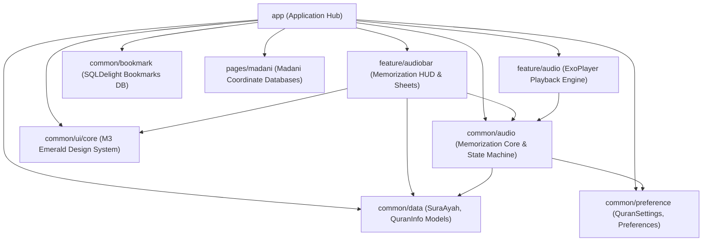
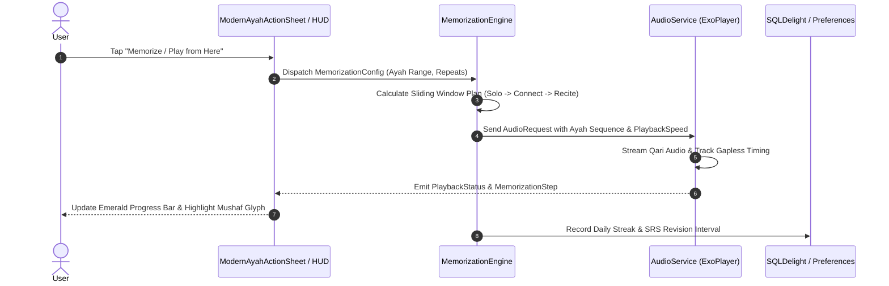

# NETWORK TOPOLOGY & BLAST RADIUS MATRIX
> **Repository:** `quran-intelligent-memorizer`  
> **Empirical Callers Mapped:** 825 Source Files, 993 Declared Types

---

## 1. Visual Dependency Networks

### Architecture & Module-to-Module Topology

### Runtime Data & User Interaction State Flow

---

## 2. Cross-File Network & Blast Radius Matrix
The following matrix cataloges the most critical core files across the repository, their outgoing dependencies, incoming callers, mutated state, and exact blast radius verification warnings:

| Target File / Module | Depends On (Outgoing Imports) | Depended On By (Incoming Callers) | Shared State / Events Mutated | Blast Radius Warning (What to Test/Check After Editing) |
| :--- | :--- | :--- | :--- | :--- |
| `common/data/.../SuraAyah.kt` | Kotlin Stdlib, Parcelable | **134 caller files** across `app`, `feature/*`, `common/*` | Core Ayah coordinate identifier | **CRITICAL BLAST RADIUS**: Any change breaks page navigation, audio queues, bookmarking, and search. Run `.\gradlew.bat testMadaniDebugUnitTest`. |
| `common/data/.../QuranInfo.kt` | `SuraAyah.kt`, `QuranPageInfo` | **88 caller files** across all modules | Surah page bounds, Ayah counts, Juz numbers | **CRITICAL BLAST RADIUS**: Modifying page math causes off-by-one errors in Mushaf display and audio queues. Test reader page jumping and audio advance. |
| `app/.../util/QuranSettings.java` | `SharedPreferences`, Android Context | **59 caller files** across `app`, `common/preference` | App settings, Night mode, Dyslexia font, Audio paths | Modifying setting keys resets user preferences or causes silent configuration defaults. Verify Settings screen toggles. |
| `common/data/.../AppScope.kt` | Metro / Dagger DI Qualifiers | **57 caller files** across all modules | Application-level singleton lifecycle | DI dependency graph failure. Verify app launch via `adb shell am start`. |
| `common/ui/core/.../Theme.kt` | Compose Material 3, Emerald Palette | **49 caller files** across UI screens | Color schemes, typography, surface colors | Visual UI regressions across all Compose screens. Inspect screenshots on device. |
| `feature/linebyline/.../HighlightType.kt` | Compose Color, Drawing Canvas | **47 caller files** | Ayah highlight colors, selection borders | Canvas rendering and visual highlighting glitches during playback. |
| `common/audio/.../QariItem.kt` | Qari database, remote server URLs | **33 caller files** in audio engine | Active reciter ID, gapless audio format | Reciter downloads fail or audio streams fail to buffer. Test audio playback on device. |
| `common/audio/.../MemorizationEngine.kt` | `MemorizationPlanBuilder.kt`, `AudioService` | `MemorizationHud.kt`, `ModernRevisionDashboardScreen.kt`, `AudioService.kt` | `MemorizationState`, current step, repeat countdown | Core memorization loop breaks. Run unit tests in `MemorizationEngineTest.kt`. |
| `app/.../service/AudioService.kt` | ExoPlayer, MediaSessionCompat, AudioQueue | `QuranActivity.kt`, `MemorizationHud.kt`, NotificationManager | Background playback, lockscreen controls, MediaStyle notification | Background playback drops, notifications don't update, or earphone remote fails. |
| `app/.../ui/modern/ModernAyahActionSheet.kt` | Compose M3, String resources, `SuraAyah.kt` | `QuranActivity.kt`, `ModernReaderChrome.kt` | Bookmark creation, play from here triggers | Bottom sheet fails to appear or triggers wrong Ayah. Verify long press on Ayah. |
| `app/.../ui/modern/ModernLanguagePickerSheet.kt` | `QuranSettings.java`, Activity recreate | `QuranActivity.kt`, `ModernSettingsScreen.kt` | App locale configuration | App fails to switch language or leaves untranslated strings. Test switching between Arabic, Persian, English. |

| `common/di/src/main/java/com/quran/mobile/di/qualifier/ApplicationContext.kt` | Key Domain Model / Controller | **33 caller files** | Component State | Test callers across modules when modifying `ApplicationContext.kt`. |
| `common/data/src/main/java/com/quran/data/model/bookmark/ReadingBookmarkType.kt` | Key Domain Model / Controller | **33 caller files** | Component State | Test callers across modules when modifying `ReadingBookmarkType.kt`. |
| `common/data/src/main/java/com/quran/data/model/audio/Qari.kt` | Key Domain Model / Controller | **31 caller files** | Component State | Test callers across modules when modifying `Qari.kt`. |
| `common/translation/src/main/kotlin/com/quran/mobile/translation/model/LocalTranslation.kt` | Key Domain Model / Controller | **30 caller files** | Component State | Test callers across modules when modifying `LocalTranslation.kt`. |
| `common/data/src/main/java/com/quran/data/model/bookmark/ReadingBookmark.kt` | Key Domain Model / Controller | **30 caller files** | Component State | Test callers across modules when modifying `ReadingBookmark.kt`. |
| `pages/data/madani/src/main/kotlin/com/quran/labs/androidquran/pages/data/madani/MadaniDataSource.kt` | Key Domain Model / Controller | **29 caller files** | Component State | Test callers across modules when modifying `MadaniDataSource.kt`. |
| `app/src/main/java/com/quran/labs/androidquran/util/QuranFileUtils.kt` | Key Domain Model / Controller | **28 caller files** | Component State | Test callers across modules when modifying `QuranFileUtils.kt`. |
| `app/src/main/java/com/quran/labs/androidquran/util/QuranUtils.java` | Key Domain Model / Controller | **23 caller files** | Component State | Test callers across modules when modifying `QuranUtils.java`. |
| `app/src/main/java/com/quran/labs/androidquran/data/Constants.kt` | Key Domain Model / Controller | **23 caller files** | Component State | Test callers across modules when modifying `Constants.kt`. |
| `app/src/main/java/com/quran/labs/androidquran/QuranApplication.kt` | Key Domain Model / Controller | **23 caller files** | Component State | Test callers across modules when modifying `QuranApplication.kt`. |
| `common/data/src/main/java/com/quran/data/model/bookmark/Tag.kt` | Key Domain Model / Controller | **22 caller files** | Component State | Test callers across modules when modifying `Tag.kt`. |
| `common/data/src/main/java/com/quran/data/dao/BookmarksDao.kt` | Key Domain Model / Controller | **22 caller files** | Component State | Test callers across modules when modifying `BookmarksDao.kt`. |
| `common/data/src/main/java/com/quran/data/source/PageProvider.kt` | Key Domain Model / Controller | **21 caller files** | Component State | Test callers across modules when modifying `PageProvider.kt`. |
| `app/src/main/java/com/quran/labs/androidquran/data/QuranDisplayData.kt` | Key Domain Model / Controller | **21 caller files** | Component State | Test callers across modules when modifying `QuranDisplayData.kt`. |
| `common/pages/src/main/java/com/quran/page/common/data/PageCoordinates.kt` | Key Domain Model / Controller | **20 caller files** | Component State | Test callers across modules when modifying `PageCoordinates.kt`. |
| `app/src/test/java/com/quran/labs/androidquran/base/TestApplication.kt` | Key Domain Model / Controller | **20 caller files** | Component State | Test callers across modules when modifying `TestApplication.kt`. |
| `common/data/src/main/java/com/quran/data/model/highlight/HighlightColor.kt` | Key Domain Model / Controller | **19 caller files** | Component State | Test callers across modules when modifying `HighlightColor.kt`. |
| `common/data/src/main/java/com/quran/data/model/bookmark/ReadingBookmarkTarget.kt` | Key Domain Model / Controller | **19 caller files** | Component State | Test callers across modules when modifying `ReadingBookmarkTarget.kt`. |